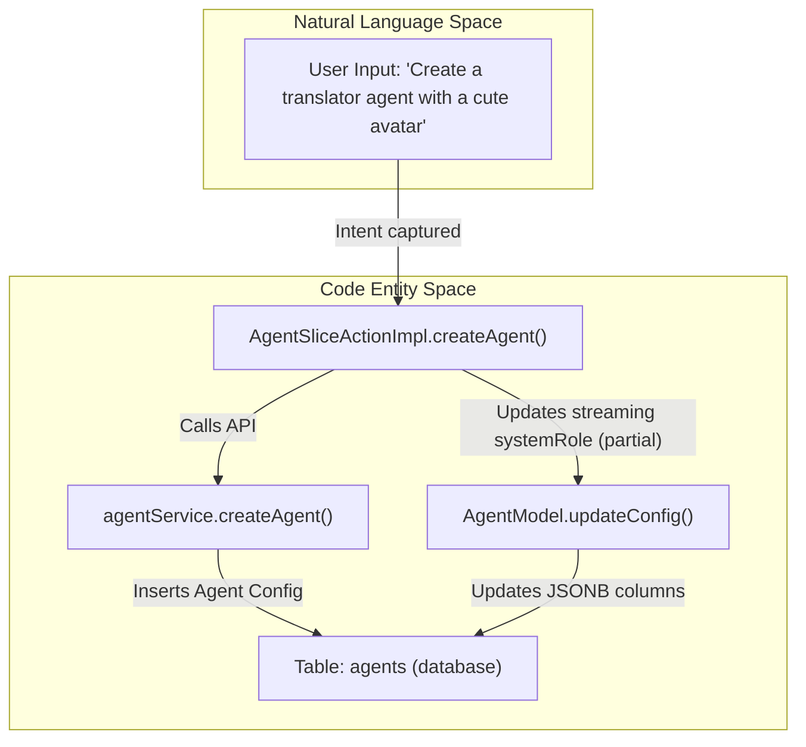
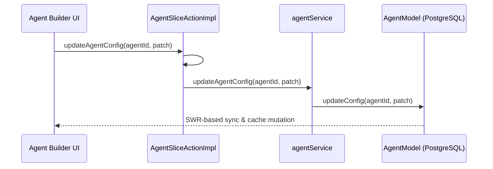

<!-- source: DeepWiki mcp.deepwiki.com · repo lobehub/lobehub · page 4.1 Agent Configuration and Builder · fetched 2026-10-29 -->

# Agent Configuration and Builder

<details>
<summary>Relevant source files</summary>

The following files were used as context for generating this wiki page:

- [apps/server/src/routers/lambda/__tests__/agent.test.ts](apps/server/src/routers/lambda/__tests__/agent.test.ts)
- [apps/server/src/routers/lambda/__tests__/agentShare.test.ts](apps/server/src/routers/lambda/__tests__/agentShare.test.ts)
- [apps/server/src/routers/lambda/__tests__/share.test.ts](apps/server/src/routers/lambda/__tests__/share.test.ts)
- [apps/server/src/routers/lambda/agent.ts](apps/server/src/routers/lambda/agent.ts)
- [apps/server/src/routers/lambda/agentShare.ts](apps/server/src/routers/lambda/agentShare.ts)
- [apps/server/src/routers/lambda/share.ts](apps/server/src/routers/lambda/share.ts)
- [apps/server/src/services/agent/index.test.ts](apps/server/src/services/agent/index.test.ts)
- [apps/server/src/services/agent/index.ts](apps/server/src/services/agent/index.ts)
- [locales/en-US/agent.json](locales/en-US/agent.json)
- [locales/en-US/suggestQuestions.json](locales/en-US/suggestQuestions.json)
- [locales/zh-CN/agent.json](locales/zh-CN/agent.json)
- [locales/zh-CN/suggestQuestions.json](locales/zh-CN/suggestQuestions.json)
- [packages/database/src/models/__tests__/agent.test.ts](packages/database/src/models/__tests__/agent.test.ts)
- [packages/database/src/models/__tests__/agentShare.test.ts](packages/database/src/models/__tests__/agentShare.test.ts)
- [packages/database/src/models/agent.ts](packages/database/src/models/agent.ts)
- [packages/database/src/models/agentShare.ts](packages/database/src/models/agentShare.ts)
- [packages/database/src/schemas/agentShare.ts](packages/database/src/schemas/agentShare.ts)
- [packages/database/src/utils/agencyConfigDevices.ts](packages/database/src/utils/agencyConfigDevices.ts)
- [packages/locales/src/default/agent.ts](packages/locales/src/default/agent.ts)
- [packages/locales/src/default/suggestQuestions.ts](packages/locales/src/default/suggestQuestions.ts)
- [packages/prompts/src/chains/builderSuggestion.test.ts](packages/prompts/src/chains/builderSuggestion.test.ts)
- [packages/prompts/src/chains/builderSuggestion.ts](packages/prompts/src/chains/builderSuggestion.ts)
- [packages/types/src/agent/index.ts](packages/types/src/agent/index.ts)
- [packages/types/src/agent/item.ts](packages/types/src/agent/item.ts)
- [packages/types/src/agent/share.ts](packages/types/src/agent/share.ts)
- [src/business/client/features/AgentShareSpendDetail.tsx](src/business/client/features/AgentShareSpendDetail.tsx)
- [src/features/AgentBuilder/AgentBuilderWelcome.tsx](src/features/AgentBuilder/AgentBuilderWelcome.tsx)
- [src/features/AgentBuilder/SuggestionChips/feedbackStore.test.ts](src/features/AgentBuilder/SuggestionChips/feedbackStore.test.ts)
- [src/features/ChatInput/ControlBar/__tests__/useCommitWorkingDirectory.test.tsx](src/features/ChatInput/ControlBar/__tests__/useCommitWorkingDirectory.test.tsx)
- [src/features/ChatInput/ControlBar/useCommitWorkingDirectory.ts](src/features/ChatInput/ControlBar/useCommitWorkingDirectory.ts)
- [src/features/SuggestQuestions/useRandomQuestions.ts](src/features/SuggestQuestions/useRandomQuestions.ts)
- [src/routes/(main)/agent/channel/index.tsx](src/routes/(main)/agent/channel/index.tsx)
- [src/services/agent.test.ts](src/services/agent.test.ts)
- [src/services/agent.ts](src/services/agent.ts)
- [src/services/agentShare.ts](src/services/agentShare.ts)
- [src/store/agent/slices/agent/action.test.ts](src/store/agent/slices/agent/action.test.ts)
- [src/store/agent/slices/agent/action.ts](src/store/agent/slices/agent/action.ts)
- [src/store/agent/slices/bot/action.ts](src/store/agent/slices/bot/action.ts)
- [src/store/agent/slices/bot/index.ts](src/store/agent/slices/bot/index.ts)
- [src/store/agent/slices/builtin/action.ts](src/store/agent/slices/builtin/action.ts)
- [src/store/agent/slices/builtin/index.ts](src/store/agent/slices/builtin/index.ts)
- [src/store/agent/slices/builtin/initialState.ts](src/store/agent/slices/builtin/initialState.ts)
- [src/store/agent/slices/builtin/projection.ts](src/store/agent/slices/builtin/projection.ts)
- [src/store/agent/slices/builtin/replica.test.ts](src/store/agent/slices/builtin/replica.test.ts)

</details>


This page documents the technical implementation details of AI Agents within LobeHub, focusing on the `agents` database schema, the `LobeAgentConfig` data structure, frontend agent store slices and selectors, and the Agent Builder UI that enables auto-configuration of agents from natural language descriptions.

---

## 1. Agent Data Schema

Agents are the core execution entities representing configurable AI personalities or services. The data schema captures both metadata for UI representation and functional configuration for runtime AI behavior.

### 1.1 Database Table: `agents`

The `agents` table schema is managed through Drizzle ORM and stored in PostgreSQL. It stores identity fields, configuration blobs, metadata, and relations to associated knowledge bases or files.

| Column           | Type                 | Description                                                                                              |
|------------------|----------------------|----------------------------------------------------------------------------------------------------------|
| `id`             | `text`               | Unique agent identifier, generated with `idGenerator('agents')`, prefixed with `"agt_"`.                 |
| `slug`           | `varchar(100)`       | Readable unique identifier used for URLs. User slugs are validated and forbidden from reserved slugs.    |
| `title`          | `varchar(255)`       | Primary semantic identity label of the agent (e.g., `"Chat Companion"`).                                 |
| `name`           | `varchar(255)`       | Personal name of the agent (may be null). Distinct from `title`.                                         |
| `description`    | `varchar(1000)`      | Short human-readable summary describing the agent's purpose.                                            |
| `system_role`    | `text`               | The core system prompt defining the agent’s persona and role for the LLM.                               |
| `model`          | `text`               | The model identifier in use (e.g., `"gpt-4o-mini"`).                                                    |
| `provider`       | `text`               | The AI provider (e.g., `"openai"`, `"anthropic"`).                                                     |
| `chat_config`    | `jsonb`              | JSON object storing the agent’s chat configuration parameters (`LobeAgentChatConfig`).                   |
| `agency_config`  | `jsonb`              | Advanced JSON config that covers agent execution agency such as device bindings, heterogeneous providers.|
| `plugins`        | `jsonb`              | List of enabled plugin/tool identifiers for the agent (as plugin entries).                              |
| `tts`            | `jsonb`              | Text-to-Speech configuration (`LobeAgentTTSConfig`).                                                   |
| `few_shots`      | `jsonb`              | Few-shot example messages for in-context learning.                                                     |
| `opening_message`| `text`               | The initial greeting or opening message the agent uses.                                                |
| `opening_questions` | `text[]`           | Optional array of suggested opening questions.                                                        |
| `visibility`     | `text`               | `"public"` or `"private"` indicating agents visible to workspace members vs. only to the creator.     |
| `accessed_at`    | `timestamp`          | Timestamp for usage tracking and sidebar sorting.                                                     |

The table also includes fields for ownership (`userId`), workspace tenancy (`workspaceId`), timestamps, and soft deletion flags, ensuring multi-tenant safety and lifecycle support.

**Sources:**  
[packages/database/src/schemas/agent.ts:36-114](),  
[packages/database/src/models/agent.ts:168-177](),  
[packages/database/src/models/__tests__/agent.test.ts:84-140]()

---

### 1.2 LobeAgentConfig Fields

The agent's in-memory and API-facing configuration is represented as a `LobeAgentConfig` object. Its key fields include:

- **`systemRole`** (`string`): Core system prompt to set agent persona/behavior.  
- **`model`** (`string`): LLM model name, e.g., `"gpt-4o-mini"`.  
- **`provider`** (`string`): AI provider name, e.g., `"openai"`.  
- **`chatConfig`** (`LobeAgentChatConfig`): Parameters for chat behavior like history count, auto summary, etc.  
- **`agencyConfig`** (`LobeAgentAgencyConfig`): Execution policies such as device binding and heterogeneous agent provider info.  
- **`plugins`** (`AgentPluginEntry[]`): Enabled AI assistant tools/plugins.  
- **`tts`** (`LobeAgentTTSConfig`): Text-to-speech configurations.  
- **`fewShots`**: Example QA pairs for few-shot prompting.  
- **`files`** & **`knowledgeBases`**: References to supplemental knowledge resources.  
- **`name`** (`string?`): Personal name distinctly identifying the agent for conversational addressing.  
- **`title`** (`string?`): Descriptive role name displayed in UI components.  
- **`openingMessage`** (`string?`): Initial greeting text.  
- **`openingQuestions`** (`string[]?`): Suggested opening questions to present users.  
- **`virtual`** (`boolean?`): Marker for automatically generated agents, e.g. from templates.

This strongly typed configuration schema forms the contract between frontend client state, the backend persistence layer, and runtime LLM execution.

**Sources:**  
[packages/types/src/agent/item.ts:38-126](),  
[packages/database/src/models/agent.ts:120-130]()

---

### 1.3 Agent Store Slices and Selectors

On the frontend, agent data is managed in the `agent` slice of the Zustand global store, encapsulated as `AgentSliceState`.

#### AgentSliceState Summary

```typescript
interface AgentSliceState {
  activeAgentId?: string; // Currently selected agent ID
  agentMap: Record<string, LobeAgentConfig>; // Map of agentId → agent config
  builtinAgentIdMap: Record<string, string>; // Map of builtin agent slugs to IDs
  availableAgents?: AvailableAgentItem[]; // Cached list of agents for selection
  agentDocumentsMap: Record<string, AgentContextDocument[]>; // Documents associated with agents
  streamingSystemRole?: string; // Current streaming system role data buffer
  streamingSystemRoleAgentId?: string; // Agent ID owning current stream
  streamingSystemRoleGeneration: number; // Stream generation counter
  streamingSystemRoleInProgress: boolean; // Whether streaming is active
  updateAgentConfigSignal?: number; // A signal to trigger reactive UI updates
  updateAgentMetaSignal?: number; // Similar reactive update for meta changes
  agentConfigErrorMap: Record<string, string>; // Mapping of agentId → error message on config update failure
  agentNotFoundMap: Record<string, boolean>; // Tracks agent IDs that failed to load
  localAgentWorkingDirectoryMap: Record<string, string|undefined>; // Mapping of agent to working directory path on local devices
  // ... other state pieces
}
```

#### Key agent selectors include:

| Selector | Purpose |
|----------|---------|
| `agentSelectors.currentAgentConfig(s)` | Retrieve the current active agent's full `LobeAgentConfig`. |
| `agentSelectors.getAgentConfigById(agentId)(s)` | Retrieve config of a specific agent by ID. |
| `agentSelectors.currentAgentDisplayName(s)` | Compute the display name (prefers personal `name` over human role `title`). |
| `agentSelectors.currentAgentPlugins(s)` | Get list of active plugin IDs enabled for current agent. |
| `chatConfigByIdSelectors.getChatConfigById(agentId)(s)` | Retrieve the `LobeAgentChatConfig` for specified agent. |
| `agentByIdSelectors.getAgentSystemRoleById(agentId)(s)` | Get the system role string for an agent. |
| `agentByIdSelectors.getAgentWorkingDirectoryById(agentId, deviceId)(s)` | Compute working directory path for agent, considering device bindings and desktop overrides. |
| `agentByIdSelectors.getAgencyConfigById(agentId)(s)` | Get the `LobeAgentAgencyConfig` with advanced execution policies. |

Selectors are optimized for partial updates and deep property access to reduce rerenders across React components.

**Sources:**  
[src/store/agent/slices/agent/index.ts]() (state definition),  
[src/store/agent/selectors/selectors.ts:39-191](),  
[src/store/agent/selectors/chatConfigByIdSelectors.ts:19-125](),  
[src/store/agent/selectors/agentByIdSelectors.ts:24-185]()

---

## 2. Agent Builder Implementation

The Agent Builder is a special system agent designed to help users create and configure agents using natural language commands or assistance. It auto-generates the `LobeAgentConfig` from user intent, manages system prompt streaming, and restricts certain protected fields.

### 2.1 Natural Language to Code Entity Space

User input in natural language is parsed and translated into structured configuration data, which is then persisted to the `agents` table.



This flow reflects how the UI layer converts text commands to store actions which in turn invoke backend APIs to persist configurations atomically.

**Sources:**  
[src/store/agent/slices/agent/action.ts:150-182](),  
[packages/database/src/models/agent.ts:104-129](),  
[packages/database/src/schemas/agent.ts:36-51]()

---

### 2.2 Builder UI to Database Flow

The Agent Builder UI interacts closely with the agent store. It:

- Sends partial config updates for system role streaming (the AI generates the system prompt piecewise).
- Issues full create or update commands for final agent configurations.
- Relies on SWR and replica state synchronization for up-to-date UI rendering.



The UI leverages `AgentSliceActionImpl` abstraction to manage optimistic updates, streaming data merges, and error handling.

**Sources:**  
[src/store/agent/slices/agent/action.ts:102-124](),  
[packages/database/src/models/agent.ts:143-163]()

---

### 2.3 Protected and Immutable Fields

To protect integrity and avoid accidental overriding of core system agents or identity fields, the backend enforces:

- **`AGENT_BUILDER_PROTECTED_FIELDS`**: Fields that the builder's own agent row may never store or overwrite, such as `title`, `avatar`, `systemRole`. These fields are dynamically rendered from translations/i18n and system templates rather than database fields for the builder agent.

- **`IMMUTABLE_AGENT_FIELDS`**: Identity and scope fields such as `id`, `slug`, `userId`, `workspaceId`, `sessionGroupId` must never be updated via generic patching methods, as these govern ownership, tenancy, and visibility. Attempts to patch these fields are rejected with errors.

These protections centralize access control and prevent erroneous state mutations during agent editing workflows.

**Sources:**  
[packages/database/src/models/agent.ts:125-163]()

---

## 3. Key Functions and Classes

### 3.1 `AgentModel` (Server-side)

The `AgentModel` class implements data access logic for agents, residing in `packages/database/src/models/agent.ts`. It supports CRUD and advanced queries:

- **`getAgentConfigById(agentId)`**: Returns full `LobeAgentConfig` including hydrated `knowledgeBases` and `files`. Loads document content for enabled files to provide complete context. This method handles complex joins and nested relations.  
- **`existsOwnedById(agentId)`**: Validates that the caller is the actual creator of the agent and that it is not trashed, used in authorization gates.  
- **`updateConfig(agentId, patch)`**: Updates config fields with validation against protected and immutable fields.  
- **Constants**:  
  - `RESERVED_AGENT_SLUGS` is a `ReadonlySet` of system reserved slugs that users cannot claim for their agents.  
  - `AGENT_SLUG_PATTERN` enforces agent slug/name formats.

The class interacts with related models for knowledge bases, files, and agent transfers.

**Sources:**  
[packages/database/src/models/agent.ts:100-177](),  
[packages/database/src/models/__tests__/agent.test.ts:84-140]()

---

### 3.2 `AgentSliceActionImpl` (Client-side)

On the client, the `AgentSliceActionImpl` class implements agent-related store actions. It is defined in `src/store/agent/slices/agent/action.ts`.

Key capabilities include:

- **`createAgent()`**: Creates a new agent with parameters, initializes a random localized name (`randomAgentName(locale)`), and tracks analytics events (`new_agent_created`). Includes special naming for heterogeneous agents.  
- **`mergeAgentConfig(current, patch, options?)`**: Deep merges partial configs with current state, handling device-specific working directory patches atomically.  
- **`appendStreamingSystemRole(agentId, generation, chunk)`**: Supports streaming chunks of the system role prompt during AI generation, buffering incrementally and discarding stale generations.  
- **`#createAgentScopedAbortController(agentId)`**: Manages abort controllers for agent-specific async operations, ensuring only the latest request proceeds, safely cancels duplicates.  
- **`updateAgentConfigById(agentId, patch, options)`**: Sends patches to backend while handling optimistic UI updates and error rollbacks.  

The class also supports agent metadata updates (`updateAgentMetaById`) and streaming prompt lifecycle management including generation counting.

**Sources:**  
[src/store/agent/slices/agent/action.ts:90-188]()

---

### 3.3 ID Generation

Identifiers for agents follow a prefixed NanoID scheme for freshness and traceability in logs and database entries.

- **Prefix:** `"agt_"` for agents.
- **Implementation:** Via the `idGenerator('agents')` function, producing unique IDs with this prefix.

This consistent scheme aids debugging and ID filtering in client and server logs.

**Sources:**  
[packages/database/src/utils/idGenerator.ts:15-54](),  
[packages/database/src/schemas/agent.ts:39-42]()

---

# Summary

This page described the agent configuration data schema, the `LobeAgentConfig` fields fundamental to AI personality and runtime behavior, the frontend store slice managing agent state and updates, and the Agent Builder system that interprets natural language instructions to auto-configure agents. It included detailed data flows, code-focused mermaid diagrams, and core class descriptions to assist engineers in navigating the agent subsystem for LobeHub.

# Index of Cited Files
- packages/database/src/models/agent.ts  
- packages/database/src/models/__tests__/agent.test.ts  
- packages/database/src/schemas/agent.ts  
- src/store/agent/slices/agent/action.ts  
- src/store/agent/selectors/selectors.ts  
- src/store/agent/selectors/chatConfigByIdSelectors.ts  
- src/store/agent/selectors/agentByIdSelectors.ts  
- packages/types/src/agent/item.ts  
- packages/database/src/utils/idGenerator.ts  

---

# Appendix: Mermaid Diagrams

### Diagram 1: Natural Language to Code Entity Space


### Diagram 2: Agent Builder UI to Database Flow


---

