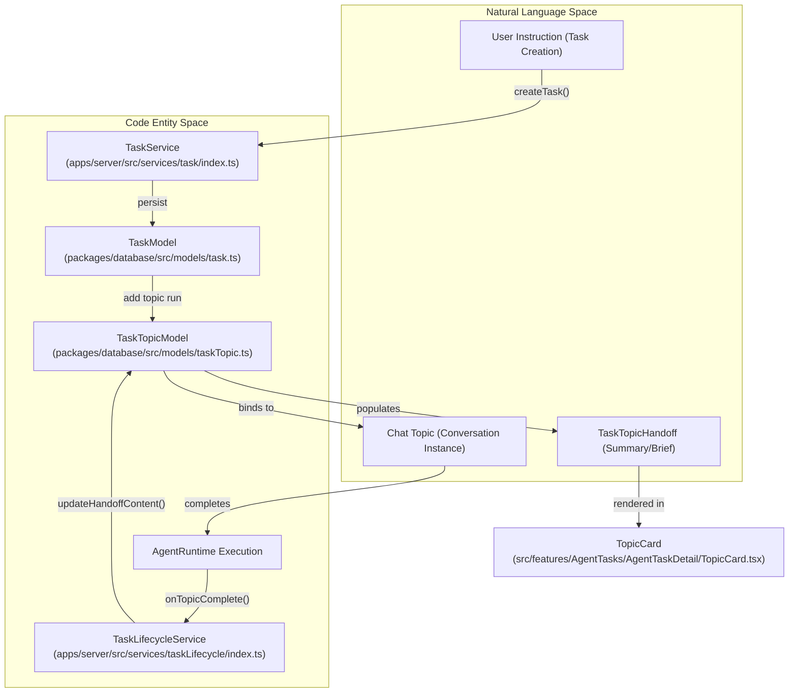
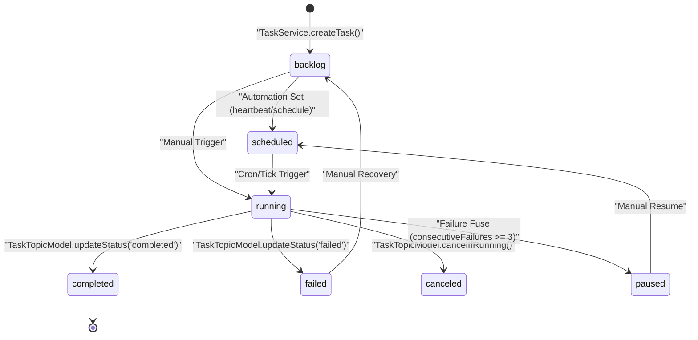

<!-- source: DeepWiki mcp.deepwiki.com · repo lobehub/lobehub · page 4.10 Agent Tasks and Task Lifecycle · fetched 2026-10-29 -->

# Agent Tasks and Task Lifecycle

Relevant source files

The following files were used as context for generating this wiki page:

- [apps/cli/src/commands/task.test.ts](apps/cli/src/commands/task.test.ts)
- [apps/cli/src/commands/task/assignee.test.ts](apps/cli/src/commands/task/assignee.test.ts)
- [apps/cli/src/commands/task/assignee.ts](apps/cli/src/commands/task/assignee.ts)
- [apps/cli/src/commands/task/index.ts](apps/cli/src/commands/task/index.ts)
- [apps/cli/src/commands/task/url.ts](apps/cli/src/commands/task/url.ts)
- [apps/server/src/routers/lambda/__tests__/integration/task.integration.test.ts](apps/server/src/routers/lambda/__tests__/integration/task.integration.test.ts)
- [apps/server/src/routers/lambda/task.ts](apps/server/src/routers/lambda/task.ts)
- [apps/server/src/services/task/index.test.ts](apps/server/src/services/task/index.test.ts)
- [apps/server/src/services/task/index.ts](apps/server/src/services/task/index.ts)
- [apps/server/src/services/taskLifecycle/index.ts](apps/server/src/services/taskLifecycle/index.ts)
- [apps/server/src/services/taskLifecycle/onTopicComplete.test.ts](apps/server/src/services/taskLifecycle/onTopicComplete.test.ts)
- [apps/server/src/services/taskRunner/index.ts](apps/server/src/services/taskRunner/index.ts)
- [apps/server/src/services/taskRunner/runTask.deleteRace.test.ts](apps/server/src/services/taskRunner/runTask.deleteRace.test.ts)
- [packages/database/src/models/__tests__/task.test.ts](packages/database/src/models/__tests__/task.test.ts)
- [packages/database/src/models/__tests__/taskTopic.test.ts](packages/database/src/models/__tests__/taskTopic.test.ts)
- [packages/database/src/models/task.ts](packages/database/src/models/task.ts)
- [packages/database/src/models/taskTopic.ts](packages/database/src/models/taskTopic.ts)
- [packages/locales/src/default/index.ts](packages/locales/src/default/index.ts)
- [packages/types/src/task/index.ts](packages/types/src/task/index.ts)
- [src/features/AgentTasks/AgentTaskDetail/CommentCard.tsx](src/features/AgentTasks/AgentTaskDetail/CommentCard.tsx)
- [src/features/AgentTasks/AgentTaskDetail/CommentInput.tsx](src/features/AgentTasks/AgentTaskDetail/CommentInput.tsx)
- [src/features/AgentTasks/AgentTaskDetail/TaskDetailPage.tsx](src/features/AgentTasks/AgentTaskDetail/TaskDetailPage.tsx)
- [src/features/AgentTasks/AgentTaskDetail/TopicChatDrawer/FeedbackInput.tsx](src/features/AgentTasks/AgentTaskDetail/TopicChatDrawer/FeedbackInput.tsx)
- [src/features/AgentTasks/AgentTaskDetail/TopicChatDrawer/index.test.tsx](src/features/AgentTasks/AgentTaskDetail/TopicChatDrawer/index.test.tsx)
- [src/features/AgentTasks/AgentTaskDetail/TopicChatDrawer/index.tsx](src/features/AgentTasks/AgentTaskDetail/TopicChatDrawer/index.tsx)
- [src/features/AgentTasks/AgentTaskList/AgentTasksPage.test.ts](src/features/AgentTasks/AgentTaskList/AgentTasksPage.test.ts)
- [src/features/AgentTasks/AgentTaskList/AgentTasksPage.tsx](src/features/AgentTasks/AgentTaskList/AgentTasksPage.tsx)
- [src/features/AgentTasks/AgentTaskList/EmptyState.tsx](src/features/AgentTasks/AgentTaskList/EmptyState.tsx)
- [src/features/AgentTasks/AgentTaskList/KanbanBoard.tsx](src/features/AgentTasks/AgentTaskList/KanbanBoard.tsx)
- [src/features/AgentTasks/AgentTaskList/KanbanColumn.tsx](src/features/AgentTasks/AgentTaskList/KanbanColumn.tsx)
- [src/features/AgentTasks/AgentTaskList/KanbanInlineCreate.tsx](src/features/AgentTasks/AgentTaskList/KanbanInlineCreate.tsx)
- [src/features/AgentTasks/AgentTaskList/TaskList.tsx](src/features/AgentTasks/AgentTaskList/TaskList.tsx)
- [src/features/AgentTasks/AgentTaskList/kanbanBoardModel.test.ts](src/features/AgentTasks/AgentTaskList/kanbanBoardModel.test.ts)
- [src/features/AgentTasks/AgentTaskList/kanbanBoardModel.ts](src/features/AgentTasks/AgentTaskList/kanbanBoardModel.ts)
- [src/features/AgentTasks/AgentTaskList/listViewOptions.test.ts](src/features/AgentTasks/AgentTaskList/listViewOptions.test.ts)
- [src/features/AgentTasks/AgentTaskList/listViewOptions.ts](src/features/AgentTasks/AgentTaskList/listViewOptions.ts)
- [src/features/ChatInput/InputEditor/ActionTag/ActionMention.tsx](src/features/ChatInput/InputEditor/ActionTag/ActionMention.tsx)
- [src/features/ChatInput/InputEditor/ActionTag/ActionTag.tsx](src/features/ChatInput/InputEditor/ActionTag/ActionTag.tsx)
- [src/features/ChatInput/InputEditor/ActionTag/ActionTagNode.ts](src/features/ChatInput/InputEditor/ActionTag/ActionTagNode.ts)
- [src/features/ChatInput/InputEditor/ActionTag/style.ts](src/features/ChatInput/InputEditor/ActionTag/style.ts)
- [src/features/ChatInput/InputEditor/LocalFileTag/LocalFileTagNode.ts](src/features/ChatInput/InputEditor/LocalFileTag/LocalFileTagNode.ts)
- [src/features/ChatInput/InputEditor/ReferTopic/ReferTopicView.tsx](src/features/ChatInput/InputEditor/ReferTopic/ReferTopicView.tsx)
- [src/features/ChatInput/InputEditor/mentionStyle.ts](src/features/ChatInput/InputEditor/mentionStyle.ts)
- [src/features/Conversation/ChatInput/useConversationChatInputUiState.test.ts](src/features/Conversation/ChatInput/useConversationChatInputUiState.test.ts)
- [src/features/Conversation/ChatInput/useConversationChatInputUiState.ts](src/features/Conversation/ChatInput/useConversationChatInputUiState.ts)
- [src/features/Conversation/Markdown/plugins/Skill/Render.tsx](src/features/Conversation/Markdown/plugins/Skill/Render.tsx)
- [src/features/Conversation/Messages/User/components/RichTextMessage.test.tsx](src/features/Conversation/Messages/User/components/RichTextMessage.test.tsx)
- [src/features/Conversation/Messages/User/components/RichTextMessage.tsx](src/features/Conversation/Messages/User/components/RichTextMessage.tsx)
- [src/features/Conversation/Messages/User/components/richTextImageRenderers.tsx](src/features/Conversation/Messages/User/components/richTextImageRenderers.tsx)
- [src/features/Home/HomeModeContent.tsx](src/features/Home/HomeModeContent.tsx)
- [src/features/PageEditor/DocumentComments/DocumentCommentEditor.tsx](src/features/PageEditor/DocumentComments/DocumentCommentEditor.tsx)
- [src/features/PageEditor/store/action.test.ts](src/features/PageEditor/store/action.test.ts)
- [src/features/PageEditor/store/action.ts](src/features/PageEditor/store/action.ts)
- [src/services/task.ts](src/services/task.ts)
- [src/store/task/selectors/detailSelectors.ts](src/store/task/selectors/detailSelectors.ts)
- [src/store/task/selectors/listSelectors.ts](src/store/task/selectors/listSelectors.ts)
- [src/store/task/slices/detail/action.test.ts](src/store/task/slices/detail/action.test.ts)
- [src/store/task/slices/detail/action.ts](src/store/task/slices/detail/action.ts)
- [src/store/task/slices/detail/initialState.ts](src/store/task/slices/detail/initialState.ts)
- [src/store/task/slices/list/action.test.ts](src/store/task/slices/list/action.test.ts)
- [src/store/task/slices/list/action.ts](src/store/task/slices/list/action.ts)
- [src/store/task/slices/list/initialState.ts](src/store/task/slices/list/initialState.ts)

The Agent Task system in LobeHub provides a comprehensive framework for managing long-running, autonomous agent workflows. Tasks are structured entities with explicit lifecycles, dependencies, priorities, and automation capabilities. This allows agents to operate beyond simple chat interactions, enabling scheduling, subtask orchestration, heartbeat monitoring, and seamless handoff between natural language conversations and underlying execution state.

---

## Task Data Model and CRUD

At the core is the `TaskService` which manages CRUD operations and business logic around tasks. Tasks are persisted in the `tasks` table and may be assigned to either an agent (`assigneeAgentId`) or a user (`assigneeUserId`).

### Key Types and States

- `TaskStatus`: Defines lifecycle states of a task: `backlog`, `canceled`, `completed`, `failed`, `paused`, `running`, `scheduled` [packages/types/src/task/index.ts:9-10]().
- `TaskItem`: Represents basic task data including identifiers, instruction, priority, status, assignees, scheduling, and metadata [packages/types/src/task/index.ts:174-207]().
- `TaskRunTrigger`: Describes what triggered a task execution: `manual`, `schedule`, `heartbeat`, or `goal` [packages/types/src/task/index.ts:79]().
- `TaskAutomationSnapshot`: Aggregated snapshot of automation mode (`heartbeat` or `schedule`), pattern, timezone, max executions, and interval [packages/types/src/task/index.ts:48-56]().
- `TaskVerifyConfig`: Configuration for automated verification gates on tasks during completion [packages/types/src/task/index.ts:147-170]().

### TaskService: Creation and Validation

The `TaskService` is responsible for creating validated task records, resolving parent task references, and snapshotting the model/provider state of the assignee agent into the task’s config to ensure consistent execution context.

- On `createTask`, the service verifies the assignee agent belongs to the user, resolves and validates `parentTaskId` to enforce project scope and visibility invariants.
- It snapshots the assignee agent’s model/provider state and applies it on task creation to prevent subsequent changes to agent defaults from silently affecting the task [apps/server/src/services/task/index.ts:128-179]().

### TaskModel: Identifiers and Sequences

`TaskModel` supports generating unique incremental identifiers scoped per user, e.g. "T-1", "T-2", while ensuring no collisions occur even during concurrent task creation [packages/database/src/models/task.ts:70-177](). It also normalizes nullable foreign keys like assignee IDs and parent task IDs to `null` when empty strings are submitted, mitigating FK violations [packages/database/src/models/task.ts:160-177]().

**Sources:**  
[packages/types/src/task/index.ts](),  
[apps/server/src/services/task/index.ts](),  
[packages/database/src/models/task.ts](),  
[packages/database/src/models/__tests__/task.test.ts]()

---

## Task Dependencies and Subtask Planning

LobeHub supports hierarchical task decomposition and dependency graphs, facilitating complex workflows.

### Subtask Relations and Visibility

- Subtasks require that their project matches the parent task’s project, enforcing logical consistency [apps/server/src/services/task/index.ts:170-181]().
- Visibility of subtasks inherits from parent tasks to ensure privacy constraints are respected [apps/server/src/services/taskTopic/index.ts:47-54](), [apps/server/src/services/task/index.ts:170-181]().
  
### TaskGraphService Execution Planning

- The `runReadySubtasks` method in `TaskService` utilizes `TaskGraphService` to plan and identify executable subtasks based on dependency constraints (`afterIds`) [apps/server/src/services/task/index.ts:114-119]().
- This enables starting subtasks only when dependencies have completed, supporting controlled task lifecycle progression [apps/server/src/services/task/index.ts:114-119]().

### Document and File Associations

Tasks support pinning documents across the hierarchical task tree. The `TaskModel.getTreePinnedDocuments` method facilitates fetching attached documents inherited down to subtask levels for comprehensive workspace views [packages/database/src/models/task.ts:1000-1001](). 

**Sources:**  
[apps/server/src/services/task/index.ts](),  
[packages/database/src/models/task.ts](),  
[packages/types/src/task/index.ts](),  
[packages/database/src/models/taskTopic.ts]()

---

## Task Lifecycle and Topic Automation

Tasks execute via "topics," chat conversations that serve as individual task runs. The `TaskLifecycleService` automates progression on topic completion.

### onTopicComplete Lifecycle Method

The main workflow when a topic completes is handled in `TaskLifecycleService.onTopicComplete` [apps/server/src/services/taskLifecycle/index.ts:101-175]():

1. **Heartbeat Update** — Updates the task heartbeat timestamp to track execution health.
2. **Topic Status Update** — If topic status is terminal (`completed`, `failed`, `canceled`), the corresponding row in `taskTopics` is updated. Terminal topics also trigger completion timestamps in the root `topics` table [packages/database/src/models/taskTopic.ts:61-110]().
3. **Handoff Generation** — Generates a handoff summary using LLM prompts for brief synthesis via `TaskLifecycleService.generateHandoff`, storing it in the `handoff` JSONB column [packages/database/src/models/taskTopic.ts:178-199]().
4. **Persistence of Raw Run Content** — Independently stores the raw assistant content for traceability and UI rendering.
5. **Verification and Review** — If task verification gates are configured (`TaskVerifyConfig`), the lifecycle defers pausing or acceptance to the `verify` subsystem before propagation [packages/types/src/task/index.ts:148-170]().
6. **Checkpoint Emission** — Optionally emits checkpoints and notification events after successful completion.
7. **Automation Retry and Failure Handling** — Automates pausing tasks after consecutive automation failures, and notifies accordingly [apps/server/src/services/taskLifecycle/index.ts:70-79]().

This orchestrated flow ensures reliable state transition from conversation runs back to task metadata, enabling automation and user visibility.

### Task-Topic Handoffs and Reviews

- `TaskTopicModel.updateHandoff` and `updateBriefDecision` patch partial JSONB fields for summaries, decisions, and next actions without overwriting other handoff data [packages/database/src/models/taskTopic.ts:170-194]().
- Verified acceptance criteria and repair attempts use `TaskVerifyConfig` settings that govern automated review cycles and maximum iteration limits [packages/types/src/task/index.ts:145-170]().

**Sources:**  
[apps/server/src/services/taskLifecycle/index.ts](),  
[packages/database/src/models/taskTopic.ts](),  
[packages/types/src/task/index.ts]()

---

## AgentTasks UI and Orchestration

The frontend UI supports interactive views for task management including Kanban boards, list views, detailed run conversations, topic drawers, and scheduling interfaces.

### Kanban and List Views

- The `AgentTasksPage` component provides different grouping and filtering modes to organize tasks and their topic runs effectively [src/features/AgentTasks/AgentTaskList/AgentTasksPage.tsx:131-137]().
- Priority and status ranking logic in the database ensures urgent or failed tasks surface to the top using computed ranks [packages/database/src/models/task.ts:70-114]().

### Task Detail and Topic Cards

- The `TaskDetailPage` and nested components render task activities, subtasks, comments, and topic runs.
- `TopicCard` components display topic summaries with markdown previews and status icons including timers for running topics [src/features/AgentTasks/AgentTaskDetail/TopicCard.tsx:63-124]().
- `TopicChatDrawer` is a floating panel that hosts a dedicated conversation view for a topic run with message streaming and follow-up input [src/features/AgentTasks/AgentTaskDetail/TopicChatDrawer/index.tsx:88-160]().

### Scheduling and Heartbeat Automation

- Tasks support automation via `heartbeat` (interval-based health checks) or `schedule` (cron expressions) [packages/types/src/task/index.ts:64-65]().
- The `TaskSchedulerContext` tracks failures per task run; after a configurable threshold (default 3 failures), a task is auto-paused to prevent infinite error loops [apps/server/src/services/taskLifecycle/index.ts:70-79]().

**Sources:**  
[src/features/AgentTasks/AgentTaskDetail/TopicCard.tsx](),  
[packages/types/src/task/index.ts](),  
[packages/database/src/models/task.ts](),  
[src/features/AgentTasks/AgentTaskDetail/TopicChatDrawer/index.tsx](),  
[src/features/AgentTasks/AgentTaskList/AgentTasksPage.tsx]()

---

## System Architecture: Task Lifecycle Flow

### Natural Language to Code Entity Flow

This diagram connects the user's natural language task creation request through persistence and eventual agent runtime execution, highlighting the major service and model classes involved.

### Task Status State Machine

The following state diagram shows the lifecycle transitions of a Task, including automation triggers and failure handling.

---

This detailed overview captures the implementation, data flow, key classes, and UI integration of the Agent Task system and its lifecycle management in LobeHub.

---

**Sources:**  
[packages/types/src/task/index.ts](),  
[apps/server/src/services/task/index.ts](),  
[packages/database/src/models/task.ts](),  
[packages/database/src/models/taskTopic.ts](),  
[apps/server/src/services/taskLifecycle/index.ts](),  
[src/features/AgentTasks/AgentTaskDetail/TopicCard.tsx](),  
[src/features/AgentTasks/AgentTaskDetail/TopicChatDrawer/index.tsx](),  
[src/features/AgentTasks/AgentTaskList/AgentTasksPage.tsx]()

---

