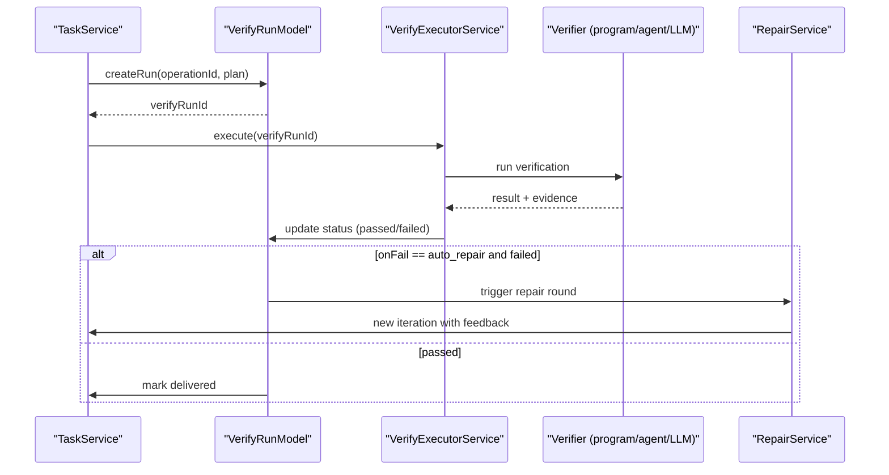

<!-- source: DeepWiki mcp.deepwiki.com · repo lobehub/lobehub · page 4.11 Verification and Delivery Checks (Verify) · fetched 2026-10-29 -->

# Verification and Delivery Checks (Verify)

<details>
<summary>Relevant source files</summary>

The following files were used as context for generating this wiki page:

- [apps/cli/src/commands/acceptanceEvidence.ts](apps/cli/src/commands/acceptanceEvidence.ts)
- [apps/cli/src/commands/acceptanceFlow.test.ts](apps/cli/src/commands/acceptanceFlow.test.ts)
- [apps/cli/src/commands/acceptanceFlow.ts](apps/cli/src/commands/acceptanceFlow.ts)
- [apps/cli/src/commands/acceptanceFlowFeedback.test.ts](apps/cli/src/commands/acceptanceFlowFeedback.test.ts)
- [apps/cli/src/commands/acceptanceInstall.test.ts](apps/cli/src/commands/acceptanceInstall.test.ts)
- [apps/cli/src/commands/acceptanceLanguage.test.ts](apps/cli/src/commands/acceptanceLanguage.test.ts)
- [apps/cli/src/commands/acceptanceLanguage.ts](apps/cli/src/commands/acceptanceLanguage.ts)
- [apps/cli/src/commands/acceptanceRun.test.ts](apps/cli/src/commands/acceptanceRun.test.ts)
- [apps/cli/src/commands/acceptanceRun.ts](apps/cli/src/commands/acceptanceRun.ts)
- [apps/cli/src/commands/task/lifecycle.test.ts](apps/cli/src/commands/task/lifecycle.test.ts)
- [apps/cli/src/commands/task/lifecycle.ts](apps/cli/src/commands/task/lifecycle.ts)
- [apps/cli/src/commands/verify.test.ts](apps/cli/src/commands/verify.test.ts)
- [apps/cli/src/commands/verify.ts](apps/cli/src/commands/verify.ts)
- [apps/cli/src/commands/verifyAcceptance.create.test.ts](apps/cli/src/commands/verifyAcceptance.create.test.ts)
- [apps/cli/src/commands/verifyAcceptance.ts](apps/cli/src/commands/verifyAcceptance.ts)
- [apps/cli/src/commands/verifyHelpers.ts](apps/cli/src/commands/verifyHelpers.ts)
- [apps/cli/src/utils/skillWiring.test.ts](apps/cli/src/utils/skillWiring.test.ts)
- [apps/cli/src/utils/skillWiring.ts](apps/cli/src/utils/skillWiring.ts)
- [apps/server/src/routers/lambda/__tests__/verify.test.ts](apps/server/src/routers/lambda/__tests__/verify.test.ts)
- [apps/server/src/routers/lambda/acceptance.ts](apps/server/src/routers/lambda/acceptance.ts)
- [apps/server/src/routers/lambda/verify.ts](apps/server/src/routers/lambda/verify.ts)
- [apps/server/src/services/taskRunner/buildTaskPrompt.test.ts](apps/server/src/services/taskRunner/buildTaskPrompt.test.ts)
- [apps/server/src/services/taskRunner/buildTaskPrompt.ts](apps/server/src/services/taskRunner/buildTaskPrompt.ts)
- [apps/server/src/services/taskRunner/taskSkill.test.ts](apps/server/src/services/taskRunner/taskSkill.test.ts)
- [apps/server/src/services/verify/__tests__/acceptanceDecision.test.ts](apps/server/src/services/verify/__tests__/acceptanceDecision.test.ts)
- [apps/server/src/services/verify/__tests__/acceptanceLifecycle.test.ts](apps/server/src/services/verify/__tests__/acceptanceLifecycle.test.ts)
- [apps/server/src/services/verify/__tests__/acceptanceMerge.test.ts](apps/server/src/services/verify/__tests__/acceptanceMerge.test.ts)
- [apps/server/src/services/verify/__tests__/acceptanceSettledCheck.test.ts](apps/server/src/services/verify/__tests__/acceptanceSettledCheck.test.ts)
- [apps/server/src/services/verify/__tests__/acceptanceUnion.test.ts](apps/server/src/services/verify/__tests__/acceptanceUnion.test.ts)
- [apps/server/src/services/verify/__tests__/carryForward.db.test.ts](apps/server/src/services/verify/__tests__/carryForward.db.test.ts)
- [apps/server/src/services/verify/__tests__/carryForward.test.ts](apps/server/src/services/verify/__tests__/carryForward.test.ts)
- [apps/server/src/services/verify/__tests__/driveTaskFromVerify.test.ts](apps/server/src/services/verify/__tests__/driveTaskFromVerify.test.ts)
- [apps/server/src/services/verify/__tests__/evidenceCoverage.test.ts](apps/server/src/services/verify/__tests__/evidenceCoverage.test.ts)
- [apps/server/src/services/verify/__tests__/executor.test.ts](apps/server/src/services/verify/__tests__/executor.test.ts)
- [apps/server/src/services/verify/__tests__/goalReview.test.ts](apps/server/src/services/verify/__tests__/goalReview.test.ts)
- [apps/server/src/services/verify/__tests__/goalReviewEvidence.test.ts](apps/server/src/services/verify/__tests__/goalReviewEvidence.test.ts)
- [apps/server/src/services/verify/__tests__/judgePrompt.test.ts](apps/server/src/services/verify/__tests__/judgePrompt.test.ts)
- [apps/server/src/services/verify/__tests__/lifecycleClaim.test.ts](apps/server/src/services/verify/__tests__/lifecycleClaim.test.ts)
- [apps/server/src/services/verify/__tests__/modelFrames.test.ts](apps/server/src/services/verify/__tests__/modelFrames.test.ts)
- [apps/server/src/services/verify/__tests__/taskAcceptance.test.ts](apps/server/src/services/verify/__tests__/taskAcceptance.test.ts)
- [apps/server/src/services/verify/acceptanceMerge.ts](apps/server/src/services/verify/acceptanceMerge.ts)
- [apps/server/src/services/verify/acceptanceService.ts](apps/server/src/services/verify/acceptanceService.ts)
- [apps/server/src/services/verify/carryForward.ts](apps/server/src/services/verify/carryForward.ts)
- [apps/server/src/services/verify/evidenceCoverage.ts](apps/server/src/services/verify/evidenceCoverage.ts)
- [apps/server/src/services/verify/executor.ts](apps/server/src/services/verify/executor.ts)
- [apps/server/src/services/verify/goalReview.ts](apps/server/src/services/verify/goalReview.ts)
- [apps/server/src/services/verify/lifecycle.ts](apps/server/src/services/verify/lifecycle.ts)
- [apps/server/src/services/verify/modelFrames.ts](apps/server/src/services/verify/modelFrames.ts)
- [apps/server/src/services/verify/planInstantiation.ts](apps/server/src/services/verify/planInstantiation.ts)
- [apps/server/src/services/verify/repairService.ts](apps/server/src/services/verify/repairService.ts)
- [apps/server/src/services/verify/reviewPredictor.ts](apps/server/src/services/verify/reviewPredictor.ts)
- [apps/server/src/services/verify/settle.ts](apps/server/src/services/verify/settle.ts)
- [apps/server/src/services/verify/taskAcceptance.ts](apps/server/src/services/verify/taskAcceptance.ts)
- [locales/en-US/verify.json](locales/en-US/verify.json)
- [locales/zh-CN/verify.json](locales/zh-CN/verify.json)
- [packages/builtin-skills/src/task/SKILL.md](packages/builtin-skills/src/task/SKILL.md)
- [packages/const/src/verify.test.ts](packages/const/src/verify.test.ts)
- [packages/const/src/verify.ts](packages/const/src/verify.ts)
- [packages/database/migrations/0119_add_acceptances.sql](packages/database/migrations/0119_add_acceptances.sql)
- [packages/database/migrations/meta/0119_snapshot.json](packages/database/migrations/meta/0119_snapshot.json)
- [packages/database/src/models/__tests__/acceptance.test.ts](packages/database/src/models/__tests__/acceptance.test.ts)
- [packages/database/src/models/__tests__/verifyRun.test.ts](packages/database/src/models/__tests__/verifyRun.test.ts)
- [packages/database/src/models/acceptance.ts](packages/database/src/models/acceptance.ts)
- [packages/database/src/models/verifyRun.ts](packages/database/src/models/verifyRun.ts)
- [packages/database/src/schemas/verify.ts](packages/database/src/schemas/verify.ts)
- [packages/locales/src/default/verify.ts](packages/locales/src/default/verify.ts)
- [packages/prompts/src/chains/verify.test.ts](packages/prompts/src/chains/verify.test.ts)
- [packages/prompts/src/chains/verify.ts](packages/prompts/src/chains/verify.ts)
- [packages/prompts/src/prompts/task/index.test.ts](packages/prompts/src/prompts/task/index.test.ts)
- [packages/prompts/src/prompts/task/index.ts](packages/prompts/src/prompts/task/index.ts)
- [packages/prompts/src/prompts/verify/index.ts](packages/prompts/src/prompts/verify/index.ts)
- [packages/types/src/verify.ts](packages/types/src/verify.ts)
- [src/services/verify.ts](src/services/verify.ts)

</details>


The **Verify** subsystem in LobeHub provides a robust framework for quality assurance and delivery gating. It enables defining granular verification criteria (rubrics), running automated or agentic checks (verification runs), and generating detailed reports to ensure that AI agent outputs and software artifacts meet agreed standards. Verification supports both internal end-to-end agent testing and external delivery verification workflows, integrating with task management and acceptance processes.

---

## 1. System Overview and Data Model

This subsystem is structured around reusable standards (criteria and rubrics) and verification execution instances (runs and results). It supports deterministic checks (program scripts), agent-driven probes, and LLM-based judging, unified by a Toulmin argumentation model to provide explainable conclusions.

### 1.1 Core Verification Entities

The key verification-related database models are summarized below. Their canonical schema is defined in [packages/database/src/schemas/verify.ts]().

| Entity                   | Description                                                                                     |
|--------------------------|-------------------------------------------------------------------------------------------------|
| **Verify Criterion**      | Atomic verification unit (e.g., "Check valid JSON output"). Defines the `verifierType` and `verifierConfig`. |
| **Verify Rubric**         | Named group of criteria serving as a verification standard or suite.                           |
| **Verify Run**            | Execution session that captures a snapshot of criteria (plan), tracks progress and status.     |
| **Verify Check Result**   | Outcome of a single criterion check: verdict (passed, failed, uncertain), status, and Toulmin claim. |
| **Verify Evidence**       | Artifacts linked to check results supporting verdicts (screenshots, logs, DOM snapshots, etc.). |
| **Acceptance**            | Business-level aggregate tracking the delivery state across multiple verification rounds per subject (Task, Topic, Document, or standalone). |

### 1.2 Verifier Types

Verification criteria employ three types of verifiers as defined by the `VerifierType`:

- **Program**: Runs deterministic commands or scripts (e.g., automated tests).
- **Agent**: Spawns auxiliary agents to investigate the system or UI (e.g., `agent-browser`).
- **LLM**: An LLM-based judge analyzes evidence and produces a structured Toulmin verdict.

These verifier types allow the system to combine traditional testing with AI-driven judgment.

### 1.3 Toulmin Argumentation Model

Non-deterministic verification uses Toulmin argumentation to present evidence-backed claims with explicit reasoning. A verdict typically includes:

- **Claim/Veredict**: Passed, Failed, or Uncertain.
- **Reasoning**: Logical explanation supporting the conclusion.
- **Evidence**: Data supporting the verdict.
- **Counter-evidence**: Contradictory information.
- **Limitations**: Boundaries of applicability.

This enhances explainability and trust in LLM-driven checks.

---

## 2. Verification Lifecycle and Integration

Verification tightly integrates with agent operations and task workflows to enforce quality gates.

### 2.1 Delivery Gate Workflow

The verification lifecycle implements a delivery gate controlling whether agent outputs can be accepted or must be reworked:

1. **Plan Generation**: Verification plans are generated from assigned rubrics and criteria via the `VerifyPlanGeneratorService` [apps/server/src/routers/lambda/verify.ts]().

2. **Run Execution**: The `VerifyExecutorService` triggers verifier executions, collecting check results and evidence [apps/server/src/services/verify/executor.ts]().

3. **Verdict Assessment**: If critical checks fail, delivery is blocked.

4. **Auto-Repair**: When the `onFail` strategy is `auto_repair`, the system automatically initiates a new task or agent execution to fix problems [packages/types/src/verify.ts:26]().

5. **Human Acceptance**: Once verification passes or exceptions are reviewed, a human reviewer uses the Acceptance subsystem to make the final delivery decision.

### 2.2 Verification Execution Flow Diagram



This lifecycle ensures automated and semi-automated quality gating with repair and human review loops.

---

## 3. CLI and Server API

The Verify subsystem exposes a rich CLI (`lh verify`) and corresponding server-side API endpoints implemented in tRPC.

### 3.1 CLI Commands

The CLI supports key operations including:

- **Install/Update the Acceptance Skill**: Materializes verification skill files for local development ([apps/cli/src/commands/acceptanceRun.ts:67-178]()).
- **Create and Manage Rubrics**: Create, update, and view verification rubrics and configurations ([apps/cli/src/commands/verify.test.ts]()).
- **Ingest Verification Reports**: Upload local run reports and associated evidence for ingestion to the server ([apps/cli/src/commands/verify.ts:138-150]()).
- **Upload Evidence**: Submit screenshots, logs, or inline text evidence ([apps/cli/src/commands/verify.test.ts:150-190]()).

These commands enable CI integration and manual workflows for managing verification assets.

### 3.2 Server API Routes

The server logic in [apps/server/src/routers/lambda/verify.ts]() exposes:

- **Run Management**: Create, update, delete verification runs.
- **Result and Evidence Management**: Submit and query verification check results and attached evidence.
- **Criteria and Rubric Management**: CRUD operations on criteria and rubrics.
- **Skill Bundle Serving**: Serve the acceptance skill bundle for local installs.

Middleware enforces workspace authorization and scopes data access. Complex mutations (e.g., finalize runs, generate plans) reside in service layer classes.

---

## 4. UI Report Viewer

LobeHub provides an interactive UI to browse verification reports and evidence.

### 4.1 VerifyReportViewer Component

- Implemented in React at [src/features/AgentTasks/AgentTaskDetail/RunVerifyDetail.tsx]().
- Displays all checks and their statuses, verdicts, and Toulmin details.
- Visualizes evidence with previews, side-by-side diffs, code highlighting, and inline comments.
- Shows interaction cost metrics like KLM (Key/Point/Mouse/Hand count and active/wait times) [src/features/AgentTasks/AgentTaskDetail/TopicCard.tsx:44-51]().

### 4.2 Acceptance UI Overview

- Aggregates results from multiple verification rounds into an acceptance decision interface.
- Facilitates reviewer feedback, exception handling, and final delivery acceptance [packages/locales/src/default/verify.ts]().
- UI provides a detailed round ledger for tracing the delivery history and verification evolution.

### UI-to-Database Mapping Diagram

```mermaid
graph TD
    subgraph Frontend (React/Zustand)
        RV["RunVerifyDetail.tsx"]
        AC["TaskAcceptance.tsx"]
        H["useVerifyReportBundle"]
    end

    subgraph Server (tRPC/Services)
        VR["verifyRouter (lambda/verify.ts)"]
        AS["AcceptanceService"]
        RS["VerifyReporterService"]
    end

    subgraph Database (PostgreSQL)
        A["acceptances (Table)"]
        VRuns["verify_runs (Table)"]
        VResults["verify_check_results (Table)"]
        VEvidence["verify_evidence (Table)"]
    end

    RV --> H
    AC --> H
    H --> VR
    VR --> AS
    VR --> RS
    AS --> A
    RS --> VRuns
    RS --> VResults
    RS --> VEvidence
```

---

## 5. Agentic Testing and Auto-Repair

### 5.1 Probes and Agent Testing

- **Probes**: Lightweight shell scripts (`app-probe.sh`) inspect app states without invasive instrumentation, covering app readiness, auth, modal dialogs, and chat operations [.agents/acceptance/probe-mock-patterns.md:20-40]().

- These facilitate deterministic testing of agent environments and UI.

### 5.2 Common Pitfalls in Verification

The Acceptance subsystem documents typical mistakes to improve test quality:

| Mistake ID | Description                                  | Summary                                      |
|------------|----------------------------------------------|----------------------------------------------|
| L-E5       | Replacing per-check evidence with summary    | Individual evidence items are mandatory.     |
| L-E10      | Judging agent quality without runtime proof | Check that runtime metadata confirms the model used. |
| L-E11      | Declaring ingest complete without evidence reconciliation | Ensure evidence count matches expectations.|

Addressing these leads to more reliable verification outcomes and better acceptance decisions.

---

## 6. Acceptance and Delivery Review

The **Acceptance** subsystem manages the business-level delivery check aggregate, merging verification results across multiple rounds and enabling human-in-the-loop decisions.

- Acceptance aggregates unify check results with feedback, user decisions (accept/reject), and annotations.
- The acceptance flow supports multiple iterations, capturing repair rounds and evolving verdicts.
- The acceptance review loop is implemented with rich UI features and command-line tools ([apps/cli/src/commands/verifyAcceptance.ts](), [apps/server/src/services/verify/acceptanceService.ts]()).

For full details on acceptance aggregates, review cycles, comments, and feedback annotation, see the child page [Acceptance Aggregates and Review Loops](#4.11.1).

---

# References and Further Reading

- [Acceptance Aggregates and Review Loops](#4.11.1) — Deep dive into the acceptance subsystem.
- [apps/server/src/routers/lambda/verify.ts]() — The main server route for verify operations.
- [apps/cli/src/commands/verify.ts]() — CLI command implementations for verification.
- [src/features/AgentTasks/AgentTaskDetail/RunVerifyDetail.tsx]() — React UI for verification report viewing.
- [apps/server/src/services/verify/settle.ts]() — Code handling delivery settlement from verification results.
- Packages: `@lobechat/types`, `@lobechat/const/verify`, `packages/database/src/schemas/verify.ts`.

---

This page provides a high-level overview to orient engineers on the verification and delivery check system, its integration points, data model, user interaction layers, and tooling. For detailed operation, analysis, and acceptance workflow, refer to the linked child page and source code citations.

---

Sources:  
- [packages/database/src/schemas/verify.ts]()  
- [packages/types/src/verify.ts:20-45]()  
- [apps/server/src/routers/lambda/verify.ts:1-180]()  
- [apps/server/src/services/verify/executor.ts]()  
- [apps/server/src/services/verify/settle.ts]()  
- [apps/cli/src/commands/verify.ts:1-150]()  
- [apps/cli/src/commands/verify.test.ts:1-120]()  
- [src/features/AgentTasks/AgentTaskDetail/RunVerifyDetail.tsx:1-100]()  
- [src/features/AgentTasks/AgentTaskDetail/TopicCard.tsx:40-60]()  
- [packages/locales/src/default/verify.ts:1-100]()  
- [apps/cli/src/commands/acceptanceRun.ts:60-140]()  
- [.agents/acceptance/probe-mock-patterns.md:1-60]()  
- [apps/server/src/services/verify/acceptanceService.ts]()  
- [apps/cli/src/commands/verifyAcceptance.ts:1-150]()

---

