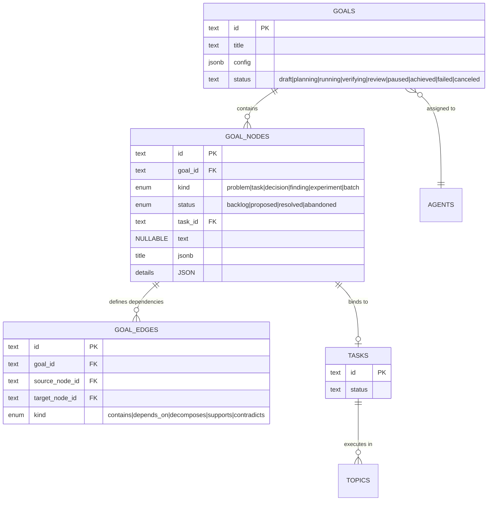
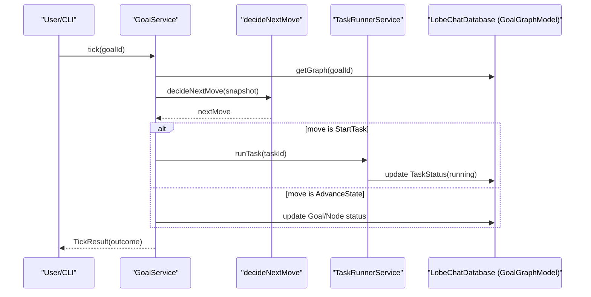

<!-- source: DeepWiki mcp.deepwiki.com · repo lobehub/lobehub · page 4.12 Goal Graph System · fetched 2026-10-29 -->

# Goal Graph System

<details>
<summary>Relevant source files</summary>

The following files were used as context for generating this wiki page:

- [.agents/skills/cli/references/goal.md](.agents/skills/cli/references/goal.md)
- [apps/cli/src/commands/goal.test.ts](apps/cli/src/commands/goal.test.ts)
- [apps/cli/src/commands/goal.ts](apps/cli/src/commands/goal.ts)
- [apps/server/src/routers/lambda/goal.ts](apps/server/src/routers/lambda/goal.ts)
- [apps/server/src/services/goal/criteriaGenerator.test.ts](apps/server/src/services/goal/criteriaGenerator.test.ts)
- [apps/server/src/services/goal/criteriaGenerator.ts](apps/server/src/services/goal/criteriaGenerator.ts)
- [apps/server/src/services/goal/decideNextMove.test.ts](apps/server/src/services/goal/decideNextMove.test.ts)
- [apps/server/src/services/goal/decideNextMove.ts](apps/server/src/services/goal/decideNextMove.ts)
- [apps/server/src/services/goal/index.test.ts](apps/server/src/services/goal/index.test.ts)
- [apps/server/src/services/goal/index.ts](apps/server/src/services/goal/index.ts)
- [apps/server/src/services/goal/manager.README.md](apps/server/src/services/goal/manager.README.md)
- [apps/server/src/services/goal/manager.test.ts](apps/server/src/services/goal/manager.test.ts)
- [apps/server/src/services/goal/manager.ts](apps/server/src/services/goal/manager.ts)
- [apps/server/src/services/goal/recoveryPolicy.test.ts](apps/server/src/services/goal/recoveryPolicy.test.ts)
- [apps/server/src/services/goal/recoveryPolicy.ts](apps/server/src/services/goal/recoveryPolicy.ts)
- [apps/server/src/services/goal/replayCoordinator.test.ts](apps/server/src/services/goal/replayCoordinator.test.ts)
- [apps/server/src/services/goal/replayCoordinator.ts](apps/server/src/services/goal/replayCoordinator.ts)
- [apps/server/src/services/goal/spec.test.ts](apps/server/src/services/goal/spec.test.ts)
- [apps/server/src/services/goal/spec.ts](apps/server/src/services/goal/spec.ts)
- [apps/server/src/services/goal/start.ts](apps/server/src/services/goal/start.ts)
- [apps/server/src/services/goal/supervisor/index.test.ts](apps/server/src/services/goal/supervisor/index.test.ts)
- [apps/server/src/services/goal/supervisor/index.ts](apps/server/src/services/goal/supervisor/index.ts)
- [apps/server/src/services/goal/supervisor/policy.test.ts](apps/server/src/services/goal/supervisor/policy.test.ts)
- [apps/server/src/services/goal/supervisor/policy.ts](apps/server/src/services/goal/supervisor/policy.ts)
- [apps/server/src/services/goal/taskRecoveryCoordinator.ts](apps/server/src/services/goal/taskRecoveryCoordinator.ts)
- [apps/server/src/services/goal/traceObservation.ts](apps/server/src/services/goal/traceObservation.ts)
- [packages/agent-tracing/src/goal/replay.ts](packages/agent-tracing/src/goal/replay.ts)
- [packages/agent-tracing/src/goal/types.ts](packages/agent-tracing/src/goal/types.ts)
- [packages/builtin-tool-goal/src/conversationGoalPrompt.ts](packages/builtin-tool-goal/src/conversationGoalPrompt.ts)
- [packages/const/src/goal.ts](packages/const/src/goal.ts)
- [packages/database/src/models/__tests__/goalGraph.test.ts](packages/database/src/models/__tests__/goalGraph.test.ts)
- [packages/database/src/models/goal.ts](packages/database/src/models/goal.ts)
- [packages/database/src/models/goalGraph.ts](packages/database/src/models/goalGraph.ts)
- [packages/prompts/src/chains/goal.test.ts](packages/prompts/src/chains/goal.test.ts)
- [packages/prompts/src/chains/goal.ts](packages/prompts/src/chains/goal.ts)
- [packages/types/src/goal.ts](packages/types/src/goal.ts)
- [src/components/Skeleton/Goal.tsx](src/components/Skeleton/Goal.tsx)
- [src/features/AgentGoals/AgentGoalsPage.tsx](src/features/AgentGoals/AgentGoalsPage.tsx)
- [src/features/AgentGoals/GoalDetailPage.tsx](src/features/AgentGoals/GoalDetailPage.tsx)
- [src/features/AgentGoals/ProcessControl/Graph/GraphNode.tsx](src/features/AgentGoals/ProcessControl/Graph/GraphNode.tsx)
- [src/features/AgentGoals/ProcessControl/Graph/index.tsx](src/features/AgentGoals/ProcessControl/Graph/index.tsx)
- [src/features/AgentGoals/ProcessControl/goalGraphViewModel.test.ts](src/features/AgentGoals/ProcessControl/goalGraphViewModel.test.ts)
- [src/features/AgentGoals/ProcessControl/goalGraphViewModel.ts](src/features/AgentGoals/ProcessControl/goalGraphViewModel.ts)
- [src/features/AgentGoals/ProcessControl/index.tsx](src/features/AgentGoals/ProcessControl/index.tsx)
- [src/features/AgentGoals/goalStatusMenu.test.ts](src/features/AgentGoals/goalStatusMenu.test.ts)
- [src/features/AgentGoals/goalStatusMenu.ts](src/features/AgentGoals/goalStatusMenu.ts)
- [src/features/Portal/Goal/Body.tsx](src/features/Portal/Goal/Body.tsx)
- [src/features/Projects/Workspace/ProjectDashboard.tsx](src/features/Projects/Workspace/ProjectDashboard.tsx)
- [src/services/goal.ts](src/services/goal.ts)
- [src/store/goal/action.test.ts](src/store/goal/action.test.ts)
- [src/store/goal/action.ts](src/store/goal/action.ts)
- [src/store/goal/goalListFilter.test.ts](src/store/goal/goalListFilter.test.ts)
- [src/store/goal/goalListFilter.ts](src/store/goal/goalListFilter.ts)
- [src/store/goal/index.ts](src/store/goal/index.ts)
- [src/store/goal/initialState.ts](src/store/goal/initialState.ts)
- [src/store/goal/projection.ts](src/store/goal/projection.ts)
- [src/store/goal/replica.test.ts](src/store/goal/replica.test.ts)
- [src/store/goal/selectors.ts](src/store/goal/selectors.ts)

</details>


The **Goal Graph System** within LobeHub is an advanced long-horizon planning and execution framework designed to manage complex, multi-step objectives that go beyond the capabilities of a single agent run. It models a user's high-level goal as a structured, persistent directed acyclic graph (DAG) — the Goal Graph — whose nodes represent diversified units of work or knowledge such as problems, tasks, decisions, and findings. The system decomposes broad requirements into manageable tasks, orchestrates their execution, and tracks progress, acceptance criteria, and recovery policies over time.

---

## 1. System Overview

The Goal Graph system bridges between natural language user objectives and concrete agentic workflow by representing a **Goal** as a graph that evolves through planning, execution, and verification stages.

### Mental Model to Code Mapping

| Natural Language Concept | Code Entity / Schema | Description |
|-------------------------|---------------------|-------------|
| **Goal**                | `goals` table [[packages/database/src/schemas/goal.ts:1]()] | Root high-level objective entered by user. |
| **Goal Graph**          | `goalNodes`, `goalEdges` tables [[packages/database/src/schemas/goalGraph.ts:1]()] | Persistent DAG representing decomposition and dependencies. |
| **Next Move Decision**  | `decideNextMove()` [[apps/server/src/services/goal/decideNextMove.ts:35]()] | Heuristic logic determining the next goal state transition. |
| **Goal Tick**           | `GoalService.tick()` [[apps/server/src/services/goal/index.ts:138]()] | Advances the goal state machine, managing moves and side effects. |
| **Plan Submission**     | `GoalManagerService.submitPlan()` [[apps/server/src/services/goal/manager.ts:40]()] | Handles external plan inputs to transform the Goal Graph state. |

---

## 2. Data Architecture

The Goal Graph System persists state in the PostgreSQL database using Drizzle ORM, primarily across the `goals`, `goalNodes`, `goalEdges`, and related tables.

### Database Schema Relationships



This schema enables capturing complex hierarchies, dependency constraints, and workflow states for goal constituents, including external Links to in-progress Tasks and acceptance criteria.

Sources: [[packages/database/src/schemas/goal.ts:1]()], [[packages/database/src/schemas/goalGraph.ts:1]()], [[packages/database/src/schemas/task.ts:1]()].

---

### `GoalGraphSnapshot` Schema

A **GoalGraphSnapshot** aggregates a goal’s current state across nodes, edges, decisions, events, and linked work versions, collectively enabling read-time snapshotting and UI rendering.

```mermaid
graph TD
    GoalGraphSnapshot --> Goal[goal: GoalItem]
    GoalGraphSnapshot --> Nodes[nodes: GoalGraphNode[]]
    GoalGraphSnapshot --> Edges[edges: GoalGraphEdge[]]
    GoalGraphSnapshot --> Decisions[decisions: GoalNodeDecision[]]
    GoalGraphSnapshot --> Events[events: GoalEvent[]]
    GoalGraphSnapshot --> WorkVersions[workVersions: GoalGraphWorkVersionRelation[]]

    Goal --> ID[id: string]
    Goal --> Title[title: string]
    Goal --> Status[status: GoalStatus]
    Goal --> Config[config: GoalConfig]

    Nodes --> NodeID[id]
    Nodes --> NodeKind[kind: GoalNodeKind]
    Nodes --> NodeStatus[status: GoalNodeStatus]
    Nodes --> TitleNode[title]
    Nodes --> TaskID[taskId?]

    Edges --> Source[sourceNodeId]
    Edges --> Target[targetNodeId]
    Edges --> Type[kind]

    Decisions --> NodeIDDecision[nodeId]
    Decisions --> Authority[authority]
    Decisions --> Question[question]

    Events --> ActorID[actorId]
    Events --> EventType[type]
    Events --> EntityType[entityType]
    Events --> EntityID[entityId]

    WorkVersions --> NodeIDVersion[nodeId]
    WorkVersions --> VersionID[workVersionId]
    WorkVersions --> Relation[relation]
    WorkVersions --> Work[work?]
```

This snapshot is returned by `GoalGraphModel.getGraph()` to producers like UI components and planners for a consistent state of the Goal and its ecosystem.

Sources: [[packages/types/src/goal.ts:9]()], [[packages/database/src/models/goalGraph.ts:104-201]()].

---

## 3. Planning & Execution Logic

Execution of goal graphs is orchestrated primarily by the `GoalService`, which incorporates the core lifecycle management and decision-making.

### Goal Tick Lifecycle

`GoalService.tick(goalId)` is the core advancement method implementing a goal state machine:

1. **Lock Acquisition**  
   Uses an advisory lock (`GOAL_DISPATCH_LOCK_NAMESPACE`) to prevent concurrent updates [[apps/server/src/services/goal/index.ts:77]()].

2. **Graph State Observation**  
   Loads the current `GoalGraphSnapshot` to gather the state of nodes, edges, tasks, decisions, and metrics [[apps/server/src/services/goal/traceObservation.ts:34]()].

3. **Next Move Determination**  
   Calls `decideNextMove(snapshot)` which applies heuristics to select the next "move," such as dispatching a new task, decomposing a problem node, or pausing for human review [[apps/server/src/services/goal/decideNextMove.ts:35]()].

4. **Move Execution**  
   The move may create tasks (via `TaskService`), run tasks (using `TaskRunnerService`), pause or resume the goal, or mark completion. The service handles scheduling follow-up ticks [[apps/server/src/services/goal/index.ts:138-200]()].

### Key Heuristics in `decideNextMove`

- **Frontier Selection**: Finds task nodes ready to run, prioritizing unresolved dependencies [[apps/server/src/services/goal/decideNextMove.ts:45]()].  
- **Budget Checking**: Verifies resource limits and concurrency constraints before dispatch [[apps/server/src/services/goal/decideNextMove.ts:114]()].
- **Metric Criteria**: Checks acceptance metrics (numerical clauses) that gate goal completion [[apps/server/src/services/goal/decideNextMove.ts:167]()].
- **Completion Detection**: Recognizes terminal graph states where all nodes are resolved or goal is achieved/failed.

This mechanism supports layered workflows such as seed task injection, exploration of alternatives, batch rollouts, and multi-round verification.

Sources: [[apps/server/src/services/goal/index.ts:77-200]()], [[apps/server/src/services/goal/decideNextMove.ts:35-171]()], [[apps/server/src/services/goal/index.test.ts:62-91]()].

---

## 4. CLI and Tool Integration

The Goal Graph System exposes operational commands through a CLI (`lh goal`) and a builtin Agent tool, enabling interactive and programmatic control.

### CLI: `lh goal`

- **Command**: `lh goal run <goalId>` [[apps/cli/src/commands/goal.ts:167]()]  
- **Function**: Wraps calls to `GoalService.tick()` with retry logic (`tickWithRetry()`) that retries transient failure errors with exponential backoff [[apps/cli/src/commands/goal.ts:95]()].  
- **Visualization**: Includes `printGraph()` which renders an ASCII/art-style representation of the goal graph showing node types, status, titles, task links, and incoming edge relationships [[apps/cli/src/commands/goal.ts:126]()].

This CLI tooling facilitates unattended goal ticking over long periods and interactive inspection of progress.

### Built-in Tool: `builtin-tool-goal`

- **Client Side**: Provides Agent-level APIs to spawn subgoals, submit findings, or report goal progress programmatically [[packages/builtin-tool-goal/src/client/executor/index.ts:1]()].  
- **Server Runtime**: Requests routed through `apps/server/src/services/toolExecution/serverRuntimes/goal.ts` that map calls into corresponding `GoalService` operations [[apps/server/src/services/toolExecution/serverRuntimes/goal.ts:1]()].

This arrangement allows Goals to be an integral primitive in Agent workflows, extending goal control into chat and automated agent skills.

Sources: [[apps/cli/src/commands/goal.ts:1,95,126,167]()], [[packages/builtin-tool-goal/src/client/executor/index.ts:1]()], [[apps/server/src/services/toolExecution/serverRuntimes/goal.ts:1]()].


---

## 5. Process Control Graph UI

The Goal Graph UI is a React component built upon the `@xyflow/react` library, primarily in `ProcessControl/Graph/index.tsx`. It provides an interactive visualization for exploring goal graphs and their workflows.

### Features

- **Node Types**: Displays distinct icons and styles for node kinds like `batch`, `decision`, `experiment`, `finding`, `problem`, and `task` [[apps/cli/src/commands/goal.ts:54-60](), [src/features/AgentGoals/ProcessControl/Graph/GraphNode.tsx:1]()].
- **Edge Types**: Shows labeled edges reflecting relationship kinds such as `contains`, `decomposes`, `depends_on` with visual properties for clarity [[src/features/AgentGoals/ProcessControl/Graph/index.tsx:65](), [src/features/AgentGoals/ProcessControl/Graph/ExplorationEdge.tsx:1]()].
- **Views**: Supports toggling between "stage" (current goal phase) and "all" (full graph) views for focused or broad context [[src/features/AgentGoals/ProcessControl/Graph/index.tsx:180](), [src/features/AgentGoals/ProcessControl/Graph/index.tsx:198]()].
- **Interactivity**: Enables node selection leading to detail panels, graph zoom, pan, and fit-to-view behaviors [[src/features/AgentGoals/ProcessControl/Graph/index.tsx:20,87]()].

### UI Components

| Component | Responsibility |
|-----------|----------------|
| `GraphNodeView` | Renders individual graph nodes with status badges and type icons [[src/features/AgentGoals/ProcessControl/Graph/GraphNode.tsx:1]()]. |
| `ExplorationEdge` | Custom edge rendering for Goal Relations [[src/features/AgentGoals/ProcessControl/Graph/ExplorationEdge.tsx:1]()]. |
| `ExperimentGroup` | Groups related experiments conceptually [[src/features/AgentGoals/ProcessControl/Graph/ExperimentGroup.tsx:1]()]. |
| Controls and Legends | Controls for fullscreen, filtering by node kind, and view mode selection [[src/features/AgentGoals/ProcessControl/Graph/index.tsx:20,188]()]. |

The UI integrates with the Goal Store and the Portal navigation stack to provide drill-down navigation into task, topic, and agent views.

Sources: [[src/features/AgentGoals/ProcessControl/Graph/index.tsx:1,20,37,38,40,65,180,198](), [src/features/AgentGoals/ProcessControl/Graph/useFitViewOnResize.ts:1]()], [[apps/cli/src/commands/goal.ts:54-60]()].

---

## 6. Implementation Details

### Key Service Classes and Roles

| Class | File | Responsibility |
|-------|------|----------------|
| `GoalService` | `apps/server/src/services/goal/index.ts` | Core orchestrator of goal lifecycle: creation, ticking, state transitions, and task binding [[apps/server/src/services/goal/index.ts:138]()]. |
| `GoalModel` | `packages/database/src/models/goal.ts` | Low-level CRUD for goals table, config handling [[apps/server/src/services/goal/index.ts:140]()]. |
| `GoalGraphModel` | `packages/database/src/models/goalGraph.ts` | Manages graph nodes, edges, decisions, events, snapshot preparation [[apps/server/src/services/goal/index.ts:145]()]. |
| `GoalManagerService` | `apps/server/src/services/goal/manager.ts` | Manages plan submission, validation, and goal movement using the main supervising agent [[apps/server/src/services/goal/manager.ts:1](), [apps/server/src/routers/lambda/goal.ts:13]()]. |
| `GoalSupervisorService` | `apps/server/src/services/goal/supervisor.ts` | Handles supervision policies, incident tracking, and recovery escalations [[apps/server/src/services/goal/supervisor.ts:1](), [apps/server/src/services/goal/index.ts:64]()]. |
| `TaskRecoveryCoordinator` | `apps/server/src/services/goal/taskRecoveryCoordinator.ts` | Coordinates recovery and retries on failed Tasks within a goal [[apps/server/src/services/goal/taskRecoveryCoordinator.ts:1]()]. |

### Data Flow Diagram: Goal Tick Operation



This sequence captures the typical tick operation where the GoalService uses the graph snapshot to decide and enact the next move, updating persistent state and orchestrating task executions as needed.

---

## Summary

The **Goal Graph System** is a sophisticated subsystem within LobeHub that enables sustained long-horizon AI agent workflows. It supports decomposition, execution, supervision, recovery, and acceptance over complex multi-node goal graphs. Its design links natural language goals to executable tasks through a managed DAG, interacting via CLI commands, a React Flow-based visualization UI, and built-in agent tools, creating an integrated ecosystem for advanced AI project management.

---

## Sources

- apps/server/src/services/goal/index.ts:1-200  
- apps/server/src/services/goal/decideNextMove.ts:35-171  
- apps/server/src/services/goal/manager.ts:1-190  
- packages/database/src/models/goalGraph.ts:104-201  
- packages/database/src/schemas/goal.ts:1-100  
- apps/cli/src/commands/goal.ts:1-180  
- src/features/AgentGoals/ProcessControl/Graph/index.tsx:1-205  
- packages/builtin-tool-goal/src/client/executor/index.ts:1-50  
- apps/server/src/services/toolExecution/serverRuntimes/goal.ts:1-50  
- apps/server/src/routers/lambda/goal.ts:1-181

---

