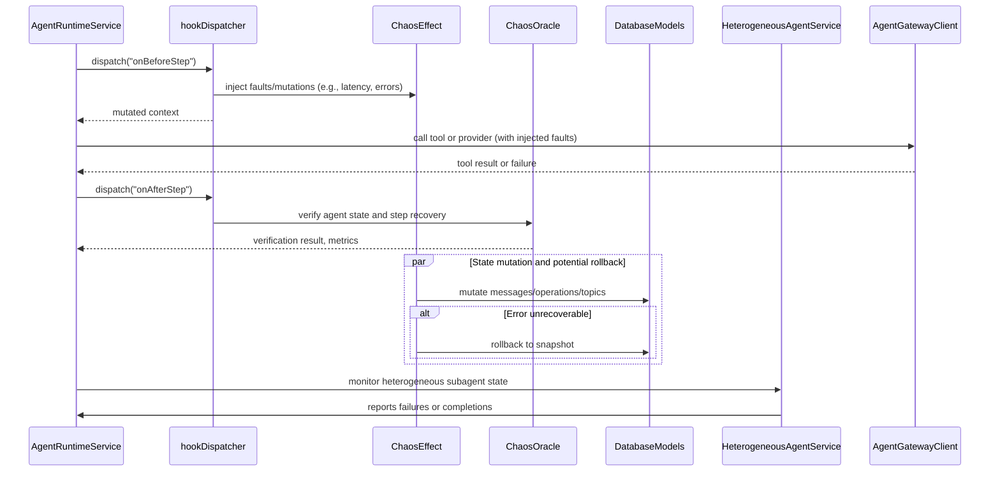
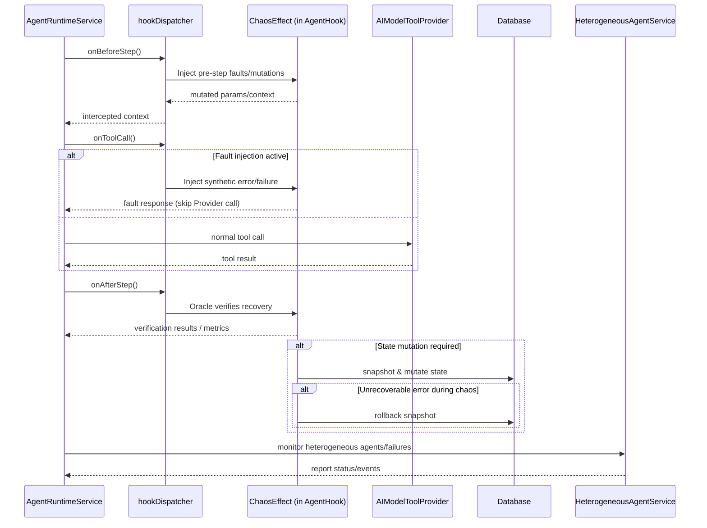

<!-- source: DeepWiki mcp.deepwiki.com · repo lobehub/lobehub · page 4.13 Chaos Engineering (achaos) · fetched 2026-10-29 -->

# Chaos Engineering (achaos)

Relevant source files

The following files were used as context for generating this wiki page:

- [.agents/scripts/check/advisories.ts](.agents/scripts/check/advisories.ts)
- [.agents/scripts/check/base.ts](.agents/scripts/check/base.ts)
- [.agents/scripts/check/check.test.ts](.agents/scripts/check/check.test.ts)
- [.agents/scripts/check/fileSize.ts](.agents/scripts/check/fileSize.ts)
- [.agents/scripts/check/index.ts](.agents/scripts/check/index.ts)
- [.agents/scripts/check/report.ts](.agents/scripts/check/report.ts)
- [.agents/scripts/check/routing.ts](.agents/scripts/check/routing.ts)
- [.agents/scripts/check/size-gate.ts](.agents/scripts/check/size-gate.ts)
- [.agents/scripts/check/sizeGate.ts](.agents/scripts/check/sizeGate.ts)
- [.agents/skills/desktop/SKILL.md](.agents/skills/desktop/SKILL.md)
- [.agents/skills/react/SKILL.md](.agents/skills/react/SKILL.md)
- [.agents/skills/testing/references/desktop-controller-test.md](.agents/skills/testing/references/desktop-controller-test.md)
- [.stylelintignore](.stylelintignore)
- [AGENTS.md](AGENTS.md)
- [apps/desktop/src/overlay/entry.tsx](apps/desktop/src/overlay/entry.tsx)
- [packages/python-interpreter/src/__tests__/interpreter.test.ts](packages/python-interpreter/src/__tests__/interpreter.test.ts)
- [packages/python-interpreter/src/__tests__/worker.test.ts](packages/python-interpreter/src/__tests__/worker.test.ts)
- [packages/python-interpreter/src/index.ts](packages/python-interpreter/src/index.ts)
- [packages/python-interpreter/src/interpreter.ts](packages/python-interpreter/src/interpreter.ts)
- [packages/python-interpreter/src/types.ts](packages/python-interpreter/src/types.ts)
- [packages/python-interpreter/src/worker.ts](packages/python-interpreter/src/worker.ts)
- [packages/python-interpreter/vitest.config.mts](packages/python-interpreter/vitest.config.mts)
- [plugins/vite/vercelSkewProtection.ts](plugins/vite/vercelSkewProtection.ts)
- [public/_dangerous_local_dev_proxy.html](public/_dangerous_local_dev_proxy.html)
- [scripts/copySpaBuild.test.ts](scripts/copySpaBuild.test.ts)
- [scripts/copySpaBuildCore.ts](scripts/copySpaBuildCore.ts)
- [src/components/BootErrorBoundary/index.test.tsx](src/components/BootErrorBoundary/index.test.tsx)
- [src/components/BootErrorBoundary/index.tsx](src/components/BootErrorBoundary/index.tsx)
- [src/components/DebugNode.tsx](src/components/DebugNode.tsx)
- [src/components/Error/index.tsx](src/components/Error/index.tsx)
- [src/features/AgentMockDevtools/index.tsx](src/features/AgentMockDevtools/index.tsx)
- [src/features/SkillStore/index.tsx](src/features/SkillStore/index.tsx)
- [src/initialize.test.ts](src/initialize.test.ts)
- [src/initialize.ts](src/initialize.ts)
- [src/layout/GlobalProvider/FaviconProvider.tsx](src/layout/GlobalProvider/FaviconProvider.tsx)
- [src/layout/SPAGlobalProvider/index.test.tsx](src/layout/SPAGlobalProvider/index.test.tsx)
- [src/layout/SPAGlobalProvider/index.tsx](src/layout/SPAGlobalProvider/index.tsx)
- [src/spa/entry.auth.tsx](src/spa/entry.auth.tsx)
- [src/spa/entry.desktop.tsx](src/spa/entry.desktop.tsx)
- [src/spa/entry.mobile.tsx](src/spa/entry.mobile.tsx)
- [src/spa/entry.popup.tsx](src/spa/entry.popup.tsx)
- [src/spa/entry.web.tsx](src/spa/entry.web.tsx)
- [src/spa/initialize/bootstrap.ts](src/spa/initialize/bootstrap.ts)
- [src/spa/router/authRouter.config.tsx](src/spa/router/authRouter.config.tsx)
- [src/utils/chunkError.ts](src/utils/chunkError.ts)
- [src/utils/router.tsx](src/utils/router.tsx)
- [tsconfig.json](tsconfig.json)
- [vitest.config.mts](vitest.config.mts)

The LobeHub chaos engineering subsystem, orchestrated primarily via the `@achaos/*` packages, integrates deeply with the AI Agent runtime to provide a comprehensive framework for fault injection, resilience testing, and verification of AI Agents under adverse conditions. This subsystem targets multiple layers of the AI agent workflow, from the runtime hook adapter level up to database state mutation and rollback, process fault injection, and dedicated chaos scenarios under `.agents/chaos`.

This page documents the core architectural elements, key interfaces and classes, lifecycle and data flow of chaos experiments, and their integration with AI agent execution. It highlights how chaos is injected, monitored, and controlled within system boundaries, and how recovery and rollback are verified.

---

## Purpose and Scope

The chaos engineering system aims to:

- Inject controlled faults and mutations into AI agent execution paths.
- Simulate real-world instability such as tool failures, network latency, and corrupted database state.
- Validate agent resilience by verifying that recovery or failover logic triggers correctly.
- Support rollback of mutated state to maintain operational integrity.
- Enable experimentation through reusable contracts: experiments, effects, oracles.
- Provide runtime hook adapters that interpose on agent lifecycle events.
- Cover process injection scenarios including sub-agent and heterogeneous agent failures.
- Utilize specialized test scenarios under `.agents/chaos` for targeted stress-testing.

---

## Core Components and Contracts

### Experiments, Effects, and Oracles

Chaos engineering revolves around three principal *contracts* defined in the `@achaos/core` packages:

- **Experiments** define **what** is tested, encompassing the scope and activation strategy for fault injections.  
- **Effects** implement **how** faults or disruptions are injected, ranging from data mutation and latency injection to error synthesis in tool calls.  
- **Oracles** serve as the verification layer, inspecting the agent's runtime state after chaos injection to assess if proper recovery or fallback has occurred.

These contracts are realized as TypeScript interfaces and classes embedded within the agent runtime lifecycle via the `AgentHook` interface, thereby allowing seamless integration and extension.

---

### Runtime Hook Adapter Interface

The integration of chaos engineering logic into the AI agent runtime is done primarily through lifecycle hooks declared in `AgentHook`. Key hooks relevant for chaos injection and verification include:

- `onBeforeStep`: invoked before an agent step executes, allowing pre-step mutations or preparations.
- `onToolCall`: invoked around tool invocations, where fault injection effects can intercept and mutate tool call parameters or inject synthetic errors without invoking the real tool.
- `onAfterStep`: invoked after step execution, used by oracles to verify agent state transitions and recovery from injected faults.

The dispatching and orchestration of these hooks occur inside the `AgentRuntimeService`, which manages agent execution.

---

### Database Mutation and Rollback Port

In order to test robustness to faulty persisted state, chaos experiments can mutate database entities such as messages, topics, and agent operations. The models involved include `MessageModel`, `AgentOperationModel`, and `TopicModel`. The system takes a snapshot of relevant entities before mutation.

If the chaos effect causes unrecoverable errors, atomic rollback restores the snapshot to maintain system consistency. This provides a controlled environment for time-travel testing and evaluation of system recovery logic during experiments.

---

### Process Injection and Heterogeneous Agent Faults

Chaos engineering also targets process-level injections, particularly for heterogeneous or sub-agents that run concurrently or remotely (e.g., CLI producers, device gateways). The `HeterogeneousAgentService` handles event ingestion and state monitoring of these agents.

Chaos effects may simulate conditions such as device offline errors, gateway disconnections, execution delays, or process crashes. The pipeline includes finalization functions like `finalizeHeteroDispatchError` for handling dispatch failures safely. This ensures that fault injection extends beyond the primary agent runtime to distributed agent orchestration components.

---

## Lifecycle and Data Flow of Chaos Engineering

The chaos framework overlays the AI agent execution lifecycle as follows:

This enables precise injection, observation, and recovery control during agent execution and testing.

---

## Key Classes and Functions

### AgentRuntimeService and Hook Dispatcher

- **AgentRuntimeService** manages the execution lifecycle of AI agents. It tracks and advances agent state from step to step.
- Lifecycles hooks (`AgentHook`) are dispatched via an internal `hookDispatcher` within the runtime service to registered chaos experiments and oracles.
- Experiments may be activated, suspended, or concluded dynamically based on agent state and predefined criteria.
- Hook events provide interception points to apply chaos effects or perform verification.

### Chaos Effect Implementations

- Effects intercept payloads during `onToolCall`, injecting failures such as synthetic error responses, simulated timeouts, or delayed invocation.
- Effects may also mutate database rows to simulate corrupted or inconsistent states.
- Effects can enforce fault injection conditions dynamically and revert mutations when necessary.

### Chaos Oracles

- Oracles observe agent lifecycle events, especially `onAfterStep`.
- They analyze the current agent state (`AgentState`) and step event data (`StepPresentationData`).
- Oracles produce validation results asserting whether the agent recovered correctly, issued fallback actions, or handled injected chaos gracefully.

### Database Mutation and Rollback

- The system snapshots key entities using `MessageModel`, `AgentOperationModel`, and `TopicModel` before mutating.
- On unrecoverable injected faults, rollback functions restore snapshots atomically.
- This mechanism supports experiments that alter persisted state to confirm system robustness and recovery paths during AI agent runs.

### Process Injection in Heterogeneous Agents

- `HeterogeneousAgentService` ingests batches of event data from CLI or native agent producers.
- Chaos testing simulates process failures and device offline events to stress fault recovery logic.
- Functions like `finalizeHeteroDispatchError` ensure safe handling and error reporting for synchronization issues.
- JWT signing ensures integrity and permission guardrails on agent operations.

---

## Chaos Scenarios (.agents/chaos)

Chaos scenarios are configured as specialized agents within the `.agents/chaos/` directory. These scenarios:

- Define the target agent configurations subject to chaos experiments.
- Specify injection profiles detailing which lifecycle hook to trigger and what fault or latency to simulate.
- Define expected agent behaviors, i.e., oracles, to verify resilient recovery or failover.
- Cover cases like tool failures, context compression stress, async race conditions, and state mutation rollbacks.

These scenarios form the backbone of automated resilience regression testing within vitest and integration tests, ensuring system reliability under adverse conditions.

---

## Bridging Natural Language Concepts to Code Entities

The following diagrams map chaos engineering domain terms to precise code artifacts for easier navigation and understanding.

### Diagram 1: Chaos Engineering Concept to Code Entity Mapping

```mermaid
graph TD
    subgraph "ChaosEngineeringConcepts"
        Experiment["ChaosExperiment"]
        Effect["FaultInjectionEffect"]
        Oracle["VerificationOracle"]
        Recovery["RecoveryRetryLogic"]
        StateMutation["DBMutation&Rollback"]
        ProcessFault["ProcessInjection"]
    end

    subgraph "LobeHubCodeEntities"
        AgentHook["AgentHook (packages/agent-runtime/src/types/hooks.ts)"]
        HookDispatcher["hookDispatcher (AgentRuntimeService.ts)"]
        AgentRuntimeService["AgentRuntimeService (apps/server/src/services/agentRuntime/AgentRuntimeService.ts)"]
        MessageModel["MessageModel (database/models/message.ts)"]
        AgentOperationModel["AgentOperationModel (database/models/agentOperation.ts)"]
        HeterogeneousAgentService["HeterogeneousAgentService (apps/server/src/services/heterogeneousAgent/index.ts)"]
        CompletionLifecycle["CompletionLifecycle (agentRuntime/CompletionLifecycle.ts)"]
        SnapshotStore["SnapshotStore (AgentRuntime snapshot)"]
    end

    Experiment --> HookDispatcher
    Effect --> AgentHook
    Effect --> ProcessFault
    Oracle --> AgentHook
    Oracle --> Recovery
    Recovery --> CompletionLifecycle
    StateMutation --> MessageModel
    StateMutation --> AgentOperationModel
    StateMutation --> SnapshotStore
    ProcessFault --> HeterogeneousAgentService
    HookDispatcher --> AgentRuntimeService
```

### Diagram 2: Agent Execution with Chaos Injection Flow

---

## Summary

The `@achaos/*` chaos engineering modules within LobeHub enable fine-grained fault injection and resilience verification for AI agents by hooking into the agent runtime lifecycle, mutating execution conditions, and asserting recovery behavior. By imitating real-world failures like tool errors, device disconnects, and corrupted data, it ensures robust AI agent orchestration and enhances system dependability.

This leaf page serves as a comprehensive reference for the chaos-related codebases, key APIs, system flows, and testing regimes implemented in the `packages/@achaos/*`, `agent-runtime`, and server services under `apps/server/src/services`.

---

## Sources

- `apps/server/src/services/agentRuntime/AgentRuntimeService.ts` [125-182]()
- `apps/server/src/services/agentRuntime/types.ts` [12-52, 86-118]()
- `apps/server/src/services/heterogeneousAgent/index.ts` [75-161]()
- `apps/server/src/services/aiAgent/pipeline/heteroDispatch.ts` [75-167]()
- `apps/server/src/services/agentRuntime/CompletionLifecycle.ts` [10-100]()
- `apps/server/src/database/models/message.ts` [1-150]()
- `apps/server/src/database/models/agentOperation.ts` [1-150]()
- `.agents/chaos/` directory (scenario definitions)
- `packages/agent-runtime/src/types/hooks.ts` [10-50]()

---

