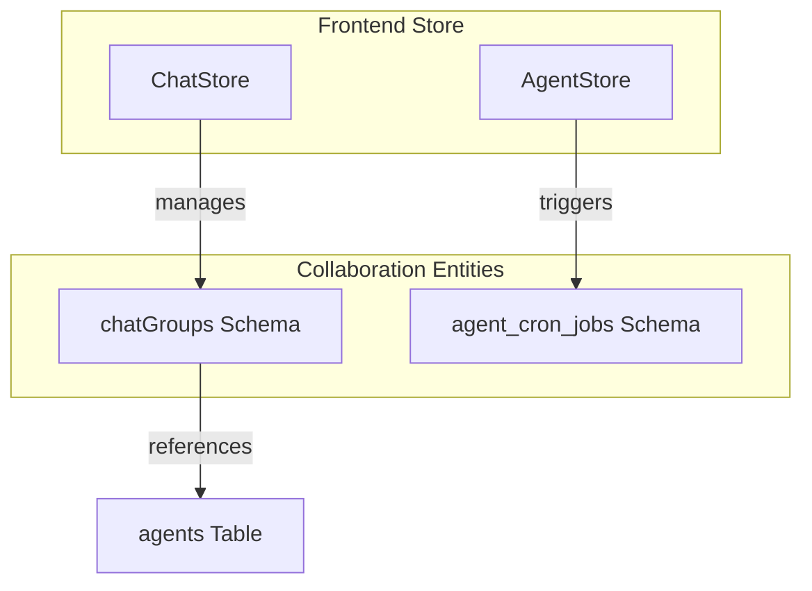

<!-- source: DeepWiki mcp.deepwiki.com · repo lobehub/lobehub · page 4.2 Multi-Agent Groups and Collaboration · fetched 2026-10-29 -->

# Multi-Agent Groups and Collaboration

<details>
<summary>Relevant source files</summary>

The following files were used as context for generating this wiki page:

- [apps/server/src/routers/lambda/aiAgent.ts](apps/server/src/routers/lambda/aiAgent.ts)
- [apps/server/src/services/agentRuntime/AgentRuntimeService.test.ts](apps/server/src/services/agentRuntime/AgentRuntimeService.test.ts)
- [apps/server/src/services/agentRuntime/AgentRuntimeService.ts](apps/server/src/services/agentRuntime/AgentRuntimeService.ts)
- [apps/server/src/services/agentRuntime/types.ts](apps/server/src/services/agentRuntime/types.ts)
- [apps/server/src/services/aiAgent/__tests__/execAgent.heteroFiles.test.ts](apps/server/src/services/aiAgent/__tests__/execAgent.heteroFiles.test.ts)
- [apps/server/src/services/aiAgent/__tests__/execAgent.threadId.test.ts](apps/server/src/services/aiAgent/__tests__/execAgent.threadId.test.ts)
- [apps/server/src/services/aiAgent/__tests__/execSubAgent.test.ts](apps/server/src/services/aiAgent/__tests__/execSubAgent.test.ts)
- [apps/server/src/services/aiAgent/index.ts](apps/server/src/services/aiAgent/index.ts)
- [apps/server/src/services/aiAgent/pipeline/__tests__/historyMessagesLoader.test.ts](apps/server/src/services/aiAgent/pipeline/__tests__/historyMessagesLoader.test.ts)
- [apps/server/src/services/aiAgent/pipeline/heteroDispatch.ts](apps/server/src/services/aiAgent/pipeline/heteroDispatch.ts)
- [apps/server/src/services/aiAgent/pipeline/operationPrep.ts](apps/server/src/services/aiAgent/pipeline/operationPrep.ts)
- [apps/server/src/services/aiAgent/pipeline/startOperation.ts](apps/server/src/services/aiAgent/pipeline/startOperation.ts)
- [apps/server/src/services/aiAgent/pipeline/turnSetup.ts](apps/server/src/services/aiAgent/pipeline/turnSetup.ts)
- [apps/server/src/services/aiAgent/subAgentRuns.ts](apps/server/src/services/aiAgent/subAgentRuns.ts)
- [apps/server/src/services/aiAgent/types.ts](apps/server/src/services/aiAgent/types.ts)
- [apps/server/src/services/document/__tests__/index.test.ts](apps/server/src/services/document/__tests__/index.test.ts)
- [apps/server/src/services/document/index.ts](apps/server/src/services/document/index.ts)
- [docs/development/database-schema.dbml](docs/development/database-schema.dbml)
- [packages/agent-runtime/src/types/state.ts](packages/agent-runtime/src/types/state.ts)
- [packages/database/migrations/0086_video_generation_schema.sql](packages/database/migrations/0086_video_generation_schema.sql)
- [packages/database/migrations/0177_agent_accounts_live_unique_and_goal_subscriptions.sql](packages/database/migrations/0177_agent_accounts_live_unique_and_goal_subscriptions.sql)
- [packages/database/migrations/0180_task_archived_at.sql](packages/database/migrations/0180_task_archived_at.sql)
- [packages/database/migrations/meta/0086_snapshot.json](packages/database/migrations/meta/0086_snapshot.json)
- [packages/database/migrations/meta/0177_snapshot.json](packages/database/migrations/meta/0177_snapshot.json)
- [packages/database/migrations/meta/0180_snapshot.json](packages/database/migrations/meta/0180_snapshot.json)
- [packages/database/migrations/meta/_journal.json](packages/database/migrations/meta/_journal.json)
- [packages/database/src/models/__tests__/agentAccount.test.ts](packages/database/src/models/__tests__/agentAccount.test.ts)
- [packages/database/src/models/__tests__/document.test.ts](packages/database/src/models/__tests__/document.test.ts)
- [packages/database/src/models/__tests__/drizzleMigration.test.ts](packages/database/src/models/__tests__/drizzleMigration.test.ts)
- [packages/database/src/models/__tests__/topics/topic.create.test.ts](packages/database/src/models/__tests__/topics/topic.create.test.ts)
- [packages/database/src/models/agentAccount.ts](packages/database/src/models/agentAccount.ts)
- [packages/database/src/models/document.ts](packages/database/src/models/document.ts)
- [packages/database/src/schemas/agent.ts](packages/database/src/schemas/agent.ts)
- [packages/database/src/schemas/agentAccount.ts](packages/database/src/schemas/agentAccount.ts)
- [packages/database/src/schemas/agentCronJob.ts](packages/database/src/schemas/agentCronJob.ts)
- [packages/database/src/schemas/apiKey.ts](packages/database/src/schemas/apiKey.ts)
- [packages/database/src/schemas/asyncTask.ts](packages/database/src/schemas/asyncTask.ts)
- [packages/database/src/schemas/chatGroup.ts](packages/database/src/schemas/chatGroup.ts)
- [packages/database/src/schemas/file.ts](packages/database/src/schemas/file.ts)
- [packages/database/src/schemas/generation.ts](packages/database/src/schemas/generation.ts)
- [packages/database/src/schemas/goalSubscription.ts](packages/database/src/schemas/goalSubscription.ts)
- [packages/database/src/schemas/index.ts](packages/database/src/schemas/index.ts)
- [packages/database/src/schemas/message.ts](packages/database/src/schemas/message.ts)
- [packages/database/src/schemas/rag.ts](packages/database/src/schemas/rag.ts)
- [packages/database/src/schemas/relations.ts](packages/database/src/schemas/relations.ts)
- [packages/database/src/schemas/session.ts](packages/database/src/schemas/session.ts)
- [packages/database/src/schemas/task.ts](packages/database/src/schemas/task.ts)
- [packages/database/src/schemas/topic.ts](packages/database/src/schemas/topic.ts)
- [packages/database/src/utils/idGenerator.ts](packages/database/src/utils/idGenerator.ts)
- [packages/heterogeneous-agents/src/attachedFiles.test.ts](packages/heterogeneous-agents/src/attachedFiles.test.ts)
- [packages/heterogeneous-agents/src/attachedFiles.ts](packages/heterogeneous-agents/src/attachedFiles.ts)
- [packages/types/src/agentExecution/index.ts](packages/types/src/agentExecution/index.ts)
- [packages/types/src/goalSubscription.ts](packages/types/src/goalSubscription.ts)
- [packages/types/src/index.ts](packages/types/src/index.ts)
- [src/services/aiAgent.ts](src/services/aiAgent.ts)
- [src/store/chat/slices/agentRun/actions/__tests__/conversationLifecycle.test.ts](src/store/chat/slices/agentRun/actions/__tests__/conversationLifecycle.test.ts)
- [src/store/chat/slices/agentRun/actions/__tests__/gateway.test.ts](src/store/chat/slices/agentRun/actions/__tests__/gateway.test.ts)
- [src/store/chat/slices/agentRun/actions/entries/conversationLifecycle.ts](src/store/chat/slices/agentRun/actions/entries/conversationLifecycle.ts)
- [src/store/chat/slices/agentRun/actions/transports/gateway/gateway.ts](src/store/chat/slices/agentRun/actions/transports/gateway/gateway.ts)

</details>


Multi-agent collaboration in LobeHub is implemented through a sophisticated group chat system allowing multiple AI agents to engage within a shared conversation context. This system supports advanced orchestration modes, such as supervisor-led coordination and parallel execution of sub-agents, and integrates deeply with workspace contexts including Projects, Schedule, and Pages.

---

## Group Chat Architecture

The core of multi-agent collaboration centers around the `chatGroups` schema, which organizes agents into groups that participate jointly in conversations scoped by topics and threads.

### Data Schema and Relationships

- **`chatGroups` Table**  
  Defines group metadata, member agents, and orchestration policies for collaboration. Each group has a unique identifier and encapsulates agent membership and settings.  
  Location: [packages/database/src/schemas/chatGroup.ts:6-14]()

- **`topics` Table**  
  Represents conversation threads which can be bound to a `groupId` to contextualize group chats.  
  Location: [packages/database/src/schemas/topic.ts:37-37]()

- **`threads` Table**  
  Sub-conversations within topics, also optionally scoped to a `groupId` for fine-grained collaborative threading.  
  Location: [packages/database/src/schemas/topic.ts:151-151]()

- **`agents` Table**  
  Individual AI agents, potentially members of groups via `sessionGroupId`. Agents carry configuration, identity, and execution context.  
  Location: [packages/database/src/schemas/agent.ts:99-101]()

### Collaboration Data Flow and Orchestration Roles

The group chat system distinguishes roles such as **Supervisor/Orchestrator Agents** and **Member Agents**. The supervisor manages the overall dialog flow, while member agents respond in parallel or sequence according to orchestration.

---

### Collaboration Execution Map

This diagram relates the conceptual multi-agent collaboration flow in the natural language domain to the corresponding entities and flow in the codebase:

```mermaid
graph TD
    subgraph "Natural_Language_Space"
        UserPrompt["User sends message to Group"]
        Supervisor["Supervisor Agent coordinates"]
        Member["Member Agents respond"]
    end

    subgraph "Code_Entity_Space_(packages/agent-runtime)"
        UserPrompt -->|"AgentRuntime.runner()"| Runtime["AgentRuntime"]
        Runtime -->|"phase: user_input"| GeneralChatAgent["GeneralChatAgent"]

        subgraph Orchestration_Logic
            GeneralChatAgent -->|"call_llm"| LLM["LLM Result"]
            LLM -->|"tool_calls"| ToolExec["InterventionChecker"]
            ToolExec -->|"type: call_tools_batch"| BatchExec["Execute Safe Tools"]
            BatchExec -->|"sub_agent_call"| SubAgentExec["Sub-Agent Execution"]
        end
    end

    subgraph Data_Persistence_(packages/database)
        SubAgentExec -->|"groupId"| TopicsDB["topics table"]
        SubAgentExec -->|"groupId"| ThreadsDB["threads table"]
    end
```

This mapping denotes the runtime mechanism where a user prompt initiates the AgentRuntime, handled by `GeneralChatAgent`. The agent delegates to the LLM, then manages tool calls and sub-agent execution. Resulting data is persisted within topics and threads linked by group identifiers.

Sources:  
[packages/agent-runtime/src/agents/GeneralChatAgent.ts:41-50](),  
[packages/database/src/schemas/topic.ts:37-37](),  
[packages/database/src/schemas/topic.ts:151-151](),  
[packages/agent-runtime/src/core/runtime.ts:15-20]()

---

## Orchestration and Execution Details

### 1. Decision Loop and Tool Execution in `GeneralChatAgent`

The `GeneralChatAgent` orchestrates multi-agent collaboration by implementing a decision loop with the following flow:

- **User Input Handling**:  
  New user messages trigger a phase `"user_input"` executing a `call_llm` instruction to invoke language model reasoning.  
  Location: [packages/agent-runtime/src/agents/GeneralChatAgent.ts:42]()

- **LLM Result Processing and Intervention Detection**:  
  The agent inspects the response for tool call instructions such as `call_tools_batch` or requests for human approval (`request_human_approve`).  
  Location: [packages/agent-runtime/src/agents/GeneralChatAgent.ts:43-46]()

- **Batch Execution of Tools/Sub-Agents**:  
  Sub-agent calls or tools that do not require human approval are executed in batch for efficiency, enabling parallelism in multi-agent responses.  
  Location: [packages/agent-runtime/src/agents/GeneralChatAgent.ts:44-46]()

- **Result Integration**:  
  Tool results feed back into the LLM or runtime context to generate the concluding step or additional instructions.  
  Location: [packages/agent-runtime/src/agents/GeneralChatAgent.ts:48-49]()

### 2. Response Ordering: Sequential vs Parallel Execution

- **Sequential Execution**:  
  Instructions such as `call_llm` or individual `call_tool` are processed one after another in the agent runner, ensuring ordered thought and response synthesis.  
  Location: [packages/agent-runtime/src/agents/GeneralChatAgent.ts:189-192]()

- **Parallel/Batch Execution**:  
  The use of `call_tools_batch` allows simultaneous execution of multiple sub-agent or tool calls that do not require human intervention, optimizing responsiveness.  
  Location: [packages/agent-runtime/src/agents/GeneralChatAgent.ts:44-46]()

### 3. Context Compression

To efficiently manage token usage during long-running or complex collaborations, `GeneralChatAgent` monitors token consumption and triggers context compression:

- **Token Threshold**:  
  A default recompression ratio of `0.65` is used to decide when to compress conversation context.  
  Location: [packages/agent-runtime/src/agents/GeneralChatAgent.ts:36]()

- **Compression Decision**:  
  The utility function `shouldCompress` evaluates the current token count against the model's window size to trigger context re-summarization or compression.  
  Location: [packages/agent-runtime/src/agents/GeneralChatAgent.ts:28]()

Sources:  
[packages/agent-runtime/src/agents/GeneralChatAgent.ts:30-50](),  
[packages/agent-runtime/src/agents/GeneralChatAgent.ts:138-143]()

---

## Multi-Agent UI and Settings

### Group Settings UI

The frontend implements specific interfaces and localized resources (`setting.json`) to configure agent groups and collaborative behaviors. Features include:

- **Scheduled Tasks for Groups**  
  Agents within groups can be automated via scheduled cron jobs, utilizing the `agentCronJobs` table schema with fields like `cron_pattern` and `timezone` for flexible timing.  
  Location: [packages/database/src/schemas/agentCronJob.ts:95]()

- **Collaboration Status Feedback**  
  The UI reflects collaboration state, providing labels such as "waiting for human" approval or "running" for active multi-agent workflows, connected to topic metadata managed in the `topics` table.  
  Location: [packages/database/src/schemas/topic.ts:47-58]()

---

### Frontend Collaboration Interaction Diagram



This reflects how the frontend state management layers orchestrate group and agent scheduling via the underlying database schemas.

Sources:  
[packages/database/src/schemas/chatGroup.ts:6-14](),  
[packages/database/src/schemas/agentCronJob.ts:95]()

---

## Collaboration Contexts

Agents collaborate across different workspace contexts with varying integration modes.

### Projects and Schedule

- **Topic Scoping**:  
  Topics are the core unit of collaboration, linked both to agents (`agentId`) and groups (`groupId`), enabling associating conversations with project or schedule-related contexts.  
  Location: [packages/database/src/schemas/topic.ts:36-37]()

- **Scheduled Automation**:  
  The `agent_cron_jobs` table supports automatically triggered agent logic in group contexts, facilitating periodic or event-driven collaboration workflows.  
  Location: [packages/database/src/schemas/agentCronJob.ts:95]()

### Pages and Documents

- **Agent-Document Association**:  
  The `agents_documents` table manages mappings between agents and specific documents, controlling context loading policies such as always loading the document or loading before the first user interaction.  
  Location: [docs/development/database-schema.dbml:134-139]()

- **Access Control Levels**:  
  Access scopes include `access_self` (only the agent), `access_shared` (group/team), and `access_public` (broadly available), supporting nuanced permissions for collaborative document agents.  
  Location: [docs/development/database-schema.dbml:137-139]()

Sources:  
[packages/database/src/schemas/topic.ts:36-37](),  
[docs/development/database-schema.dbml:134-139](),  
[packages/database/src/schemas/agentCronJob.ts:95]()

---

# Summary

LobeHub’s multi-agent collaboration leverages group chats defined by the `chatGroups` schema, enabling orchestration modes managed by `AgentRuntime` and `GeneralChatAgent`. Collaboration is organized via database scoping to topics and threads, with parallel and sequential sub-agent execution handled transparently. Frontend UI and scheduling features provide control over collaborative behaviors in diverse workspace contexts, including Projects, Pages, and Schedule. This architectural design supports rich, multi-agent interaction patterns with integrated human intervention handling, tooling, and context management.

# End of Section 4.2.

Sources:  
- [packages/database/src/schemas/chatGroup.ts:6-14]()  
- [packages/database/src/schemas/topic.ts:36-37]()  
- [packages/database/src/schemas/topic.ts:151-151]()  
- [packages/database/src/schemas/agent.ts:99-101]()  
- [packages/agent-runtime/src/agents/GeneralChatAgent.ts:28-50]()  
- [packages/agent-runtime/src/agents/GeneralChatAgent.ts:138-143]()  
- [packages/agent-runtime/src/agents/GeneralChatAgent.ts:189-192]()  
- [packages/database/src/schemas/agentCronJob.ts:95]()  
- [docs/development/database-schema.dbml:134-139]()  
- [packages/agent-runtime/src/core/runtime.ts:15-20]()

---

