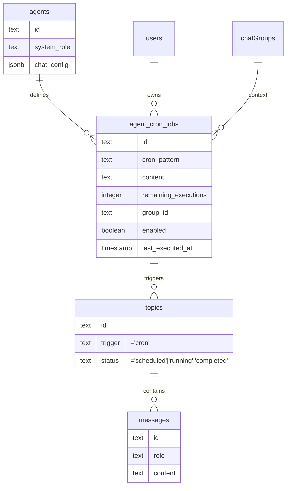
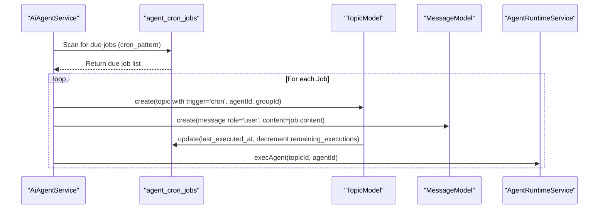

<!-- source: DeepWiki mcp.deepwiki.com · repo lobehub/lobehub · page 4.3 Agent Cron Jobs and Scheduling · fetched 2026-10-29 -->

# Agent Cron Jobs and Scheduling

<details>
<summary>Relevant source files</summary>

The following files were used as context for generating this wiki page:

- [apps/server/src/services/document/__tests__/index.test.ts](apps/server/src/services/document/__tests__/index.test.ts)
- [apps/server/src/services/document/index.ts](apps/server/src/services/document/index.ts)
- [docs/development/database-schema.dbml](docs/development/database-schema.dbml)
- [locales/en-US/setting.json](locales/en-US/setting.json)
- [locales/zh-CN/setting.json](locales/zh-CN/setting.json)
- [packages/database/migrations/0086_video_generation_schema.sql](packages/database/migrations/0086_video_generation_schema.sql)
- [packages/database/migrations/0177_agent_accounts_live_unique_and_goal_subscriptions.sql](packages/database/migrations/0177_agent_accounts_live_unique_and_goal_subscriptions.sql)
- [packages/database/migrations/0180_task_archived_at.sql](packages/database/migrations/0180_task_archived_at.sql)
- [packages/database/migrations/meta/0086_snapshot.json](packages/database/migrations/meta/0086_snapshot.json)
- [packages/database/migrations/meta/0177_snapshot.json](packages/database/migrations/meta/0177_snapshot.json)
- [packages/database/migrations/meta/0180_snapshot.json](packages/database/migrations/meta/0180_snapshot.json)
- [packages/database/migrations/meta/_journal.json](packages/database/migrations/meta/_journal.json)
- [packages/database/src/models/__tests__/agentAccount.test.ts](packages/database/src/models/__tests__/agentAccount.test.ts)
- [packages/database/src/models/__tests__/document.test.ts](packages/database/src/models/__tests__/document.test.ts)
- [packages/database/src/models/__tests__/drizzleMigration.test.ts](packages/database/src/models/__tests__/drizzleMigration.test.ts)
- [packages/database/src/models/__tests__/topics/topic.create.test.ts](packages/database/src/models/__tests__/topics/topic.create.test.ts)
- [packages/database/src/models/agentAccount.ts](packages/database/src/models/agentAccount.ts)
- [packages/database/src/models/document.ts](packages/database/src/models/document.ts)
- [packages/database/src/schemas/agent.ts](packages/database/src/schemas/agent.ts)
- [packages/database/src/schemas/agentAccount.ts](packages/database/src/schemas/agentAccount.ts)
- [packages/database/src/schemas/agentCronJob.ts](packages/database/src/schemas/agentCronJob.ts)
- [packages/database/src/schemas/apiKey.ts](packages/database/src/schemas/apiKey.ts)
- [packages/database/src/schemas/asyncTask.ts](packages/database/src/schemas/asyncTask.ts)
- [packages/database/src/schemas/chatGroup.ts](packages/database/src/schemas/chatGroup.ts)
- [packages/database/src/schemas/file.ts](packages/database/src/schemas/file.ts)
- [packages/database/src/schemas/generation.ts](packages/database/src/schemas/generation.ts)
- [packages/database/src/schemas/goalSubscription.ts](packages/database/src/schemas/goalSubscription.ts)
- [packages/database/src/schemas/index.ts](packages/database/src/schemas/index.ts)
- [packages/database/src/schemas/message.ts](packages/database/src/schemas/message.ts)
- [packages/database/src/schemas/rag.ts](packages/database/src/schemas/rag.ts)
- [packages/database/src/schemas/relations.ts](packages/database/src/schemas/relations.ts)
- [packages/database/src/schemas/session.ts](packages/database/src/schemas/session.ts)
- [packages/database/src/schemas/task.ts](packages/database/src/schemas/task.ts)
- [packages/database/src/schemas/topic.ts](packages/database/src/schemas/topic.ts)
- [packages/database/src/utils/idGenerator.ts](packages/database/src/utils/idGenerator.ts)
- [packages/locales/src/default/setting.ts](packages/locales/src/default/setting.ts)
- [packages/types/src/goalSubscription.ts](packages/types/src/goalSubscription.ts)
- [packages/types/src/index.ts](packages/types/src/index.ts)

</details>


The `agentCronJobs` feature provides a robust mechanism for scheduling autonomous agent actions within the LobeHub framework. This system enables agents to execute tasks based on recurring time intervals defined through standard cron expressions. This facility supports use cases such as automated report generation, periodic system checks, routine data processing, or scheduled content creation.

## 1. Core Concepts and Configuration

Scheduled tasks for agents are represented as persistent database entities in the `agent_cron_jobs` table. Each job defines an agent to run, the schedule (expressed as a cron pattern), execution constraints, and the content (instructions or prompt) for the agent's action.

### 1.1 Data Schema

The `agent_cron_jobs` table is defined with Drizzle ORM and holds configuration and state fields critical for scheduling and tracking executions.

| Column               | Type    | Description                                                                                         |
| -------------------- | ------- | ------------------------------------------------------------------------------------------------- |
| `id`                 | `text`  | Unique identifier generated using `idGenerator('agentCronJobs')`                                  |
| `agent_id`           | `text`  | Foreign key referencing the `agents` table, representing the agent that owns the cron job         |
| `group_id`           | `text`  | Optional foreign key referencing `chatGroups`, for group context scheduling                       |
| `cron_pattern`       | `text`  | Cron expression defining the schedule, e.g. `0 9 * * *` for daily at 9 AM                          |
| `timezone`           | `text`  | Timezone for interpreting the cron expression (defaults to `"UTC"` if unspecified)                |
| `content`            | `text`  | Prompt or instruction content that the agent will execute upon triggering                         |
| `max_executions`     | `integer` | Optional maximum number of times the job is allowed to execute                                   |
| `remaining_executions`| `integer` | Remaining runs counter, decremented each time the job executes                                    |
| `last_executed_at`   | `timestamp` | Timestamp marking the last successful execution                                                 |
| `enabled`            | `boolean` | Indicates if the cron job is active and should be scheduled                                      |
| `created_at` / `updated_at` | `timestamp` | Timestamps for audit and maintenance                                                         |

These fields enable precise control over when and how often a job runs, under what context, and track execution history.

```ts
// Extract from agentCronJob schema
export const agentCronJobs = pgTable('agent_cron_jobs', {
  id: text('id').primaryKey().defaultFn(() => idGenerator('agentCronJobs')),
  agentId: text('agent_id').references(() => agents.id),
  groupId: text('group_id').references(() => chatGroups.id).nullable(),
  cronPattern: text('cron_pattern'),
  timezone: text('timezone').default('UTC'),
  content: text('content'),
  maxExecutions: integer('max_executions').nullable(),
  remainingExecutions: integer('remaining_executions').nullable(),
  lastExecutedAt: timestamptz('last_executed_at').nullable(),
  enabled: boolean('enabled').default(true),
  createdAt: createdAt(),
  updatedAt: updatedAt(),
});
```
**Sources:** [packages/database/src/schemas/agentCronJob.ts:11-46](), [docs/development/database-schema.dbml:114-147]()

---

## 2. Execution and Data Flow

The core engine detects scheduled jobs that are due and triggers executions by creating new conversation topics for the associated agent. This tightly integrates scheduled jobs with the conversational and messaging subsystems.

### 2.1 Topic Integration

When a scheduled job triggers, it initiates a new `topic` representing a conversation thread starting from the cron event. These topics are marked with a `trigger` value of `"cron"` to distinguish them from user-initiated interactions.

The `topics` table includes columns:

- `trigger: 'cron'` — identifies topic creation cause
- `status` — tracks lifecycle states including `'scheduled'`, `'running'`, `'completed'`, or `'failed'`

This integration facilitates tracking jobs in the UI and analytics, providing context for downstream agent operations.

### 2.2 Sequence of Execution

1. **Job Scanning:** Scheduler queries the database for enabled cron jobs whose schedule matches the current time considering their timezone.
2. **Execution Conditions:** Checks `remainingExecutions` and other constraints to decide if the job should proceed.
3. **Topic Creation:** Creates a new topic with trigger `cron` and status `scheduled` (or directly `running`).
4. **Message Insertion:** Sends initial user message with the cron job's `content`.
5. **Agent Runtime Invocation:** Calls agent execution service to run the agent on this topic.
6. **State Updates:** After execution, updates `lastExecutedAt` and adjusts counters like `remainingExecutions`.

**Sources:** [packages/database/src/schemas/topic.ts:25-59](), [apps/server/src/services/aiAgent/index.ts:169-180](), [packages/database/src/schemas/agentCronJob.ts:11-38]()

---

## 3. Entity Relationship Diagram

This diagram illustrates the relationships between the agent cron job scheduling components, the agent entity, conversation topics triggered by schedules, and messages created within topics.



**Sources:** [packages/database/src/schemas/agentCronJob.ts:11-38](), [packages/database/src/schemas/topic.ts:25-59](), [packages/database/src/schemas/agent.ts:35-89](), [docs/development/database-schema.dbml:114-147]()

---

## 4. Implementation Details

### 4.1 Task Lifecycle Management

- **Scheduling:** Jobs use the cron expression in `cron_pattern` and the `timezone` field to decide when to run.
- **Execution Limits:** Jobs respect `max_executions` and track remaining count with `remaining_executions`. Once depleted, jobs become inactive.
- **Execution:** Trigger initiates creation of a new conversation topic linked to the agent, with a user message containing the job's `content`.
- **State Update:** Post execution, updates include setting `last_executed_at`, updating counters, and optionally disabling the job.

### 4.2 Interaction with the Task System

LobeHub’s broader task system (`tasks` table) allows complex workflows to be scheduled with an `automationMode` set to `'schedule'`. Such tasks incorporate schedule pattern fields (`schedule_pattern`, `schedule_timezone`) that relate conceptually to `agentCronJobs` but are more generalized for multi-step task orchestration.

### 4.3 Sequence Diagram of Scheduling and Execution



---

## 5. Database Indices for Performance

To optimize scheduled job querying and execution, several important database indexes are present:

- `agent_cron_jobs_enabled_idx` — filters on `enabled` boolean to retrieve active jobs quickly
- `agent_cron_jobs_remaining_executions_idx` — speeds up queries for jobs with remaining executions
- `agent_cron_jobs_last_executed_at_idx` — helps identify jobs that haven't run recently for scheduling
- `topics_trigger_idx` — optimizes lookup of topics initiated by cron jobs

These indices ensure the scheduler can operationally scale to many agents and frequent schedules efficiently.

---

## Summary Table

| Aspect                  | Description                                                    |
|-------------------------|----------------------------------------------------------------|
| **Scheduled Task Entity** | `agent_cron_jobs` table storing cron patterns, triggers, content, counters |
| **Scheduling Syntax**     | Standard cron expressions with timezone support               |
| **Execution State**       | Tracks `last_executed_at`, `remaining_executions`, and enablement |
| **Conversation Integration** | Each execution creates a `topics` entry with trigger `"cron"` |
| **Agent Execution**       | Agent is invoked on the new topic to perform automated task    |
| **Performance**           | Indexes on enabled, remaining executions, recency optimize scanning |

---

This detailed documentation should assist developers and maintainers in understanding the scheduling model for autonomous agent execution in LobeHub, linking data models, runtime execution, and the broader task and conversation systems.

---

**Sources:**  
- [packages/database/src/schemas/agentCronJob.ts:11-46]()  
- [packages/database/src/schemas/topic.ts:25-59]()  
- [packages/database/src/schemas/agent.ts:35-89]()  
- [docs/development/database-schema.dbml:114-147]()  
- [apps/server/src/services/aiAgent/index.ts:169-180]()  
- [packages/database/src/schemas/task.ts:69-80]()  
- [packages/database/src/schemas/message.ts:95-153]()

---

