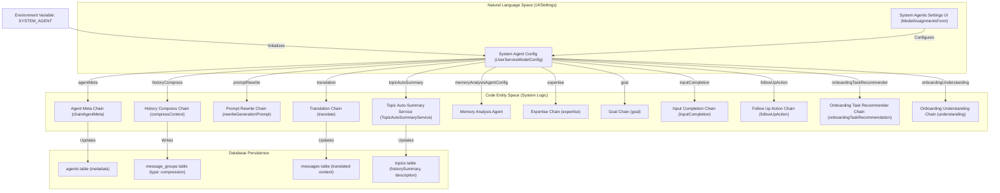
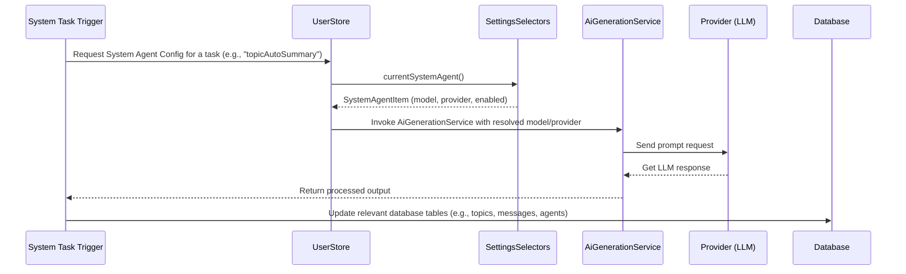

<!-- source: DeepWiki mcp.deepwiki.com · repo lobehub/lobehub · page 4.4 System Agents · fetched 2026-10-29 -->

# System Agents

Relevant source files

The following files were used as context for generating this wiki page:

- [apps/cli/src/commands/task/lifecycle.test.ts](apps/cli/src/commands/task/lifecycle.test.ts)
- [apps/cli/src/commands/task/lifecycle.ts](apps/cli/src/commands/task/lifecycle.ts)
- [apps/server/src/services/taskRunner/buildTaskPrompt.test.ts](apps/server/src/services/taskRunner/buildTaskPrompt.test.ts)
- [apps/server/src/services/taskRunner/buildTaskPrompt.ts](apps/server/src/services/taskRunner/buildTaskPrompt.ts)
- [apps/server/src/services/taskRunner/taskSkill.test.ts](apps/server/src/services/taskRunner/taskSkill.test.ts)
- [apps/server/src/services/verify/__tests__/acceptanceLifecycle.test.ts](apps/server/src/services/verify/__tests__/acceptanceLifecycle.test.ts)
- [apps/server/src/services/verify/__tests__/carryForward.db.test.ts](apps/server/src/services/verify/__tests__/carryForward.db.test.ts)
- [apps/server/src/services/verify/__tests__/carryForward.test.ts](apps/server/src/services/verify/__tests__/carryForward.test.ts)
- [apps/server/src/services/verify/__tests__/driveTaskFromVerify.test.ts](apps/server/src/services/verify/__tests__/driveTaskFromVerify.test.ts)
- [apps/server/src/services/verify/__tests__/evidenceCoverage.test.ts](apps/server/src/services/verify/__tests__/evidenceCoverage.test.ts)
- [apps/server/src/services/verify/__tests__/executor.test.ts](apps/server/src/services/verify/__tests__/executor.test.ts)
- [apps/server/src/services/verify/__tests__/goalReview.test.ts](apps/server/src/services/verify/__tests__/goalReview.test.ts)
- [apps/server/src/services/verify/__tests__/goalReviewEvidence.test.ts](apps/server/src/services/verify/__tests__/goalReviewEvidence.test.ts)
- [apps/server/src/services/verify/__tests__/judgePrompt.test.ts](apps/server/src/services/verify/__tests__/judgePrompt.test.ts)
- [apps/server/src/services/verify/__tests__/lifecycleClaim.test.ts](apps/server/src/services/verify/__tests__/lifecycleClaim.test.ts)
- [apps/server/src/services/verify/__tests__/modelFrames.test.ts](apps/server/src/services/verify/__tests__/modelFrames.test.ts)
- [apps/server/src/services/verify/carryForward.ts](apps/server/src/services/verify/carryForward.ts)
- [apps/server/src/services/verify/evidenceCoverage.ts](apps/server/src/services/verify/evidenceCoverage.ts)
- [apps/server/src/services/verify/executor.ts](apps/server/src/services/verify/executor.ts)
- [apps/server/src/services/verify/goalReview.ts](apps/server/src/services/verify/goalReview.ts)
- [apps/server/src/services/verify/lifecycle.ts](apps/server/src/services/verify/lifecycle.ts)
- [apps/server/src/services/verify/modelFrames.ts](apps/server/src/services/verify/modelFrames.ts)
- [apps/server/src/services/verify/planInstantiation.ts](apps/server/src/services/verify/planInstantiation.ts)
- [apps/server/src/services/verify/repairService.ts](apps/server/src/services/verify/repairService.ts)
- [apps/server/src/services/verify/reviewPredictor.ts](apps/server/src/services/verify/reviewPredictor.ts)
- [apps/server/src/services/verify/settle.ts](apps/server/src/services/verify/settle.ts)
- [locales/en-US/setting.json](locales/en-US/setting.json)
- [locales/zh-CN/setting.json](locales/zh-CN/setting.json)
- [packages/builtin-skills/src/task/SKILL.md](packages/builtin-skills/src/task/SKILL.md)
- [packages/locales/src/default/setting.ts](packages/locales/src/default/setting.ts)
- [packages/prompts/src/chains/verify.test.ts](packages/prompts/src/chains/verify.test.ts)
- [packages/prompts/src/chains/verify.ts](packages/prompts/src/chains/verify.ts)
- [packages/prompts/src/prompts/task/index.test.ts](packages/prompts/src/prompts/task/index.test.ts)
- [packages/prompts/src/prompts/task/index.ts](packages/prompts/src/prompts/task/index.ts)
- [packages/prompts/src/prompts/verify/index.ts](packages/prompts/src/prompts/verify/index.ts)

System Agents are built-in, specialized AI entities within LobeHub designed to handle background tasks and automate specific aspects of the user experience. Unlike standard agents that interact directly with users, System Agents perform autonomous operations such as generating topic summaries, translating content, compressing conversation history, rewriting user prompts for enhanced LLM performance, and analyzing user memory.

## Overview and Configuration

System Agents are globally configured and can be overridden on a per-user or per-agent basis. They are primarily controlled via the `SYSTEM_AGENT` environment variable or through the System Agents settings UI provided in the application.

### Environment Configuration

The `SYSTEM_AGENT` environment variable supports flexible configuration:

1. **Global Default**: Specifying `default=provider/model` (e.g., `default=ollama/deepseek-v3`) applies a catch-all model for all system agent tasks.
2. **Task-Specific Overrides**: Individual keys can override the default per system task, e.g., `topic=openai/gpt-4,translation=anthropic/claude-3`.

System agents and their mapping to keys are defined as a record `{ [key:string]: string }` indicating the model-provider pairing [packages/const/src/settings/systemAgent.ts:12-17, 56-74]().

### Available System Agents

The following system agents are implemented and configurable:

| Key Name                   | Purpose                                                 | Data Target (DB Table/Entity)               | Implementation/Chain          | Tracing Scenario                |
|----------------------------|---------------------------------------------------------|---------------------------------------------|-------------------------------|-------------------------------|
| `agentMeta`                | Generates metadata (title, description, avatar)         | `agents` table                              | `chainAgentMeta`               | `AgentWelcome`                 |
| `expertise`                | Drafts expertise domains and extracts experience        | `expertise` table                           | `expertise`                   | `ExpertiseDomainDraft`, `ExpertiseTopicIngestion` |
| `followUpAction`           | Generates follow-up action suggestions                   | Chat UI                                    | `followUpAction`              | `FollowUp`                    |
| `generationTopic`          | Generates titles for new topics                          | `topics` table                             | `summaryGenerationTitle`      | `TopicTitle`                  |
| `goal`                     | Generates acceptance criteria for goals                 | `goals` table                             | `goal`                       | `GoalCriteriaGen`             |
| `historyCompress`          | Summarizes long-running conversation history             | `message_groups` table (type: compression) | `compressContext`             | N/A                          |
| `inputCompletion`          | Provides user input suggestions                           | Chat input                                 | `inputCompletion`             | `InputCompletion`             |
| `memoryAnalysisAgentConfig`| Analyzes user memory for insights                         | `memories` table                          | N/A                          | `MemoryExtract`               |
| `onboardingTaskRecommender`| Recommends tasks during onboarding                        | `tasks` table                             | `onboardingTaskRecommendation`| `OnboardingTaskRecommendation`|
| `onboardingUnderstanding`  | Synthesizes onboarding evidence                           | `understanding` table                     | `understanding`               | `UnderstandingAnalysis`, `UnderstandingDetailedPersona` |
| `promptRewrite`            | Rewrites user input prompts for optimized retrieval       | Context engineering                        | `rewriteGenerationPrompt`     | N/A                          |
| `thread`                   | Manages conversation threads                             | `threads` table                           | N/A                          | N/A                          |
| `topic`                    | Generates titles and summaries for topics                | `topics` table                           | `summaryTitle`                | `TopicTitle`                  |
| `topicAutoSummary`         | Summarizes inactive topics                                | `topics` table (historySummary, description) | `chainTopicAutoSummary`       | `TopicAutoSummary`            |
| `translation`              | Translates messages content                               | `messages` table                          | `translate`                   | N/A                          |
| `userMemoryEmbedding`      | Generates embeddings for user memory                      | `chunk_embeddings` table                  | N/A                          | N/A                          |
| `userMemoryPersonaWriter`  | Writes personas for user memory                           | `memories` table                          | N/A                          | N/A                          |

Sources:  
- [packages/const/src/settings/systemAgent.ts:12-17,56-74]()  
- [packages/types/src/user/settings/systemAgent.ts:13-39]()  
- [packages/prompts/src/chains/index.ts:1-29]()  
- [apps/server/src/services/topicAutoSummary/index.ts:31-36]()

---

## Data Flow and Implementation

### System Agent Configuration Resolution

The effective model/provider used for a system agent is derived via a hierarchy:

1. **User Settings**: System agent overrides set per user in settings (via UI or API) [src/store/user/slices/settings/action.ts:105-157]().
2. **Environment Variables**: System-wide defaults specified by `SYSTEM_AGENT` environment variable [packages/const/src/settings/systemAgent.ts:56-74]().
3. **Fallback Defaults**: Hardcoded default configuration in the code `DEFAULT_SYSTEM_AGENT_CONFIG` [packages/const/src/settings/systemAgent.ts:56-74]().

The Zustand selector `currentSystemAgent` merges these sources and provides resolved agent configs for runtime usage [src/store/user/slices/settings/selectors/systemAgent.ts:7-8]().

### System Agent Key to Implementation Mapping

Each system agent is backed by a distinct prompt chain or service. The chains are imported from the `packages/prompts/src/chains/` directory (e.g., `chainAgentMeta`, `compressContext`, `rewriteGenerationPrompt`, `translate`) and invoked by their corresponding system agent key at runtime.

### System Agent Configuration to Execution Diagram

Sources:  
- [packages/const/src/settings/systemAgent.ts:56-74]()  
- [packages/types/src/user/settings/systemAgent.ts:13-39]()  
- [src/features/ServiceModel/ModelAssignmentsForm.tsx:39-60]()  
- [packages/prompts/src/chains/index.ts:1-29]()  
- [apps/server/src/services/topicAutoSummary/index.ts:31-36]()

---

### System Agent Execution Flow

The following sequence diagram outlines the runtime data flow for executing a system agent task:

This flow illustrates how system agent configurations resolve at runtime to drive background system tasks through AI prompt chains and persist their outputs in the database.

Sources:  
- [src/store/user/slices/settings/selectors/systemAgent.ts:7-8]()  
- [apps/server/src/services/topicAutoSummary/index.ts:95-119]()  
- [packages/const/src/llmGenerationTracing.ts:9-43]()

---

## User Interface and Localization

System Agents can be customized by users via the dedicated System Agents settings UI, making it possible to change assigned models for specific background tasks without environment variable changes.

### Settings UI

- **ModelAssignmentsForm**: A React component rendering the system agents configuration UI, allowing assignment of different models per system agent key [src/features/ServiceModel/ModelAssignmentsForm.tsx:62-68]().

- The form uses constants arrays `SYSTEM_AGENT_MODEL_ITEMS`, `MEMORY_MODEL_ITEMS`, and `OPTIONAL_FEATURE_ITEMS` to list system agents exposed to users for configuration [src/features/ServiceModel/ModelAssignmentsForm.tsx:39-60]().

- The `updateSystemAgentModel` callback commits changes to the Zustand user store to persist per-user overrides [src/features/ServiceModel/ModelAssignmentsForm.tsx:129-142]().

### Localization

Strings for the system agent UI are localized in the setting.json files:

| Locale    | File                               |
| --------- | --------------------------------- |
| English   | `locales/en-US/setting.json`      |
| Chinese   | `locales/zh-CN/setting.json`      |

The UI uses the `t` function from `react-i18next` to retrieve localized text keys like `systemAgent.agentMeta.title` and similar [src/features/ServiceModel/ModelAssignmentsForm.tsx:194]().

---

## Summary Table of System Agent Properties

| Key                       | Data Target (DB Table)   | Primary Action                                            | Prompt Chain / Service              | Tracing Scenario           |
|---------------------------|-------------------------|-----------------------------------------------------------|-----------------------------------|---------------------------|
| `agentMeta`               | `agents`                | Generates agent metadata (title, description, avatar)     | `chainAgentMeta`                   | `AgentWelcome`             |
| `expertise`               | `expertise`             | Drafts expertise domains and reusable experience           | `expertise`                       | `ExpertiseDomainDraft`, `ExpertiseTopicIngestion` |
| `followUpAction`          | Chat UI                 | Generates follow-up action suggestions                      | `followUpAction`                  | `FollowUp`                 |
| `generationTopic`         | `topics`                | Generates topic titles                                      | `summaryGenerationTitle`          | `TopicTitle`               |
| `goal`                    | `goals`                 | Creates acceptance criteria for goals                       | `goal`                           | `GoalCriteriaGen`          |
| `historyCompress`         | `message_groups`        | Compresses conversation history into message groups         | `compressContext`                | N/A                       |
| `inputCompletion`         | Chat Input              | Provides input suggestions                                  | `inputCompletion`                | `InputCompletion`          |
| `memoryAnalysisAgentConfig`| `memories`             | Analyzes user memory                                        | N/A                              | `MemoryExtract`            |
| `onboardingTaskRecommender`| `tasks`                | Recommends onboarding tasks                                 | `onboardingTaskRecommendation`  | `OnboardingTaskRecommendation` |
| `onboardingUnderstanding` | `understanding`         | Synthesizes onboarding evidence                             | `understanding`                  | `UnderstandingAnalysis`, `UnderstandingDetailedPersona` |
| `promptRewrite`           | Context Engineering     | Rewrites prompts for better RAG retrieval                   | `rewriteGenerationPrompt`        | N/A                       |
| `thread`                  | `threads`               | Manages conversation threads                               | N/A                              | N/A                       |
| `topic`                   | `topics`                | Generates topic titles and summaries                        | `summaryTitle`                  | `TopicTitle`               |
| `topicAutoSummary`        | `topics`                | Summarizes inactive topics                                  | `chainTopicAutoSummary`           | `TopicAutoSummary`         |
| `translation`             | `messages`              | Translates textual content                                  | `translate`                     | N/A                       |
| `userMemoryEmbedding`     | `chunk_embeddings`      | Generates embeddings for user memory                        | N/A                              | N/A                       |
| `userMemoryPersonaWriter` | `memories`              | Writes user memory personas                                 | N/A                              | N/A                       |

Sources:  
- [packages/const/src/settings/systemAgent.ts:56-74]()  
- [packages/types/src/user/settings/systemAgent.ts:13-39]()  
- [packages/prompts/src/chains/index.ts:1-29]()  
- [packages/const/src/llmGenerationTracing.ts:9-43]()  
- [apps/server/src/services/topicAutoSummary/index.ts:56-71]()

---

