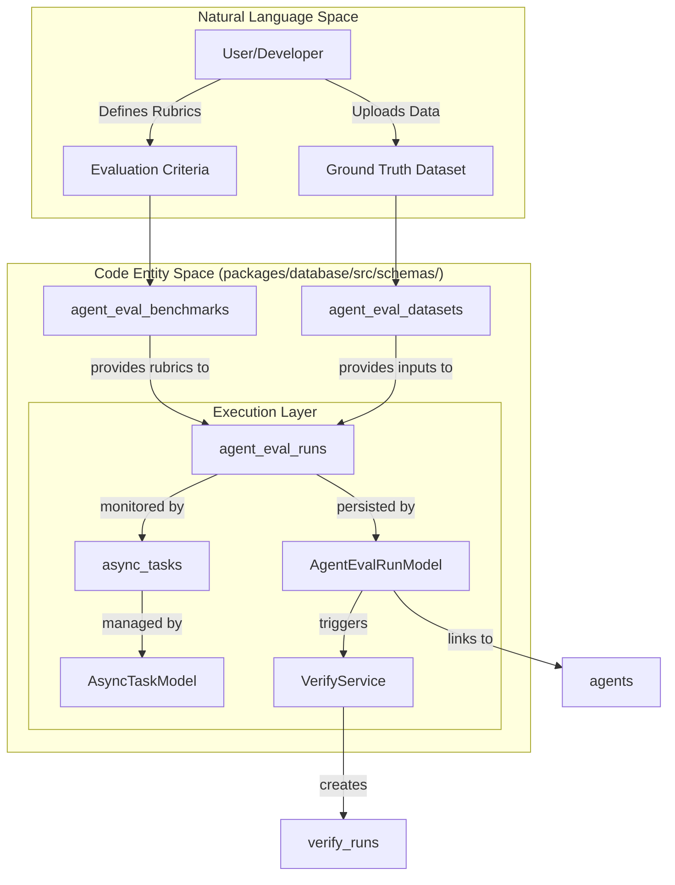
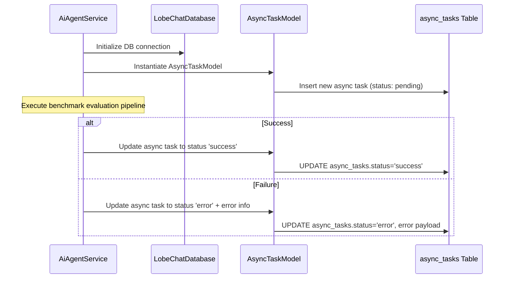
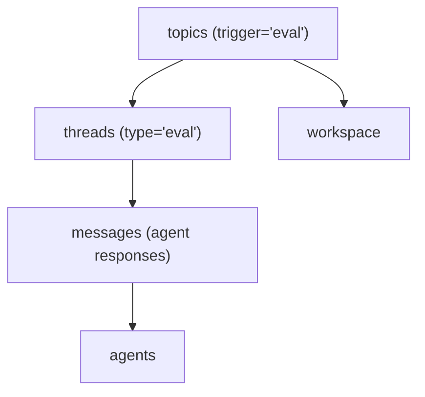
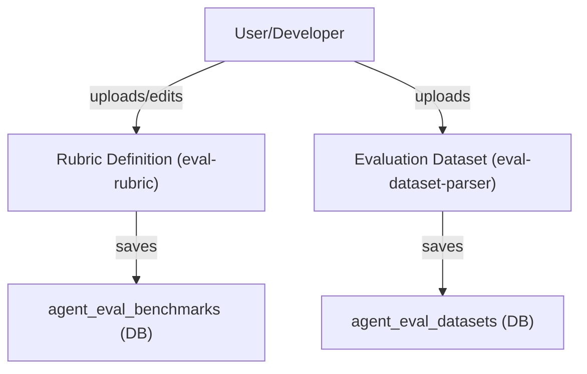
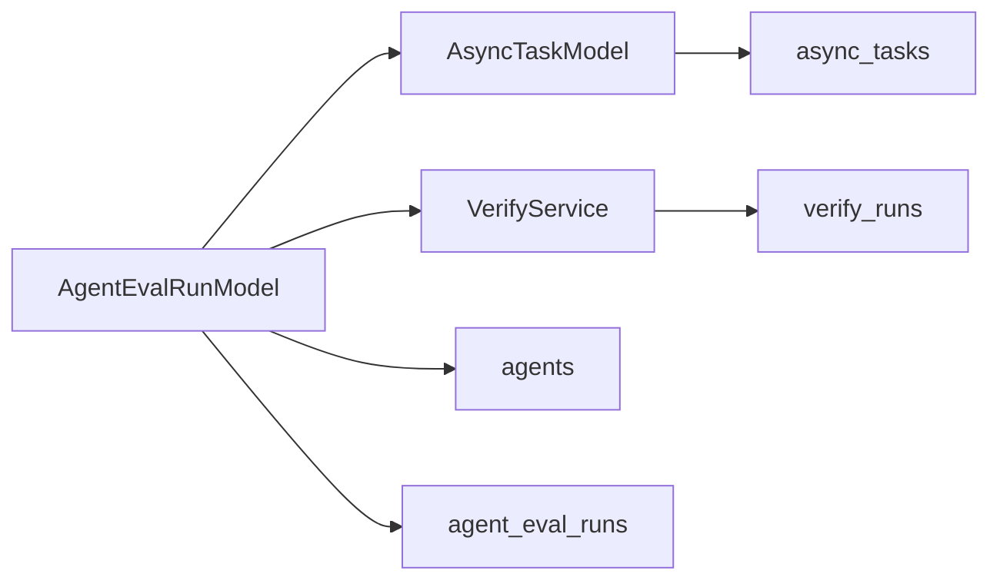

<!-- source: DeepWiki mcp.deepwiki.com · repo lobehub/lobehub · page 4.5 Agent Evaluation System · fetched 2026-10-29 -->

# Agent Evaluation System

Relevant source files

The following files were used as context for generating this wiki page:

- [apps/cli/man/man1/lh.1](apps/cli/man/man1/lh.1)
- [apps/cli/package.json](apps/cli/package.json)
- [apps/cli/src/commands/dashboard.ts](apps/cli/src/commands/dashboard.ts)
- [apps/cli/src/commands/widget.test.ts](apps/cli/src/commands/widget.test.ts)
- [apps/cli/src/commands/widget.ts](apps/cli/src/commands/widget.ts)
- [apps/cli/src/program.ts](apps/cli/src/program.ts)
- [apps/server/src/services/document/__tests__/index.test.ts](apps/server/src/services/document/__tests__/index.test.ts)
- [apps/server/src/services/document/index.ts](apps/server/src/services/document/index.ts)
- [docs/development/database-schema.dbml](docs/development/database-schema.dbml)
- [packages/builtin-skills/src/lobehub/content.ts](packages/builtin-skills/src/lobehub/content.ts)
- [packages/builtin-skills/src/lobehub/index.ts](packages/builtin-skills/src/lobehub/index.ts)
- [packages/builtin-skills/src/lobehub/references/dashboard.ts](packages/builtin-skills/src/lobehub/references/dashboard.ts)
- [packages/database/migrations/0086_video_generation_schema.sql](packages/database/migrations/0086_video_generation_schema.sql)
- [packages/database/migrations/0177_agent_accounts_live_unique_and_goal_subscriptions.sql](packages/database/migrations/0177_agent_accounts_live_unique_and_goal_subscriptions.sql)
- [packages/database/migrations/0180_task_archived_at.sql](packages/database/migrations/0180_task_archived_at.sql)
- [packages/database/migrations/meta/0086_snapshot.json](packages/database/migrations/meta/0086_snapshot.json)
- [packages/database/migrations/meta/0177_snapshot.json](packages/database/migrations/meta/0177_snapshot.json)
- [packages/database/migrations/meta/0180_snapshot.json](packages/database/migrations/meta/0180_snapshot.json)
- [packages/database/migrations/meta/_journal.json](packages/database/migrations/meta/_journal.json)
- [packages/database/src/models/__tests__/agentAccount.test.ts](packages/database/src/models/__tests__/agentAccount.test.ts)
- [packages/database/src/models/__tests__/document.test.ts](packages/database/src/models/__tests__/document.test.ts)
- [packages/database/src/models/__tests__/drizzleMigration.test.ts](packages/database/src/models/__tests__/drizzleMigration.test.ts)
- [packages/database/src/models/__tests__/topics/topic.create.test.ts](packages/database/src/models/__tests__/topics/topic.create.test.ts)
- [packages/database/src/models/agentAccount.ts](packages/database/src/models/agentAccount.ts)
- [packages/database/src/models/document.ts](packages/database/src/models/document.ts)
- [packages/database/src/schemas/agent.ts](packages/database/src/schemas/agent.ts)
- [packages/database/src/schemas/agentAccount.ts](packages/database/src/schemas/agentAccount.ts)
- [packages/database/src/schemas/agentCronJob.ts](packages/database/src/schemas/agentCronJob.ts)
- [packages/database/src/schemas/apiKey.ts](packages/database/src/schemas/apiKey.ts)
- [packages/database/src/schemas/asyncTask.ts](packages/database/src/schemas/asyncTask.ts)
- [packages/database/src/schemas/chatGroup.ts](packages/database/src/schemas/chatGroup.ts)
- [packages/database/src/schemas/file.ts](packages/database/src/schemas/file.ts)
- [packages/database/src/schemas/generation.ts](packages/database/src/schemas/generation.ts)
- [packages/database/src/schemas/goalSubscription.ts](packages/database/src/schemas/goalSubscription.ts)
- [packages/database/src/schemas/index.ts](packages/database/src/schemas/index.ts)
- [packages/database/src/schemas/message.ts](packages/database/src/schemas/message.ts)
- [packages/database/src/schemas/rag.ts](packages/database/src/schemas/rag.ts)
- [packages/database/src/schemas/relations.ts](packages/database/src/schemas/relations.ts)
- [packages/database/src/schemas/session.ts](packages/database/src/schemas/session.ts)
- [packages/database/src/schemas/task.ts](packages/database/src/schemas/task.ts)
- [packages/database/src/schemas/topic.ts](packages/database/src/schemas/topic.ts)
- [packages/database/src/utils/idGenerator.ts](packages/database/src/utils/idGenerator.ts)
- [packages/heterogeneous-agents/src/protocol/lobeHubCliGuide.ts](packages/heterogeneous-agents/src/protocol/lobeHubCliGuide.ts)
- [packages/types/src/goalSubscription.ts](packages/types/src/goalSubscription.ts)
- [packages/types/src/index.ts](packages/types/src/index.ts)

The Agent Evaluation System in LobeHub is a comprehensive framework designed to rigorously assess AI agents' performance, accuracy, and reliability against structured datasets and defined evaluation rubrics. It integrates with the larger LobeHub ecosystem and provides tools for dataset management, rubric definition, run tracking, verification, and benchmark execution. This page documents the detailed schema definitions, packages involved (`eval-rubric`, `eval-dataset-parser`), how evaluation runs are managed asynchronously, and the architecture of the benchmark evaluation pipeline.

---

## Overview

The primary goal of the Agent Evaluation System is to support systematic evaluation workflows that measure how well AI agents perform on benchmark datasets using predefined scoring rubrics. It enables:

- Defining **evaluation benchmarks** with rubrics (criteria and scoring rules).
- Managing **evaluation datasets** containing input prompts and ground truths.
- Tracking **evaluation runs** with detailed progress and results.
- Leveraging the **Verify subsystem** for criteria-based checks.
- Executing benchmarks efficiently with **asyncTasks** for concurrency and robustness.
  
This system supports multi-tenant isolation via workspace scoping and integrates tightly with agent, topic, and message models for full traceability.

---

## System Architecture and Data Flow

The evaluation workflow involves multiple entities interacting from natural language concepts (benchmarks, datasets, rubrics) down to database tables and async task models. Below is a detailed system architecture diagram linking these elements:

**Explanation:**

- **User/Developer**: Creates rubrics and uploads datasets defining the ground truth.
- **agent_eval_benchmarks**: Stores rubrics and metadata for benchmarks.
- **agent_eval_datasets**: Stores input-output pairs for testing.
- **agent_eval_runs**: Records individual evaluation runs linking benchmarks and datasets.
- **async_tasks**: Tracks the lifecycle of evaluation runs as asynchronous background jobs.
- **AsyncTaskModel**: Manages async tasks in code.
- **AgentEvalRunModel**: Provides persistence and business logic for evaluation runs.
- **VerifyService**: Runs verification checks against agent outputs per rubric.
- **agents**: Agents under evaluation are referenced.
- **verify_runs**: Stores verification results per run.

Sources: [packages/database/src/schemas/index.ts:5-15](), [docs/development/database-schema.dbml:191-200](), [apps/server/src/services/agentEvalRun/index.ts:1-10]()

---

## Core Schema Definitions

The evaluation system relies on several database tables managed by Drizzle ORM to represent benchmarks, datasets, evaluation runs, and asynchronous tasks. These are defined primarily under the `schemas` directory.

### agent_eval_benchmarks

This table stores evaluation benchmark definitions, including scoring rubrics.

| Column       | Type    | Description                                               |
|--------------|---------|-----------------------------------------------------------|
| identifier   | text    | Unique ID for the benchmark                                |
| rubrics      | jsonb   | JSON structure defining criteria and scoring rules        |
| is_system    | boolean | Flag indicating if this is a built-in LobeHub benchmark   |

This schema ensures flexible rubric definition that guides scoring and verification.

Sources: [docs/development/database-schema.dbml:191-200]()

### agent_eval_datasets

Contains evaluation datasets made up of prompt-answer pairs or similar structured data used as ground truth for testing agents.

- Associated with users and optionally scoped to workspaces.
- Includes metadata and content for evaluation.

Sources: [packages/database/src/schemas/index.ts:7](), [docs/development/database-schema.dbml:182-194]()

### agent_eval_runs

Tracks each run of an evaluation benchmark against a dataset by a particular agent.

- Stores metrics, status, errors, and links the run to asyncTasks for lifecycle management.
- Tracks user, workspace, and agent context for multi-tenant isolation.

### async_tasks

Since evaluation runs often involve long-running LLM calls, evaluations are tracked as async tasks with statuses such as:

| Status      | Description                          |
|-------------|-------------------------------------|
| pending     | Task created, waiting to execute    |
| processing  | Task in progress                    |
| success     | Task completed successfully        |
| error       | Task failed with error information |

Sources: [packages/database/src/schemas/asyncTask.ts:1-20]()

---

## Evaluation Run Tracking and Execution

Evaluation runs are submitted and tracked as asynchronous background jobs to accommodate latency and retries.

### Async Task Lifecycle

### Business Logic Flow

- The evaluation run model (`AgentEvalRunModel`) creates a new entry representing the run.
- An associated async task is created marking it as pending.
- The run executes, invoking agents with evaluation prompts.
- Verification checks validate the outputs using the `VerifyService`.
- Final status and results are persisted, signaling run completion.

Sources: [apps/server/src/services/agentEvalRun/index.ts:1-10](), [packages/database/src/schemas/asyncTask.ts:1-20]()

---

## Rubrics and Dataset Parsing

Two dedicated packages facilitate evaluation definitions:

- **`eval-rubric`**: Defines rubrics specifying criteria, scoring logic, and how to interpret agent outputs against expectations. This package serves as the canonical source for benchmark rules.
- **`eval-dataset-parser`**: Parses and validates evaluation datasets, ensuring data formats align with the expected structure for evaluation runs.

Both packages ensure consistent, repeatable evaluation workflows by formalizing inputs and expected outputs.

Sources: Package documentation and usage in `agentEvalRun` service (not shown in code excerpts).

---

## Benchmark Evaluation Pipeline and Conversation Hierarchy

Evaluation runs are represented in the conversation data model by isolating evaluation data into dedicated topics, threads, and messages to avoid contaminating user data.

### Conversation Entities in Evaluation

| Entity              | Description                                                |
|---------------------|------------------------------------------------------------|
| **Topic**           | A conversation topic created specifically with trigger `eval` for benchmark runs. Acts as the container of evaluation communication. |
| **Thread**          | A thread within the topic that uses the type `eval`. It scopes messages related to evaluation execution. |
| **Message**         | Messages linked to the agent and thread store agent responses, prompts, and evaluation results. |

### Database Tables and Attributes

- `topics.trigger = 'eval'` identifies evaluation benchmark topics.
- `threads.type = 'eval'` segregates evaluation threads.
- Messages store detailed input/output per run.

### Diagram: Conversation Hierarchy for Evaluations

This separation supports clear tracking and aggregation of evaluation data and statistics without mixing them with standard conversations.

Sources: [packages/database/src/schemas/topic.ts:27-121](), [packages/database/src/schemas/topic.ts:127-139](), [packages/database/src/schemas/message.ts:1-10](), [packages/database/src/schemas/agent.ts:36-36]()

---

## Multi-Model Comparison via Message Groups

The system supports testing multiple AI models simultaneously on evaluation prompts for direct output comparison, leveraging the `messageGroups` schema. The evaluation lifecycle uses the AI agent service that handles multi-model dispatch and collection of outputs.

This feature enhances benchmarking by experimenting with different AI backends or configurations in parallel.

Sources: [apps/server/src/routers/lambda/aiChat.ts:1-10]()

---

## Workspace and Identity Scoping

All evaluation artifacts are scoped by user and workspace. This ensures multi-tenant safety, data isolation, and permission enforcement.

- `workspace_id` column on benchmarks, datasets, runs, topics, and threads.
- Agent and user context enforced for all queries.

Sources: [docs/development/database-schema.dbml:191-200](), [packages/database/src/schemas/topic.ts:27-121](), [packages/database/src/schemas/agent.ts:36-36]()

---

## Summary

The Agent Evaluation System is a robust, well-integrated subsystem in LobeHub providing:

- Structured **benchmark definition** with rubrics.
- Managed **datasets** of evaluation inputs and expected output.
- Persistent **run tracking** via `agent_eval_runs` and async task management.
- Execution isolation in conversation hierarchy (`topics` and `threads` with `eval` designators).
- Built-in verification with `VerifyService` for granular criteria checks.
- Support for multi-model side-by-side evaluation.
- Workspace-aware multi-tenancy with database-enforced scoping.

This system enables continuous benchmarking, automated verification, and deeper insights into how AI agents behave on standard datasets.

---

# Technical References and Source Files

- Database schemas and index exports for eval tables: [packages/database/src/schemas/index.ts:5-15]()
- Database schema DBML detailing eval tables: [docs/development/database-schema.dbml:191-200]()
- Async task schema and lifecycle: [packages/database/src/schemas/asyncTask.ts:1-20]()
- Topic and thread schema defining eval conversation separation: [packages/database/src/schemas/topic.ts:27-121](), [packages/database/src/schemas/topic.ts:127-139]()
- AI agent evaluation run service partial logic: [apps/server/src/services/agentEvalRun/index.ts:1-10]()
- CLI eval command registration for management: [apps/cli/src/program.ts:15-125]()
- Multi-model comparison usage in AI chat lambda router: [apps/server/src/routers/lambda/aiChat.ts:1-10]()

---

# Additional Diagrams Bridging Concepts to Code

### 1. Rubrics and Dataset Management Mapping

### 2. Evaluation Run and Verification Flow

---

# See Also

- [4.11 Verification and Delivery Checks (Verify)](4.11)
- [4.1 Agent Configuration and Builder](4.1)
- [4.6 Agent Runtime and Execution Engine](4.6)
- CLI Eval commands for management: [apps/cli/src/program.ts]()

---

**Sources:**

- [packages/database/src/schemas/index.ts:5-15]()
- [docs/development/database-schema.dbml:191-200]()
- [packages/database/src/schemas/asyncTask.ts:1-20]()
- [packages/database/src/schemas/topic.ts:27-121]()
- [packages/database/src/schemas/topic.ts:127-139]()
- [apps/server/src/services/agentEvalRun/index.ts:1-10]()
- [apps/server/src/routers/lambda/aiChat.ts:1-10]()
- [apps/cli/src/program.ts:15-125]()

---

