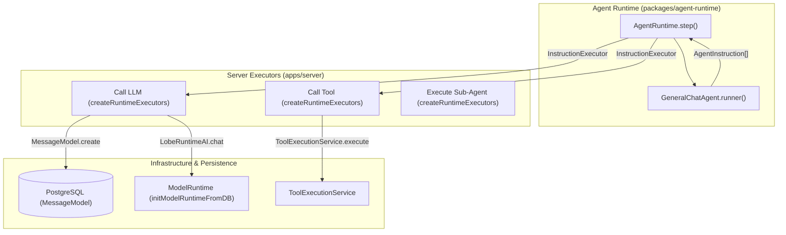
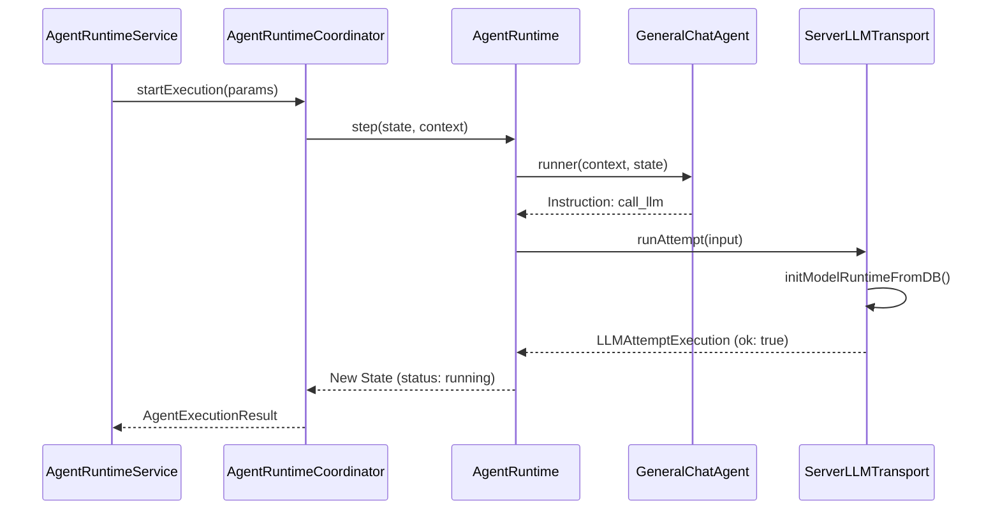
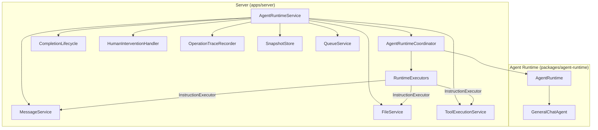

<!-- source: DeepWiki mcp.deepwiki.com · repo lobehub/lobehub · page 4.6 Agent Runtime and Execution Engine · fetched 2026-10-29 -->

# Agent Runtime and Execution Engine

<details>
<summary>Relevant source files</summary>

The following files were used as context for generating this wiki page:

- [apps/server/src/modules/AgentRuntime/RuntimeExecutors.ts](apps/server/src/modules/AgentRuntime/RuntimeExecutors.ts)
- [apps/server/src/modules/AgentRuntime/__tests__/RuntimeExecutors.test.ts](apps/server/src/modules/AgentRuntime/__tests__/RuntimeExecutors.test.ts)
- [apps/server/src/modules/AgentRuntime/adapters/ServerLLMTransport.ts](apps/server/src/modules/AgentRuntime/adapters/ServerLLMTransport.ts)
- [apps/server/src/modules/AgentRuntime/adapters/ServerMessageTransport.test.ts](apps/server/src/modules/AgentRuntime/adapters/ServerMessageTransport.test.ts)
- [apps/server/src/modules/AgentRuntime/adapters/ServerMessageTransport.ts](apps/server/src/modules/AgentRuntime/adapters/ServerMessageTransport.ts)
- [apps/server/src/modules/AgentRuntime/adapters/ServerOperationStore.test.ts](apps/server/src/modules/AgentRuntime/adapters/ServerOperationStore.test.ts)
- [apps/server/src/modules/AgentRuntime/adapters/ServerOperationStore.ts](apps/server/src/modules/AgentRuntime/adapters/ServerOperationStore.ts)
- [apps/server/src/modules/AgentRuntime/adapters/ServerStreamSink.ts](apps/server/src/modules/AgentRuntime/adapters/ServerStreamSink.ts)
- [apps/server/src/modules/AgentRuntime/buildHost.ts](apps/server/src/modules/AgentRuntime/buildHost.ts)
- [apps/server/src/modules/AgentRuntime/executorHelpers.ts](apps/server/src/modules/AgentRuntime/executorHelpers.ts)
- [apps/server/src/routers/lambda/__tests__/agentNotify.test.ts](apps/server/src/routers/lambda/__tests__/agentNotify.test.ts)
- [apps/server/src/routers/lambda/agentNotify.ts](apps/server/src/routers/lambda/agentNotify.ts)
- [apps/server/src/routers/lambda/aiAgent.ts](apps/server/src/routers/lambda/aiAgent.ts)
- [apps/server/src/services/agentRuntime/AgentRuntimeService.test.ts](apps/server/src/services/agentRuntime/AgentRuntimeService.test.ts)
- [apps/server/src/services/agentRuntime/AgentRuntimeService.ts](apps/server/src/services/agentRuntime/AgentRuntimeService.ts)
- [apps/server/src/services/agentRuntime/CompletionLifecycle.ts](apps/server/src/services/agentRuntime/CompletionLifecycle.ts)
- [apps/server/src/services/agentRuntime/__tests__/CompletionLifecycle.test.ts](apps/server/src/services/agentRuntime/__tests__/CompletionLifecycle.test.ts)
- [apps/server/src/services/agentRuntime/__tests__/CompletionLifecycle.workAnchors.integration.test.ts](apps/server/src/services/agentRuntime/__tests__/CompletionLifecycle.workAnchors.integration.test.ts)
- [apps/server/src/services/agentRuntime/types.ts](apps/server/src/services/agentRuntime/types.ts)
- [apps/server/src/services/aiAgent/__tests__/execAgent.builtinRuntime.test.ts](apps/server/src/services/aiAgent/__tests__/execAgent.builtinRuntime.test.ts)
- [apps/server/src/services/aiAgent/__tests__/execAgent.heteroFiles.test.ts](apps/server/src/services/aiAgent/__tests__/execAgent.heteroFiles.test.ts)
- [apps/server/src/services/aiAgent/__tests__/execAgent.resumeToolResult.test.ts](apps/server/src/services/aiAgent/__tests__/execAgent.resumeToolResult.test.ts)
- [apps/server/src/services/aiAgent/__tests__/execAgent.threadId.test.ts](apps/server/src/services/aiAgent/__tests__/execAgent.threadId.test.ts)
- [apps/server/src/services/aiAgent/__tests__/execSubAgent.test.ts](apps/server/src/services/aiAgent/__tests__/execSubAgent.test.ts)
- [apps/server/src/services/aiAgent/index.ts](apps/server/src/services/aiAgent/index.ts)
- [apps/server/src/services/aiAgent/pipeline/__tests__/historyMessagesLoader.test.ts](apps/server/src/services/aiAgent/pipeline/__tests__/historyMessagesLoader.test.ts)
- [apps/server/src/services/aiAgent/pipeline/heteroDispatch.ts](apps/server/src/services/aiAgent/pipeline/heteroDispatch.ts)
- [apps/server/src/services/aiAgent/pipeline/operationPrep.ts](apps/server/src/services/aiAgent/pipeline/operationPrep.ts)
- [apps/server/src/services/aiAgent/pipeline/startOperation.ts](apps/server/src/services/aiAgent/pipeline/startOperation.ts)
- [apps/server/src/services/aiAgent/pipeline/turnSetup.ts](apps/server/src/services/aiAgent/pipeline/turnSetup.ts)
- [apps/server/src/services/aiAgent/subAgentRuns.ts](apps/server/src/services/aiAgent/subAgentRuns.ts)
- [apps/server/src/services/aiAgent/types.ts](apps/server/src/services/aiAgent/types.ts)
- [apps/server/src/services/bot/AgentBridgeService.ts](apps/server/src/services/bot/AgentBridgeService.ts)
- [apps/server/src/services/bot/BotCallbackService.ts](apps/server/src/services/bot/BotCallbackService.ts)
- [apps/server/src/services/bot/BotMessageRouter.ts](apps/server/src/services/bot/BotMessageRouter.ts)
- [apps/server/src/services/bot/__tests__/AgentBridgeService.test.ts](apps/server/src/services/bot/__tests__/AgentBridgeService.test.ts)
- [apps/server/src/services/bot/__tests__/BotCallbackService.test.ts](apps/server/src/services/bot/__tests__/BotCallbackService.test.ts)
- [apps/server/src/services/bot/__tests__/BotMessageRouter.test.ts](apps/server/src/services/bot/__tests__/BotMessageRouter.test.ts)
- [apps/server/src/services/bot/__tests__/formatPrompt.test.ts](apps/server/src/services/bot/__tests__/formatPrompt.test.ts)
- [apps/server/src/services/bot/__tests__/renderThrownError.test.ts](apps/server/src/services/bot/__tests__/renderThrownError.test.ts)
- [apps/server/src/services/bot/__tests__/replyTemplate.test.ts](apps/server/src/services/bot/__tests__/replyTemplate.test.ts)
- [apps/server/src/services/bot/formatPrompt.ts](apps/server/src/services/bot/formatPrompt.ts)
- [apps/server/src/services/bot/isWholeGroupChatThreadId.test.ts](apps/server/src/services/bot/isWholeGroupChatThreadId.test.ts)
- [apps/server/src/services/bot/isWholeGroupChatThreadId.ts](apps/server/src/services/bot/isWholeGroupChatThreadId.ts)
- [apps/server/src/services/bot/platforms/attachmentDelivery.test.ts](apps/server/src/services/bot/platforms/attachmentDelivery.test.ts)
- [apps/server/src/services/bot/platforms/attachmentDelivery.ts](apps/server/src/services/bot/platforms/attachmentDelivery.ts)
- [apps/server/src/services/bot/platforms/chatSdkContract.test.ts](apps/server/src/services/bot/platforms/chatSdkContract.test.ts)
- [apps/server/src/services/bot/platforms/discord/client.test.ts](apps/server/src/services/bot/platforms/discord/client.test.ts)
- [apps/server/src/services/bot/platforms/discord/client.ts](apps/server/src/services/bot/platforms/discord/client.ts)
- [apps/server/src/services/bot/platforms/discord/mentions.test.ts](apps/server/src/services/bot/platforms/discord/mentions.test.ts)
- [apps/server/src/services/bot/platforms/discord/mentions.ts](apps/server/src/services/bot/platforms/discord/mentions.ts)
- [apps/server/src/services/bot/platforms/discord/patch/forwardedInteractions.test.ts](apps/server/src/services/bot/platforms/discord/patch/forwardedInteractions.test.ts)
- [apps/server/src/services/bot/platforms/discord/patch/forwardedInteractions.ts](apps/server/src/services/bot/platforms/discord/patch/forwardedInteractions.ts)
- [apps/server/src/services/bot/platforms/discord/patch/index.ts](apps/server/src/services/bot/platforms/discord/patch/index.ts)
- [apps/server/src/services/bot/platforms/telegram/client.test.ts](apps/server/src/services/bot/platforms/telegram/client.test.ts)
- [apps/server/src/services/bot/platforms/telegram/client.ts](apps/server/src/services/bot/platforms/telegram/client.ts)
- [apps/server/src/services/bot/platforms/telegram/helpers.test.ts](apps/server/src/services/bot/platforms/telegram/helpers.test.ts)
- [apps/server/src/services/bot/platforms/telegram/helpers.ts](apps/server/src/services/bot/platforms/telegram/helpers.ts)
- [apps/server/src/services/bot/platforms/types.ts](apps/server/src/services/bot/platforms/types.ts)
- [apps/server/src/services/bot/renderThrownError.ts](apps/server/src/services/bot/renderThrownError.ts)
- [apps/server/src/services/bot/replyTemplate.ts](apps/server/src/services/bot/replyTemplate.ts)
- [apps/server/src/services/messenger/MessengerRouter.test.ts](apps/server/src/services/messenger/MessengerRouter.test.ts)
- [apps/server/src/services/messenger/MessengerRouter.ts](apps/server/src/services/messenger/MessengerRouter.ts)
- [apps/server/src/services/messenger/systemReply.ts](apps/server/src/services/messenger/systemReply.ts)
- [apps/server/src/services/messenger/types.ts](apps/server/src/services/messenger/types.ts)
- [apps/server/src/services/toolExecution/serverRuntimes/__tests__/groupManagement.test.ts](apps/server/src/services/toolExecution/serverRuntimes/__tests__/groupManagement.test.ts)
- [apps/server/src/services/toolExecution/serverRuntimes/groupManagement.ts](apps/server/src/services/toolExecution/serverRuntimes/groupManagement.ts)
- [apps/server/src/services/toolExecution/types.ts](apps/server/src/services/toolExecution/types.ts)
- [apps/server/src/services/workRegistration/registerWorksForOperation.test.ts](apps/server/src/services/workRegistration/registerWorksForOperation.test.ts)
- [apps/server/src/services/workRegistration/registerWorksForOperation.ts](apps/server/src/services/workRegistration/registerWorksForOperation.ts)
- [packages/agent-runtime/src/agents/GeneralChatAgent.ts](packages/agent-runtime/src/agents/GeneralChatAgent.ts)
- [packages/agent-runtime/src/agents/__tests__/GeneralChatAgent.test.ts](packages/agent-runtime/src/agents/__tests__/GeneralChatAgent.test.ts)
- [packages/agent-runtime/src/agents/index.ts](packages/agent-runtime/src/agents/index.ts)
- [packages/agent-runtime/src/core/__tests__/asyncToolPauseInstructions.test.ts](packages/agent-runtime/src/core/__tests__/asyncToolPauseInstructions.test.ts)
- [packages/agent-runtime/src/core/__tests__/runtime.test.ts](packages/agent-runtime/src/core/__tests__/runtime.test.ts)
- [packages/agent-runtime/src/core/runtime.ts](packages/agent-runtime/src/core/runtime.ts)
- [packages/agent-runtime/src/executors/callLlm.test.ts](packages/agent-runtime/src/executors/callLlm.test.ts)
- [packages/agent-runtime/src/executors/callLlm.ts](packages/agent-runtime/src/executors/callLlm.ts)
- [packages/agent-runtime/src/executors/callLlmFinalizer.test.ts](packages/agent-runtime/src/executors/callLlmFinalizer.test.ts)
- [packages/agent-runtime/src/executors/callLlmFinalizer.ts](packages/agent-runtime/src/executors/callLlmFinalizer.ts)
- [packages/agent-runtime/src/executors/finish.ts](packages/agent-runtime/src/executors/finish.ts)
- [packages/agent-runtime/src/executors/index.ts](packages/agent-runtime/src/executors/index.ts)
- [packages/agent-runtime/src/transport/host.ts](packages/agent-runtime/src/transport/host.ts)
- [packages/agent-runtime/src/transport/index.ts](packages/agent-runtime/src/transport/index.ts)
- [packages/agent-runtime/src/transport/llm.ts](packages/agent-runtime/src/transport/llm.ts)
- [packages/agent-runtime/src/transport/message.ts](packages/agent-runtime/src/transport/message.ts)
- [packages/agent-runtime/src/transport/operation.ts](packages/agent-runtime/src/transport/operation.ts)
- [packages/agent-runtime/src/transport/stream.ts](packages/agent-runtime/src/transport/stream.ts)
- [packages/agent-runtime/src/types/generalAgent.ts](packages/agent-runtime/src/types/generalAgent.ts)
- [packages/agent-runtime/src/types/hooks.ts](packages/agent-runtime/src/types/hooks.ts)
- [packages/agent-runtime/src/types/index.ts](packages/agent-runtime/src/types/index.ts)
- [packages/agent-runtime/src/types/instruction.ts](packages/agent-runtime/src/types/instruction.ts)
- [packages/agent-runtime/src/types/state.ts](packages/agent-runtime/src/types/state.ts)
- [packages/agent-runtime/src/utils/toolCallRepeatGuard.test.ts](packages/agent-runtime/src/utils/toolCallRepeatGuard.test.ts)
- [packages/agent-runtime/src/utils/toolCallRepeatGuard.ts](packages/agent-runtime/src/utils/toolCallRepeatGuard.ts)
- [packages/context-engine/src/engine/tools/ToolNameResolver.ts](packages/context-engine/src/engine/tools/ToolNameResolver.ts)
- [packages/context-engine/src/engine/tools/__tests__/ToolNameResolver.config.test.ts](packages/context-engine/src/engine/tools/__tests__/ToolNameResolver.config.test.ts)
- [packages/context-engine/src/engine/tools/__tests__/ToolNameResolver.test.ts](packages/context-engine/src/engine/tools/__tests__/ToolNameResolver.test.ts)
- [packages/context-engine/src/engine/tools/index.ts](packages/context-engine/src/engine/tools/index.ts)
- [packages/context-engine/src/processors/DisabledToolCallFilter.ts](packages/context-engine/src/processors/DisabledToolCallFilter.ts)
- [packages/context-engine/src/providers/ModelInfoProvider.ts](packages/context-engine/src/providers/ModelInfoProvider.ts)
- [packages/context-engine/src/providers/__tests__/ModelInfoProvider.test.ts](packages/context-engine/src/providers/__tests__/ModelInfoProvider.test.ts)
- [packages/database/src/models/__tests__/messages/message.operationLookup.test.ts](packages/database/src/models/__tests__/messages/message.operationLookup.test.ts)
- [packages/heterogeneous-agents/src/attachedFiles.test.ts](packages/heterogeneous-agents/src/attachedFiles.test.ts)
- [packages/heterogeneous-agents/src/attachedFiles.ts](packages/heterogeneous-agents/src/attachedFiles.ts)
- [packages/types/src/agentExecution/index.ts](packages/types/src/agentExecution/index.ts)
- [packages/types/src/topic/topic.test.ts](packages/types/src/topic/topic.test.ts)
- [src/features/Electron/HeterogeneousAgent/RestartRecovery/recoverInterruptedRuns.test.ts](src/features/Electron/HeterogeneousAgent/RestartRecovery/recoverInterruptedRuns.test.ts)
- [src/features/Electron/HeterogeneousAgent/RestartRecovery/recoverInterruptedRuns.ts](src/features/Electron/HeterogeneousAgent/RestartRecovery/recoverInterruptedRuns.ts)
- [src/services/aiAgent.ts](src/services/aiAgent.ts)
- [src/store/chat/agents/StreamingHandler.test.ts](src/store/chat/agents/StreamingHandler.test.ts)
- [src/store/chat/agents/StreamingHandler.ts](src/store/chat/agents/StreamingHandler.ts)
- [src/store/chat/agents/types/streaming.ts](src/store/chat/agents/types/streaming.ts)
- [src/store/chat/slices/agentRun/actions/__tests__/conversationLifecycle.test.ts](src/store/chat/slices/agentRun/actions/__tests__/conversationLifecycle.test.ts)
- [src/store/chat/slices/agentRun/actions/__tests__/gateway.test.ts](src/store/chat/slices/agentRun/actions/__tests__/gateway.test.ts)
- [src/store/chat/slices/agentRun/actions/entries/conversationLifecycle.ts](src/store/chat/slices/agentRun/actions/entries/conversationLifecycle.ts)
- [src/store/chat/slices/agentRun/actions/transports/gateway/gateway.ts](src/store/chat/slices/agentRun/actions/transports/gateway/gateway.ts)

</details>


The **Agent Runtime** is the foundational execution engine of LobeHub, enabling multi-step agentic workflows by bridging agent logic, external tool execution, and persistence layers. This runtime manages the decision-making loop of agents like `GeneralChatAgent`, interprets their instructions, and invokes platform-specific executors on the server.

---

## 1. Core Architecture

The runtime is organized as two key components:

- **GeneralChatAgent (Agent Logic)**: Implements the core decision loop — processing user input, invoking LLM calls, tool executions, handling human intervention, and managing context compression. It determines the instructions to be executed.  
  Defined in `packages/agent-runtime/src/agents/GeneralChatAgent.ts` [lines 1-156]().

- **AgentRuntime (Execution Engine)**: A stateless engine that executes instructions from the agent. It uses a registry of `InstructionExecutor` functions to perform specific actions such as invoking language models, tools, or managing completion.  
  Defined in `packages/agent-runtime/src/core/runtime.ts` [lines 27-53]().

### Execution Flow – Instructions and Executors

The runtime processes a sequential list of instructions returned by the agent's runner. Each instruction corresponds to an action in the agent's workflow.



This design cleanly separates domain logic (agent decision-making) from infrastructure concerns (database, APIs, long-running execution).

**Sources:**
- `packages/agent-runtime/src/core/runtime.ts:27-53`()
- `packages/agent-runtime/src/agents/GeneralChatAgent.ts:1-156`()
- `apps/server/src/modules/AgentRuntime/RuntimeExecutors.ts:9-13`()

---

## 2. Instruction Types and Executors

### Common Instruction Types

| Instruction Type            | Description                                                | Executor Location                                                  |
| -------------------------- | ---------------------------------------------------------- | ----------------------------------------------------------------- |
| `call_llm`                 | Invokes the language model with prepared context messages. | `packages/agent-runtime/src/executors/callLlm.ts`                 |
| `call_tool`                | Triggers the execution of a tool or plugin command.         | `packages/agent-runtime/src/executors/tool.ts`                    |
| `finish`                   | Terminates the current execution with a final status.       | `packages/agent-runtime/src/executors/finish.ts`                  |
| `request_human_approve`    | Pauses to wait for human approval on a tool call.           | `packages/agent-runtime/src/executors/humanApprove.ts`            |
| `compress_context`         | Initiates summarization or truncation of conversation.      | `packages/agent-runtime/src/executors/compressContext.ts`         |
| `exec_sub_agents`          | Runs sub-agents within multi-agent workflows.                | See `packages/agent-runtime/src/types/instruction.ts` [160-186]() |

### Host and Transport Abstractions

The instruction executors operate via an environment-abstracted `AgentRuntimeHost`. This host injects dependencies like message persistence, LLM transport, and tool execution in a way that lets the core runtime be platform-agnostic.

- **Server Host Build**: The server constructs this host using `buildHost()` [apps/server/src/modules/AgentRuntime/buildHost.ts:26-69](), which provides adapters to real services like `ServerLLMTransport` and `ServerMessageTransport`.
- **Tool Name Resolution**: Tools are namespaced internally with `PLUGIN_SCHEMA_SEPARATOR` (____) to avoid collisions and platform limits, particularly important when using OpenAI that limits function name lengths. [packages/context-engine/src/engine/tools/ToolNameResolver.ts:9-17]()

**Sources:**
- `apps/server/src/modules/AgentRuntime/buildHost.ts:26-69`()
- `packages/agent-runtime/src/transport/host.ts:1-20`()
- `packages/context-engine/src/engine/tools/ToolNameResolver.ts:92-122`()

---

## 3. The Execution Engine (`AgentRuntime`)

`AgentRuntime` orchestrates a single step of agent execution, receiving the current `AgentState` and returning an updated state plus any emitted events.

### Step Method Workflow

The main method `step()` performs:

1. Calls the agent's runner function to get an array of instructions:   
   `instructions = this.agent.runner(context, state)` [packages/agent-runtime/src/core/runtime.ts:114-115]().
2. Iterates instructions sequentially, finding and invoking the matching executor from the registry:   
   `result = await executor(instruction, context)` [packages/agent-runtime/src/core/runtime.ts:121-127]().
3. Aggregates the new `AgentState` and event stream from each executor, returning the final state. [packages/agent-runtime/src/core/runtime.ts:133-138]()

### AgentState Composition

The `AgentState` carries the runtime state between steps, encapsulating:

- `messages`: Ordered chat message history with roles and content.
- `status`: Current lifecycle phase, such as `idle`, `running`, `waiting_for_human`, or `error`.
- `usage`: Tracking token and tool usage counts per call, stored as `ModelUsage`.  
Detailed type definitions found in [packages/agent-runtime/src/types/state.ts:20-162]().

**Sources:**
- `packages/agent-runtime/src/core/runtime.ts:82-153`()
- `packages/agent-runtime/src/types/state.ts:20-162`()

---

## 4. Multi-Step Orchestration and Group Execution

The runtime enables complex agentic workflows supporting sub-agents and groups.

### Sub-Agent Management

When an agent calls another agent (via the `callAgent` tool), the parent operation **parks** with status `waiting_for_async_tool`, awaiting the sub-agent run result. A watchdog mechanism verifies sub-agent completion before resuming the parent.

- The watchdog retries with exponential backoff up to configured maxima (`ASYNC_TOOL_VERIFY_MAX_ATTEMPTS`, `ASYNC_TOOL_VERIFY_MAX_DELAY_MS`).  
- Parent/child linkages are managed in the database and via runtime metadata.  
See definitions and constants in `apps/server/src/services/agentRuntime/types.ts:130` and detailed logic in `apps/server/src/services/agentRuntime/AgentRuntimeService.ts` [lines 125-138]().

### Group Orchestration

`AgentRuntimeCoordinator` coordinates group mode executions supporting:

- `in_group`: Sub-agents share the same topic and session context.
- `isolated`: Each sub-agent has a separate isolated thread for fine-grained control.

This coordination enables multi-agent collaboration and distributed task handling.  
See `apps/server/src/services/toolExecution/types.ts:87-93` for related group execution abstractions.

### Execution Lifecycle Diagram



**Sources:**
- `apps/server/src/services/agentRuntime/AgentRuntimeService.ts:125-138`()
- `apps/server/src/modules/AgentRuntime/adapters/ServerLLMTransport.ts:188-218`()
- `apps/server/src/services/toolExecution/types.ts:81-102`()

---

## 5. Human-in-the-Loop (HIL) and Interventions

The `GeneralChatAgent` implements intervention logic to enforce safety and user oversight before unsafe or costly tool executions.

### Intervention Checking Details

- Global audits and security blacklists are checked first via the `InterventionChecker` abstraction. It combines all audit matches to take the strictest action.  
- API-level intervention config in tool manifests overrides tool-level settings, providing fine control over calls.  
- Dynamic audits run ad-hoc checks against tool arguments using `dynamicInterventionAudits` (e.g., content scanning or security gating).  
- Calls needing intervention trigger `request_human_approve` instructions to suspend runtime execution and wait for user approval.

### Tool Call Partitioning

When multiple tool calls are issued in a batch, the agent partitions calls into:

- Allowed tools (based on `allowedToolNames` in config).
- Blocked tools (tools disallowed in the current scope).

An omitted allow-list preserves unrestricted calls, while an empty list blocks all tools execution.

**Sources:**
- `packages/agent-runtime/src/agents/GeneralChatAgent.ts:68-85`()
- `packages/agent-runtime/src/agents/GeneralChatAgent.ts:138-200`()

---

## 6. Context Engineering and Compression

To adhere to model token limits, the runtime manages conversation context size through:

- **Automatic Triggered Compression**: If token usage exceeds a threshold (`DEFAULT_RECOMPRESSION_THRESHOLD_RATIO` ≈ 0.65), compression instructions are emitted during runtime to summarize or truncate older conversation history.

- **Incremental Summarization**: Persisted compression groups serve as summaries retained across steps, enabling the LLM to maintain compressed knowledge without losing core context.

This mechanism balances token budget usage without sacrificing relevant message history or context freshness.

**Sources:**
- `packages/agent-runtime/src/agents/GeneralChatAgent.ts:36-38`()
- `packages/agent-runtime/src/agents/__tests__/GeneralChatAgent.test.ts:194-211`()
- `packages/agent-runtime/src/utils/tokenCounter.ts:1-20`()

---

## 7. Server-Side RuntimeExecutors

Concrete implementations for `InstructionExecutors` are provided by the server in the `AgentRuntimeService` module.

### Creating Server Executors

The server exports a factory, `createRuntimeExecutors`, which constructs the executor map given a runtime context:

```typescript
// apps/server/src/modules/AgentRuntime/RuntimeExecutors.ts
export const createRuntimeExecutors = (
  ctx: RuntimeExecutorContext,
): Partial<Record<AgentInstruction['type'], InstructionExecutor>> => {
  return createAgentRuntimeExecutors(buildHost(ctx));
};
```

- `createAgentRuntimeExecutors` is imported from `@lobechat/agent-runtime`, containing generic executors.
- `buildHost(ctx)` provides server-specific wrappers and transports (e.g., database adapters, LLM API calls).

This clean separation allows the core `agent-runtime` package to remain platform-agnostic.

**Sources:**
- `apps/server/src/modules/AgentRuntime/RuntimeExecutors.ts:9-13`()
- `apps/server/src/modules/AgentRuntime/buildHost.ts:26-69`()

---

## 8. CompletionLifecycle

The `CompletionLifecycle` encapsulates post-operation tasks required when an agent run finishes, whether normally or due to interrupt, error, or human intervention.

### Responsibilities:

- Persist the operation's final status (`done`, `error`, `interrupted`, etc.) to the database (`AgentOperationModel`).  
- Aggregate and persist usage and cost rollup for tokens and tool calls.  
- Register any created work artifacts or files.  
- Trigger verification plans if assigned for the operation.  
- Notify listeners and the user for user-recallable triggers like chat messages or scheduled runs.  
- Format and persist error information for diagnostics and UI presentation.  
- Handle parked operations awaiting human approval by ensuring durable persistence of review batches, raising `CriticalAgentInterventionPersistenceError` on failure to allow retries.  

### Success-like Completion Reasons

Runs capped by time, steps, or cost limits are still treated as successful if they produced deliverables. This avoids losing artifacts or skipping work registration for capped runs.

**Sources:**
- `apps/server/src/services/agentRuntime/CompletionLifecycle.ts:79`()
- `apps/server/src/services/agentRuntime/CompletionLifecycle.ts:44-45`()
- `apps/server/src/services/agentRuntime/CompletionLifecycle.ts:11-12`()
- `apps/server/src/services/agentRuntime/CompletionLifecycle.ts:28`()
- `apps/server/src/services/agentRuntime/CompletionLifecycle.ts:27`()
- `apps/server/src/services/agentRuntime/CompletionLifecycle.ts:54-60`()
- `apps/server/src/services/agentRuntime/CompletionLifecycle.ts:81-167`()
- `apps/server/src/services/agentRuntime/CompletionLifecycle.ts:67-72`()

---

## 9. AgentRuntimeService

The `AgentRuntimeService` is the high-level server orchestrator managing full agent operation lifecycle.

### Key Features

- **`createOperation`**: Initialize new agent executions, constructing the initial runtime state and DB records.
- **`startExecution`**: Begin or resume running the agent with all context parameters.
- **Group & Sub-Agent Runs**: Support execution of group members and asynchronous sub-agent calls.
- **Intervention & Status Queries**: Provide APIs to query pending human interventions or operation statuses.
- **Interruption**: Gracefully cancel running operations.
- **Integration**: Leverages `AgentRuntimeCoordinator` for state management and execution flow. Utilizes services such as `FileService`, `MessageService`, `QueueService`, and `ToolExecutionService` for external interactions.
- Stream events are managed via `createStreamEventManager` to support real-time client updates.

### Component Relationships



**Sources:**
- `apps/server/src/services/agentRuntime/AgentRuntimeService.ts:100-153`()
- `apps/server/src/services/agentRuntime/types.ts:134-193`()
- `apps/server/src/server/modules/AgentRuntime/AgentRuntimeCoordinator.ts:1-10`()

---

# Summary

The **Agent Runtime and Execution Engine** in LobeHub comprise a modular architecture putting heavy emphasis on separation of concerns. The core runtime (`AgentRuntime` + `GeneralChatAgent`) delivers instruction-driven agent workflows, abstracted away from infrastructure.

On the server, the `AgentRuntimeService` and `RuntimeExecutors` implement concrete execution steps, coordinate multi-agent orchestration, and manage persistence. The `CompletionLifecycle` assures robust finalization of runs, including error handling and human interventions.

This design enables flexible and composable AI agent behaviors capable of integrating advanced tooling, asynchronous workflows, and human-in-the-loop collaboration.

---

# References

The main source files contributing to the above documentation include:

- `packages/agent-runtime/src/core/runtime.ts:27-53`  
- `packages/agent-runtime/src/agents/GeneralChatAgent.ts:1-156`  
- `apps/server/src/modules/AgentRuntime/RuntimeExecutors.ts:9-13`  
- `apps/server/src/modules/AgentRuntime/buildHost.ts:26-69`  
- `apps/server/src/services/agentRuntime/CompletionLifecycle.ts:1-149`  
- `apps/server/src/services/agentRuntime/AgentRuntimeService.ts:1-169`  
- `packages/agent-runtime/src/types/instruction.ts:160-186`  
- `packages/context-engine/src/engine/tools/ToolNameResolver.ts:9-17`

---

