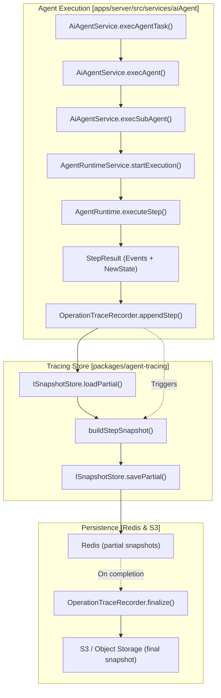
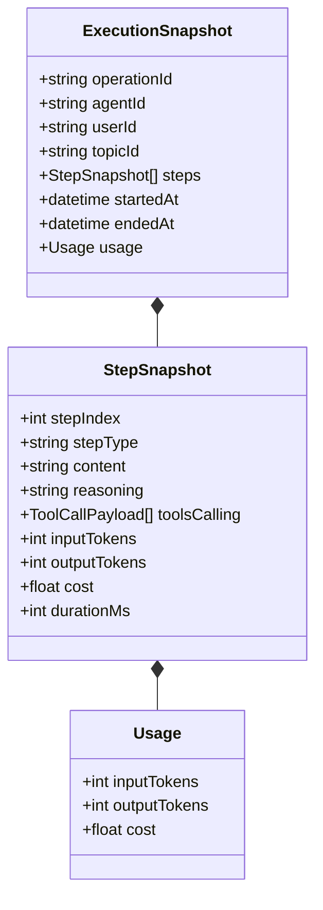
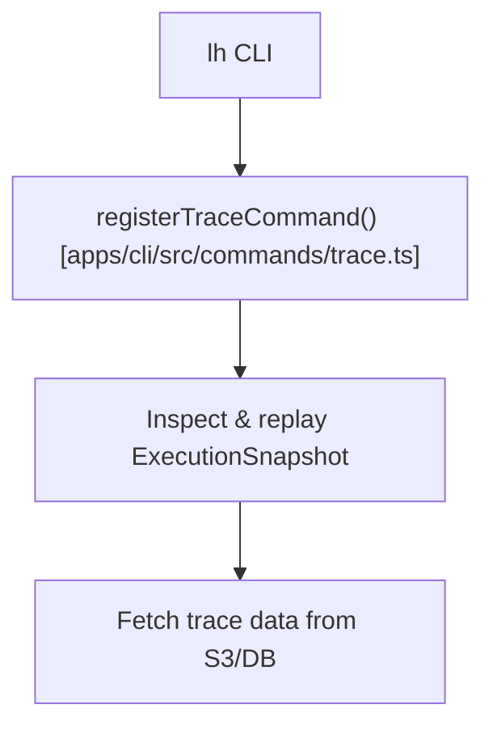

<!-- source: DeepWiki mcp.deepwiki.com · repo lobehub/lobehub · page 4.7 Agent Tracing and Observability · fetched 2026-10-29 -->

# Agent Tracing and Observability

<details>
<summary>Relevant source files</summary>

The following files were used as context for generating this wiki page:

- [apps/cli/man/man1/lh.1](apps/cli/man/man1/lh.1)
- [apps/cli/package.json](apps/cli/package.json)
- [apps/cli/src/commands/dashboard.ts](apps/cli/src/commands/dashboard.ts)
- [apps/cli/src/commands/widget.test.ts](apps/cli/src/commands/widget.test.ts)
- [apps/cli/src/commands/widget.ts](apps/cli/src/commands/widget.ts)
- [apps/cli/src/program.ts](apps/cli/src/program.ts)
- [apps/cli/src/utils/BatchIngester.test.ts](apps/cli/src/utils/BatchIngester.test.ts)
- [apps/cli/src/utils/BatchIngester.ts](apps/cli/src/utils/BatchIngester.ts)
- [apps/cli/src/utils/CoalescingBatchIngester.test.ts](apps/cli/src/utils/CoalescingBatchIngester.test.ts)
- [apps/cli/src/utils/CoalescingBatchIngester.ts](apps/cli/src/utils/CoalescingBatchIngester.ts)
- [apps/server/src/services/heterogeneousAgent/HeteroTraceRecorder.ts](apps/server/src/services/heterogeneousAgent/HeteroTraceRecorder.ts)
- [apps/server/src/services/heterogeneousAgent/HeterogeneousPersistenceHandler.ts](apps/server/src/services/heterogeneousAgent/HeterogeneousPersistenceHandler.ts)
- [apps/server/src/services/heterogeneousAgent/__tests__/HeteroTraceRecorder.test.ts](apps/server/src/services/heterogeneousAgent/__tests__/HeteroTraceRecorder.test.ts)
- [apps/server/src/services/heterogeneousAgent/__tests__/HeterogeneousPersistenceHandler.coldReplicaChainAnchor.test.ts](apps/server/src/services/heterogeneousAgent/__tests__/HeterogeneousPersistenceHandler.coldReplicaChainAnchor.test.ts)
- [apps/server/src/services/heterogeneousAgent/__tests__/HeterogeneousPersistenceHandler.eventBranches.test.ts](apps/server/src/services/heterogeneousAgent/__tests__/HeterogeneousPersistenceHandler.eventBranches.test.ts)
- [apps/server/src/services/heterogeneousAgent/__tests__/HeterogeneousPersistenceHandler.fixture.test.ts](apps/server/src/services/heterogeneousAgent/__tests__/HeterogeneousPersistenceHandler.fixture.test.ts)
- [apps/server/src/services/heterogeneousAgent/__tests__/HeterogeneousPersistenceHandler.mainTurnRehydration.test.ts](apps/server/src/services/heterogeneousAgent/__tests__/HeterogeneousPersistenceHandler.mainTurnRehydration.test.ts)
- [apps/server/src/services/heterogeneousAgent/__tests__/HeterogeneousPersistenceHandler.subagentRehydration.test.ts](apps/server/src/services/heterogeneousAgent/__tests__/HeterogeneousPersistenceHandler.subagentRehydration.test.ts)
- [apps/server/src/services/heterogeneousAgent/__tests__/HeterogeneousPersistenceHandler.test.ts](apps/server/src/services/heterogeneousAgent/__tests__/HeterogeneousPersistenceHandler.test.ts)
- [apps/server/src/services/heterogeneousAgent/__tests__/index.test.ts](apps/server/src/services/heterogeneousAgent/__tests__/index.test.ts)
- [apps/server/src/services/heterogeneousAgent/index.ts](apps/server/src/services/heterogeneousAgent/index.ts)
- [packages/agent-gateway-client/src/intervention.test.ts](packages/agent-gateway-client/src/intervention.test.ts)
- [packages/agent-gateway-client/src/intervention.ts](packages/agent-gateway-client/src/intervention.ts)
- [packages/builtin-skills/src/lobehub/content.ts](packages/builtin-skills/src/lobehub/content.ts)
- [packages/builtin-skills/src/lobehub/index.ts](packages/builtin-skills/src/lobehub/index.ts)
- [packages/builtin-skills/src/lobehub/references/dashboard.ts](packages/builtin-skills/src/lobehub/references/dashboard.ts)
- [packages/heterogeneous-agents/src/mainAgentCoordinator/reducer.test.ts](packages/heterogeneous-agents/src/mainAgentCoordinator/reducer.test.ts)
- [packages/heterogeneous-agents/src/mainAgentCoordinator/reducer.ts](packages/heterogeneous-agents/src/mainAgentCoordinator/reducer.ts)
- [packages/heterogeneous-agents/src/mainAgentCoordinator/types.ts](packages/heterogeneous-agents/src/mainAgentCoordinator/types.ts)
- [packages/heterogeneous-agents/src/protocol/lobeHubCliGuide.ts](packages/heterogeneous-agents/src/protocol/lobeHubCliGuide.ts)
- [packages/heterogeneous-agents/src/spawn/classifyProcessFailure.test.ts](packages/heterogeneous-agents/src/spawn/classifyProcessFailure.test.ts)
- [packages/heterogeneous-agents/src/spawn/classifyProcessFailure.ts](packages/heterogeneous-agents/src/spawn/classifyProcessFailure.ts)
- [packages/heterogeneous-agents/src/subagentCoordinator/index.ts](packages/heterogeneous-agents/src/subagentCoordinator/index.ts)
- [packages/heterogeneous-agents/src/subagentCoordinator/reducer.test.ts](packages/heterogeneous-agents/src/subagentCoordinator/reducer.test.ts)
- [packages/heterogeneous-agents/src/subagentCoordinator/reducer.ts](packages/heterogeneous-agents/src/subagentCoordinator/reducer.ts)
- [packages/heterogeneous-agents/src/subagentCoordinator/types.ts](packages/heterogeneous-agents/src/subagentCoordinator/types.ts)

</details>


The **Agent Tracing and Observability** subsystem in LobeHub provides comprehensive recording, inspection, and replay capabilities for multi-step, agentic runs. This layer addresses the core challenge of the "black box" nature of AI agents by recording detailed execution snapshots and providing tooling to explore and diagnose agent behavior and failures.

This page documents the `packages/agent-tracing` and closely related packages such as `heterogeneous-agent` components that perform ExecutionSnapshot recording, the S3-based SnapshotStore, CLI trace inspection, and replay tooling used in the debugging and monitoring workflow of agent executions.

---

## Overview and Purpose

Agent tracing captures and persists stepwise execution data from the AI Agent system, including:

- **LLM streaming chunks** with prompt context and model/provider metadata.
- **Tool invocation calls and results** during agentic workflows.
- **Turn boundaries**, execution timing, and token usage metrics.
- **Error classification metadata** for enhanced observability.

These traces facilitate:

- **Replay and debug**: reconstruct an agent's execution history step by step with exact internal state.
- **Performance analysis**: track token costs and counts on a per-turn basis.
- **Context engineering inspection**: examine the prompts, tool calls, and intermediate states used.
- **Error taxonomy integration**: classify and annotate errors for easier diagnosis across heterogeneous agents.

Observability is crucial for reliability in multi-step agentic logic that chains LLM generations and tool actions over a conversation.

Sources:  
[apps/server/src/services/aiAgent/index.ts:87-154](),  
[apps/server/src/services/aiAgent/pipeline/heteroDispatch.ts:138-150](),  
[packages/types/src/agentExecution/index.ts:1-156](),  
[apps/server/src/modules/AgentRuntime/formatErrorForState.ts:1-20]().

---

## System Architecture and Data Flow

The agent tracing system acts as a dedicated recording sidecar running alongside the `AgentRuntime` execution. As each step runs—be it an LLM call or tool call—the `OperationTraceRecorder` captures the differences ("deltas") from the previous state and persists partial snapshots incrementally to Redis.

On agent run completion, accumulated partials are merged and the final trace snapshot is saved to longer-term storage (typically an S3-compatible service) via the `ISnapshotStore` interface implementation.

### Main Components and Flow



- The `AgentRuntimeService` executes agent steps producing streamed events.
- `OperationTraceRecorder` folds the step results into partial snapshots.
- `ISnapshotStore` interface abstracts backing stores; partials persist in Redis, finalized traces in S3.
- Partial snapshots are incrementally updated and fenced with tokens for consistency.
- Upon run completion, the final merged snapshot is pushed to S3 for long-term archival.

Sources:  
[apps/server/src/services/aiAgent/index.ts:87-154](),  
[apps/server/src/services/aiAgent/pipeline/heteroDispatch.ts:138-150](),  
[apps/server/src/modules/AgentTracing/S3SnapshotStore.ts:1-53](),  
[apps/server/src/services/heterogeneousAgent/HeteroTraceRecorder.ts:1-170]().

---

## Key Components

### OperationTraceRecorder

- Resides in server services, it manages tracing lifecycle during an agent operation run.
- On each step, `appendStep()` records agent state, streaming chunks, tool calls, and context engine data.
- On run end, `finalize()` consolidates partial snapshots and annotates errors/classifications.
- Partial writes are fenced by tokens to ensure safe multi-instance concurrent writes.
- Strips heavy streaming events to keep persistent snapshots lean.

Key files and location: `apps/server/src/services/agentRuntime/OperationTraceRecorder.ts` and related [not fully shown, but detailed in imports].

Sources:  
[apps/server/src/services/aiAgent/index.ts:87-154](),  
[apps/server/src/services/agentRuntime/types.ts:49-62]().

---

### Snapshot Store (`ISnapshotStore`)

- Generic interface for snapshot persistence; offers methods:
  - `loadPartial(operationId: string)`
  - `savePartial(operationId: string, snapshot: ExecutionSnapshot, options?)`
  - `loadFinal(operationId: string)`
  - `saveFinal(operationId: string, snapshot: ExecutionSnapshot)`

- Production uses `S3SnapshotStore`, which stores snapshots in an S3-compatible bucket.
- Partial snapshots are cached and layered in Redis to allow incremental event folding.

---

### S3SnapshotStore

- Concrete implementation of `ISnapshotStore`.
- Wraps AWS SDK S3 client (`s3Client`) for get/put operations.
- Organizes trace JSON files under a structured key pattern using operation IDs.
- Supports partial and final snapshot object management for robust durability.

Diagram: S3SnapshotStore Interaction

```mermaid
graph TD
    Tracer["HeteroTraceRecorder"] --> SavePartial["S3SnapshotStore.savePartial()"]
    SavePartial --> PutObj["s3Client.putObject()"]
    PutObj --> Bucket[S3 Bucket (e.g., minio)]

    Tracer --> LoadPartial["S3SnapshotStore.loadPartial()"]
    LoadPartial --> GetObj["s3Client.getObject()"]
    GetObj --> Bucket
```

Sources:  
[apps/server/src/modules/AgentTracing/S3SnapshotStore.ts:1-53](),  
[apps/server/src/services/heterogeneousAgent/HeteroTraceRecorder.ts:1-170]().

---

## Execution Snapshot Model

Agent execution data is represented as structured snapshots that capture the state, inputs, and results of every step.

### StepSnapshot

Each turn in an agent’s execution is represented by a `StepSnapshot` recording:

| Field               | Description                                         |
|---------------------|-----------------------------------------------------|
| `stepIndex`         | Zero-based step order in the entire operation.      |
| `stepType`          | E.g., `call_llm`, `call_tool`, `step_complete`.     |
| `content`           | Accumulated assistant text emitted this step.       |
| `reasoning`         | Streamed reasoning/thinking text this step.         |
| `toolsCalling`      | List of tool calls made during this step.            |
| `inputTokens`       | Input token count for this step's LLM call.          |
| `outputTokens`      | Output token count emitted by the model.             |
| `cost`              | Estimated cost of this step.                          |
| `durationMs`        | Execution time in milliseconds.                       |
| `usage`             | Token usage details (input/output/total costs).      |

The `ExecutionSnapshot` aggregates these steps with metadata such as userId, topicId, agentId, model, provider, start and end time.

Class Diagram: Execution Snapshot



Sources:  
[packages/types/src/agentExecution/index.ts:1-156](),  
[apps/server/src/services/heterogeneousAgent/HeteroTraceRecorder.ts:1-170]().

---

## Error Classification and Observability

LobeHub enriches traces with structured error classification metadata for surfaced failures during agent runs. The error observability system:

- Matches raw error messages against known patterns derived from provider SDKs and agent runtime errors.
- Assigns categories such as **Auth**, **Quota**, **Capacity**, **Provider**, or **Harness**.
- Tags errors with attribution (e.g., user error, provider error, system/harness error).
- Aids frontend trace viewers to explain errors and guide recovery steps.

Example categories and their meaning:

| Category    | Description                          | Example error type/entity              |
|-------------|-----------------------------------|--------------------------------------|
| **Auth**    | Credential or API key failures    | `InvalidProviderAPIKey`               |
| **Quota**   | Usage/balance exhaustion          | `InsufficientQuota`                   |
| **Capacity**| Rate limiting or overload         | `RateLimitExceeded`                   |
| **Provider**| Upstream model or API failure    | `ModelEmptyCompletion`                |
| **Harness** | Internal system errors            | `DatabasePersistError`                |

The function `formatErrorForState` enriches raw errors before appending them into snapshots [apps/server/src/modules/AgentRuntime/formatErrorForState.ts:1-20]().

Specific observability logic detects **Model Empty Completions**, a subtle error mode when a model returns effectively no tokens and blank content, allowing the runtime to retry transparently to avoid silent run failures.

Sources:  
[apps/server/src/services/aiAgent/pipeline/heteroDispatch.ts:101-128](),  
[apps/server/src/modules/AgentRuntime/formatErrorForState.ts:1-20]().

---

## Heterogeneous Agent CLI Tracing

The CLI (`lh`), which acts as a client for running heterogeneous agents (e.g., Claude Code, Codex, and others), integrates deeply with agent tracing:

- **Trace Inspection CLI Command**: `lh trace` lets users inspect recorded traces, replay agent executions step-by-step, and diagnose unexpected agent behavior or errors.
- The trace command is registered inside the CLI command tree ([apps/cli/src/program.ts:38-105]()) and made available in the CLI manual (`lh man trace`) [apps/cli/man/man1/lh.1:107-108]().

This tooling bridges recorded `AgentStreamEvent` logs and persistent snapshots to an interactive debugging experience.

### CLI Program Trace Command Overview



Sources:  
[apps/cli/man/man1/lh.1:107-108](),  
[apps/cli/src/program.ts:39](),  
[apps/server/src/services/heterogeneousAgent/HeteroTraceRecorder.ts:1-170]().

---

# Summary

Agent Tracing and Observability in LobeHub are provided by an integrated stack of:

- **Execution snapshot recording** via `OperationTraceRecorder` and `HeteroTraceRecorder`.
- **Partial and final snapshot stores**, including the S3-backed `S3SnapshotStore`.
- **Error classification logic** with a unified error taxonomy to surface actionable insights.
- **Command-line trace inspection tooling** targeting debugging of complex multi-step AI agent runs.

This system enables reproducible, step-level introspection of agent executions and is essential for reliable production AI agents operating in multi-model, multi-tool workflows.

---

# References and Sources

- [apps/server/src/services/aiAgent/index.ts:87-154]()
- [apps/server/src/services/aiAgent/pipeline/heteroDispatch.ts:101-150]()
- [packages/types/src/agentExecution/index.ts:1-156]()
- [apps/server/src/modules/AgentTracing/S3SnapshotStore.ts:1-53]()
- [apps/server/src/services/heterogeneousAgent/HeteroTraceRecorder.ts:1-170]()
- [apps/cli/man/man1/lh.1:107-108]()
- [apps/cli/src/program.ts:39-105]()
- [apps/server/src/modules/AgentRuntime/formatErrorForState.ts:1-20]()

---

