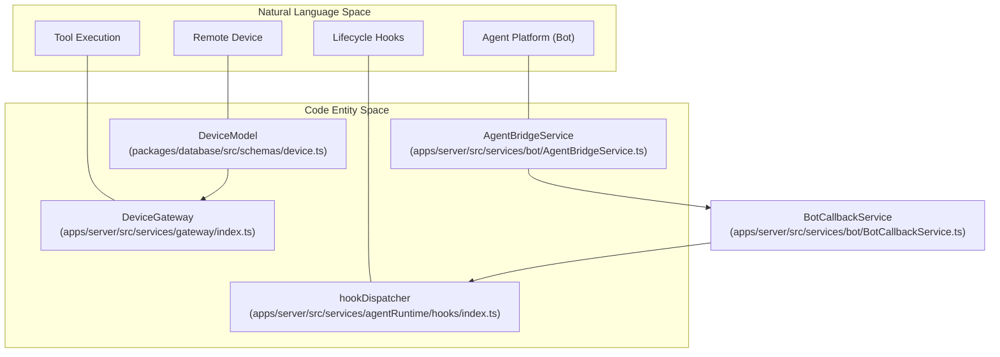
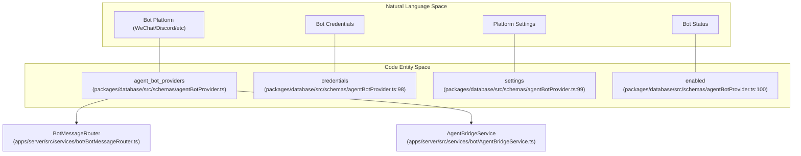
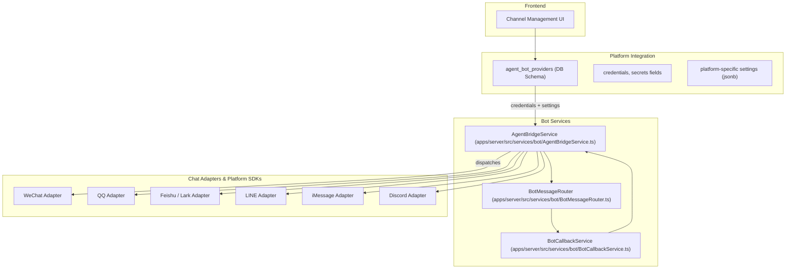

<!-- source: DeepWiki mcp.deepwiki.com · repo lobehub/lobehub · page 4.8 Bot Channels and Platform Integration · fetched 2026-10-29 -->

# Bot Channels and Platform Integration

Relevant source files

The following files were used as context for generating this wiki page:

- [apps/server/src/routers/lambda/__tests__/agentShare.test.ts](apps/server/src/routers/lambda/__tests__/agentShare.test.ts)
- [apps/server/src/routers/lambda/__tests__/share.test.ts](apps/server/src/routers/lambda/__tests__/share.test.ts)
- [apps/server/src/routers/lambda/agentShare.ts](apps/server/src/routers/lambda/agentShare.ts)
- [apps/server/src/routers/lambda/share.ts](apps/server/src/routers/lambda/share.ts)
- [apps/server/src/services/agentRuntime/CompletionLifecycle.ts](apps/server/src/services/agentRuntime/CompletionLifecycle.ts)
- [apps/server/src/services/agentRuntime/__tests__/CompletionLifecycle.test.ts](apps/server/src/services/agentRuntime/__tests__/CompletionLifecycle.test.ts)
- [apps/server/src/services/bot/AgentBridgeService.ts](apps/server/src/services/bot/AgentBridgeService.ts)
- [apps/server/src/services/bot/BotCallbackService.ts](apps/server/src/services/bot/BotCallbackService.ts)
- [apps/server/src/services/bot/BotMessageRouter.ts](apps/server/src/services/bot/BotMessageRouter.ts)
- [apps/server/src/services/bot/__tests__/AgentBridgeService.test.ts](apps/server/src/services/bot/__tests__/AgentBridgeService.test.ts)
- [apps/server/src/services/bot/__tests__/BotCallbackService.test.ts](apps/server/src/services/bot/__tests__/BotCallbackService.test.ts)
- [apps/server/src/services/bot/__tests__/BotMessageRouter.test.ts](apps/server/src/services/bot/__tests__/BotMessageRouter.test.ts)
- [apps/server/src/services/bot/__tests__/formatPrompt.test.ts](apps/server/src/services/bot/__tests__/formatPrompt.test.ts)
- [apps/server/src/services/bot/__tests__/renderThrownError.test.ts](apps/server/src/services/bot/__tests__/renderThrownError.test.ts)
- [apps/server/src/services/bot/__tests__/replyTemplate.test.ts](apps/server/src/services/bot/__tests__/replyTemplate.test.ts)
- [apps/server/src/services/bot/formatPrompt.ts](apps/server/src/services/bot/formatPrompt.ts)
- [apps/server/src/services/bot/isWholeGroupChatThreadId.test.ts](apps/server/src/services/bot/isWholeGroupChatThreadId.test.ts)
- [apps/server/src/services/bot/isWholeGroupChatThreadId.ts](apps/server/src/services/bot/isWholeGroupChatThreadId.ts)
- [apps/server/src/services/bot/platforms/attachmentDelivery.test.ts](apps/server/src/services/bot/platforms/attachmentDelivery.test.ts)
- [apps/server/src/services/bot/platforms/attachmentDelivery.ts](apps/server/src/services/bot/platforms/attachmentDelivery.ts)
- [apps/server/src/services/bot/platforms/chatSdkContract.test.ts](apps/server/src/services/bot/platforms/chatSdkContract.test.ts)
- [apps/server/src/services/bot/platforms/discord/client.test.ts](apps/server/src/services/bot/platforms/discord/client.test.ts)
- [apps/server/src/services/bot/platforms/discord/client.ts](apps/server/src/services/bot/platforms/discord/client.ts)
- [apps/server/src/services/bot/platforms/discord/mentions.test.ts](apps/server/src/services/bot/platforms/discord/mentions.test.ts)
- [apps/server/src/services/bot/platforms/discord/mentions.ts](apps/server/src/services/bot/platforms/discord/mentions.ts)
- [apps/server/src/services/bot/platforms/discord/patch/forwardedInteractions.test.ts](apps/server/src/services/bot/platforms/discord/patch/forwardedInteractions.test.ts)
- [apps/server/src/services/bot/platforms/discord/patch/forwardedInteractions.ts](apps/server/src/services/bot/platforms/discord/patch/forwardedInteractions.ts)
- [apps/server/src/services/bot/platforms/discord/patch/index.ts](apps/server/src/services/bot/platforms/discord/patch/index.ts)
- [apps/server/src/services/bot/platforms/telegram/client.test.ts](apps/server/src/services/bot/platforms/telegram/client.test.ts)
- [apps/server/src/services/bot/platforms/telegram/client.ts](apps/server/src/services/bot/platforms/telegram/client.ts)
- [apps/server/src/services/bot/platforms/telegram/helpers.test.ts](apps/server/src/services/bot/platforms/telegram/helpers.test.ts)
- [apps/server/src/services/bot/platforms/telegram/helpers.ts](apps/server/src/services/bot/platforms/telegram/helpers.ts)
- [apps/server/src/services/bot/platforms/types.ts](apps/server/src/services/bot/platforms/types.ts)
- [apps/server/src/services/bot/renderThrownError.ts](apps/server/src/services/bot/renderThrownError.ts)
- [apps/server/src/services/bot/replyTemplate.ts](apps/server/src/services/bot/replyTemplate.ts)
- [apps/server/src/services/messenger/MessengerRouter.test.ts](apps/server/src/services/messenger/MessengerRouter.test.ts)
- [apps/server/src/services/messenger/MessengerRouter.ts](apps/server/src/services/messenger/MessengerRouter.ts)
- [apps/server/src/services/messenger/systemReply.ts](apps/server/src/services/messenger/systemReply.ts)
- [apps/server/src/services/messenger/types.ts](apps/server/src/services/messenger/types.ts)
- [locales/en-US/agent.json](locales/en-US/agent.json)
- [locales/zh-CN/agent.json](locales/zh-CN/agent.json)
- [packages/database/src/models/__tests__/agentShare.test.ts](packages/database/src/models/__tests__/agentShare.test.ts)
- [packages/database/src/models/__tests__/messages/message.operationLookup.test.ts](packages/database/src/models/__tests__/messages/message.operationLookup.test.ts)
- [packages/database/src/models/agentShare.ts](packages/database/src/models/agentShare.ts)
- [packages/database/src/schemas/agentShare.ts](packages/database/src/schemas/agentShare.ts)
- [packages/locales/src/default/agent.ts](packages/locales/src/default/agent.ts)
- [packages/types/src/agent/share.ts](packages/types/src/agent/share.ts)
- [src/business/client/features/AgentShareSpendDetail.tsx](src/business/client/features/AgentShareSpendDetail.tsx)
- [src/features/Electron/HeterogeneousAgent/RestartRecovery/recoverInterruptedRuns.test.ts](src/features/Electron/HeterogeneousAgent/RestartRecovery/recoverInterruptedRuns.test.ts)
- [src/features/Electron/HeterogeneousAgent/RestartRecovery/recoverInterruptedRuns.ts](src/features/Electron/HeterogeneousAgent/RestartRecovery/recoverInterruptedRuns.ts)
- [src/routes/(main)/agent/channel/index.tsx](src/routes/(main)/agent/channel/index.tsx)
- [src/services/agentShare.ts](src/services/agentShare.ts)
- [src/store/agent/slices/bot/action.ts](src/store/agent/slices/bot/action.ts)
- [src/store/agent/slices/bot/index.ts](src/store/agent/slices/bot/index.ts)

This page documents the bot channel system within LobeHub, focusing on how AI Agents are integrated as bots in various external messaging platforms such as WeChat, QQ, Feishu/Lark, LINE, and iMessage. It details the core services including the `AgentBridgeService` and `BotMessageRouter`, the chat adapters for multiple platforms, webhook callbacks, and the channel management UI that allows configuring and managing these integrations.

---

## System Architecture Overview

LobeHub's platform integration system enables AI agents to act as "bots" that interact within messaging ecosystems. The main components include:

- **AgentBridgeService**: The core orchestrator handling message dispatching between platform-specific chat adapters and the agent runtime.
- **BotMessageRouter**: Routes incoming platform webhook calls to the appropriate agent and delegates handling to `AgentBridgeService`.
- **Chat Adapters**: Platform-specific adapters translating platform events and message formats into a unified internal interface supporting WeChat, QQ, Feishu/Lark, LINE, iMessage, and more.
- **Webhook Callbacks**: HTTP routes that receive and validate incoming messages from platforms and remote agent executions.
- **Channel Management UI**: Frontend pages and components for configuring bot credentials, platform settings, and runtime status.

### Code Entity Mapping: Platform Integration and Bot Execution

_Sources: [apps/server/src/services/bot/AgentBridgeService.ts:1-37](), [apps/server/src/services/gateway/index.ts:1-40](), [apps/server/src/services/agentRuntime/hooks/index.ts:1-8]()_

### Code Entity Mapping: Bot Channel Persistence

_Sources: [packages/database/src/schemas/agentBotProvider.ts:68](), [apps/server/src/services/bot/BotMessageRouter.ts:1-60](), [apps/server/src/services/bot/AgentBridgeService.ts:1-400]()_

---

## AgentBridgeService

The `AgentBridgeService` is the primary orchestrator for bridging platform messages with the LobeHub AI agent runtime. It performs the following key functions:

- **Platform Identification and Credential Resolution**  
  It manages bot configuration data stored in the `agent_bot_providers` table, decrypting credentials to establish platform connections [apps/server/src/services/bot/AgentBridgeService.ts:9-20]().

- **Message Processing Pipeline**  
  Incoming messages from chat adapters are handled by `AgentBridgeService`. It determines the target agent, thread, and context, then executes the agent using the AI runtime service. It supports features such as message history merging, prompt formatting, and attachment handling [apps/server/src/services/bot/AgentBridgeService.ts:200-400]().

- **Error Formatting and Reply Rendering**  
  The service provides robust error formatting to produce readable error replies on platforms. It renders intermediate progress, tool calls, and final replies using templates specific to each platform [apps/server/src/services/bot/AgentBridgeService.ts:114-150]().

- **Deferred Message Delivery**  
  To handle rate limits and reliable delivery, deferred messages can be scheduled and replayed asynchronously using functionality within this service [apps/server/src/services/bot/AgentBridgeService.ts:300-350]().

- **Event and Reaction Management**  
  Manages reactions (emojis) on messages for bot states such as "thinking" or "received" and updates reaction status accordingly [apps/server/src/services/bot/AgentBridgeService.ts:30-45]().

---

## BotMessageRouter

The `BotMessageRouter` coordinates routing incoming webhook requests from various messaging platforms to their corresponding bot handlers.

- It maintains a registry of platform-specific chat SDK adapters, unified under a common routing interface.
- Routes events such as text messages, slash commands, mentions, and subscription callbacks to the appropriate handler on `AgentBridgeService`.
- Performs membership and permission checks to ensure users have access rights to interact with specific agents.
- Supports reply formatting, default behaviors, and error handling for message dispatch [apps/server/src/services/bot/BotMessageRouter.ts:1-120]().

---

## Platform-Specific Chat Adapters

LobeHub supports multiple chat platforms through adapters that translate platform-specific protocols into a unified interface.

### Supported Platforms Include:

| Platform     | Description                                      | Localization Keys (agent.json)           |
|--------------|------------------------------------------------|-----------------------------------------|
| WeChat       | Connects agents to public WeChat accounts and listens to messages | `channel.platform.wechat.description` [locales/en-US/agent.json:75]() |
| QQ           | Supports QQ private, group, and guild chats    | `channel.platform.qq.description` [locales/en-US/agent.json:69]()      |
| Feishu/Lark  | Supports enterprise collaboration chats        | `channel.platform.feishu.description` [locales/en-US/agent.json:61]()  |
| LINE         | Official account and user chats support         | `channel.platform.line.description` [locales/en-US/agent.json:207]()   |
| iMessage     | Integration with Apple Messages via BlueBubbles | `channel.platform.imessage.description` [locales/en-US/agent.json:133]()|
| Discord      | Community and direct message support             | `channel.discord.description` [locales/en-US/agent.json:71]()          |

### Platform Configuration Highlights:

- **Credentials**: Support for platform-specific credentials such as Application ID, Bot Token(API key), App Secret, Encrypt Key.
- **Connection Modes**: Supports both WebSocket (recommended for real-time event streaming) and Webhook (callback URLs) modes.
- **Message Policies**: Configurable DM policies (open, allowlist, pairing, disabled), group policies (allowlist, open, disabled) to control bot access scope.
- **Concurrency Controls**: Modes for handling concurrent messages:
  - Burst: Aggregate multiple rapid messages into one dispatch.
  - Debounce: Process only the last message in a burst.
  - Queue: Sequentially process messages one by one.

---

## Bot Channel Data Schema

The `agent_bot_providers` table stores the information needed to connect an agent bot to external platforms, including encrypted credentials and platform-specific settings.

### Key Fields in `agent_bot_providers`

| Column Name     | Type            | Description                                          |
| --------------- | --------------- | ----------------------------------------------------|
| `agent_id`      | `text`          | Foreign key to the agent owning this platform binding |
| `platform`      | `varchar(50)`   | Platform identifier string, e.g., 'wechat', 'discord'|
| `application_id`| `varchar(255)`  | Unique ID or Bot username on the external platform  |
| `credentials`   | `text`          | Encrypted API keys, tokens or secrets                |
| `settings`      | `jsonb`         | Platform-specific config such as webhook URLs or prefixes |
| `enabled`       | `boolean`       | Bot connection active state                           |

This allows the same agent to be connected to multiple platforms simultaneously with distinct configurations [packages/database/src/schemas/agentBotProvider.ts:68]().

---

## Webhook Callbacks and Routing

LobeHub uses a TRPC router to expose incoming webhook routes for bot integrations:

| Route            | Handler Service     | Functionality                                      |
|------------------|--------------------|--------------------------------------------------|
| `/checkCapability`| `DeviceGateway`     | Probe if a platform integration is available on remote devices |
| `/botWebhook`     | `BotMessageRouter`  | Receive and process callbacks from messaging platforms (e.g., Discord, Slack) |
| `/taskCallback`   | `TaskResultBridge`  | Receive results from heterogeneous agent tasks executed remotely |

These routes delegate to respective services which parse, verify, and dispatch the messages internally, ensuring security and correctness.

---

## Channel Management UI

LobeHub includes a frontend UI for managing bot channel configurations per agent, located in the React route `src/routes/(main)/agent/channel/index.tsx` and related detailed subcomponents.

### Features:

- **Platform Selector**: Users can select from supported platforms (WeChat, QQ, Feishu, LINE, iMessage, Discord, etc.) and view the connection status.
- **Dynamic Platform Forms**: Using `SerializedPlatformDefinition` objects, the forms dynamically render the required credential fields and settings for each platform.
- **Validation Rules**: Schema-driven validation supports required fields, regex patterns, minimum and maximum values, and conditional field visibility (`visibleWhen`) [src/routes/(main)/agent/channel/index.tsx:20-130]() and detailed form logic [src/routes/(main)/agent/channel/detail/Body.tsx:1-728]() .
- **Credential Encryption**: Credentials like API keys and secrets are stored encrypted server-side, and UI masks them to prevent accidental leaks.
- **Live Status Display**: The runtime connection and error state are displayed to the user to assist with troubleshooting.
- **Export/Import Channel Configurations**: Users can export bot credential configurations in plaintext or import them, for ease of deployment or backup.

The UI tooling makes it easy for users to maintain multichannel AI agent bots without leaving the LobeHub environment.

---

## Localization of Bot Channels

All bot platform descriptions, field labels, validation messages, and hints are fully localized under the `agent` namespace in `agent.json` locale files. This covers:

- Bot credential configuration labels (`applicationId`, `botToken`, `appSecret`)
- Connection modes and statuses
- Policy descriptions and hints for DM and group message management
- Platform-specific instructions and error messages

Examples include keys such as:

- `channel.applicationId`
- `channel.botToken`
- `channel.connectionModeWebSocket`
- `channel.concurrencyDebounceHint`
- `channel.groupPolicyAllowlistHint`

Localization supports English, Chinese (zh-CN), and default fallback files [locales/en-US/agent.json:1-462](), [locales/zh-CN/agent.json:1-462](), [packages/locales/src/default/agent.ts:1-103]().

---

## Summary Mermaid Diagram: Bot Channel System Overview

---

# Summary

LobeHub's bot channel and platform integration subsystem enables rich AI agent interactions across multiple messaging platforms and remote devices:

- **AgentBridgeService** implements the core message dispatch and agent lifecycle management for multi-platform bots.
- **BotMessageRouter** centralizes message routing from diverse platform webhooks.
- Chat adapters translate platform-specific APIs into unified communication handled by `AgentBridgeService`.
- The system persists configurations securely in encrypted form and provides a dynamic UI for channel management.
- Webhook callback routes and concurrency controls ensure robust, scalable bot operations.
- Localization enables multi-language support for channel configuration interfaces.

This subsystem supports ongoing expansion to new platforms and improves the end-user experience of interfacing with AI agents inside their native chat environments.

---

### Sources

- [apps/server/src/services/bot/AgentBridgeService.ts:1-400]()
- [apps/server/src/services/bot/BotMessageRouter.ts:1-120]()
- [apps/server/src/services/bot/BotCallbackService.ts:1-100]()
- [packages/database/src/schemas/agentBotProvider.ts:68]()
- [locales/en-US/agent.json:1-462]()
- [locales/zh-CN/agent.json:1-462]()
- [packages/locales/src/default/agent.ts:1-103]()
- [src/routes/(main)/agent/channel/index.tsx:1-140]()
- [apps/server/src/services/agentRuntime/hooks/index.ts:1-8]()

---

