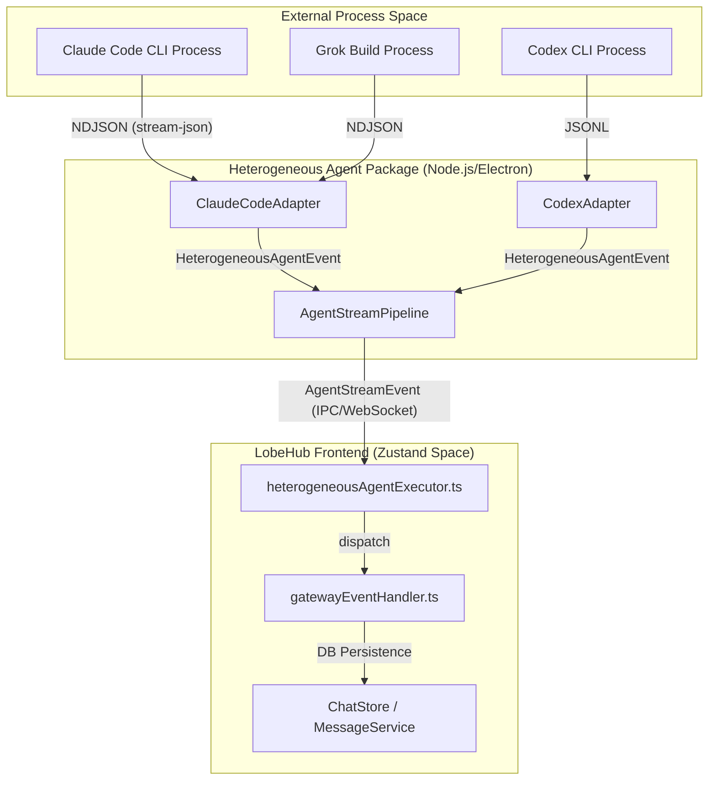
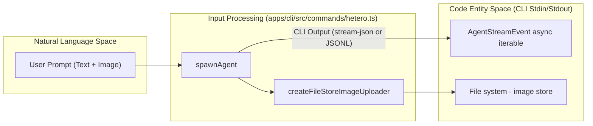
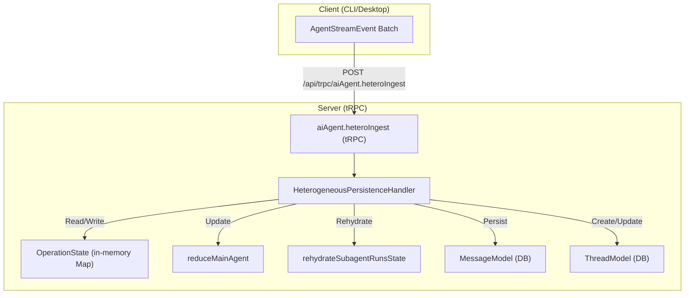
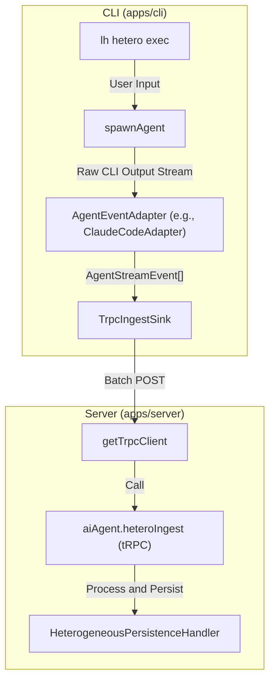

<!-- source: DeepWiki mcp.deepwiki.com · repo lobehub/lobehub · page 4.9 Heterogeneous Agents and Claude Code · fetched 2026-10-29 -->

# Heterogeneous Agents and Claude Code

Relevant source files

The following files were used as context for generating this wiki page:

- [apps/cli/src/commands/hetero.test.ts](apps/cli/src/commands/hetero.test.ts)
- [apps/cli/src/commands/hetero.ts](apps/cli/src/commands/hetero.ts)
- [apps/cli/src/device/agentRun.test.ts](apps/cli/src/device/agentRun.test.ts)
- [apps/cli/src/device/agentRun.ts](apps/cli/src/device/agentRun.ts)
- [apps/cli/src/utils/BatchIngester.test.ts](apps/cli/src/utils/BatchIngester.test.ts)
- [apps/cli/src/utils/BatchIngester.ts](apps/cli/src/utils/BatchIngester.ts)
- [apps/cli/src/utils/CoalescingBatchIngester.test.ts](apps/cli/src/utils/CoalescingBatchIngester.test.ts)
- [apps/cli/src/utils/CoalescingBatchIngester.ts](apps/cli/src/utils/CoalescingBatchIngester.ts)
- [apps/desktop/src/main/controllers/HeterogeneousAgentCtr.ts](apps/desktop/src/main/controllers/HeterogeneousAgentCtr.ts)
- [apps/desktop/src/main/controllers/HeterogeneousAgentImpl.ts](apps/desktop/src/main/controllers/HeterogeneousAgentImpl.ts)
- [apps/desktop/src/main/controllers/__tests__/HeterogeneousAgentCtr.test.ts](apps/desktop/src/main/controllers/__tests__/HeterogeneousAgentCtr.test.ts)
- [apps/desktop/src/main/modules/binaries/__tests__/cliAgentBinaries.test.ts](apps/desktop/src/main/modules/binaries/__tests__/cliAgentBinaries.test.ts)
- [apps/desktop/src/main/modules/binaries/cliAgentBinaries.ts](apps/desktop/src/main/modules/binaries/cliAgentBinaries.ts)
- [apps/desktop/src/main/modules/heterogeneousAgent/drivers/claudeCode.test.ts](apps/desktop/src/main/modules/heterogeneousAgent/drivers/claudeCode.test.ts)
- [apps/desktop/src/main/modules/heterogeneousAgent/drivers/claudeCode.ts](apps/desktop/src/main/modules/heterogeneousAgent/drivers/claudeCode.ts)
- [apps/server/src/services/heterogeneousAgent/HeteroTraceRecorder.ts](apps/server/src/services/heterogeneousAgent/HeteroTraceRecorder.ts)
- [apps/server/src/services/heterogeneousAgent/HeterogeneousPersistenceHandler.ts](apps/server/src/services/heterogeneousAgent/HeterogeneousPersistenceHandler.ts)
- [apps/server/src/services/heterogeneousAgent/__tests__/HeteroTraceRecorder.test.ts](apps/server/src/services/heterogeneousAgent/__tests__/HeteroTraceRecorder.test.ts)
- [apps/server/src/services/heterogeneousAgent/__tests__/HeterogeneousPersistenceHandler.coldReplicaChainAnchor.test.ts](apps/server/src/services/heterogeneousAgent/__tests__/HeterogeneousPersistenceHandler.coldReplicaChainAnchor.test.ts)
- [apps/server/src/services/heterogeneousAgent/__tests__/HeterogeneousPersistenceHandler.eventBranches.test.ts](apps/server/src/services/heterogeneousAgent/__tests__/HeterogeneousPersistenceHandler.eventBranches.test.ts)
- [apps/server/src/services/heterogeneousAgent/__tests__/HeterogeneousPersistenceHandler.fixture.test.ts](apps/server/src/services/heterogeneousAgent/__tests__/HeterogeneousPersistenceHandler.fixture.test.ts)
- [apps/server/src/services/heterogeneousAgent/__tests__/HeterogeneousPersistenceHandler.mainTurnRehydration.test.ts](apps/server/src/services/heterogeneousAgent/__tests__/HeterogeneousPersistenceHandler.mainTurnRehydration.test.ts)
- [apps/server/src/services/heterogeneousAgent/__tests__/HeterogeneousPersistenceHandler.subagentRehydration.test.ts](apps/server/src/services/heterogeneousAgent/__tests__/HeterogeneousPersistenceHandler.subagentRehydration.test.ts)
- [apps/server/src/services/heterogeneousAgent/__tests__/HeterogeneousPersistenceHandler.test.ts](apps/server/src/services/heterogeneousAgent/__tests__/HeterogeneousPersistenceHandler.test.ts)
- [apps/server/src/services/heterogeneousAgent/__tests__/index.test.ts](apps/server/src/services/heterogeneousAgent/__tests__/index.test.ts)
- [apps/server/src/services/heterogeneousAgent/__tests__/sandboxRunner.test.ts](apps/server/src/services/heterogeneousAgent/__tests__/sandboxRunner.test.ts)
- [apps/server/src/services/heterogeneousAgent/index.ts](apps/server/src/services/heterogeneousAgent/index.ts)
- [apps/server/src/services/heterogeneousAgent/sandboxRunner.ts](apps/server/src/services/heterogeneousAgent/sandboxRunner.ts)
- [locales/en-US/chat.json](locales/en-US/chat.json)
- [locales/zh-CN/chat.json](locales/zh-CN/chat.json)
- [packages/agent-gateway-client/src/intervention.test.ts](packages/agent-gateway-client/src/intervention.test.ts)
- [packages/agent-gateway-client/src/intervention.ts](packages/agent-gateway-client/src/intervention.ts)
- [packages/builtin-tool-claude-code/src/client/Render/BrowserMcp.tsx](packages/builtin-tool-claude-code/src/client/Render/BrowserMcp.tsx)
- [packages/builtin-tool-claude-code/src/client/Render/Read/index.tsx](packages/builtin-tool-claude-code/src/client/Render/Read/index.tsx)
- [packages/builtin-tool-claude-code/src/client/Render/reservedImageProps.test.ts](packages/builtin-tool-claude-code/src/client/Render/reservedImageProps.test.ts)
- [packages/builtin-tool-claude-code/src/client/Render/reservedImageProps.ts](packages/builtin-tool-claude-code/src/client/Render/reservedImageProps.ts)
- [packages/electron-client-ipc/src/types/heterogeneousAgent.ts](packages/electron-client-ipc/src/types/heterogeneousAgent.ts)
- [packages/heterogeneous-agents/src/adapters/claudeCode.test.ts](packages/heterogeneous-agents/src/adapters/claudeCode.test.ts)
- [packages/heterogeneous-agents/src/adapters/claudeCode.ts](packages/heterogeneous-agents/src/adapters/claudeCode.ts)
- [packages/heterogeneous-agents/src/adapters/codex.test.ts](packages/heterogeneous-agents/src/adapters/codex.test.ts)
- [packages/heterogeneous-agents/src/adapters/codex.ts](packages/heterogeneous-agents/src/adapters/codex.ts)
- [packages/heterogeneous-agents/src/mainAgentCoordinator/reducer.test.ts](packages/heterogeneous-agents/src/mainAgentCoordinator/reducer.test.ts)
- [packages/heterogeneous-agents/src/mainAgentCoordinator/reducer.ts](packages/heterogeneous-agents/src/mainAgentCoordinator/reducer.ts)
- [packages/heterogeneous-agents/src/mainAgentCoordinator/types.ts](packages/heterogeneous-agents/src/mainAgentCoordinator/types.ts)
- [packages/heterogeneous-agents/src/models/index.ts](packages/heterogeneous-agents/src/models/index.ts)
- [packages/heterogeneous-agents/src/models/listHeterogeneousAgentModels.test.ts](packages/heterogeneous-agents/src/models/listHeterogeneousAgentModels.test.ts)
- [packages/heterogeneous-agents/src/models/listHeterogeneousAgentModels.ts](packages/heterogeneous-agents/src/models/listHeterogeneousAgentModels.ts)
- [packages/heterogeneous-agents/src/protocol/execStdinPayload.test.ts](packages/heterogeneous-agents/src/protocol/execStdinPayload.test.ts)
- [packages/heterogeneous-agents/src/protocol/execStdinPayload.ts](packages/heterogeneous-agents/src/protocol/execStdinPayload.ts)
- [packages/heterogeneous-agents/src/protocol/index.ts](packages/heterogeneous-agents/src/protocol/index.ts)
- [packages/heterogeneous-agents/src/protocol/promptEngine.test.ts](packages/heterogeneous-agents/src/protocol/promptEngine.test.ts)
- [packages/heterogeneous-agents/src/protocol/promptEngine.ts](packages/heterogeneous-agents/src/protocol/promptEngine.ts)
- [packages/heterogeneous-agents/src/spawn/agentStreamPipeline.test.ts](packages/heterogeneous-agents/src/spawn/agentStreamPipeline.test.ts)
- [packages/heterogeneous-agents/src/spawn/agentStreamPipeline.ts](packages/heterogeneous-agents/src/spawn/agentStreamPipeline.ts)
- [packages/heterogeneous-agents/src/spawn/classifyProcessFailure.test.ts](packages/heterogeneous-agents/src/spawn/classifyProcessFailure.test.ts)
- [packages/heterogeneous-agents/src/spawn/classifyProcessFailure.ts](packages/heterogeneous-agents/src/spawn/classifyProcessFailure.ts)
- [packages/heterogeneous-agents/src/spawn/cliSpawn.test.ts](packages/heterogeneous-agents/src/spawn/cliSpawn.test.ts)
- [packages/heterogeneous-agents/src/spawn/cliSpawn.ts](packages/heterogeneous-agents/src/spawn/cliSpawn.ts)
- [packages/heterogeneous-agents/src/spawn/codexModel.test.ts](packages/heterogeneous-agents/src/spawn/codexModel.test.ts)
- [packages/heterogeneous-agents/src/spawn/codexModel.ts](packages/heterogeneous-agents/src/spawn/codexModel.ts)
- [packages/heterogeneous-agents/src/spawn/fileStoreImageUploader.test.ts](packages/heterogeneous-agents/src/spawn/fileStoreImageUploader.test.ts)
- [packages/heterogeneous-agents/src/spawn/fileStoreImageUploader.ts](packages/heterogeneous-agents/src/spawn/fileStoreImageUploader.ts)
- [packages/heterogeneous-agents/src/spawn/imageDimensions.test.ts](packages/heterogeneous-agents/src/spawn/imageDimensions.test.ts)
- [packages/heterogeneous-agents/src/spawn/imageDimensions.ts](packages/heterogeneous-agents/src/spawn/imageDimensions.ts)
- [packages/heterogeneous-agents/src/spawn/index.ts](packages/heterogeneous-agents/src/spawn/index.ts)
- [packages/heterogeneous-agents/src/spawn/resolveCliCommand.test.ts](packages/heterogeneous-agents/src/spawn/resolveCliCommand.test.ts)
- [packages/heterogeneous-agents/src/spawn/resolveCliCommand.ts](packages/heterogeneous-agents/src/spawn/resolveCliCommand.ts)
- [packages/heterogeneous-agents/src/spawn/spawnAgent.test.ts](packages/heterogeneous-agents/src/spawn/spawnAgent.test.ts)
- [packages/heterogeneous-agents/src/spawn/spawnAgent.ts](packages/heterogeneous-agents/src/spawn/spawnAgent.ts)
- [packages/heterogeneous-agents/src/subagentCoordinator/index.ts](packages/heterogeneous-agents/src/subagentCoordinator/index.ts)
- [packages/heterogeneous-agents/src/subagentCoordinator/reducer.test.ts](packages/heterogeneous-agents/src/subagentCoordinator/reducer.test.ts)
- [packages/heterogeneous-agents/src/subagentCoordinator/reducer.ts](packages/heterogeneous-agents/src/subagentCoordinator/reducer.ts)
- [packages/heterogeneous-agents/src/subagentCoordinator/types.ts](packages/heterogeneous-agents/src/subagentCoordinator/types.ts)
- [packages/heterogeneous-agents/src/types.ts](packages/heterogeneous-agents/src/types.ts)
- [packages/heterogeneous-agents/src/utils/codexUsage.test.ts](packages/heterogeneous-agents/src/utils/codexUsage.test.ts)
- [packages/heterogeneous-agents/src/utils/codexUsage.ts](packages/heterogeneous-agents/src/utils/codexUsage.ts)
- [packages/locales/src/default/chat.ts](packages/locales/src/default/chat.ts)
- [packages/types/src/agent/agencyConfig.test.ts](packages/types/src/agent/agencyConfig.test.ts)
- [packages/types/src/agent/agencyConfig.ts](packages/types/src/agent/agencyConfig.ts)
- [packages/types/src/agent/heteroSelectorCapabilities.test.ts](packages/types/src/agent/heteroSelectorCapabilities.test.ts)
- [packages/types/src/agent/heteroSelectorCapabilities.ts](packages/types/src/agent/heteroSelectorCapabilities.ts)
- [src/features/AgentTasks/AgentTaskDetail/TaskRunReport.tsx](src/features/AgentTasks/AgentTaskDetail/TaskRunReport.tsx)
- [src/features/AgentTasks/AgentTaskDetail/TopicCard.test.tsx](src/features/AgentTasks/AgentTaskDetail/TopicCard.test.tsx)
- [src/features/AgentTasks/AgentTaskDetail/TopicCard.tsx](src/features/AgentTasks/AgentTaskDetail/TopicCard.tsx)
- [src/features/AgentTasks/AgentTaskDetail/useRunFollowUp.test.ts](src/features/AgentTasks/AgentTaskDetail/useRunFollowUp.test.ts)
- [src/features/AgentTasks/AgentTaskDetail/useRunFollowUp.ts](src/features/AgentTasks/AgentTaskDetail/useRunFollowUp.ts)
- [src/features/ChatInput/ControlBar/HeteroModel/useModelCatalog.test.ts](src/features/ChatInput/ControlBar/HeteroModel/useModelCatalog.test.ts)
- [src/routes/(main)/agent/features/Conversation/HeterogeneousChatInput/shouldShowHeteroModelSelector.test.ts](src/routes/(main)/agent/features/Conversation/HeterogeneousChatInput/shouldShowHeteroModelSelector.test.ts)
- [src/services/electron/heterogeneousAgent.test.ts](src/services/electron/heterogeneousAgent.test.ts)
- [src/services/electron/heterogeneousAgent.ts](src/services/electron/heterogeneousAgent.ts)
- [src/store/chat/slices/agentRun/actions/__tests__/heterogeneousAgentExecutor.test.ts](src/store/chat/slices/agentRun/actions/__tests__/heterogeneousAgentExecutor.test.ts)
- [src/store/chat/slices/agentRun/actions/transports/hetero/heterogeneousAgentExecutor.ts](src/store/chat/slices/agentRun/actions/transports/hetero/heterogeneousAgentExecutor.ts)

The Heterogeneous Agents system in LobeHub enables integration of external agent processes—specifically **Claude Code**, **Amp**, **Grok Build**, and **OpenAI Codex**—into the LobeHub chat interface. Unlike typical HTTP-based LLM integrations, heterogeneous agents are spawned as local CLI processes (especially within the Electron desktop app) or bridged via gateway protocols. This architectural choice empowers LobeHub to leverage terminal-based toolsets, file-system access, and streaming capabilities while offering a unified UI experience, including streaming, tool visualization, session management, and quota tracking.

---

## 1. Package Architecture and Adapters

The `@lobechat/heterogeneous-agents` package acts as a translation and adaptation layer, converting raw CLI process output into a normalized internal event format compatible with LobeHub’s chat system.

### 1.1 Adapter Pattern

The system employs an adapter pattern where each external agent’s CLI output (often NDJSON or JSONL) is parsed and transformed into a unified `AgentStreamEvent` protocol.

- **ClaudeCodeAdapter**: This adapter processes the Claude Code CLI stream (`--output-format stream-json --verbose`), which emits detailed event types including system init, assistant thoughts, tool uses, user responses, retries, and rate limit notifications. The adapter handles:

  - State synchronization of internal task lists emitted as tool interactions (`TaskCreate`, `TaskUpdate`, `TaskList`).
  
  - Streaming partial messages (token-level deltas) to provide live UI feedback.
  
  - Stripping extraneous model beta markers from model identifiers to maintain consistent rendering.
  
  - Distinguishing multiple assistant turns and preserving correct parent-child message relationships.

  [packages/heterogeneous-agents/src/adapters/claudeCode.ts:1-153]()

- **CodexAdapter**: Deals with OpenAI Codex's JSONL event stream, tracking thread lifecycle events (`thread.started`, `item.completed`), extracting session IDs, and consolidating usage data.

- **Trae Adapter** (implied, less detailed): Handles similar streaming from other toolchains (e.g., Grok Build). 

These adapters emit unified `HeterogeneousAgentEvent[]` consumed by the heterogeneous agent runtime and the frontend executor.

### 1.2 Data Flow Diagram: CLI to UI Protocol Bridge

**Explanation:**

- The CLI processes (`claude`, `codex`, etc.) produce raw event streams.

- Adapters (`ClaudeCodeAdapter`, `CodexAdapter`) translate these CLI streams into unified heterogeneous agent events.

- The agent stream pipeline funnels these events through the frontend heterogeneous agent executor (`heterogeneousAgentExecutor.ts`), which invokes a gateway event handler to persist messages and update UI state.

Sources:  
[packages/heterogeneous-agents/src/adapters/claudeCode.ts:1-37](),  
[src/store/chat/slices/agentRun/actions/transports/hetero/heterogeneousAgentExecutor.ts:1-48](),  
[packages/heterogeneous-agents/src/adapters/claudeCode.test.ts:3-19]()

---

## 2. Electron Integration: HeterogeneousAgentCtr

`HeterogeneousAgentCtr` is the Electron main process controller responsible for managing heterogeneous agent lifecycles. It leverages a lazy-loaded implementation via `HeterogeneousAgentImpl` to avoid early evaluation of heavy CLI adapters and streaming logic.

### 2.1 Key Responsibilities

- **Process Lifecycle Management**: Spawning, stopping, and cancelling agent CLI processes on demand.

- **Auth and Remote Server Configuration**: Provides access tokens and remote server URLs for file uploads and MCP integrations.

- **Quota and Identity Queries**: Fetches usage quota and identity details for Claude Code, Codex, and Kimi Code agents.

- **Prompt Redaction**: Contains utilities (`redactPromptArgs`) for sanitizing sensitive CLI prompt data in logs, especially relevant for private prompts in Kimi and Claude Code modes.

### 2.2 IPC Methods Exposed

| Method                      | Description                                                  |
| ----------------------------| ------------------------------------------------------------|
| `startSession`              | Initiates a CLI agent session with given config and prompt  |
| `sendPrompt`                | Streams prompt input and files into an active session       |
| `getSessionInfo`            | Retrieves current session metadata and status               |
| `cancelSession`             | Cancels the ongoing session                                 |
| `stopSession`               | Gracefully stops the session                                 |
| `respondPermission`         | Sends back human-in-the-loop permission responses           |
| `submitIntervention`        | Submits intervention actions for human approvals            |
| `listModels`                | Lists available heterogeneous models                        |
| `getCodexQuota`             | Gets Codex quota details                                    |
| `getClaudeCodeIdentity`     | Retrieves Claude Code user identity                          |
| `getClaudeCodeQuota`        | Retrieves Claude Code usage quota                            |
| `spawnLhHeteroExec`         | Spawns a wrapped `lh hetero exec` CLI process (internal use) |

The controller defers actual implementation logic loading until first call to improve startup performance.

Sources:  
[apps/desktop/src/main/controllers/HeterogeneousAgentCtr.ts:10-112](),  
[apps/desktop/src/main/controllers/__tests__/HeterogeneousAgentCtr.test.ts:40-76]()

---

## 3. The Spawn Pipeline and Protocol

The heterogeneous agent spawn system encapsulates launching local agent CLI processes with well-known command-line arguments and environment variables, managing their streams, and providing native handles to read structured events.

### 3.1 Spawn Utilities

- `spawnAgent` is the generic CLI spawner producing an async iterable of agent events.

- `createCodexAgentHandle` and `createPiRpcAgentHandle` instantiate special RPC or native handles for Codex or PiRPC-compatible agents.

### 3.2 CLI Command Resolution

Commands and flags are resolved dynamically via `resolveHeteroSpawnCommand` based on `agentType`. Common flags include:

- `--model`: Specifies the model variant.

- `--effort` or `-c model_reasoning_effort`: Controls reasoning effort level.

- `--service_tier`: For Codex, sets account service tier.

- `--resume <sessionId>`: To resume a prior session.

### 3.3 Resume and Retry Logic

The CLI spawner attempts to resume interrupted agent sessions via the `--resume <sessionId>` flag. If errors occur, such as:

- Missing session file (sandbox recycled),

- Context overflow exceeding model window,

it retries without the `--resume` flag to start fresh.

### 3.4 Prompt Materialization and Input Flow Diagram

**Explanation:**

- User prompt (text + image attachments) is fed into `spawnAgent`.

- `createFileStoreImageUploader` saves images to local filesystem for tools to access.

- Spawned CLI outputs structured event streams scanned line-by-line as `AgentStreamEvent` objects.

Sources:  
[apps/cli/src/commands/hetero.ts:23-80](),  
[apps/cli/src/commands/hetero.ts:134-173](),  
[packages/types/src/agent/agencyConfig.ts:148-163]()

---

## 4. Bridging to the Chat Interface

The frontend heterogeneous agent executor connects IPC events from the Electron main process to the LobeHub chat store, managing message persistence, error classification, and UI synchronization.

### 4.1 heterogeneousAgentExecutor

- Listens for streams of `AgentStreamEvent` from Electron IPC.

- Batches message writes to the database with `createMessageWriteBatcher` for performance.

- Supports multi-step assistant message flows, preserving correct parent-child message hierarchies to avoid content contamination.

### 4.2 Error Classification for Auth Required

- Recognizes CLI output patterns requesting login (e.g., "Please run `claude login`").

- Wraps such errors in `HeterogeneousAgentSessionError` with special error codes.

- Provides hooks to show install and login guides localized via i18next [locales/en-US/chat.json], [locales/zh-CN/chat.json].

### 4.3 Capability Mapping and Runtime Selection

- User UI selections for `effort`, `mode`, and `model` are mapped to CLI flags during agent spawn.

- Working directory per session is tracked and persisted for context consistency.

- Native Codex agent spawning is supported for specific binary features.

Sources:  
[src/store/chat/slices/agentRun/actions/transports/hetero/heterogeneousAgentExecutor.ts:84-150](),  
[packages/types/src/agent/agencyConfig.ts:164-193](),  
[apps/cli/src/commands/hetero.ts:134-173]()

---

## 5. Heterogeneous Persistence Handler (Server-Side)

On the server, `HeterogeneousPersistenceHandler` is the main service for ingesting and persisting `AgentStreamEvent` batches from heterogeneous agent runs, especially under serverless and multi-replica architectures.

### 5.1 OperationState

Lifetimes:

- Spans the entirety of a heterogeneous agent operation (from first ingest batch to finish).

- Maintains in-memory state keyed by operation ID.

Key state fields:

| Field                         | Description                                                                     |
|-------------------------------|---------------------------------------------------------------------------------|
| `heteroSessionId`             | Native session ID from the agent (e.g., Claude Code's session ID)               |
| `main`                       | `MainAgentRunState` object coordinating full agent execution flow               |
| `lastAppliedToolStateSeqByCallId` | Maps tool call IDs to last applied DB tool state sequence                  |
| `processedKeys`               | Idempotency set for processed event keys (prevents duplicate writes)          |
| `publishedKeys`               | Track events successfully published for live streaming                        |
| `toolMsgIdByCallId`           | Global index mapping `tool_call_id` → `message.id` (for tool result association) |

### 5.2 Event Deduplication

The `eventKey` function produces a per-event stable ID keyed by `(stepIndex, type, timestamp, fnv1a_hash(data))` for de-duplication during retries and multi-process coordination.

### 5.3 Agent Intervention and Review

- Integrates with the agent intervention system to detect and notify human approval points.

- Deduplication of intervention transitions prevents redundant notifications.

### 5.4 Heterogeneous Persistence Flow Diagram

Sources:  
[apps/server/src/services/heterogeneousAgent/HeterogeneousPersistenceHandler.ts:1-170](),  
[apps/server/src/services/heterogeneousAgent/HeterogeneousPersistenceHandler.ts:53-97]()

---

## 6. Quota and Status UI

LobeHub provides mechanisms to query and display usage quota and status for heterogeneous agents.

### 6.1 Codex Quota

- Queried via the main process IPC method `getCodexQuota`.

- Response includes `daily_limit`, `daily_usage`, `rate_limit_remaining`, and `rate_limit_reset_seconds`.

- Used to power UI quota bar indicators and usage notifications.

### 6.2 Claude Code Identity & Quota

- Identity query returns user metadata: account info, login timestamp, and token expiration.

- Quota query reports usage limits and resets similarly to Codex.

### 6.3 Server-Side Quota Management

- Before spawning agents, frontend calls `agentQuotaService.selectAccountForAgent` to route the run under the appropriate account.

- After agent completes turns, usage is recorded via `agentQuotaService.recordUsage`.

- This quota info guides spawn arguments and usage billing.

### 6.4 Frontend Env Construction for Spawn

`resolveQuotaAccountSpawnPlan` composes environment variables and spawn plans from quota accounts to configure heterogeneous agents correctly.

Sources:  
[apps/desktop/src/main/controllers/HeterogeneousAgentCtr.ts:72-92](),  
[packages/electron-client-ipc/src/types/heterogeneousAgent.ts:10-15](),  
[src/store/chat/slices/agentRun/actions/transports/hetero/heterogeneousAgentExecutor.ts:92-94](),  
[src/store/chat/slices/agentRun/actions/transports/hetero/resolveQuotaAccountEnv.ts]()

---

## 7. Hetero CLI Bridge

LobeHub’s CLI tool `lh` features a `hetero` command providing a dedicated interface to heterogeneous agents.

### 7.1 `lh hetero exec` Command

- Allows executing heterogeneous agents standalone for debugging or advanced scripting.

- Supports options:

  - `--type <agentType>`: Select agent type (claude-code, codex, kimi-code, deepseek-harness).

  - `--prompt <string>`: Natural language prompt string.

  - `--image <path>`: Image paths to upload and embed.

  - `--topic <id>` and `--operation-id <id>`: Connect to a server-side ingestion pipeline.

  - `--raw-dump`: Save raw stdout/stderr of the CLI run for inspection.

  - `--render`: Control JSON event stream output to stdout.

- Handles ephemeral and permanent storage of images with `createFileStoreImageUploader`.

- Manages retry logic for session resumption and fallback spawn commands.

### 7.2 Server-Side Relay Support

- The openapi routes allow server-default heterogeneous models to be called via Anthropic- or OpenAI-compatible APIs.

- Invoked with model dispatch and adaptive thinking support, mapped to underlying heterogeneous runtime APIs.

### 7.3 CLI to Server Ingestion Flow Diagram

Sources:  
[apps/cli/src/commands/hetero.ts:1-130](),  
[apps/cli/src/commands/hetero.ts:127-129](),  
[packages/openapi/src/services/heterogeneous-direct.service.ts:18-21](),  
[packages/openapi/src/services/heterogeneous-direct.service.test.ts:65-175]()

---

# Summary

This page documented:

- The architecture of heterogeneous agents in LobeHub, focusing on CLI adapter implementations (notably Claude Code).

- Electron integration via `HeterogeneousAgentCtr` that lazily loads the heavy implementation.

- The spawn pipeline with command resolution, resume logic, and prompt/image handling.

- The bridge into chat store and UI via the `heterogeneousAgentExecutor`.

- Server-side persistence via `HeterogeneousPersistenceHandler`, including session state and idempotency.

- Quota consumption querying, UI status integration, and environment passing for proper agent spawning.

- The CLI bridge enabling command-line heterogeneous agent operations, including ingestion into the server.

This design allows LobeHub to seamlessly unify multi-tool heterogeneous agent runtimes, preserving rich streaming, tooling, and human-in-the-loop capabilities under a consistent developer and user interface.

---

# References and Sources

- [packages/heterogeneous-agents/src/adapters/claudeCode.ts:1-153]()
- [src/store/chat/slices/agentRun/actions/transports/hetero/heterogeneousAgentExecutor.ts:1-185]()
- [apps/desktop/src/main/controllers/HeterogeneousAgentCtr.ts:10-159]()
- [apps/desktop/src/main/controllers/__tests__/HeterogeneousAgentCtr.test.ts:40-76]()
- [apps/cli/src/commands/hetero.ts:1-176]()
- [apps/server/src/services/heterogeneousAgent/HeterogeneousPersistenceHandler.ts:1-170]()
- [src/store/chat/slices/agentRun/actions/transports/hetero/resolveQuotaAccountEnv.ts]()
- [packages/electron-client-ipc/src/types/heterogeneousAgent.ts:10-15]()
- [packages/openapi/src/services/heterogeneous-direct.service.ts:18-21]()
- [packages/openapi/src/services/heterogeneous-direct.service.test.ts:65-175]()

---

