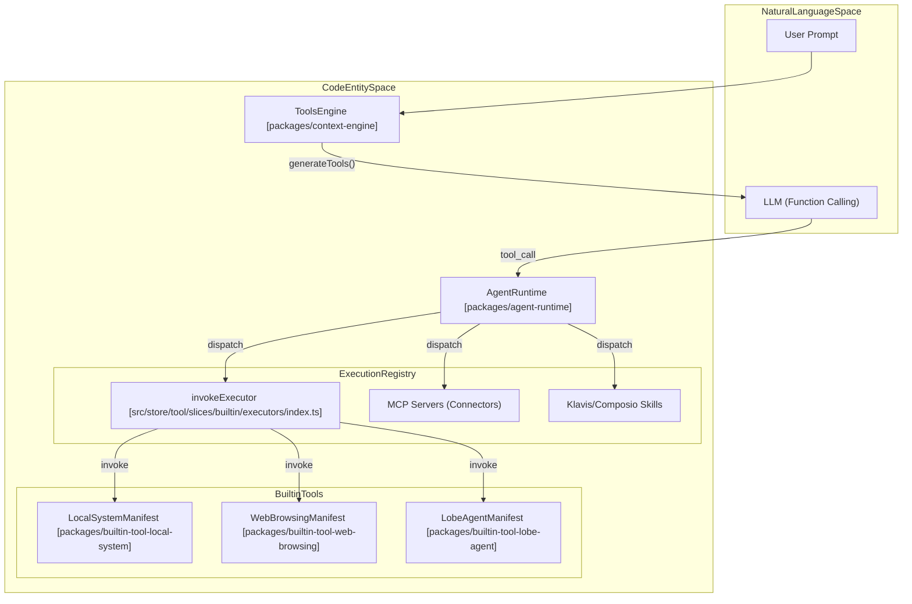
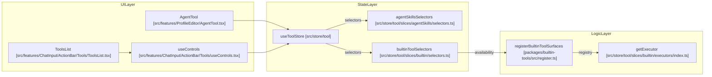

<!-- source: DeepWiki mcp.deepwiki.com · repo lobehub/lobehub · page 5 Plugin and Tool System · fetched 2026-10-29 -->

# Plugin and Tool System

Relevant source files

The following files were used as context for generating this wiki page:

- [apps/server/src/modules/Mecha/AgentToolsEngine/__tests__/index.test.ts](apps/server/src/modules/Mecha/AgentToolsEngine/__tests__/index.test.ts)
- [apps/server/src/modules/Mecha/AgentToolsEngine/index.ts](apps/server/src/modules/Mecha/AgentToolsEngine/index.ts)
- [apps/server/src/modules/Mecha/AgentToolsEngine/types.ts](apps/server/src/modules/Mecha/AgentToolsEngine/types.ts)
- [apps/server/src/services/toolExecution/serverRuntimes/index.ts](apps/server/src/services/toolExecution/serverRuntimes/index.ts)
- [packages/builtin-tool-knowledge-base/package.json](packages/builtin-tool-knowledge-base/package.json)
- [packages/builtin-tool-knowledge-base/src/client/executor/index.ts](packages/builtin-tool-knowledge-base/src/client/executor/index.ts)
- [packages/builtin-tool-knowledge-base/src/client/index.ts](packages/builtin-tool-knowledge-base/src/client/index.ts)
- [packages/builtin-tools/package.json](packages/builtin-tools/package.json)
- [packages/builtin-tools/src/identifiers.ts](packages/builtin-tools/src/identifiers.ts)
- [packages/builtin-tools/src/index.ts](packages/builtin-tools/src/index.ts)
- [packages/context-engine/src/processors/HistoryTruncate.ts](packages/context-engine/src/processors/HistoryTruncate.ts)
- [packages/context-engine/src/processors/__tests__/HistoryTruncate.test.ts](packages/context-engine/src/processors/__tests__/HistoryTruncate.test.ts)
- [packages/types/src/tool/builtin.ts](packages/types/src/tool/builtin.ts)
- [src/features/ChatInput/ControlBar/HeteroDeviceSwitcher.tsx](src/features/ChatInput/ControlBar/HeteroDeviceSwitcher.tsx)
- [src/helpers/executionTarget.test.ts](src/helpers/executionTarget.test.ts)
- [src/helpers/executionTarget.ts](src/helpers/executionTarget.ts)
- [src/helpers/toolEngineering/index.test.ts](src/helpers/toolEngineering/index.test.ts)
- [src/helpers/toolEngineering/index.ts](src/helpers/toolEngineering/index.ts)
- [src/store/agent/selectors/agentByIdSelectors.test.ts](src/store/agent/selectors/agentByIdSelectors.test.ts)
- [src/store/agent/selectors/agentByIdSelectors.ts](src/store/agent/selectors/agentByIdSelectors.ts)
- [src/store/agent/selectors/chatConfigByIdSelectors.test.ts](src/store/agent/selectors/chatConfigByIdSelectors.test.ts)
- [src/store/agent/selectors/chatConfigByIdSelectors.ts](src/store/agent/selectors/chatConfigByIdSelectors.ts)
- [src/store/agent/selectors/chatConfigSelectors.test.ts](src/store/agent/selectors/chatConfigSelectors.test.ts)
- [src/store/agent/selectors/chatConfigSelectors.ts](src/store/agent/selectors/chatConfigSelectors.ts)
- [src/store/agent/selectors/selectors.test.ts](src/store/agent/selectors/selectors.test.ts)
- [src/store/agent/selectors/selectors.ts](src/store/agent/selectors/selectors.ts)
- [src/store/agent/slices/agent/initialState.ts](src/store/agent/slices/agent/initialState.ts)
- [src/store/tool/slices/builtin/executors/index.ts](src/store/tool/slices/builtin/executors/index.ts)

LobeHub features a sophisticated, extensible tool system designed to bridge the gap between Large Language Model (LLM) reasoning and actionable code execution. The system supports multiple tool sources, including the Model Context Protocol (MCP), native built-in tools, third-party integrations via Klavis/Composio, and a robust connector architecture for credential management.

The core of this system is the `ToolsEngine`, which dynamically assembles tool manifests based on agent configuration, runtime context, and environment constraints to provide LLMs with valid function-calling schemas.

## System Overview

The tool system operates across both the Natural Language Space (where the LLM decides to use a tool) and the Code Entity Space (where the tool is executed).

### Tool Invocation Flow

The following diagram illustrates how a user request results in a tool execution through the `ToolsEngine` and the execution registry:

**Sources:**  
[src/store/tool/slices/builtin/executors/index.ts:72-111](),  
[packages/builtin-tools/src/index.ts:46-111](),  
[packages/context-engine]()

---

## MCP Protocol Integration

LobeHub fully supports the **Model Context Protocol (MCP)**, enabling one-click plugin installation directly from the MCP Marketplace. MCP connections can operate over standard IO (`stdio`) for local processes or HTTP transports. Because `stdio` requires desktop-level local system access, it is restricted to LobeHub Desktop. MCP servers integrate tightly with the Connector system for secure credential management, enabling controlled access to third-party MCP tools.

For detailed mechanics of the MCP integration, plugin installation methods, the MCP Marketplace, and transport layers, see the child page [MCP Protocol Integration](#5.1).

**Sources:**  
[src/store/tool/slices/builtin/selectors.ts:56-70]()

---

## Built-in Tools

LobeHub offers an extensive collection of built-in tools representing core capabilities, managed through manifest identifiers and integrated natively into the tool execution pipeline. Key built-in tools include:

- **Lobe Agent**: Central agent features like plan management, sub-agent dispatch, and fallback mechanisms, identified via `LobeAgentManifest.identifier`
- **Web Browsing**: Provides real-time web search and content extraction capabilities (`WebBrowsingManifest.identifier`)
- **Local System**: Enables file system and command execution in desktop mode (`LocalSystemManifest.identifier`)
- **Memory and Knowledge Base**: Implements retrieval-augmented generation and user context (`MemoryManifest.identifier`, `KnowledgeBaseManifest.identifier`)
- **Cloud Sandbox**: Secure code execution environment based on server sandboxing (`CloudSandboxManifest.identifier`)

These tools are described and registered declaratively through tool manifests, which specify APIs, metadata, and human intervention policies. The lifecycle of work-resources created by these tools (e.g., documents, tasks) is managed via declarative configurations (`PluginApiWorkConfig`). Frontend components such as inspectors, renderers, and streaming handlers complement this with rich UI interactions.

For a comprehensive list of built-in tools, their manifests, and runtime capabilities, see [Built-in Tools](#5.2).

**Sources:**  
[packages/builtin-tools/src/index.ts:45-95](),  
[packages/types/src/tool/builtin.ts:140-169](),  
[packages/builtin-tools/src/register.ts:1-174]()

---

## Skills and Third-Party Integrations

Beyond built-ins and MCP connectors, LobeHub supports third-party skill integrations based on manifests similar to built-in tools. These include stacks like Composio and other enterprise skills (e.g. GitHub, Notion, Slack, Airtable connectors). Skills can be enabled or disabled per agent configuration and are represented alongside plugins within the tool system.

Skill tools are managed transparently by selectors such as `composioStoreSelectors.composioAsLobeTools` and `lobehubSkillStoreSelectors.lobehubSkillAsLobeTools`. The Skill Store UI allows users to browse and install these capabilities.

For full details and configuration of third-party skills, see [Skills and Third-Party Integrations](#5.3).

**Sources:**  
[src/helpers/toolEngineering/index.test.ts:147-152](),  
[src/store/tool/slices/builtin/selectors.ts:56-70]()

---

## ToolsEngine and Invocation Flow

The `ToolsEngine` class is the central orchestrator in the Plugin and Tool system. It aggregates manifests from various sources—installed MCP plugins, built-in tools, third-party skills, and custom connectors—into a unified tool manifest pool. It then applies enablement rules and context resolutions to provide LLMs with accurate function calling definitions.

Key capabilities include:

- **Manifest Pool Assembly:** Combining tool manifests with disambiguation, exclusion of disabled identifiers, and application of context-aware trimming on APIs via `manifestContext`.
- **Enablement Rules:** Using an enableChecker function that respects agent config, chat mode, device capabilities, and platform constraints. This supports lists such as `alwaysOnToolIds` and `chatModeAllowedToolIds`.
- **Runtime Environment Awareness:** Differentiation of execution targets (desktop local, device gateway, cloud sandbox) influences which tools are available at runtime.

The server-side counterpart, `createServerAgentToolsEngine()`, initializes a `ToolsEngine` with database-fetched plugins and server execution details, ensuring security and compatibility checks. On the client side, the similarly named `createAgentToolsEngine()` operates on frontend store state.

| Code Entity                           | Responsibility                                              | File Path                                        |
|-------------------------------------|-------------------------------------------------------------|-------------------------------------------------|
| `defaultToolIds`                    | List of tools added to the engine by default                 | [packages/builtin-tools/src/index.ts:65-79]()   |
| `alwaysOnToolIds`                   | Core system tools that cannot be disabled (e.g. `lobe-agent`)| [packages/builtin-tools/src/index.ts:96-101]()  |
| `chatModeAllowedToolIds`            | Whitelist for non-agent chat mode tools                      | [packages/builtin-tools/src/index.ts:133-140]() |
| `createToolsEngine`                 | Client-side `ToolsEngine` factory merging all tool sources   | [src/helpers/toolEngineering/index.ts:74-140]() |
| `createServerAgentToolsEngine`      | Server-side factory with DB context & runtime info          | [apps/server/src/modules/Mecha/AgentToolsEngine/index.ts:46-189]() |
| `invokeExecutor`                   | Dispatch to the correct builtin tool executor at runtime     | [src/store/tool/slices/builtin/executors/index.ts:72-111]() |

For detailed flow and API, see [ToolsEngine and Invocation Flow](#5.4).

**Sources:**  
[packages/builtin-tools/src/index.ts:65-140](),  
[src/helpers/toolEngineering/index.ts:74-140](),  
[apps/server/src/modules/Mecha/AgentToolsEngine/index.ts:46-189](),  
[src/store/tool/slices/builtin/executors/index.ts:72-111]()

---

## Connector System

The Connector subsystem provides architecture for managing custom tool integrations beyond built-in and MCP plugins. These connectors store user credentials securely, handle OAuth2/OIDC flows, and resolve per-user or per-agent priority when multiple connectors or plugins provide overlapping tools.

Key features:

- **ConnectorModel** stores connector metadata, credentials encrypted by `KeyVaultsGateKeeper`.
- **Priority Resolution** ensures custom connectors override plugins with the same identifiers.
- **UI Integration** through `CustomConnectorModal` enables configuration and onboarding of new connectors.
- **Legacy Migration** supports transition from old plugin models to connectors.

Connectors tightly integrate with the plugin manifest pool, influencing tool visibility and enablement rules.

For deep dive into connector design, authentication flows, and UI, see [Connector System](#5.5).

**Sources:**  
[src/store/tool/slices/builtin/selectors.ts:56-73](),  
[src/store/tool/slices/builtin/selectors.ts:91-102](),  
[src/helpers/toolEngineering/index.ts:127-133]()

---

## Component Architecture

The following diagram maps key UI components for tools management to the underlying state and logic entities, illustrating the interaction flow from user interface to tool execution logic:

This architecture ensures modularity and lazy-loading of executors, improving load time and isolation between UI and runtime logic.

**Sources:**  
[src/features/ProfileEditor/AgentTool.tsx:96-120](),  
[src/features/ChatInput/ActionBar/Tools/useControls.tsx:35-48](),  
[packages/builtin-tools/src/register.ts:217-220]()

---

This page serves as a high-level overview of the plugin and tool system architecture and flows in LobeHub. For detailed technical and implementation information, please refer to the linked child pages:

- [MCP Protocol Integration](#5.1)  
- [Built-in Tools](#5.2)  
- [Skills and Third-Party Integrations](#5.3)  
- [ToolsEngine and Invocation Flow](#5.4)  
- [Connector System](#5.5)  
- [Web Browsing and Search Tools](#5.6)  
- [Dashboards and Widgets](#5.7)

---

**Sources Summary:**  
- packages/builtin-tools/src/index.ts:1-148  
- src/helpers/toolEngineering/index.ts:1-170  
- apps/server/src/modules/Mecha/AgentToolsEngine/index.ts:1-189  
- src/store/tool/slices/builtin/executors/index.ts:1-139  
- src/store/tool/slices/builtin/selectors.ts:56-73, 91-102  
- src/helpers/toolEngineering/index.test.ts:1-219  
- src/features/ProfileEditor/AgentTool.tsx:96-120  
- src/features/ChatInput/ActionBar/Tools/useControls.tsx:35-48  
- packages/builtin-tools/src/register.ts:1-174

---

