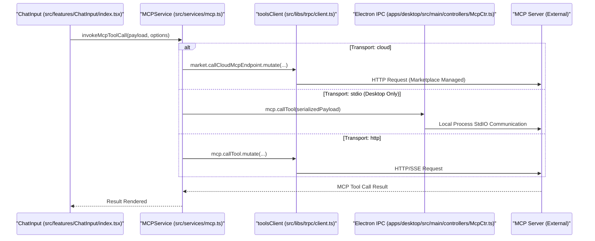
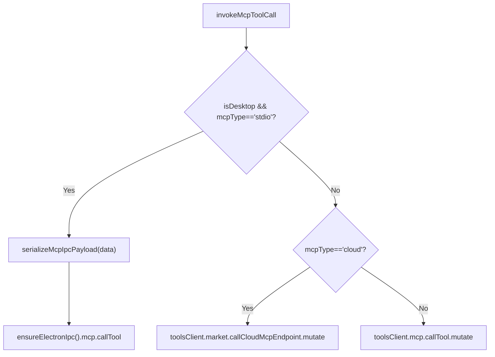
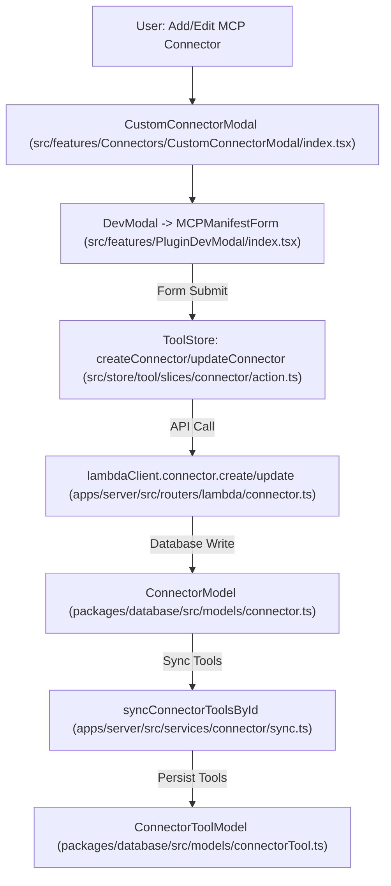

<!-- source: DeepWiki mcp.deepwiki.com · repo lobehub/lobehub · page 5.1 MCP Protocol Integration · fetched 2026-10-29 -->

# MCP Protocol Integration

<details>
<summary>Relevant source files</summary>

The following files were used as context for generating this wiki page:

- [apps/server/src/routers/lambda/__tests__/connector.syncPluginTools.test.ts](apps/server/src/routers/lambda/__tests__/connector.syncPluginTools.test.ts)
- [apps/server/src/routers/lambda/connector.ts](apps/server/src/routers/lambda/connector.ts)
- [apps/server/src/services/connector/oauth.test.ts](apps/server/src/services/connector/oauth.test.ts)
- [apps/server/src/services/connector/oauth.ts](apps/server/src/services/connector/oauth.ts)
- [apps/server/src/services/connector/stateStore.ts](apps/server/src/services/connector/stateStore.ts)
- [apps/server/src/services/connector/tokens.ts](apps/server/src/services/connector/tokens.ts)
- [locales/en-US/plugin.json](locales/en-US/plugin.json)
- [locales/zh-CN/plugin.json](locales/zh-CN/plugin.json)
- [packages/builtin-tool-local-system/src/client/Intervention/EditLocalFile/index.tsx](packages/builtin-tool-local-system/src/client/Intervention/EditLocalFile/index.tsx)
- [packages/builtin-tool-local-system/src/client/Render/EditLocalFile/index.tsx](packages/builtin-tool-local-system/src/client/Render/EditLocalFile/index.tsx)
- [packages/builtin-tool-local-system/src/client/Render/ListFiles/index.tsx](packages/builtin-tool-local-system/src/client/Render/ListFiles/index.tsx)
- [packages/builtin-tool-local-system/src/client/Render/ReadLocalFile/ReadFileView.tsx](packages/builtin-tool-local-system/src/client/Render/ReadLocalFile/ReadFileView.tsx)
- [packages/builtin-tool-local-system/src/client/Render/ReadLocalFile/buildReadFileState.test.ts](packages/builtin-tool-local-system/src/client/Render/ReadLocalFile/buildReadFileState.test.ts)
- [packages/builtin-tool-local-system/src/client/Render/ReadLocalFile/buildReadFileState.ts](packages/builtin-tool-local-system/src/client/Render/ReadLocalFile/buildReadFileState.ts)
- [packages/builtin-tool-local-system/src/client/Render/ReadLocalFile/index.tsx](packages/builtin-tool-local-system/src/client/Render/ReadLocalFile/index.tsx)
- [packages/builtin-tools/src/register.ts](packages/builtin-tools/src/register.ts)
- [packages/database/src/models/__tests__/connectorAgentScope.test.ts](packages/database/src/models/__tests__/connectorAgentScope.test.ts)
- [packages/database/src/models/connector.ts](packages/database/src/models/connector.ts)
- [packages/database/src/schemas/connector.ts](packages/database/src/schemas/connector.ts)
- [packages/heterogeneous-agents/src/adapters/devinAcp.test.ts](packages/heterogeneous-agents/src/adapters/devinAcp.test.ts)
- [packages/heterogeneous-agents/src/adapters/devinAcp.ts](packages/heterogeneous-agents/src/adapters/devinAcp.ts)
- [packages/locales/src/default/plugin.ts](packages/locales/src/default/plugin.ts)
- [packages/shared-tool-ui/src/Inspector/ReadLocalFile/formatLineRange.test.ts](packages/shared-tool-ui/src/Inspector/ReadLocalFile/formatLineRange.test.ts)
- [packages/shared-tool-ui/src/Inspector/ReadLocalFile/formatLineRange.ts](packages/shared-tool-ui/src/Inspector/ReadLocalFile/formatLineRange.ts)
- [packages/shared-tool-ui/src/Inspector/ReadLocalFile/index.tsx](packages/shared-tool-ui/src/Inspector/ReadLocalFile/index.tsx)
- [packages/shared-tool-ui/src/Inspector/WriteLocalFile/index.tsx](packages/shared-tool-ui/src/Inspector/WriteLocalFile/index.tsx)
- [src/app/(backend)/oauth/connector/callback/route.test.ts](src/app/(backend)/oauth/connector/callback/route.test.ts)
- [src/app/(backend)/oauth/connector/callback/route.ts](src/app/(backend)/oauth/connector/callback/route.ts)
- [src/features/Connectors/AddConnectorModal/index.tsx](src/features/Connectors/AddConnectorModal/index.tsx)
- [src/features/Connectors/ConnectorDetail/index.test.tsx](src/features/Connectors/ConnectorDetail/index.test.tsx)
- [src/features/Connectors/ConnectorDetail/index.tsx](src/features/Connectors/ConnectorDetail/index.tsx)
- [src/features/Connectors/ConnectorDetail/localization.test.ts](src/features/Connectors/ConnectorDetail/localization.test.ts)
- [src/features/Connectors/ConnectorDetail/localization.ts](src/features/Connectors/ConnectorDetail/localization.ts)
- [src/features/Connectors/CustomConnectorModal/index.test.tsx](src/features/Connectors/CustomConnectorModal/index.test.tsx)
- [src/features/Connectors/CustomConnectorModal/index.tsx](src/features/Connectors/CustomConnectorModal/index.tsx)
- [src/features/Connectors/CustomConnectorModal/oauthCreate.test.ts](src/features/Connectors/CustomConnectorModal/oauthCreate.test.ts)
- [src/features/Connectors/CustomConnectorModal/oauthCreate.ts](src/features/Connectors/CustomConnectorModal/oauthCreate.ts)
- [src/features/DesktopFileMenuBridge/index.tsx](src/features/DesktopFileMenuBridge/index.tsx)
- [src/features/DevPanel/RenderGallery/fixtures/devin.ts](src/features/DevPanel/RenderGallery/fixtures/devin.ts)
- [src/features/DevPanel/RenderGallery/fixtures/index.ts](src/features/DevPanel/RenderGallery/fixtures/index.ts)
- [src/features/PluginDevModal/index.tsx](src/features/PluginDevModal/index.tsx)
- [src/features/PluginDevModal/saveErrorToast.test.ts](src/features/PluginDevModal/saveErrorToast.test.ts)
- [src/features/PluginDevModal/saveErrorToast.ts](src/features/PluginDevModal/saveErrorToast.ts)
- [src/libs/replica/cacheScopeEvents.ts](src/libs/replica/cacheScopeEvents.ts)
- [src/libs/swr/useCacheScope.test.ts](src/libs/swr/useCacheScope.test.ts)
- [src/libs/swr/useCacheScope.ts](src/libs/swr/useCacheScope.ts)
- [src/services/mcp.test.ts](src/services/mcp.test.ts)
- [src/spa/initialize/connectors.test.ts](src/spa/initialize/connectors.test.ts)
- [src/spa/initialize/connectors.ts](src/spa/initialize/connectors.ts)
- [src/store/tool/builtinToolRegistry.test.ts](src/store/tool/builtinToolRegistry.test.ts)
- [src/store/tool/slices/connector/action.test.ts](src/store/tool/slices/connector/action.test.ts)
- [src/store/tool/slices/connector/action.ts](src/store/tool/slices/connector/action.ts)
- [src/store/tool/slices/connector/initialState.ts](src/store/tool/slices/connector/initialState.ts)
- [src/store/tool/slices/connector/selectors.ts](src/store/tool/slices/connector/selectors.ts)
- [src/store/tool/slices/connector/types.ts](src/store/tool/slices/connector/types.ts)

</details>


The Model Context Protocol (MCP) integration in LobeHub enables AI agents to seamlessly invoke and interact with external tools, services, and data sources through a unified and extensible protocol. This integration encompasses one-click plugin installation, supports multiple transport mechanisms (stdio, HTTP, cloud), operates via the MCP Marketplace and Connector system, and imposes desktop mode constraints for local stdio processes.

---

## Architectural Overview

LobeHub's MCP integration orchestrates communication between the AI agent interface and MCP servers through carefully designed client components, server routers, and UI elements. The Connector system abstracts individual MCP plugins, while the `MCPService` manages the execution flow adapting to different transport types.

### Core Components and Data Flow



- The main entry is `invokeMcpToolCall` in `MCPService` which determines transport based on plugin type and platform.
- For `stdio` plugins and when running in desktop mode, communication uses Electron IPC with local-process stdio.
- For `http` and cloud types, remote HTTP or SSE calls via TRPC `toolsClient` are employed.
- Responses flow back to the UI for rendering.

Sources: [src/services/mcp.ts:33-37](), [src/services/mcp.ts:144-167]()

---

## Transport Types and Platform Constraints

LobeHub supports three MCP connection/transport types, each with unique platform constraints and implementation:

| Transport Type | Implementation Details                | Platform Constraint | Description                                                                                  |
|----------------|------------------------------------|---------------------|----------------------------------------------------------------------------------------------|
| **stdio**      | Electron IPC (`McpCtr`) bridge      | Desktop Only        | Spawns and communicates with a local executable via standard input/output pipes.            |
| **http**       | TRPC `toolsClient.mcp.callTool`     | Web & Desktop       | Makes HTTP or SSE calls directly to remote MCP servers; supports HTTP headers authentication.|
| **cloud**      | TRPC `toolsClient.market.callCloudMcpEndpoint` | Web & Desktop       | Communicates with the managed MCP Marketplace endpoint, handling token authorization.         |

### Implementation Details

- **stdio Transport**  
  On desktop, MCP tools of this type launch local processes with commands and environment variables configured from plugin settings. Communication is via stdio pipes bridged over Electron IPC. This allows rich local tool integration while preserving security boundaries.  
  
- **http Transport**  
  Remote HTTP endpoints are called using the TRPC `mcp.callTool` mutation. Plugin settings are converted to HTTP headers for auth. Supports SSE streaming for real-time tool output.  
  
- **cloud Transport**  
  Tools verified and deployed in the MCP Marketplace are invoked through `market.callCloudMcpEndpoint`, which abstracts token management and multi-tenant authentication.

### Desktop vs Web Check in MCPService



Sources: [src/services/mcp.ts:158-167](), [src/services/mcp.ts:75-105]()

---

## MCP Marketplace and One-Click Plugin Installation

LobeHub ships a rich UI and backend integration for discovering, installing, and managing MCP plugins via a marketplace model.

### Marketplace Discovery and Sync

- The **DiscoverService** queries the external MCP Marketplace for available tools, categories, and manifests.
- On installation, the server calls `syncConnectorToolsById` to fetch and synchronize MCP tools from the market plugin into the **Connector** system.
- Marketplace plugins are first bootstrapped into Connector storage, then their individual tools are persisted in the `connector_tools` table.

### Custom Connector Modal

The `CustomConnectorModal` in the frontend allows users to add or edit custom MCP connectors with these features:

- Supports multiple auth mechanisms (none, bearer token, API key, headers, or OAuth2).
- Presents MCP plugin manifest form with transport type (stdio, http, cloud).
- When editing, it fetches full connector details including credential metadata securely.
- Supports migration from legacy custom plugins to the new connector system.
- On successful save, triggers sync calls for tool list updates.



Sources:  
[src/features/Connectors/CustomConnectorModal/index.tsx:1-150](),  
[src/features/PluginDevModal/index.tsx:1-206](),  
[src/store/tool/slices/connector/action.ts:83-157](),  
[apps/server/src/routers/lambda/connector.ts:95-174](),  
[apps/server/src/services/connector/sync.ts](line ranges unavailable)

---

## MCP Client Library and Connector Model

The MCP client-side implementation is encapsulated in `src/libs/mcp/client.ts`. It handles:

- Connection management to MCP servers.
- Making MCP tool calls with argument serialization.
- Handling different transport protocols transparently.
- Parsing and exposing MCP manifests and tools for UI consumption.

Connectors represent configured integrations in the system and abstract the underlying MCP plugin deployment. Connectors:

- Store metadata such as connection type, credentials, OAuth config.
- Map plugin manifests to tools usable by agents.
- Are created/updated via backend TRPC routes (in `connectorRouter`).
- Are linked in the frontend via `toolStore` slices for UI display and tooling.

Sources: [src/libs/mcp/client.ts:150-170](), [apps/server/src/routers/lambda/connector.ts:53-174]()

---

## Handling Tool Calls in MCPService

The core function `invokeMcpToolCall(payload, options?)` in `MCPService` manages how tool calls are routed:

- For desktop and `stdio` plugins, immediately serialize the call data for IPC and send it to the Electron main process.
- For `cloud` plugins, use the marketplace client mutation to forward calls.
- For HTTP plugins on web or desktop, use regular TRPC calls to the MCP HTTP endpoint.
- Plugin environment variables or headers are merged with entry payload for auth or configuration.

```typescript
// Internal logic snippet (conceptual)
if (isDesktop && pluginType === 'stdio') {
  // IPC call to spawn local process and communicate stdio
  ipc.mcp.callTool(serializeMcpIpcPayload(...));
} else if (pluginType === 'cloud') {
  // Call marketplace cloud endpoint with automatic token
  toolsClient.market.callCloudMcpEndpoint.mutate(...);
} else {
  // HTTP call to remote MCP server
  toolsClient.mcp.callTool.mutate(...);
}
```

Sources: [src/services/mcp.ts:75-105](), [src/services/mcp.ts:158-167]()

---

## Key Code Entities

| Class / Function            | Location                                   | Description                                                                                      |
|:---------------------------|:-------------------------------------------|:------------------------------------------------------------------------------------------------|
| `MCPService`               | `src/services/mcp.ts`                      | Orchestrates MCP tool calls adapting to platform and transport types                            |
| `invokeMcpToolCall`        | `src/services/mcp.ts`                      | Main method to initiate MCP tool execution                                                      |
| `MCPClient`                | `src/libs/mcp/client.ts`                    | Core MCP protocol client handling connections and communication transport                       |
| `connectorRouter`          | `apps/server/src/routers/lambda/connector.ts` | Server-side TRPC router handling Connector CRUD, auth, and tool sync                            |
| `CustomConnectorModal`     | `src/features/Connectors/CustomConnectorModal/index.tsx` | UI component for installing or editing MCP connectors with OAuth and manifest configuration     |
| `MCPManifestForm`          | `src/features/PluginDevModal/MCPManifestForm/index.tsx` | Form to configure MCP plugin manifests during connector creation/editing                        |
| `serializeMcpIpcPayload`  | `packages/utils/src/mcpIpcPayload.ts`      | Prepares payload for transmission over Electron IPC bridge for stdio tool invocation            |
| `syncConnectorToolsById`   | `apps/server/src/services/connector/sync.ts` | Syncs MCP plugin tools into ConnectorToolModel entries                                         |
| `toolsClient` (TRPC client)| `src/libs/trpc/client.ts`                   | Client for calling MCP HTTP and marketplace APIs                                               |

---

## Desktop-Only Constraints for stdio Transport

- MCP tools configured with transport type `stdio` run local processes spawned via an Electron main process bridge.
- Due to browser sandbox restrictions, stdio transport is **only supported in Desktop mode**.
- The desktop process launches subprocesses configured from the MCP connector's stdio config (command, args, and environment).
- The frontend sends commands to the main process over IPC (`mcp.callTool`), which manages stdio streams to and from the plugin.
- On web, attempting to use stdio transport falls back or fails, forcing use of HTTP or cloud transports.

This model supports powerful local tooling while maintaining security and cross-platform UX consistency.

Sources: [src/services/mcp.ts:158-167](), [src/features/Connectors/CustomConnectorModal/index.tsx:1-150]()

---

# Summary

LobeHub's MCP Protocol Integration enables seamless one-click MCP plugin installation, flexible transport (stdio, HTTP, cloud) support, and integration with a managed marketplace and connector system. The system respects platform constraints (stdio only on desktop) and provides rich UI components to configure, authenticate, and invoke MCP tools efficiently. Core client libraries and server routers abstract complexity and allow AI agents to leverage a growing ecosystem of external capabilities via MCP.

---

# References and Sources

- [src/services/mcp.ts:1-167]()
- [src/libs/mcp/client.ts:150-170]()
- [apps/server/src/routers/lambda/connector.ts:53-174]()
- [src/features/Connectors/CustomConnectorModal/index.tsx:1-150]()
- [src/features/PluginDevModal/index.tsx:1-206]()
- [src/store/tool/slices/connector/action.ts:83-157]()
- [apps/server/src/services/connector/sync.ts](line ranges unavailable)
- [packages/utils/src/mcpIpcPayload.ts:1-18]()

---

