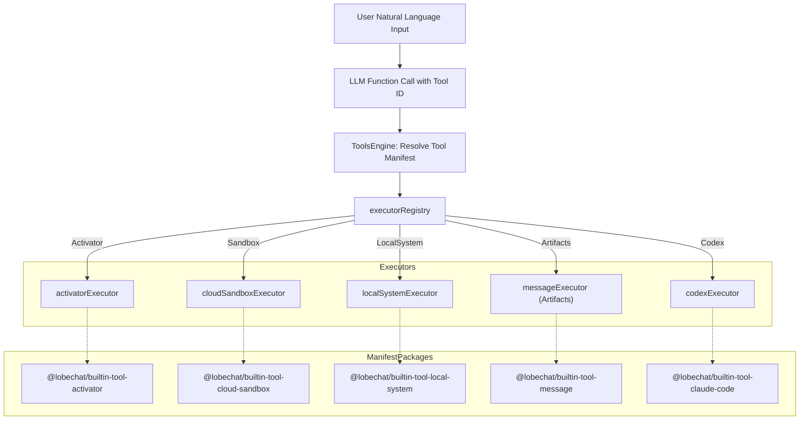
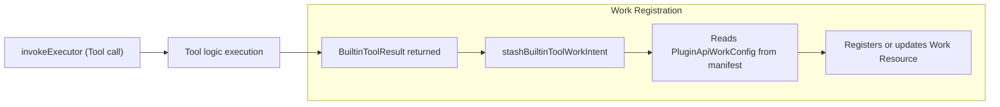
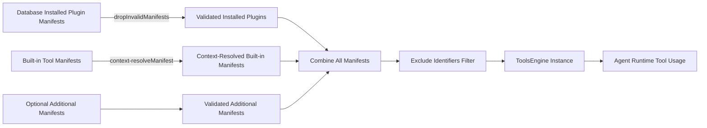
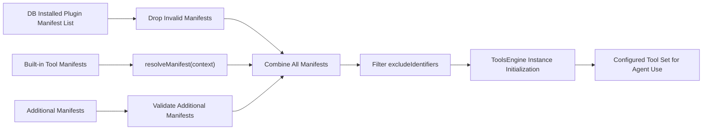
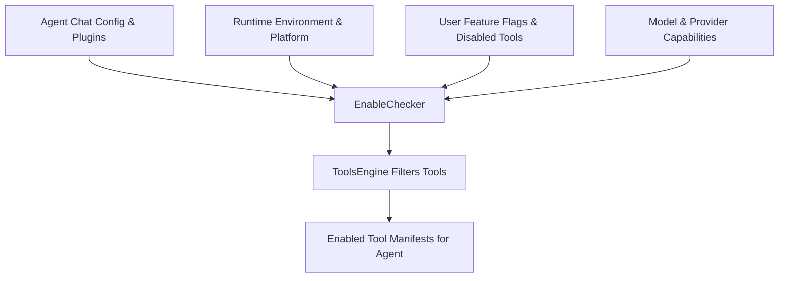

<!-- source: DeepWiki mcp.deepwiki.com · repo lobehub/lobehub · page 5.2 Built-in Tools · fetched 2026-10-29 -->

# Built-in Tools

Relevant source files

The following files were used as context for generating this wiki page:

- [apps/desktop/src/main/controllers/__tests__/LocalFileCtr.readFile.test.ts](apps/desktop/src/main/controllers/__tests__/LocalFileCtr.readFile.test.ts)
- [apps/server/src/modules/Mecha/AgentToolsEngine/__tests__/index.test.ts](apps/server/src/modules/Mecha/AgentToolsEngine/__tests__/index.test.ts)
- [apps/server/src/modules/Mecha/AgentToolsEngine/index.ts](apps/server/src/modules/Mecha/AgentToolsEngine/index.ts)
- [apps/server/src/modules/Mecha/AgentToolsEngine/types.ts](apps/server/src/modules/Mecha/AgentToolsEngine/types.ts)
- [apps/server/src/services/deviceGateway/__tests__/deviceChannels.test.ts](apps/server/src/services/deviceGateway/__tests__/deviceChannels.test.ts)
- [apps/server/src/services/deviceGateway/deviceChannels.ts](apps/server/src/services/deviceGateway/deviceChannels.ts)
- [apps/server/src/services/deviceGateway/scopedDevices.ts](apps/server/src/services/deviceGateway/scopedDevices.ts)
- [apps/server/src/services/queue/__tests__/QueueService.test.ts](apps/server/src/services/queue/__tests__/QueueService.test.ts)
- [apps/server/src/services/queue/impls/qstash.ts](apps/server/src/services/queue/impls/qstash.ts)
- [apps/server/src/services/toolExecution/__tests__/index.test.ts](apps/server/src/services/toolExecution/__tests__/index.test.ts)
- [apps/server/src/services/toolExecution/index.ts](apps/server/src/services/toolExecution/index.ts)
- [apps/server/src/services/toolExecution/serverRuntimes/__tests__/browser.test.ts](apps/server/src/services/toolExecution/serverRuntimes/__tests__/browser.test.ts)
- [apps/server/src/services/toolExecution/serverRuntimes/__tests__/localSystem.test.ts](apps/server/src/services/toolExecution/serverRuntimes/__tests__/localSystem.test.ts)
- [apps/server/src/services/toolExecution/serverRuntimes/__tests__/remoteDevice.test.ts](apps/server/src/services/toolExecution/serverRuntimes/__tests__/remoteDevice.test.ts)
- [apps/server/src/services/toolExecution/serverRuntimes/browser.ts](apps/server/src/services/toolExecution/serverRuntimes/browser.ts)
- [apps/server/src/services/toolExecution/serverRuntimes/index.ts](apps/server/src/services/toolExecution/serverRuntimes/index.ts)
- [apps/server/src/services/toolExecution/serverRuntimes/localSystem.ts](apps/server/src/services/toolExecution/serverRuntimes/localSystem.ts)
- [apps/server/src/services/toolExecution/serverRuntimes/noActiveDevice.ts](apps/server/src/services/toolExecution/serverRuntimes/noActiveDevice.ts)
- [apps/server/src/services/toolExecution/serverRuntimes/remoteDevice.ts](apps/server/src/services/toolExecution/serverRuntimes/remoteDevice.ts)
- [apps/server/src/services/toolExecution/serverRuntimes/withoutDeviceReplay.ts](apps/server/src/services/toolExecution/serverRuntimes/withoutDeviceReplay.ts)
- [locales/en-US/plugin.json](locales/en-US/plugin.json)
- [locales/zh-CN/plugin.json](locales/zh-CN/plugin.json)
- [packages/builtin-tool-knowledge-base/package.json](packages/builtin-tool-knowledge-base/package.json)
- [packages/builtin-tool-knowledge-base/src/client/executor/index.ts](packages/builtin-tool-knowledge-base/src/client/executor/index.ts)
- [packages/builtin-tool-knowledge-base/src/client/index.ts](packages/builtin-tool-knowledge-base/src/client/index.ts)
- [packages/builtin-tool-local-system/src/__tests__/grepContentForwarding.test.ts](packages/builtin-tool-local-system/src/__tests__/grepContentForwarding.test.ts)
- [packages/builtin-tool-local-system/src/client/Intervention/EditLocalFile/index.tsx](packages/builtin-tool-local-system/src/client/Intervention/EditLocalFile/index.tsx)
- [packages/builtin-tool-local-system/src/client/Render/EditLocalFile/index.tsx](packages/builtin-tool-local-system/src/client/Render/EditLocalFile/index.tsx)
- [packages/builtin-tool-local-system/src/client/Render/ListFiles/index.tsx](packages/builtin-tool-local-system/src/client/Render/ListFiles/index.tsx)
- [packages/builtin-tool-local-system/src/client/Render/ReadLocalFile/ReadFileView.tsx](packages/builtin-tool-local-system/src/client/Render/ReadLocalFile/ReadFileView.tsx)
- [packages/builtin-tool-local-system/src/client/Render/ReadLocalFile/buildReadFileState.test.ts](packages/builtin-tool-local-system/src/client/Render/ReadLocalFile/buildReadFileState.test.ts)
- [packages/builtin-tool-local-system/src/client/Render/ReadLocalFile/buildReadFileState.ts](packages/builtin-tool-local-system/src/client/Render/ReadLocalFile/buildReadFileState.ts)
- [packages/builtin-tool-local-system/src/client/Render/ReadLocalFile/index.tsx](packages/builtin-tool-local-system/src/client/Render/ReadLocalFile/index.tsx)
- [packages/builtin-tool-local-system/src/client/executor/index.test.ts](packages/builtin-tool-local-system/src/client/executor/index.test.ts)
- [packages/builtin-tool-local-system/src/client/executor/index.ts](packages/builtin-tool-local-system/src/client/executor/index.ts)
- [packages/builtin-tool-local-system/src/manifest.ts](packages/builtin-tool-local-system/src/manifest.ts)
- [packages/builtin-tool-local-system/src/systemRole.desktop.ts](packages/builtin-tool-local-system/src/systemRole.desktop.ts)
- [packages/builtin-tool-local-system/src/systemRole.ts](packages/builtin-tool-local-system/src/systemRole.ts)
- [packages/builtin-tool-remote-device/src/ExecutionRuntime/index.test.ts](packages/builtin-tool-remote-device/src/ExecutionRuntime/index.test.ts)
- [packages/builtin-tool-remote-device/src/ExecutionRuntime/index.ts](packages/builtin-tool-remote-device/src/ExecutionRuntime/index.ts)
- [packages/builtin-tool-remote-device/src/ExecutionRuntime/types.ts](packages/builtin-tool-remote-device/src/ExecutionRuntime/types.ts)
- [packages/builtin-tool-remote-device/vitest.config.mts](packages/builtin-tool-remote-device/vitest.config.mts)
- [packages/builtin-tools/package.json](packages/builtin-tools/package.json)
- [packages/builtin-tools/src/identifiers.ts](packages/builtin-tools/src/identifiers.ts)
- [packages/builtin-tools/src/index.ts](packages/builtin-tools/src/index.ts)
- [packages/builtin-tools/src/register.ts](packages/builtin-tools/src/register.ts)
- [packages/context-engine/src/processors/HistoryTruncate.ts](packages/context-engine/src/processors/HistoryTruncate.ts)
- [packages/context-engine/src/processors/__tests__/HistoryTruncate.test.ts](packages/context-engine/src/processors/__tests__/HistoryTruncate.test.ts)
- [packages/heterogeneous-agents/src/adapters/devinAcp.test.ts](packages/heterogeneous-agents/src/adapters/devinAcp.test.ts)
- [packages/heterogeneous-agents/src/adapters/devinAcp.ts](packages/heterogeneous-agents/src/adapters/devinAcp.ts)
- [packages/local-file-shell/src/file/__tests__/file.test.ts](packages/local-file-shell/src/file/__tests__/file.test.ts)
- [packages/local-file-shell/src/file/read.ts](packages/local-file-shell/src/file/read.ts)
- [packages/locales/src/default/plugin.ts](packages/locales/src/default/plugin.ts)
- [packages/shared-tool-ui/src/Inspector/ReadLocalFile/formatLineRange.test.ts](packages/shared-tool-ui/src/Inspector/ReadLocalFile/formatLineRange.test.ts)
- [packages/shared-tool-ui/src/Inspector/ReadLocalFile/formatLineRange.ts](packages/shared-tool-ui/src/Inspector/ReadLocalFile/formatLineRange.ts)
- [packages/shared-tool-ui/src/Inspector/ReadLocalFile/index.tsx](packages/shared-tool-ui/src/Inspector/ReadLocalFile/index.tsx)
- [packages/shared-tool-ui/src/Inspector/WriteLocalFile/index.tsx](packages/shared-tool-ui/src/Inspector/WriteLocalFile/index.tsx)
- [packages/tool-runtime/src/ComputerRuntime.ts](packages/tool-runtime/src/ComputerRuntime.ts)
- [packages/tool-runtime/src/LocalSystemExecutionRuntime.ts](packages/tool-runtime/src/LocalSystemExecutionRuntime.ts)
- [packages/tool-runtime/src/__tests__/LocalSystemExecutionRuntime.test.ts](packages/tool-runtime/src/__tests__/LocalSystemExecutionRuntime.test.ts)
- [packages/tool-runtime/src/types.ts](packages/tool-runtime/src/types.ts)
- [packages/types/src/tool/builtin.ts](packages/types/src/tool/builtin.ts)
- [src/features/ChatInput/ControlBar/HeteroDeviceSwitcher.tsx](src/features/ChatInput/ControlBar/HeteroDeviceSwitcher.tsx)
- [src/features/DesktopFileMenuBridge/index.tsx](src/features/DesktopFileMenuBridge/index.tsx)
- [src/features/DevPanel/RenderGallery/fixtures/devin.ts](src/features/DevPanel/RenderGallery/fixtures/devin.ts)
- [src/features/DevPanel/RenderGallery/fixtures/index.ts](src/features/DevPanel/RenderGallery/fixtures/index.ts)
- [src/helpers/executionTarget.test.ts](src/helpers/executionTarget.test.ts)
- [src/helpers/executionTarget.ts](src/helpers/executionTarget.ts)
- [src/helpers/toolEngineering/index.test.ts](src/helpers/toolEngineering/index.test.ts)
- [src/helpers/toolEngineering/index.ts](src/helpers/toolEngineering/index.ts)
- [src/store/agent/selectors/agentByIdSelectors.test.ts](src/store/agent/selectors/agentByIdSelectors.test.ts)
- [src/store/agent/selectors/agentByIdSelectors.ts](src/store/agent/selectors/agentByIdSelectors.ts)
- [src/store/agent/selectors/chatConfigByIdSelectors.test.ts](src/store/agent/selectors/chatConfigByIdSelectors.test.ts)
- [src/store/agent/selectors/chatConfigByIdSelectors.ts](src/store/agent/selectors/chatConfigByIdSelectors.ts)
- [src/store/agent/selectors/chatConfigSelectors.test.ts](src/store/agent/selectors/chatConfigSelectors.test.ts)
- [src/store/agent/selectors/chatConfigSelectors.ts](src/store/agent/selectors/chatConfigSelectors.ts)
- [src/store/agent/selectors/selectors.test.ts](src/store/agent/selectors/selectors.test.ts)
- [src/store/agent/selectors/selectors.ts](src/store/agent/selectors/selectors.ts)
- [src/store/agent/slices/agent/initialState.ts](src/store/agent/slices/agent/initialState.ts)
- [src/store/tool/builtinToolRegistry.test.ts](src/store/tool/builtinToolRegistry.test.ts)
- [src/store/tool/slices/builtin/executors/index.ts](src/store/tool/slices/builtin/executors/index.ts)

LobeHub includes a comprehensive set of built-in tools that provide foundational capabilities to AI Agents, covering diverse areas such as artifacts management, calculation, cloud sandboxing, local system interactions, memory, notebook handling, tasks, goals, and agent documents. These tools are implemented as independent packages following the `@lobechat/builtin-tool-*` naming pattern and are integrated into the system through manifest-based registration and runtime tool engines.

---

## 1. Overview and Architecture

The built-in tools architecture is centered on declarative tool manifests that describe the tool's APIs, metadata, user interface components (inspectors, renders), and runtime behaviors. These are aggregated into the `ToolsEngine`, responsible for filtering, enabling, and routing tool invocations in both frontend and server environments.

Each built-in tool package exposes:

- **Manifest**: Defines the tool identifier, API methods, default timeouts, human intervention policies, and metadata such as title, description, and avatar.
- **Inspectors**: UI components to gather or display structured input parameters and tool invocation details.
- **Render Components**: UI components for displaying tool output in chat or other interfaces.
- **Streaming Handlers**: Support streaming results, useful for long-running or real-time operations.
- **Intervention Policies**: Configurations for when to require human confirmations or audits.

The tools serve multiple roles, including:

- **Always-On Core Tools**: Tools like `lobe-agent` and `lobe-activator` which are fundamental and always enabled in agent mode.
- **Runtime-Available Tools**: Tools enabled or disabled based on environment, user preferences, or model capabilities (e.g., `local-system` active only on Electron desktop).
- **Chat Mode Tools**: Limited sets of tools allowed when agent mode is disabled (e.g., Knowledge Base, Memory, Web Browsing).

### 1.1 Built-in Tool Packages and Identifiers

The monorepo under `packages/builtin-tool-*` hosts the implementations of each built-in tool. The `@lobechat/builtin-tools` package imports and re-exports these manifests, consolidating all tools into centralized lists such as `defaultToolIds`, `alwaysOnToolIds`, and `chatModeAllowedToolIds` [packages/builtin-tools/src/index.ts:1-140]().

Key identifiers include:

| Tool Identifier            | Description                                      |
|---------------------------|------------------------------------------------|
| `lobe-agent`              | Core agent management and orchestration        |
| `lobe-activator`          | Dynamic tool enabling meta-tool                 |
| `lobe-cloud-sandbox`      | Secure isolated code execution environment      |
| `lobe-local-system`       | Local file system and command execution         |
| `lobe-claude-code`        | CLI integration for code execution and editing |
| `memory`                  | User Memory management                           |
| `notebook`                | Conversational note-taking                       |
| `task`                    | Task management                                 |
| `goal`                    | Goal graph planning and supervision             |
| `agent-documents`         | AI Agent document handling                      |
| `web-browsing`            | Web search and browser simulation                |

### 1.2 Natural Language to Code Entity Mapping

User inputs requesting actions that require tools are mapped through LLM function calls using tool identifiers. The following diagram illustrates the flow from user input to tool invocation through the internal registries:

**Sources:** [packages/builtin-tools/src/index.ts:48-62](), [src/store/tool/slices/builtin/executors/index.ts:15-102](), [packages/builtin-tools/src/register.ts:210-230]()

---

## 2. Core Built-in Tools

### 2.1 Lobe Activator (`lobe-activator`)

- **Role:** Acts as a meta-tool enabling the dynamic activation and loading of other tools that are otherwise disabled by default, reducing prompt complexity and fostering modular expansion.
- **Manifest ID:** `LobeActivatorManifest.identifier`
- **Notes:** Integrated closely with the skill activation mode control; exclusions are applied to prevent redundant UI entries [packages/builtin-tools/src/index.ts:66-70]().

### 2.2 Cloud Sandbox (`lobe-cloud-sandbox`)

- **Role:** Provides a sandboxed code execution environment supporting languages like Python and Node.js for safe data processing and experimentation.
- **Manifest ID:** `CloudSandboxManifest.identifier`
- **Intervention:** Enforces human intervention on sensitive operations to guard against unsafe code execution [packages/builtin-tools/src/register.ts:40-50]().

### 2.3 Local System (`lobe-local-system`)

- **Role:** Offers an interface to interact with the user’s local file system and OS shell commands from the agent.
- **Platform:** Only enabled in desktop Electron environments.
- **Capabilities:** Reading, writing, editing files; searching files and content; running shell commands; moving/renaming files.
- **Security:** Implements dynamic human intervention governed by path scope audits to prevent unauthorized filesystem access.
- **Manifest ID:** `LocalSystemManifest.identifier`
- **Details:** The system prompt instructs usage of several APIs for file operations and shell commands, tailored to match user language and context [packages/builtin-tools/src/index.ts:65-75](), [packages/builtin-tool-local-system/src/manifest.ts:1-174](), [packages/builtin-tool-local-system/src/systemRole.ts:1-83]().

### 2.4 Claude Code / Codex CLI Integration (`lobe-claude-code`)

- **Role:** Integration with Anthropic Claude Code to enable developer-centric CLI tasks such as file edits, command execution, git operations, and interactive code exploration.
- **UI Support:** Includes inspectors for CLI commands and specialized renders supporting multi-option selections and question prompts.
- **Streaming:** Supports interactive streaming output to provide real-time feedback during CLI workflows.
- **Manifest ID:** Managed under `ClaudeCodeIdentifier` [packages/builtin-tools/src/register.ts:30-40](), [locales/en-US/plugin.json:4-104]()

### 2.5 Memory and Notebook Packages

- **Memory Tool:** Enables extraction, persistent storage, and retrieval of long-term user memory layers to augment conversation context.
- **Notebook Tool:** Captures and manages user notes tied to conversation sessions, supporting annotative workflows.
- **Manifest IDs:** `MemoryManifest.identifier`, `NotebookIdentifier` [packages/builtin-tools/src/index.ts:70-75](), [packages/builtin-tools/src/register.ts:175-190]()

---

## 3. Tool Engineering and Runtime Enablement

Central to LobeHub’s extensibility is the `ToolsEngine` which unifies diverse manifest sources from built-in tools, installed plugins, Composio connectors, and MCP marketplace tools. It implements runtime filtering and enablement logic, ensuring the right tools activate per agent configuration, model capabilities, user permissions, and environment constraints.

### 3.1 Manifest Pool Assembly and Filtering

- **Sources Combined:**
  - Built-in tools from the monorepo.
  - Installed user plugins fetched from the database or local state.
  - MCP connectors from community packages.
  - Community skills converted to LobeToolManifest form.
- **Invalid Entries:** Manifest schemas that don’t conform (lack `api` arrays etc.) are filtered out early to prevent runtime errors.
- **Context-Awareness:** Tools with `resolveManifest` functions can produce runtime context-dependent manifests trimming APIs for sub-agent or restricted environments.

### 3.2 Enable Checkers

- Enablement is determined by the `createEnableChecker` predicate based on:
  - Agent’s current chat configuration (agent mode, enabled plugins).
  - Runtime platform (desktop, web, cloud).
  - User and device policies.
  - Model capabilities (FC usage, image output).
  - Feature flags and global memory settings.
- The enable checker filters manifests to only those permitted, ensuring safe and user-intent-aligned tool invocation [src/helpers/toolEngineering/index.ts:40-140](), [apps/server/src/modules/Mecha/AgentToolsEngine/index.ts:140-187]().

### 3.3 Server vs Frontend Tools Engine

- On the **server**, installed plugins come from database queries; on the **frontend**, they come from Zustand stores.
- The server engine also considers execution targets (e.g., device gateway enabled) and device locks for local system tools.
- Both environments share core filtering and manifest processing logic via `@lobechat/mecha` utilities [apps/server/src/modules/Mecha/AgentToolsEngine/index.ts:20-85](), [src/helpers/toolEngineering/index.ts:75-137]().

### 3.4 Work Resource Registration

Tools can declare `PluginApiWorkConfig` describing how they produce or manipulate persistent domain objects ("work") such as documents or tasks. After a tool's API executes, the result is processed to register or update associated resources, automating their lifecycle without imperative code in executors.

**Sources:** [src/store/tool/slices/builtin/executors/index.ts:70-110](), [packages/types/src/tool/builtin.ts:160-170]()

---

## 4. UI Components and Tool Localization

### 4.1 Renders and Inspectors

- Tool results displayed in chat use dynamic React components registered per tool and method.
- Rendering behavior is controlled by the `renderDisplayControl` property allowing default collapsed, expanded, or always expanded views.
- Inspectors provide UI for agents/users to interact with tool parameters and outputs; examples include file inspection, task editing, and code diff prompts.

### 4.2 Localization Strategy

All user-facing strings related to built-in tools (API method names, arguments, UI labels) are localized through JSON namespaces with a consistent key schema:

- Example key: `"builtins.lobe-agent-management.apiName.createAgent"` → "Create agent"
- Keys are nested by tool identifier and component type (`apiName`, `inspector`, `render`).
- Localization files exist under `locales/en-US/plugin.json`, `locales/zh-CN/plugin.json`, and default fallbacks in `packages/locales/src/default/plugin.ts`.

The UI renders use these keys to provide consistent multilingual support for tool interactions.

**Sources:** [locales/en-US/plugin.json:1-120](), [packages/locales/src/default/plugin.ts:1-105](), [packages/builtin-tools/src/register.ts:210-280]()

---

## 5. Built-in Tool Identifiers and Manifest Lists

The `@lobechat/builtin-tools` package exports several key arrays managing builtin tools for various runtime scenarios:

| Constant                  | Description                                                                                   | Source Lines            |
|--------------------------|-----------------------------------------------------------------------------------------------|-------------------------|
| `defaultToolIds`          | Tools always included in the default agent toolsets (includes activator, skills, agent core) | [src/index.ts:65-79]()  |
| `alwaysOnToolIds`         | Tools forcibly enabled in agent mode (e.g., lobe-agent, lobe-activator)                        | [src/index.ts:96-101]() |
| `activationModeControlledToolIds` | Tools controlled exclusively by skill activation mode control (e.g., activator)           | [src/index.ts:107]()     |
| `manualModeExcludeToolIds`| Tools excluded when running in manual skill activation mode to avoid discovery clutter          | [src/index.ts:114-117]() |
| `chatModeAllowedToolIds`  | Tools allowed in pure chat mode (agent mode disabled), filtered and gated                     | [src/index.ts:133-141]() |

This consistent identifier management allows coherent tool list formation across client and server, respecting mode and context.

**Sources:** [packages/builtin-tools/src/index.ts:1-140]()

---

## 6. Server-Side Agent Tools Engine

The server implementation in `apps/server/src/modules/Mecha/AgentToolsEngine/index.ts` fully implements the agent tool engine using database and server context data for plugin and model capability evaluation.

Key features:

- Retrieves installed plugin manifests from database context.
- Applies `resolveManifest` hooks on built-ins per runtime context (e.g., sub-agent restrictions).
- Filters manifests according to device gateway and execution target rules.
- Configures `ToolsEngine` with filtered manifests and enable checker for the model/environment.
- Exposes functions `createServerToolsEngine` and `createServerAgentToolsEngine` for server-side tool workflow initiations [apps/server/src/modules/Mecha/AgentToolsEngine/index.ts:40-189]().

Diagram illustrating manifest assembly on server:

**Sources:** [apps/server/src/modules/Mecha/AgentToolsEngine/index.ts:1-189]()

---

# Summary

LobeHub's built-in tools system is a robust, extensible, and well-typed framework seamlessly integrating core agent capabilities with dynamic plugin ecosystems. By leveraging fully declarative tool manifests combined with runtime context-aware enablement checks and rich UI integrations, it supports complex, multi-modal AI agents that interact with users and environments naturally and securely.

The consistent use of detailed manifests for API definitions, human intervention policies, UI components, and work resource registration enables maintainable and scalable growth of agent functionality. Both frontend and server share much of the core logic through shared utilities and the `ToolsEngine` abstraction, ensuring aligned behavior and ease of extension.

---

# References

- Built-in tools identifiers and manifest exports: [packages/builtin-tools/src/index.ts:1-140]()
- Tool manifest processing and `ToolsEngine` creation: [src/helpers/toolEngineering/index.ts:40-141]()
- Server-side agent tools engine and plugin manifest handling: [apps/server/src/modules/Mecha/AgentToolsEngine/index.ts:1-189]()
- Tool executors and work resource integration: [src/store/tool/slices/builtin/executors/index.ts:15-111]()
- UI tool rendering and inspection components: [src/features/Conversation/Messages/AssistantGroup/Tool/index.tsx:1-176]()
- Built-in tool localization keys: [locales/en-US/plugin.json:1-120](), [packages/locales/src/default/plugin.ts:1-105]()
- Local System tool details and system prompt: [packages/builtin-tool-local-system/src/manifest.ts:1-174](), [packages/builtin-tool-local-system/src/systemRole.ts:1-83]()
- Claude Code CLI integration and streaming: [packages/builtin-tools/src/register.ts:30-40]()

---

# Additional Diagrams

## Built-in Tools Manifest Sources and ToolsEngine Initialization

## Runtime Tool Enablement Decision Flow

---

