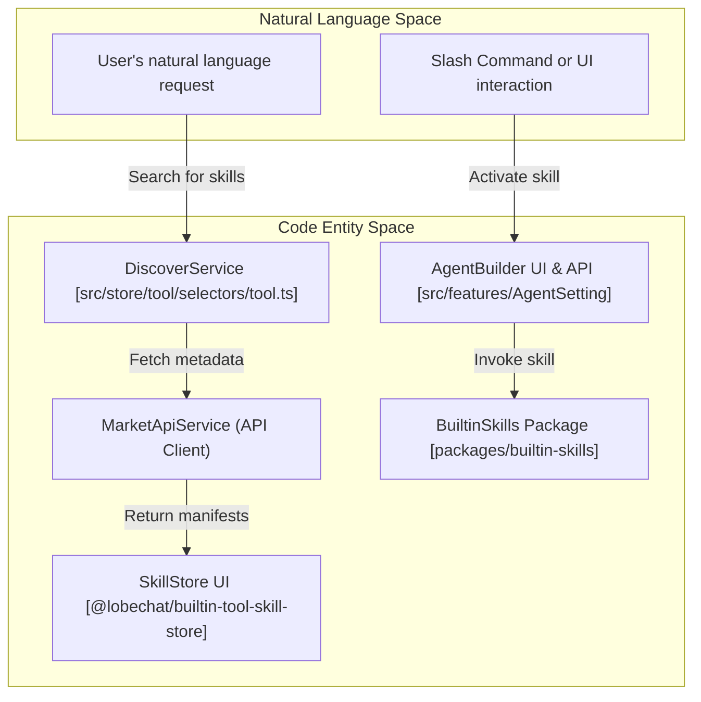
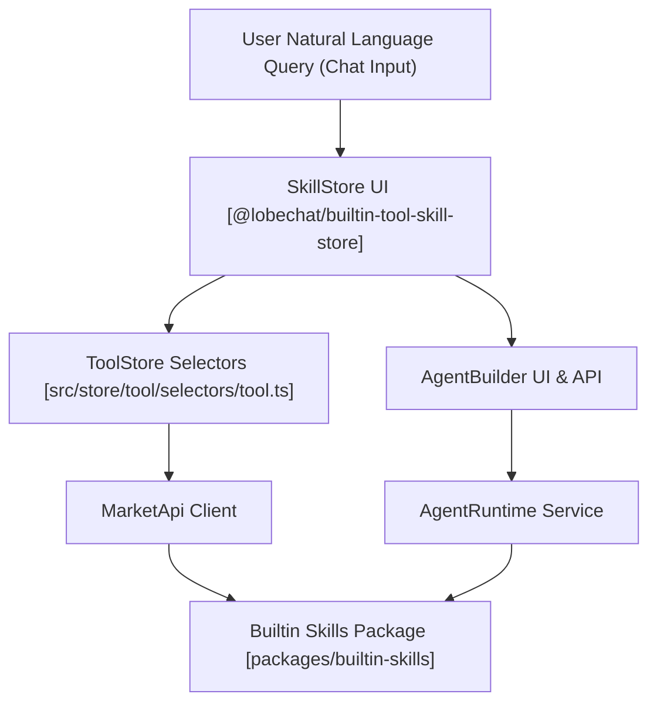
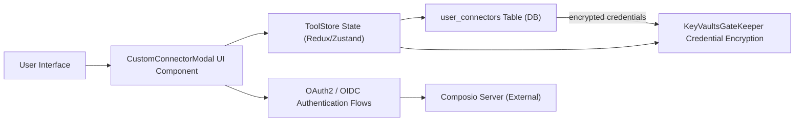

<!-- source: DeepWiki mcp.deepwiki.com · repo lobehub/lobehub · page 5.3 Skills and Third-Party Integrations · fetched 2026-10-29 -->

# Skills and Third-Party Integrations

Relevant source files

The following files were used as context for generating this wiki page:

- [apps/cli/man/man1/lh.1](apps/cli/man/man1/lh.1)
- [apps/cli/package.json](apps/cli/package.json)
- [apps/cli/src/commands/dashboard.ts](apps/cli/src/commands/dashboard.ts)
- [apps/cli/src/commands/widget.test.ts](apps/cli/src/commands/widget.test.ts)
- [apps/cli/src/commands/widget.ts](apps/cli/src/commands/widget.ts)
- [apps/cli/src/program.ts](apps/cli/src/program.ts)
- [packages/builtin-skills/src/lobehub/content.ts](packages/builtin-skills/src/lobehub/content.ts)
- [packages/builtin-skills/src/lobehub/index.ts](packages/builtin-skills/src/lobehub/index.ts)
- [packages/builtin-skills/src/lobehub/references/dashboard.ts](packages/builtin-skills/src/lobehub/references/dashboard.ts)
- [packages/heterogeneous-agents/src/protocol/lobeHubCliGuide.ts](packages/heterogeneous-agents/src/protocol/lobeHubCliGuide.ts)
- [src/features/AgentSetting/AgentSettings.tsx](src/features/AgentSetting/AgentSettings.tsx)
- [src/features/ChatInput/ActionBar/Knowledge/useControls.tsx](src/features/ChatInput/ActionBar/Knowledge/useControls.tsx)
- [src/features/ChatInput/ActionBar/Plus/index.tsx](src/features/ChatInput/ActionBar/Plus/index.tsx)
- [src/features/ChatInput/ActionBar/Tools/ComposioServerItem.tsx](src/features/ChatInput/ActionBar/Tools/ComposioServerItem.tsx)
- [src/features/ChatInput/ActionBar/Tools/LobehubSkillServerItem.tsx](src/features/ChatInput/ActionBar/Tools/LobehubSkillServerItem.tsx)
- [src/features/ChatInput/ActionBar/Tools/PopoverContent.tsx](src/features/ChatInput/ActionBar/Tools/PopoverContent.tsx)
- [src/features/ChatInput/ActionBar/Tools/SkillRow.tsx](src/features/ChatInput/ActionBar/Tools/SkillRow.tsx)
- [src/features/ChatInput/ActionBar/Tools/ToolItem.tsx](src/features/ChatInput/ActionBar/Tools/ToolItem.tsx)
- [src/features/ChatInput/ActionBar/Tools/ToolsList.tsx](src/features/ChatInput/ActionBar/Tools/ToolsList.tsx)
- [src/features/ChatInput/ActionBar/Tools/constants.ts](src/features/ChatInput/ActionBar/Tools/constants.ts)
- [src/features/ChatInput/ActionBar/Tools/index.tsx](src/features/ChatInput/ActionBar/Tools/index.tsx)
- [src/features/ChatInput/ActionBar/Tools/useControls.tsx](src/features/ChatInput/ActionBar/Tools/useControls.tsx)
- [src/features/ChatInput/ActionBar/Upload/index.tsx](src/features/ChatInput/ActionBar/Upload/index.tsx)
- [src/features/ChatInput/ActionBar/Upload/useKnowledgeMenuItems.test.ts](src/features/ChatInput/ActionBar/Upload/useKnowledgeMenuItems.test.ts)
- [src/features/ChatInput/ActionBar/Upload/useKnowledgeMenuItems.tsx](src/features/ChatInput/ActionBar/Upload/useKnowledgeMenuItems.tsx)
- [src/features/ChatInput/ActionBar/components/ActionDropdown.tsx](src/features/ChatInput/ActionBar/components/ActionDropdown.tsx)
- [src/features/ChatInput/ActionBar/components/ActionPopover.tsx](src/features/ChatInput/ActionBar/components/ActionPopover.tsx)
- [src/features/ChatInput/ActionBar/components/menuCloseVeto.test.ts](src/features/ChatInput/ActionBar/components/menuCloseVeto.test.ts)
- [src/features/Home/InputArea/EditorInput.tsx](src/features/Home/InputArea/EditorInput.tsx)
- [src/features/Home/InputArea/index.tsx](src/features/Home/InputArea/index.tsx)
- [src/features/Home/InputArea/taskAttachments.test.ts](src/features/Home/InputArea/taskAttachments.test.ts)
- [src/features/Home/InputArea/taskAttachments.ts](src/features/Home/InputArea/taskAttachments.ts)
- [src/features/Home/InputArea/useSend.test.ts](src/features/Home/InputArea/useSend.test.ts)
- [src/features/Home/InputArea/useSend.ts](src/features/Home/InputArea/useSend.ts)
- [src/features/ProfileEditor/AgentTool.tsx](src/features/ProfileEditor/AgentTool.tsx)
- [src/features/ProfileEditor/AgentUserTools/AgentToolsSection.tsx](src/features/ProfileEditor/AgentUserTools/AgentToolsSection.tsx)
- [src/features/ProfileEditor/AgentUserTools/UserToolsSection.test.tsx](src/features/ProfileEditor/AgentUserTools/UserToolsSection.test.tsx)
- [src/features/ProfileEditor/AgentUserTools/UserToolsSection.tsx](src/features/ProfileEditor/AgentUserTools/UserToolsSection.tsx)
- [src/features/ProfileEditor/PluginTag.tsx](src/features/ProfileEditor/PluginTag.tsx)
- [src/features/ProfileEditor/PopoverContent.tsx](src/features/ProfileEditor/PopoverContent.tsx)
- [src/features/ProfileEditor/profileToolVisibility.test.ts](src/features/ProfileEditor/profileToolVisibility.test.ts)
- [src/features/ProfileEditor/profileToolVisibility.ts](src/features/ProfileEditor/profileToolVisibility.ts)
- [src/features/Settings/chat-appearance/features/ChatAppearance/MermaidPreview.tsx](src/features/Settings/chat-appearance/features/ChatAppearance/MermaidPreview.tsx)
- [src/hooks/useInterceptingRoutes.test.ts](src/hooks/useInterceptingRoutes.test.ts)
- [src/hooks/useInterceptingRoutes.ts](src/hooks/useInterceptingRoutes.ts)
- [src/routes/(main)/agent/profile/features/ProfileEditor/AgentTool.tsx](src/routes/(main)/agent/profile/features/ProfileEditor/AgentTool.tsx)
- [src/routes/(main)/group/profile/features/MemberProfile/AgentTool.tsx](src/routes/(main)/group/profile/features/MemberProfile/AgentTool.tsx)
- [src/store/serverConfig/selectors.test.ts](src/store/serverConfig/selectors.test.ts)
- [src/store/tool/slices/builtin/selectors.test.ts](src/store/tool/slices/builtin/selectors.test.ts)
- [src/store/tool/slices/builtin/selectors.ts](src/store/tool/slices/builtin/selectors.ts)

This page documents LobeHub's comprehensive skills system and third-party integrations ecosystem. It covers the design and implementation of skill manifests, the built-in skill packages, the Skill Store User Interface (UI), and the integration of external SaaS tools through Composio/Klavis-style connectors. It also explains configuration mechanisms for enabling and disabling these integrations.

---

## 1. LobeHub Skill Manifests and Built-in Skills

LobeHub represents skills as manifest-driven entities describing their capabilities, parameters, system instructions, and integration options. Skills extend the AI agent's functionalities and provide tooling for domain-specific and platform-specific operations.

### 1.1 Skill Manifest Structure

Each skill is described by a manifest object containing:

- **identifier**: A unique string ID for the skill.
- **name**, **avatar**: UI display elements.
- **description**: Human-readable summary of the skill purpose.
- **version**: Skill version parsed from the `SKILL.md` frontmatter.
- **content**: The raw skill specification markdown (`SKILL.md` file contents).
- **resources**: Auxiliary markdown or reference files bundled with the skill.
- **source**: The origin type, e.g., `builtin`.

A prime example is the *Acceptance* skill manifest (`AcceptanceSkill`) which implements an end-to-end verification workflow including multi-modal adapters for CLI, web, Electron, and iOS simulator. It loads layered assets from `.agents/acceptance/` and includes comprehensive instructions and test infrastructure. This manifest and related code can be found in [packages/builtin-skills/src/acceptance/index.ts:25-87]().

### 1.2 Built-in Skill Packages and Composition

LobeHub ships a suite of built-in skills organized in the `packages/builtin-skills` package. These skills provide foundational capabilities integrated into LobeHub agents, including acceptance checks, testing, and verification workflows. Each skill exports a `BuiltinSkill` object which the runtime registers and exposes via the Skill Store UI and related tooling.

---

### 1.3 Skill Installation and Materialization

Skills are materialized into a workspace or repository directory for tangible use via CLI commands, such as `lh acceptance run install`. The installer conducts:

- Fetching of the skill bundle from the API (`client.verify.getSkillBundle.query`),
- Writing out all skill files (`SKILL.md`, references, assets) into `.agents/skills/<skill-identifier>/`,
- Cleanup of stale or removed files on forcible reinstalls,
- Ensuring `.gitignore` entries exist to exclude generated evidence,
- Reporting detailed summaries of files written, skipped, or removed.

These operations and the CLI command are implemented in [apps/cli/src/commands/acceptanceRun.ts:68-146]().

---

### Natural Language to Skill Manifest Mapping

This diagram illustrates how user input in natural language leads to skill discovery through services, which supply manifests to the Skill Store UI, enabling activation of skills via the Agent Builder and runtime layers.

---

## 2. Skill Store UI

The Skill Store UI is built as a React component suite included in the `@lobechat/builtin-tool-skill-store` package and used in chat input bars to present an interface for discovery, search, and management of all available skills.

- It aggregates skill metadata and descriptions from manifests stored internally or fetched from the marketplace.
- Users can enable, disable, or configure skills within their agent profiles.
- The UI presents built-in skills, agent-specific skills, and third-party integration tools uniformly.
- It uses selectors (`builtinToolSelectors`, `agentSkillsSelectors`, `composioStoreSelectors`) from the tool store slice to collect and filter displayed tools and skills [src/store/tool/slices/builtin/selectors.ts:26-179](), [src/features/ChatInput/ActionBar/Tools/useControls.tsx:3-133]().

The `Tools` React component displays the skill tool button in the chat input area and launches the Skill Store modal when clicked [src/features/ChatInput/ActionBar/Tools/index.tsx:8-61]().

---

## 3. Third-Party Integration Tools (Composio/Klavis-Style Connectors)

LobeHub supports external SaaS platform integrations through an architecture inspired by Composio and Klavis connectors. These connectors extend functional capabilities beyond built-in skills to external services.

### 3.1 Connector Architecture and Storage

- Connectors represent user-configurable integrations with external services such as Airtable, GitHub, and Notion.
- Connector metadata is stored in the `user_connectors` PostgreSQL table schema supporting persistent configuration [packages/database/src/schemas/user/connectors.ts].
- Sensitive authentication credentials are encrypted and managed via the `KeyVaultsGateKeeper` system.
- OAuth2 and OpenID Connect (OIDC) flows handle authorization securely.
- The UI for connector management uses a modal (`CustomConnectorModal`) to allow adding, updating, or removing connectors [src/store/tool/selectors/tool.ts:132-176]().

### 3.2 Integration Discovery and Enablement

- The system selects enabled tools via selectors like `availableToolsForDiscovery`.
- Each Composio server with status `ACTIVE` and valid tools is exposed as a "Composio" authored tool to the UI with labels, descriptions, and tags [src/store/tool/slices/builtin/selectors.ts:56-73]().
- Internal utility mappings (e.g., `getComposioAppByIdentifier`) maintain friendly display names associated with Composio connector identifiers.

### 3.3 Enable/Disable Configuration

- Skill and connector availability is controlled by runtime environment checks, user preferences, and feature flags.
- Functions `isBuiltinSkillAvailableInCurrentEnv` and `isBuiltinToolAvailableInCurrentEnv` enforce constraints such as platform availability (Desktop vs Web) and feature gating [src/store/tool/slices/builtin/selectors.ts:10-54]().
- Feature flags, e.g., enabling Composio or skill discovery, are managed through the global server config and the Labs preferences UI [src/store/serverConfig/selectors.test.ts:30-122]().

---

## 4. Data Flow and Key Functions

### 4.1 Skill Manifest Loading

- Skills are primarily bundled with their manifest, skill markdown `SKILL.md`, and related reference files.
- The function `readSkillVersion` parses the skill version from `SKILL.md` frontmatter.
- Built-in skills are registered statically in `packages/builtin-skills` and dynamically fetched bundles for installed skills extend this.
- This is exemplified in the Acceptance skill loading code [packages/builtin-skills/src/acceptance/index.ts:3-87]().

### 4.2 Skill Installation CLI Flow

The CLI command `acceptance run install` performs:

1. Fetch skill bundle via API call `client.verify.getSkillBundle.query` [apps/cli/src/commands/acceptanceRun.ts:69-71].
2. Write the skill files to `.agents/skills/<skill-id>` directory, preserving or overwriting based on a force flag [acceptanceRun.ts:81-112].
3. Clean stale files no longer part of the skill bundle to avoid orphaned artifacts.
4. Ensure proper `.gitignore` entries for skill-generated evidence directories [acceptanceRun.ts:113-145].
5. Render summary output listing created, skipped, and removed files.

### 4.3 Skill Discovery and Runtime Usage

- The `DiscoverService` in the tool store selectors collects all skills and built-in tools, filtering by availability.
- The `ToolsEngine` merges manifests from installed plugins, built-in tools, and skills to expose a unified API surface for agent runtime invocation.
- Tool components bind skill manifests to UI renderers and handlers, facilitating invocation and status updates.

---

## Diagrams: Bridging Natural Language Space to Code Entity Space

### Diagram 1: Skill Discovery and Activation Flow

### Diagram 2: Third-Party Integration Connector Lifecycle

---

## References and Sources

- Skill manifest definitions and Acceptance skill:  
  [packages/builtin-skills/src/acceptance/index.ts:25-87]()

- Skill installation CLI command and file writing logic:  
  [apps/cli/src/commands/acceptanceRun.ts:68-146]()

- Tool store selectors, availability checks, and materialization:  
  [src/store/tool/slices/builtin/selectors.ts:26-179]()  
  [src/store/tool/selectors/tool.ts:2-2]()  
  [src/store/tool/selectors/tool.ts:19-37]()  
  [src/store/tool/selectors/tool.ts:132-176]()

- Skill Store UI and chat input tool controls:  
  [src/features/ChatInput/ActionBar/Tools/useControls.tsx:1-194]()  
  [src/features/ChatInput/ActionBar/Tools/index.tsx:1-61]()

- CLI commands registration and tool execution entry:  
  [apps/cli/src/program.ts:1-127]()

- Feature flag and server config selectors impacting enablement:  
  [src/store/serverConfig/selectors.test.ts:30-124]()

---

This completes the detailed technical overview of Skills and Third-Party Integrations in LobeHub.

---

