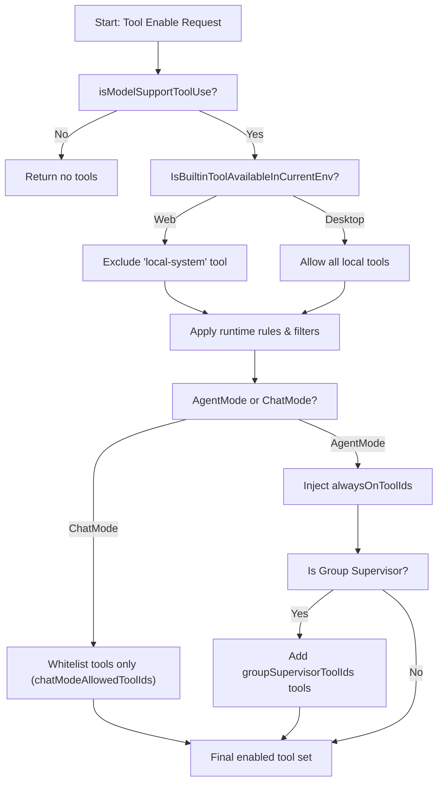
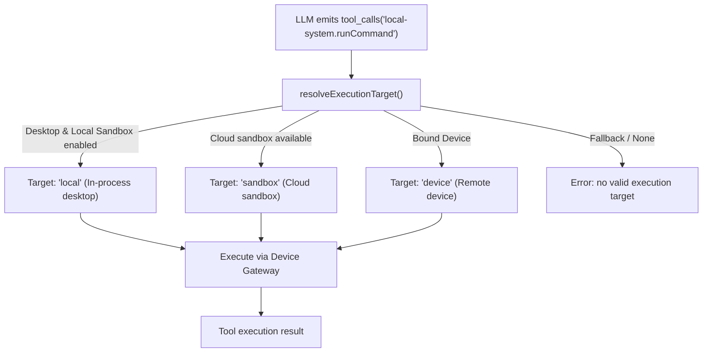
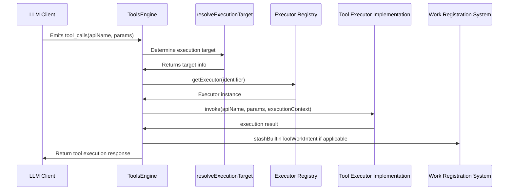

<!-- source: DeepWiki mcp.deepwiki.com · repo lobehub/lobehub · page 5.4 ToolsEngine and Invocation Flow · fetched 2026-10-29 -->

# ToolsEngine and Invocation Flow

<details>
<summary>Relevant source files</summary>

The following files were used as context for generating this wiki page:

- [apps/server/src/modules/AgentRuntime/adapters/ServerLLMTransport.test.ts](apps/server/src/modules/AgentRuntime/adapters/ServerLLMTransport.test.ts)
- [apps/server/src/modules/AgentRuntime/adapters/serverCallLlmContextHints.test.ts](apps/server/src/modules/AgentRuntime/adapters/serverCallLlmContextHints.test.ts)
- [apps/server/src/modules/AgentRuntime/adapters/serverCallLlmContextHints.ts](apps/server/src/modules/AgentRuntime/adapters/serverCallLlmContextHints.ts)
- [apps/server/src/modules/Mecha/AgentToolsEngine/__tests__/index.test.ts](apps/server/src/modules/Mecha/AgentToolsEngine/__tests__/index.test.ts)
- [apps/server/src/modules/Mecha/AgentToolsEngine/index.ts](apps/server/src/modules/Mecha/AgentToolsEngine/index.ts)
- [apps/server/src/modules/Mecha/AgentToolsEngine/types.ts](apps/server/src/modules/Mecha/AgentToolsEngine/types.ts)
- [apps/server/src/modules/Mecha/ContextEngineering/providers/index.ts](apps/server/src/modules/Mecha/ContextEngineering/providers/index.ts)
- [apps/server/src/modules/Mecha/ContextEngineering/providers/serverContextFactProviders.test.ts](apps/server/src/modules/Mecha/ContextEngineering/providers/serverContextFactProviders.test.ts)
- [apps/server/src/modules/Mecha/ModelParams/providers.ts](apps/server/src/modules/Mecha/ModelParams/providers.ts)
- [apps/server/src/routers/lambda/market/creds.test.ts](apps/server/src/routers/lambda/market/creds.test.ts)
- [apps/server/src/routers/lambda/market/creds.ts](apps/server/src/routers/lambda/market/creds.ts)
- [apps/server/src/services/agentRuntime/credentialFacts.test.ts](apps/server/src/services/agentRuntime/credentialFacts.test.ts)
- [apps/server/src/services/agentRuntime/credentialFacts.ts](apps/server/src/services/agentRuntime/credentialFacts.ts)
- [apps/server/src/services/aiAgent/pipeline/__tests__/toolDiscovery.installedPlugins.test.ts](apps/server/src/services/aiAgent/pipeline/__tests__/toolDiscovery.installedPlugins.test.ts)
- [apps/server/src/services/aiAgent/pipeline/__tests__/toolDiscovery.shareGate.test.ts](apps/server/src/services/aiAgent/pipeline/__tests__/toolDiscovery.shareGate.test.ts)
- [apps/server/src/services/aiAgent/pipeline/toolDiscovery.ts](apps/server/src/services/aiAgent/pipeline/toolDiscovery.ts)
- [apps/server/src/services/toolExecution/serverRuntimes/index.ts](apps/server/src/services/toolExecution/serverRuntimes/index.ts)
- [packages/builtin-tool-knowledge-base/package.json](packages/builtin-tool-knowledge-base/package.json)
- [packages/builtin-tool-knowledge-base/src/client/executor/index.ts](packages/builtin-tool-knowledge-base/src/client/executor/index.ts)
- [packages/builtin-tool-knowledge-base/src/client/index.ts](packages/builtin-tool-knowledge-base/src/client/index.ts)
- [packages/builtin-tools/package.json](packages/builtin-tools/package.json)
- [packages/builtin-tools/src/identifiers.ts](packages/builtin-tools/src/identifiers.ts)
- [packages/builtin-tools/src/index.ts](packages/builtin-tools/src/index.ts)
- [packages/context-engine/src/processors/HistoryTruncate.ts](packages/context-engine/src/processors/HistoryTruncate.ts)
- [packages/context-engine/src/processors/__tests__/HistoryTruncate.test.ts](packages/context-engine/src/processors/__tests__/HistoryTruncate.test.ts)
- [packages/mecha/src/contextEngineering/facts/gatherContextFacts.test.ts](packages/mecha/src/contextEngineering/facts/gatherContextFacts.test.ts)
- [packages/mecha/src/contextEngineering/facts/gatherContextFacts.ts](packages/mecha/src/contextEngineering/facts/gatherContextFacts.ts)
- [packages/mecha/src/contextEngineering/facts/officialTools.ts](packages/mecha/src/contextEngineering/facts/officialTools.ts)
- [packages/mecha/src/contextEngineering/facts/types.ts](packages/mecha/src/contextEngineering/facts/types.ts)
- [packages/mecha/src/modelParams/resolveModelParams.test.ts](packages/mecha/src/modelParams/resolveModelParams.test.ts)
- [packages/mecha/src/modelParams/resolveModelParams.ts](packages/mecha/src/modelParams/resolveModelParams.ts)
- [packages/mecha/src/toolSet/discoveryPool.test.ts](packages/mecha/src/toolSet/discoveryPool.test.ts)
- [packages/mecha/src/toolSet/discoveryPool.ts](packages/mecha/src/toolSet/discoveryPool.ts)
- [packages/model-runtime/src/providers/volcengine/index.test.ts](packages/model-runtime/src/providers/volcengine/index.test.ts)
- [packages/model-runtime/src/providers/volcengine/index.ts](packages/model-runtime/src/providers/volcengine/index.ts)
- [packages/types/src/agentExecution/modelFacts.ts](packages/types/src/agentExecution/modelFacts.ts)
- [packages/types/src/tool/builtin.ts](packages/types/src/tool/builtin.ts)
- [src/features/ChatInput/ControlBar/HeteroDeviceSwitcher.tsx](src/features/ChatInput/ControlBar/HeteroDeviceSwitcher.tsx)
- [src/helpers/executionTarget.test.ts](src/helpers/executionTarget.test.ts)
- [src/helpers/executionTarget.ts](src/helpers/executionTarget.ts)
- [src/helpers/toolEngineering/index.test.ts](src/helpers/toolEngineering/index.test.ts)
- [src/helpers/toolEngineering/index.ts](src/helpers/toolEngineering/index.ts)
- [src/store/agent/selectors/agentByIdSelectors.test.ts](src/store/agent/selectors/agentByIdSelectors.test.ts)
- [src/store/agent/selectors/agentByIdSelectors.ts](src/store/agent/selectors/agentByIdSelectors.ts)
- [src/store/agent/selectors/chatConfigByIdSelectors.test.ts](src/store/agent/selectors/chatConfigByIdSelectors.test.ts)
- [src/store/agent/selectors/chatConfigByIdSelectors.ts](src/store/agent/selectors/chatConfigByIdSelectors.ts)
- [src/store/agent/selectors/chatConfigSelectors.test.ts](src/store/agent/selectors/chatConfigSelectors.test.ts)
- [src/store/agent/selectors/chatConfigSelectors.ts](src/store/agent/selectors/chatConfigSelectors.ts)
- [src/store/agent/selectors/selectors.test.ts](src/store/agent/selectors/selectors.test.ts)
- [src/store/agent/selectors/selectors.ts](src/store/agent/selectors/selectors.ts)
- [src/store/agent/slices/agent/initialState.ts](src/store/agent/slices/agent/initialState.ts)
- [src/store/tool/slices/builtin/executors/index.ts](src/store/tool/slices/builtin/executors/index.ts)

</details>


The **ToolsEngine** is a critical subsystem within LobeHub responsible for aggregating tool manifests from installed plugins, builtin tools, skills, and connectors, then outputting these as LLM-consumable tool definitions. It implements a decision tree to determine tool enablement and routes tool execution calls through an extensible executor pipeline.

This document covers the full technical detail of the **ToolsEngine** and the invocation flow, focusing on the server-side counterpart `AgentToolsEngine` for backend contexts. It explains:

- How tool manifests are aggregated from multiple sources.
- The behavior and output of `generateTools()`.
- The decision tree applied by the `enableChecker`.
- The tool call execution pipeline through registered executors and invocation logic.

---

## 1. ToolsEngine Overview

The `ToolsEngine` class, defined in `@lobechat/context-engine`, serves as a manifest aggregator and tool definition generator. It collects tool manifests from diverse sources and processes them into a normalized form for function-calling capabilities exposed to AI models.

### Tool Manifest Sources in AgentToolsEngine

On the server side, the `AgentToolsEngine` fetches and aggregates manifests from:

- **Installed Plugins**: Custom or community plugins loaded from database context [apps/server/src/modules/Mecha/AgentToolsEngine/index.ts:68-71]().

- **Builtin Tools**: Core tools developed within LobeHub, e.g., web browsing, memory, local system, etc. [packages/builtin-tools/src/index.ts:1-148]().

- **Skills**: Bundled skill manifests designed for specific tasks [packages/builtin-tools/src/index.ts:48-51]().

- **Additional Manifests**: Dynamic or scenario-specific tool manifests provided explicitly [apps/server/src/modules/Mecha/AgentToolsEngine/index.ts:50-55]().

- **Connectors & MCP Plugins**: External service connectors and Model Context Protocol plugins integrated on demand [src/helpers/toolEngineering/index.ts:90-112]().

The aggregation is performed by the shared `assembleManifestPool()` function from `@lobechat/mecha` which filters and merges manifests respecting exclusion criteria and context-aware adjustments [apps/server/src/modules/Mecha/AgentToolsEngine/index.ts:64-73]().

### ToolsEngine Implementation

The server-side initialization is done via:

```ts
createServerAgentToolsEngine(context, params): ToolsEngine
```

Which internally calls `createServerToolsEngine(context, config)`:

- `context` provides installed plugins and a function to check model support.
- `config` specifies additional manifests, disabled plugin IDs, execution context, and model abilities.

The engine filters manifests using device and platform walls to ensure tool visibility matches runtime capabilities and security requirements [apps/server/src/modules/Mecha/AgentToolsEngine/index.ts:49-89]().

---

## 2. generateTools() Output

The method `generateTools()` takes a list of requested `toolIds` and model details and produces an array of `ChatCompletionTool` instances for the model runtime:

- Filters `manifestSchemas` by requested identifiers.
- Drops any manifest without a valid API array for safety [apps/server/src/modules/Mecha/AgentToolsEngine/index.ts:74-75]() (preventing runtime crashes).
- Resolves per-tool metadata including API details, parameter schemas, and descriptions.
- Normalizes tool names to respect deployment max length settings.

This output directly feeds the LLM’s function call specification, enabling the model to invoke these tools during chat turns.

### Diagram: ToolsEngine Manifest Aggregation to `generateTools()` Output

```mermaid
graph TD
  A[Installed Plugins (DB)] --> B[assembleManifestPool()]
  C[Builtin Tools] --> B
  D[Skills] --> B
  E[Additional Manifests] --> B
  F[Connectors] --> B

  B --> G[Filtered & Merged LobeToolManifest[]]

  G --> H{Filter by requested toolIds}
  H -->|Valid API| I[manifest array]

  I --> J[generateTools() output]
  J --> K[ChatCompletionTool[] for Model Runtime]
```

Sources: [apps/server/src/modules/Mecha/AgentToolsEngine/index.ts:40-89](), [src/helpers/toolEngineering/index.ts:74-140]().

---

## 3. The enableChecker Decision Tree

The `enableChecker` is a pivotal component deciding if a tool should be enabled (exposed) in the current execution context. It takes into account:

- **Model Support for Function Calls**:
  Checks if the current AI model supports function call usage (`isModelSupportToolUse()`).

- **Runtime Platform and Environment**:
  Enforces that some tools (e.g., `local-system`) are not enabled in incompatible environments like web clients.

- **Agent Mode vs. Chat Mode**:
  In **chat mode**, only a strict whitelist (`chatModeAllowedToolIds`) of tools is available.

- **Manual Mode Exclusions**:
  When users opt for manual skill activation, the decision tree excludes discovery tools like the activator manifest.

- **Always-On Tools**:
  Core system tools like `lobe-agent`, `lobe-activator`, and `skills` are always enabled in agent mode to maintain baseline functionality.

- **Group Supervisor Mode**:
  Additional group orchestration tools are enabled for agents in a supervisory role.

### Diagram: enableChecker Decision Flow



Key enablement gate code is shared between frontend and server via `@lobechat/mecha` tooling for consistent application [apps/server/src/modules/Mecha/AgentToolsEngine/index.ts:145-170](), [packages/builtin-tools/src/index.ts:65-145]().

Sources: [apps/server/src/modules/Mecha/AgentToolsEngine/index.ts:145-187](), [packages/builtin-tools/src/index.ts:65-146]().

---

## 4. Tool Call Execution Pipeline

After the LLM emits a `tool_calls` field in its output, the invocation pipeline executes the requested tool API.

### Execution Target Resolution

The system supports multiple execution environments for tools:

- **local**: Desktop in-process execution.
- **sandbox**: Server-side cloud sandbox.
- **device**: Remote device routed via Device Gateway.
- **auto**: Auto-select an available device.

The target resolution process is done via `resolveExecutionTarget()` which considers agent config, device gateway status, platform capabilities, and request triggers [src/helpers/executionTarget.ts:129-145]().

### Diagram: Tool Call Execution Target Resolution



### Tool Invocation

The execution pipeline involves:

1. **Executor Lookup**: Using `getExecutor(identifier)` from the executor registry to get the implementation [src/store/tool/slices/builtin/executors/index.ts:25-27]().

2. **Human Intervention & Policy Checks**: Evaluate `humanIntervention` policies configured per API, potentially pausing for user approval if required [packages/types/src/tool/builtin.ts:184-201]().

3. **Actual API Invocation**: Calling `executor.invoke(apiName, params, context)` which performs the actual tool logic [src/store/tool/slices/builtin/executors/index.ts:72-110]().

4. **Work Version Registration**: If declared in the manifest, "Work" registration (e.g., document or task created by the tool call) is automatically stashed for database versioning and audit [src/store/tool/slices/builtin/executors/index.ts:104-108]().

### Summary Diagram: Tool Call Execution Flow



Sources: [src/store/tool/slices/builtin/executors/index.ts:72-111](), [packages/types/src/tool/builtin.ts:180-210](), [src/helpers/executionTarget.ts:129-151](), [apps/server/src/services/toolExecution/types.ts:128-140]().

---

## Summary

- The **ToolsEngine** aggregates manifests from installed plugins, builtin tools, skills, and connectors, filtering by capability, environment, and agent configuration to produce a definitive list of LLM-callable tools.

- The `generateTools()` method outputs normalized tool definitions tailored to the runtime model and execution context.

- The **enableChecker** applies a layered decision tree encompassing model support, platform filters, agent mode, and special group/supervisor settings to govern tool availability dynamically.

- Tool execution resolves an appropriate environment target (`local`, `sandbox`, `device`), finds the tool executor instance, performs human intervention checks if configured, invokes the tool API, and registers resulting Work entities.

This architecture ensures flexible, secure, and extensible tool invocation for LobeHub's AI agents, tightly integrating plugin ecosystems and runtime execution layers.

---

# Appendix: Key Classes and Functions

| Entity                                  | Role/Responsibility                                            | Defined At                                            |
|-----------------------------------------|---------------------------------------------------------------|------------------------------------------------------|
| `ToolsEngine`                           | Core class aggregating manifests, generating tools for LLM    | `@lobechat/context-engine` [index.ts:11-139]()       |
| `createServerAgentToolsEngine()`       | Initializes ToolsEngine on server with DB context & agent info| `apps/server/src/modules/Mecha/AgentToolsEngine` [100-189]() |
| `assembleManifestPool()`                | Aggregates and filters manifests from all sources             | `@lobechat/mecha` [toolSet/discoveryPool.ts]         |
| `generateTools()`                      | Generates final tool definitions for function calling         | `ToolsEngine` class [context-engine/index.ts]         |
| `enableChecker`                        | Checks if a tool is enabled given execution context            | Configured in `AgentToolsEngine` & `createToolsEngine`|
| `resolveExecutionTarget()`             | Determines execution environment for tool API calls           | `src/helpers/executionTarget.ts`                       |
| `getExecutor()`                       | Retrieves tool executor instance by identifier                 | `src/store/tool/slices/builtin/executors/index.ts`   |
| `invokeExecutor()`                     | Invokes the executor’s API implementation                      | `src/store/tool/slices/builtin/executors/index.ts`   |

---

# References to Source Code

- ToolsEngine base and server wrapper: [apps/server/src/modules/Mecha/AgentToolsEngine/index.ts:1-189](), [src/helpers/toolEngineering/index.ts:1-140](), [packages/builtin-tools/src/index.ts:1-148]()

- Enable checker and tool rules: [apps/server/src/modules/Mecha/AgentToolsEngine/index.ts:145-187](), [packages/builtin-tools/src/index.ts:96-147]()

- Tool execution in builtin executors: [src/store/tool/slices/builtin/executors/index.ts:1-138]()

- Execution target resolution: [src/helpers/executionTarget.ts:1-148]()

- Invocation flow and work registration: [packages/types/src/tool/builtin.ts:170-212](), [src/store/tool/slices/builtin/executors/index.ts:72-111]()

---

This concludes the full technical documentation for the **ToolsEngine and Invocation Flow** in the LobeHub codebase.

---

