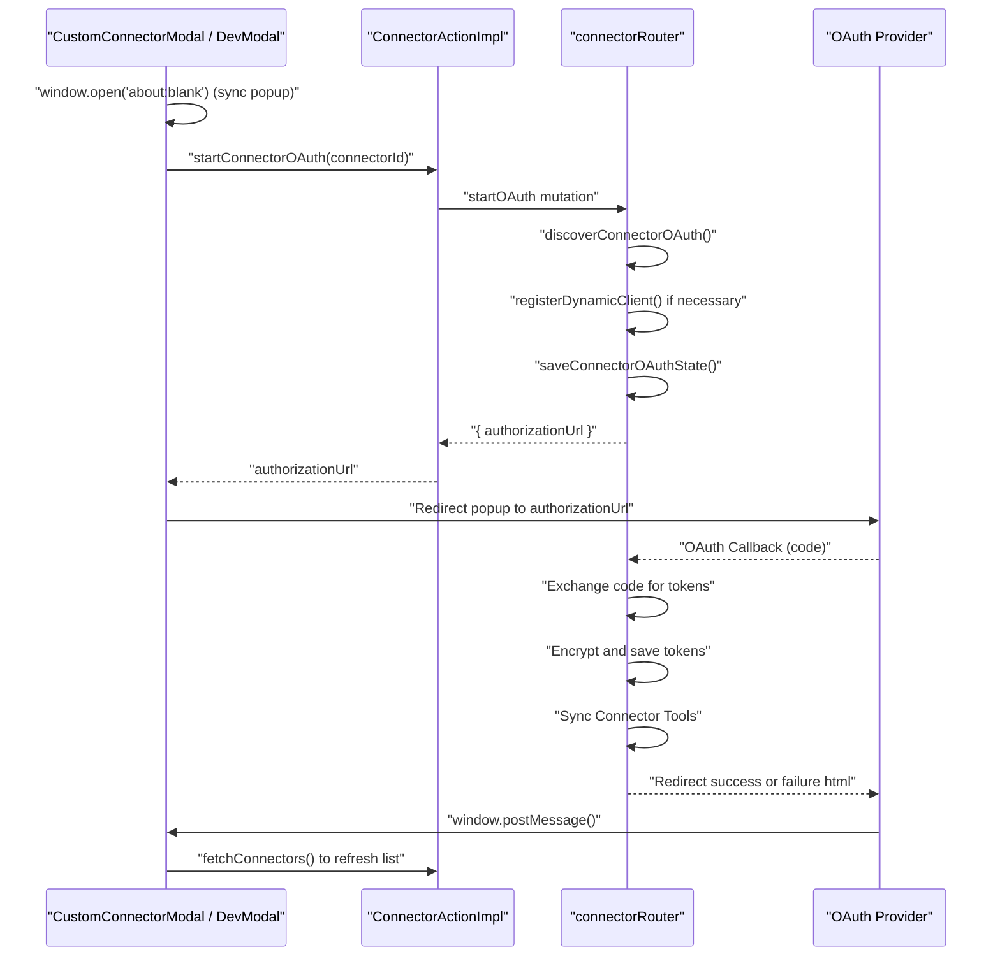

<!-- source: DeepWiki mcp.deepwiki.com · repo lobehub/lobehub · page 5.5 Connector System · fetched 2026-10-29 -->

# Connector System

<details>
<summary>Relevant source files</summary>

The following files were used as context for generating this wiki page:

- [apps/server/src/routers/lambda/__tests__/connector.syncPluginTools.test.ts](apps/server/src/routers/lambda/__tests__/connector.syncPluginTools.test.ts)
- [apps/server/src/routers/lambda/connector.ts](apps/server/src/routers/lambda/connector.ts)
- [apps/server/src/services/connector/oauth.test.ts](apps/server/src/services/connector/oauth.test.ts)
- [apps/server/src/services/connector/oauth.ts](apps/server/src/services/connector/oauth.ts)
- [apps/server/src/services/connector/stateStore.ts](apps/server/src/services/connector/stateStore.ts)
- [apps/server/src/services/connector/tokens.ts](apps/server/src/services/connector/tokens.ts)
- [packages/database/src/models/__tests__/connectorAgentScope.test.ts](packages/database/src/models/__tests__/connectorAgentScope.test.ts)
- [packages/database/src/models/connector.ts](packages/database/src/models/connector.ts)
- [packages/database/src/schemas/connector.ts](packages/database/src/schemas/connector.ts)
- [src/app/(backend)/oauth/connector/callback/route.test.ts](src/app/(backend)/oauth/connector/callback/route.test.ts)
- [src/app/(backend)/oauth/connector/callback/route.ts](src/app/(backend)/oauth/connector/callback/route.ts)
- [src/features/Connectors/AddConnectorModal/index.tsx](src/features/Connectors/AddConnectorModal/index.tsx)
- [src/features/Connectors/ConnectorDetail/index.test.tsx](src/features/Connectors/ConnectorDetail/index.test.tsx)
- [src/features/Connectors/ConnectorDetail/index.tsx](src/features/Connectors/ConnectorDetail/index.tsx)
- [src/features/Connectors/ConnectorDetail/localization.test.ts](src/features/Connectors/ConnectorDetail/localization.test.ts)
- [src/features/Connectors/ConnectorDetail/localization.ts](src/features/Connectors/ConnectorDetail/localization.ts)
- [src/features/Connectors/CustomConnectorModal/index.test.tsx](src/features/Connectors/CustomConnectorModal/index.test.tsx)
- [src/features/Connectors/CustomConnectorModal/index.tsx](src/features/Connectors/CustomConnectorModal/index.tsx)
- [src/features/Connectors/CustomConnectorModal/oauthCreate.test.ts](src/features/Connectors/CustomConnectorModal/oauthCreate.test.ts)
- [src/features/Connectors/CustomConnectorModal/oauthCreate.ts](src/features/Connectors/CustomConnectorModal/oauthCreate.ts)
- [src/features/PluginDevModal/index.tsx](src/features/PluginDevModal/index.tsx)
- [src/features/PluginDevModal/saveErrorToast.test.ts](src/features/PluginDevModal/saveErrorToast.test.ts)
- [src/features/PluginDevModal/saveErrorToast.ts](src/features/PluginDevModal/saveErrorToast.ts)
- [src/libs/replica/cacheScopeEvents.ts](src/libs/replica/cacheScopeEvents.ts)
- [src/libs/swr/useCacheScope.test.ts](src/libs/swr/useCacheScope.test.ts)
- [src/libs/swr/useCacheScope.ts](src/libs/swr/useCacheScope.ts)
- [src/services/mcp.test.ts](src/services/mcp.test.ts)
- [src/spa/initialize/connectors.test.ts](src/spa/initialize/connectors.test.ts)
- [src/spa/initialize/connectors.ts](src/spa/initialize/connectors.ts)
- [src/store/tool/slices/connector/action.test.ts](src/store/tool/slices/connector/action.test.ts)
- [src/store/tool/slices/connector/action.ts](src/store/tool/slices/connector/action.ts)
- [src/store/tool/slices/connector/initialState.ts](src/store/tool/slices/connector/initialState.ts)
- [src/store/tool/slices/connector/selectors.ts](src/store/tool/slices/connector/selectors.ts)
- [src/store/tool/slices/connector/types.ts](src/store/tool/slices/connector/types.ts)

</details>


The Connector system is LobeHub's modern architecture for extending Agent capabilities through external tools and services. It provides a unified framework for managing **Model Context Protocol (MCP)** servers, **Composio** integrations, and **LobeHub Skills**. It replaces the legacy plugin system with a more robust, secure, and agent-aware infrastructure.

## Architecture Overview

The system centers around the `user_connectors` table, which stores connection parameters and credentials. Unlike the legacy system, Connectors are multi-tenant and scope-aware, supporting personal, workspace, and agent-specific configurations.

### Data Model and Storage

- **`user_connectors` table**: Stores the primary connection info including MCP URL, stdio launch config, OIDC settings, metadata, and encrypted credentials. Agent-scoped connectors are supported, with priority used for resolution. The table schema and types are defined at [packages/database/src/schemas/connector.ts:163-210]().
- **`user_connector_tools` table**: Stores tools exposed by each connector with their permissions and API schemas [packages/database/src/schemas/connector.ts:240-260]().
- **Credential Encryption**: Credentials including OAuth tokens and API keys stored in the `credentials` column are encrypted using AES-GCM by the `KeyVaultsGateKeeper`, ensuring secure storage at rest [packages/database/src/models/connector.ts:8-11](), [apps/server/src/routers/lambda/connector.ts:26-27]().

### Connector Resolution Priority

When an Agent executes a tool call, the system resolves which connector applies based on priority:

1. **Agent-Owned Connector**  
   A connector row with `agentId` set and scoped to that agent. This acts like a "service account" with dedicated credentials for that agent. It has the highest priority [packages/database/src/models/connector.ts:139-142]().

2. **Mounted Connector**  
   A base (personal/workspace) connector referenced or "mounted" to a single agent. It is locked exclusively for that agent but remains user-owned [packages/database/src/models/connector.ts:142-144]().

3. **Base Connector**  
   A standard personal or workspace connector with no agent-specific scoping.

This layered resolution allows fine-grained connection control per agent while supporting shared connectors.

**Sources:**  
- [packages/database/src/schemas/connector.ts:163-210]()  
- [apps/server/src/routers/lambda/connector.ts:44-56]()  
- [packages/database/src/models/connector.ts:8-11]()  
- [packages/database/src/models/connector.ts:139-151]()

---

## OAuth2 and OIDC Flows

The Connector system supports customizable OAuth2 and OpenID Connect (OIDC) flows, including Dynamic Client Registration (DCR), enabling secure authentication for connectors.

### Authorization Flow

1. **OAuth Flow Initiation**  
   The frontend triggers the OAuth flow by calling `startConnectorOAuth` from the Connector slice action. This issues a tRPC mutation that engages server-side logic [src/store/tool/slices/connector/action.ts:160]().
   
2. **Server-side Setup**  
   The backend `connectorRouter` discovers OAuth configuration (`discoverConnectorOAuth`) for the connector, including OAuth endpoints and registration info. If applicable, it performs Dynamic Client Registration using `registerDynamicClient` [apps/server/src/routers/lambda/connector.ts:29-33](). The router then saves an OAuth state entry (`saveConnectorOAuthState`) for CSRF protection.

3. **Popup Window Management**  
   The frontend `DevModal` component opens a synchronous blank popup to comply with browser user-gesture requirements and then navigates it to the OAuth provider's authorization URL once retrieved [src/features/PluginDevModal/index.tsx:111-124]().

4. **OAuth Callback**  
   After user authorization, the provider redirects to the OAuth callback API route (`/oauth/connector/callback`). This route receives the authorization code, exchanges it for tokens with the provider, encrypts credentials via `KeyVaultsGateKeeper`, and updates the connector's credential storage [src/app/(backend)/oauth/connector/callback/route.ts:89-174](). Following that, it attempts to sync connector tools server-side.

5. **Popup PostMessage and UI Update**  
   The callback page posts success or error status messages to the opener window. The frontend listens to these messages to update the connector's UI state and reload the current connector list.

### Sequence Diagram of OAuth Flow



**Sources:**  
- [src/features/PluginDevModal/index.tsx:111-124]()  
- [src/store/tool/slices/connector/action.ts:160]()  
- [apps/server/src/routers/lambda/connector.ts:29-33]()  
- [packages/database/src/models/connector.ts:154-158]()  
- [src/app/(backend)/oauth/connector/callback/route.ts:89-174]()  

---

## Agent-Scoped Ownership

LobeHub introduces **agent-dimension connectors**, uniquely scoped to an individual agent. This allows agents to have dedicated credentials and connector instances differing from personal or workspace connectors.

- **Copy to Agent**  
  Creates an independent connector copy for a specific agent with its own credentials [src/store/tool/slices/connector/action.ts:105-109]().

- **Mount to Agent**  
  Creates a "mounted" reference lock from a base connector to an agent without copying credentials. Locks the base connector for that agent's exclusive use [src/store/tool/slices/connector/action.ts:111-114]().

- **UI Attribution**  
  Agent-dimension connectors in the UI show the owning agent's avatar and name, resolved by querying `resolveUserDisplayMap` during the connector list fetch [apps/server/src/routers/lambda/connector.ts:151-153]().

These features enable more secure and granular credential management per agent.

**Sources:**  
- [src/store/tool/slices/connector/action.ts:105-114]()  
- [apps/server/src/routers/lambda/connector.ts:151-153]()  
- [packages/database/src/models/connector.ts:112-131]()

---

## Legacy Plugin Migration

The platform previously used `user_installed_plugins` for MCP plugin management. The newer Connector subsystem migrates away from this legacy store.

- **Detection and Mode**  
  The `CustomConnectorModal` detects legacy plugins by the presence of `customParams.mcp`, entering a **migration mode** when a legacy plugin is provided but no connector ID exists [src/features/Connectors/CustomConnectorModal/index.tsx:26-30]().

- **Migration Process**  
  On save, a legacy plugin is transformed into a new connector row with appropriate fields extracted and normalized from the legacy record. After successful creation and tool sync, the original legacy plugin row is deleted to avoid orphaned or inconsistent states [src/features/Connectors/CustomConnectorModal/legacyPluginMigration.ts]().

- **Resilience**  
  The migration defers legacy row deletion until tools are successfully synced, ensuring no loss of usable plugin data due to transient failures.

**Sources:**  
- [src/features/Connectors/CustomConnectorModal/index.tsx:1-130]()  
- [src/features/PluginDevModal/index.tsx:1-213]()  
- [src/features/Connectors/CustomConnectorModal/legacyPluginMigration.ts]()  

---

## Composio Integration

Composio-connected accounts replicate into the Connector system to unify integrations.

- **Dual-Write Implementation**  
  When a Composio plugin is connected, two writes occur: a legacy plugin row and a new row in `user_connectors` that carries Composio metadata such as `connectedAccountId` and `appSlug` [apps/server/src/routers/lambda/__tests__/connector.syncPluginTools.test.ts:156-167]().

- **Metadata Storage**  
  Composio-specific connection metadata is stored in the `metadata.composio` JSONB field of the connector row, including multi-user attribution fields like `linkedByUserId` [packages/database/src/models/connector.ts:42-48]().

- **Tool Syncing**  
  The tools accessible via Composio are synchronized into `user_connector_tools`, allowing the runtime to build manifests locally without depending on external API calls in the chat loop [apps/server/src/routers/lambda/__tests__/connector.syncPluginTools.test.ts:118-124]().

This integration enables the runtime to invoke Composio connector tools transparently and securely.

**Sources:**  
- [apps/server/src/routers/lambda/__tests__/connector.syncPluginTools.test.ts:156-167]()  
- [packages/database/src/models/connector.ts:42-48]()  
- [apps/server/src/routers/lambda/__tests__/connector.syncPluginTools.test.ts:118-124]()  

---

## Technical Entity Map

This diagram associates high-level connector domain concepts with concrete code entities and database tables to help engineers locate and understand Connector-related functionality in the codebase.

```mermaid
classDiagram
    direction LR
    class "user_connectors" as DB_UserConnectors {
        +uuid id
        +text identifier
        +jsonb credentials
        +jsonb metadata
        +text agent_id
        +text user_id
        +text workspace_id
    }
    class "user_connector_tools" as DB_UserConnectorTools {
        +uuid id
        +uuid connector_id
        +text tool_name
        +jsonb permissions
        +jsonb apiSchema
    }
    class "ConnectorModel" as Model_Connector {
        <<Drizzle ORM Model>>
        +db: LobeChatDatabase
        +userId: string
        +workspaceId?: string
        +gateKeeper?: KeyVaultsGateKeeper
        +create(params): Promise<UserConnectorItem>
        +update(id, params): Promise<UserConnectorItem>
        +query(): Promise<PublicConnectorRecord[]>
        +queryByAgent(agentId): Promise<PublicConnectorRecord[]>
        +findScopedByIdentifier(identifier, agentId?): Promise<UserConnectorItem | undefined>
        +pickByPriority(rows, agentId?): UserConnectorItem[]
    }
    class "ConnectorToolModel" as Model_ConnectorTool {
        <<Drizzle ORM Model>>
        +db: LobeChatDatabase
        +userId: string
        +workspaceId?: string
        +queryByConnector(connectorId): Promise<UserConnectorToolItem[]>
        +upsertMany(connectorId, tools): Promise<void>
    }
    class "KeyVaultsGateKeeper" as Module_KeyVaultsGateKeeper {
        <<Credential Encryption Module>>
        +static initWithEnvKey(): Promise<KeyVaultsGateKeeper>
        +encrypt(plaintext): Promise<string>
        +decrypt(ciphertext): Promise<{ plaintext: string }>
    }
    class "connectorRouter" as TRPC_ConnectorRouter {
        <<tRPC Router>>
        +list(): Query
        +listByAgent(agentId): Query
        +create(params): Mutation
        +update(id, params): Mutation
        +delete(id): Mutation
        +startOAuth(connectorId): Mutation
        +syncPluginTools(identifier): Mutation
        +getForEdit(connectorId): Query
    }
    class "ConnectorActionImpl" as Zustand_ConnectorActionImpl {
        <<Zustand Store Slice>>
        +fetchConnectors()
        +fetchAgentBoundConnectors()
        +fetchAgentConnectors(agentId)
        +createConnector(params)
        +updateConnector(id, params)
        +deleteConnector(id)
        +startConnectorOAuth(connectorId)
        +syncConnectorTools(connectorId)
        +uninstallCustomPlugin(id)
    }
    class "CustomConnectorModal" as UI_CustomConnectorModal {
        <<React Component>>
        +onSave(value, ctx?)
        +legacyPlugin?: LobeToolCustomPlugin
        +waitForOAuthPopup(popup, connectorId)
    }
    class "DevModal" as UI_DevModal {
        <<React Component>>
        +onSave(value, ctx?)
        +runOAuthFlow()
        +MCPManifestForm
    }

    DB_UserConnectors <--> Model_Connector : "Manages Connector Rows"
    DB_UserConnectorTools <--> Model_ConnectorTool : "Manages Connector Tools"
    Model_Connector --> Module_KeyVaultsGateKeeper : "Encrypts/Decrypts Credentials"
    TRPC_ConnectorRouter --> Model_Connector : "Manipulates Connectors"
    TRPC_ConnectorRouter --> Model_ConnectorTool : "Manipulates Tools"
    Zustand_ConnectorActionImpl --> TRPC_ConnectorRouter : "Invokes tRPC Procedures"
    UI_CustomConnectorModal --> Zustand_ConnectorActionImpl : "Dispatches Connector Actions"
    UI_CustomConnectorModal --> UI_DevModal : "Renders PluginDevModal Form"
    UI_DevModal --> UI_CustomConnectorModal : "onSave Callback"
    UI_DevModal --> UI_DevModal : "Manages OAuth Popup Flow"
```

**Sources:**  
- [packages/database/src/models/connector.ts]()  
- [packages/database/src/schemas/connector.ts]()  
- [apps/server/src/routers/lambda/connector.ts]()  
- [src/store/tool/slices/connector/action.ts]()  
- [src/features/Connectors/CustomConnectorModal/index.tsx]()  
- [src/features/PluginDevModal/index.tsx]()

---

## CustomConnectorModal UI

The `CustomConnectorModal` React component [src/features/Connectors/CustomConnectorModal/index.tsx]() serves as the main user interface to add or edit custom connectors, reusing the `DevModal` form designed for MCP manifests.

- **Form Wrapping and OAuth Enablement**  
  `CustomConnectorModal` wraps `DevModal` and enables the OAuth-related form fields by passing `enableOAuth` to activate OIDC configuration UI [src/features/PluginDevModal/index.tsx:38]().

- **Form Prefill Logic**  
  In edit mode, `CustomConnectorModal` fetches the connector's full details including decrypted credentials, stdio config, metadata, and OIDC config via a protected backend query `getConnectorForEdit` [src/store/tool/slices/connector/action.ts:136-138](). It then pre-fills the form once the fetch completes; in migration mode, it seeds form values from the legacy plugin's MCP blob [src/features/Connectors/CustomConnectorModal/index.tsx:126-141]().

- **OAuth Flow Orchestration**  
  When OAuth authentication is required and the user initiates save, `DevModal` opens a blank popup synchronously to avoid browser popup blockers. It then navigates to the authorization URL retrieved by the store action `startConnectorOAuth` [src/store/tool/slices/connector/action.ts:160](). The popup's lifecycle is monitored by `waitForOAuthPopup` to detect completion or dismissal via `postMessage` events [src/features/Connectors/CustomConnectorModal/index.tsx:39-71]().

- **Legacy Plugin Migration**  
  If the modal is in migration mode, on save it calls `executeLegacyMigrationSave` to translate the old plugin data into a connector entity and perform tool sync [src/features/Connectors/CustomConnectorModal/index.tsx:109-130]().

**Sources:**  
- [src/features/Connectors/CustomConnectorModal/index.tsx]()  
- [src/features/PluginDevModal/index.tsx]()  
- [src/store/tool/slices/connector/action.ts]()  

---

This page documents the key components, data flow, and interactions for LobeHub's Connector subsystem, enabling seamless external tool integrations backed by secure credentials and flexible scoping. The system modernizes plugin management and OAuth flows, enhancing flexibility and security for AI Agent extensions.

---

