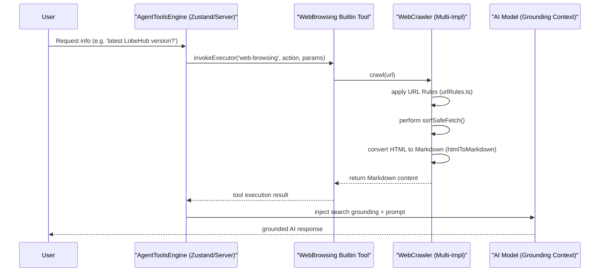
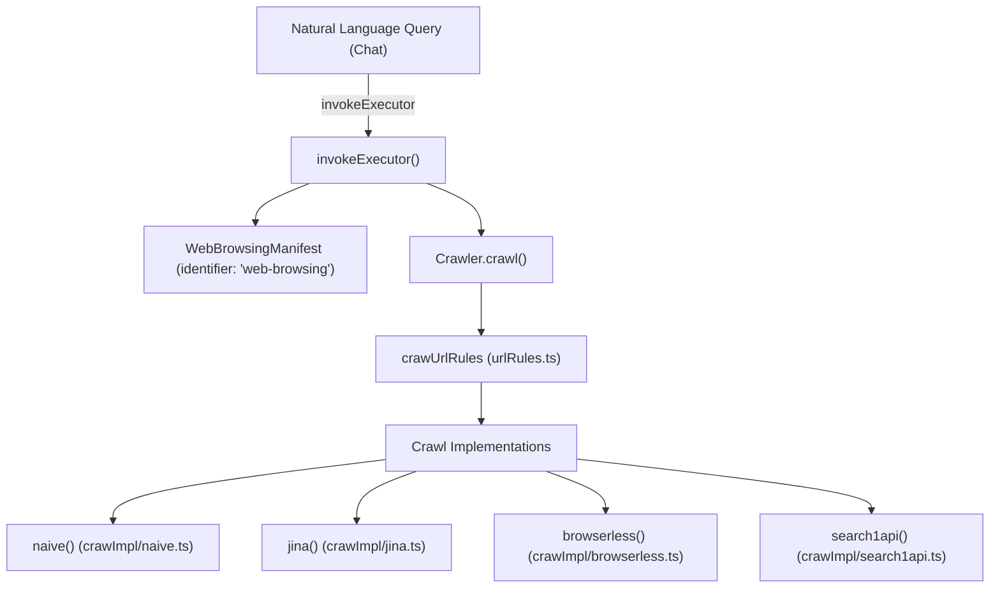
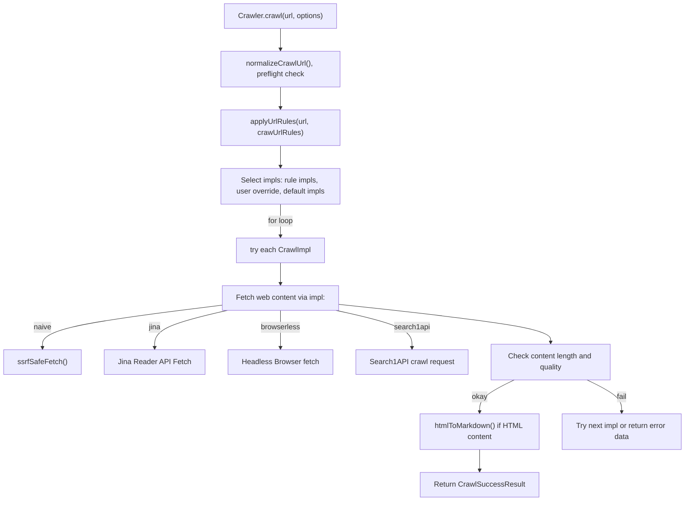

<!-- source: DeepWiki mcp.deepwiki.com · repo lobehub/lobehub · page 5.6 Web Browsing and Search Tools · fetched 2026-10-29 -->

# Web Browsing and Search Tools

Relevant source files

The following files were used as context for generating this wiki page:

- [docs/self-hosting/advanced/online-search.mdx](docs/self-hosting/advanced/online-search.mdx)
- [docs/self-hosting/advanced/online-search.zh-CN.mdx](docs/self-hosting/advanced/online-search.zh-CN.mdx)
- [packages/ssrf-safe-fetch/index.browser.ts](packages/ssrf-safe-fetch/index.browser.ts)
- [packages/ssrf-safe-fetch/index.test.ts](packages/ssrf-safe-fetch/index.test.ts)
- [packages/ssrf-safe-fetch/index.ts](packages/ssrf-safe-fetch/index.ts)
- [packages/utils/src/jina.ts](packages/utils/src/jina.ts)
- [packages/web-crawler/README.md](packages/web-crawler/README.md)
- [packages/web-crawler/README.zh-CN.md](packages/web-crawler/README.zh-CN.md)
- [packages/web-crawler/package.json](packages/web-crawler/package.json)
- [packages/web-crawler/src/__tests__/crawler.test.ts](packages/web-crawler/src/__tests__/crawler.test.ts)
- [packages/web-crawler/src/__tests__/urlRules.test.ts](packages/web-crawler/src/__tests__/urlRules.test.ts)
- [packages/web-crawler/src/crawImpl/__tests__/browserless.test.ts](packages/web-crawler/src/crawImpl/__tests__/browserless.test.ts)
- [packages/web-crawler/src/crawImpl/__tests__/jina.test.ts](packages/web-crawler/src/crawImpl/__tests__/jina.test.ts)
- [packages/web-crawler/src/crawImpl/__tests__/naive.test.ts](packages/web-crawler/src/crawImpl/__tests__/naive.test.ts)
- [packages/web-crawler/src/crawImpl/__tests__/search1api.test.ts](packages/web-crawler/src/crawImpl/__tests__/search1api.test.ts)
- [packages/web-crawler/src/crawImpl/browserless.ts](packages/web-crawler/src/crawImpl/browserless.ts)
- [packages/web-crawler/src/crawImpl/exa.ts](packages/web-crawler/src/crawImpl/exa.ts)
- [packages/web-crawler/src/crawImpl/firecrawl.ts](packages/web-crawler/src/crawImpl/firecrawl.ts)
- [packages/web-crawler/src/crawImpl/index.ts](packages/web-crawler/src/crawImpl/index.ts)
- [packages/web-crawler/src/crawImpl/jina.ts](packages/web-crawler/src/crawImpl/jina.ts)
- [packages/web-crawler/src/crawImpl/naive.ts](packages/web-crawler/src/crawImpl/naive.ts)
- [packages/web-crawler/src/crawImpl/search1api.ts](packages/web-crawler/src/crawImpl/search1api.ts)
- [packages/web-crawler/src/crawImpl/tavily.ts](packages/web-crawler/src/crawImpl/tavily.ts)
- [packages/web-crawler/src/crawler.ts](packages/web-crawler/src/crawler.ts)
- [packages/web-crawler/src/type.ts](packages/web-crawler/src/type.ts)
- [packages/web-crawler/src/urlRules.ts](packages/web-crawler/src/urlRules.ts)
- [packages/web-crawler/src/utils/__tests__/withTimeout.test.ts](packages/web-crawler/src/utils/__tests__/withTimeout.test.ts)
- [packages/web-crawler/src/utils/appUrlRules.ts](packages/web-crawler/src/utils/appUrlRules.ts)
- [packages/web-crawler/src/utils/html/yingchao.html](packages/web-crawler/src/utils/html/yingchao.html)
- [packages/web-crawler/src/utils/htmlToMarkdown.test.ts](packages/web-crawler/src/utils/htmlToMarkdown.test.ts)
- [packages/web-crawler/src/utils/htmlToMarkdown.ts](packages/web-crawler/src/utils/htmlToMarkdown.ts)
- [packages/web-crawler/src/utils/withTimeout.ts](packages/web-crawler/src/utils/withTimeout.ts)

LobeHub incorporates a comprehensive web browsing and search capability as a built-in tool within its AI agent ecosystem. This system enables AI agents to fetch real-time web content, crawl and extract relevant information from URLs, and convert HTML pages into structured Markdown data as grounding context for chat completions and queries. The implementation features a configurable set of crawler engines, SSRF-safe HTTP fetching, URL pattern-based crawling strategies, and robust HTML-to-Markdown conversion.

---

## Overview and Integration

The web browsing functionality is defined as a built-in tool under the manifest `WebBrowsingManifest.identifier` within the `@lobechat/builtin-tools` package. It is enabled by default in general `defaultToolIds` and allowed in the `chatModeAllowedToolIds` configuration, ensuring availability for chat agents to call upon when web content retrieval is needed [packages/builtin-tools/src/index.ts:39-121]().

### Data Flow and Interaction

Web browsing requests typically start as user natural language queries that require dynamic web data. The flow from user query to grounded AI response involves several components, as shown here:

This sequence ensures that web content is safely fetched, cleanly extracted, and contextually embedded to improve AI performance with up-to-date knowledge.

**Sources:**  
- [packages/builtin-tools/src/index.ts:39-121]()  
- [src/store/tool/slices/builtin/executors/index.ts:72-111]()  
- [packages/web-crawler/src/crawler.ts]()  

---

## Web Crawler Implementation

The `web-crawler` package implements the web crawling logic through multiple pluggable crawling strategies (`CrawlImpl`) tailored for different domains and content types. The crawling process is dynamic and extensible, allowing fine-grained control over which implementation to use for each URL.

### Multi-Strategy Crawlers

The system provides four primary built-in crawling implementations:

| Implementation | Description | Primary File(s) |
|-|-|-|
| **Naive** | A general-purpose crawler using `ssrfSafeFetch`, standard HTTP headers mimicking a browser, and a local HTML-to-Markdown conversion. It handles document type detection and converts HTML content into Markdown with metadata extraction. | [packages/web-crawler/src/crawImpl/naive.ts:9-123]() |
| **Jina** | Uses Jina AI's Reader API for structured content extraction and summarization, including PDF support, returning results in JSON with metadata. It uses an API key environment variable and has a 15-second timeout. | [packages/web-crawler/src/crawImpl/jina.ts:10-68]() |
| **Browserless** | Uses the Browserless headless browser service (based on Chrome) to navigate JavaScript-heavy pages, with supported ad blocking and stealth mode. It posts crawl requests to Browserless’s API and then converts fetched HTML content to Markdown. | [packages/web-crawler/src/crawImpl/browserless.ts:26-96]() |
| **Search1API** | Integrates Search1API’s crawl service optimized for social platforms and rich metadata extraction including subtitles and user interactions, using bearer token authorization. | [packages/web-crawler/src/crawImpl/search1api.ts:17-68]() |

Each implementation returns a `CrawlSuccessResult` with content in Markdown or JSON-ready text, including metadata fields such as `title`, `description`, `siteName`, and `url`.

---

### URL Rules and Dispatching

LobeHub maintains a set of URL pattern rules (`crawUrlRules`) to determine which crawler implementation(s) should be used for given URLs, optionally performing URL transformations and applying filtering options. This ensures specialized handling for diverse domains and content types:

- **YouTube, Reddit, Sogou**: routed exclusively to `search1api` for rich metadata extraction including subtitles and comments.  
- **GitHub**: Blob URLs are transformed to raw URLs for source code retrieval using `naive` and `jina`; Discussions use the same impls without transform.  
- **PDF documents including arXiv papers**: routed to `jina` for enhanced PDF content support.  
- **Medium**: URLs are transformed to use Scribe.rip proxy to facilitate crawling, avoiding paywalls.  
- **Twitter/X**: use either `jina` or `browserless` to handle dynamic content and anti-crawling measures.  
- **Sports data sites (e.g. qiumiwu.com)**: apply filter options disabling Readability and enforce pure text extraction to parse tables more effectively using `naive`.  
- **Mozilla Developer Network, CVPR conference pages, Feishu, Xiaohongshu**: mapped to `jina` or a fallback of `search1api` depending on site characteristics and crawler support.  

Filter options include disabling Readability parsing or forcing pure text extraction and are combined with URL transforms to ensure more accurate and efficient crawling.

This rule list is defined as an array of `CrawlUrlRule` objects containing regex patterns and metadata in [packages/web-crawler/src/urlRules.ts:1-89]().

---

### Crawler Class: Orchestrating Fetch Requests

The core `Crawler` class (in `packages/web-crawler/src/crawler.ts`) manages crawl requests with the following responsibilities:

- **URL Normalization and Preflight Checks:** It normalizes URLs and rejects unsupported resource file extensions (images, archives, etc.) early to avoid unnecessary requests.  
- **Rule Application:** Applies URL rules to possibly transform URLs, select crawler implementations, and configure filter options.  
- **Implementation Selection:** Decides the final ordered list of crawler implementations to attempt based on URL rules, user input, and default preferences.  
- **Crawl Attempts:** Sequentially tries each crawler implementation until one returns substantive content (content length > 100).  
- **Error Handling:** Handles common errors (invalid URLs, page not found, unsupported content) and packages error responses for consumption by AI tools.  
- **Result Wrapping:** Returns a unified crawl result object including the crawler used, content data, and any URL transformations made.

The `crawl()` method performs this entire flow asynchronously, orchestrating calls to the installed crawler implementations (naive, jina, browserless, search1api) in priority order [packages/web-crawler/src/crawler.ts:77-187]().

---

## Security and Content Processing

### SSRF-Safe Fetching

LobeHub protects server resources from SSRF (Server-Side Request Forgery) by using a custom fetch wrapper, `ssrfSafeFetch` (provided by `@lobechat/ssrf-safe-fetch` package):

- **IP Filtering:** Uses `request-filtering-agent` to block requests to private/local IP addresses by default.  
- **Whitelist Support:** Allows specifying IP allowlists through environment variables or call options.  
- **Content Length Guard:** Supports maximum body size truncation to prevent unbounded memory usage from large or malicious payloads.  
- **Protocol-aware Agents:** Configures HTTP and HTTPS agents dynamically for correct redirect handling.

`ssrfSafeFetch` is integrated inside the `naive` crawler and can be leveraged by others that perform raw HTTP fetches, ensuring network safety and compliance with environment configuration [packages/ssrf-safe-fetch/index.ts:1-128]().

---

### HTML-to-Markdown Conversion

After fetching HTML content, LobeHub converts it to Markdown with metadata using a robust pipeline designed for both performance and fidelity:

- **Size Limiting:** HTML input is truncated at 1 MB (`MAX_HTML_SIZE`) to avoid excessive resource consumption.  
- **Parsing:** Uses `happy-dom` for DOM parsing within Node.js.  
- **Readability:** Optionally applies Mozilla's `Readability` library to extract the main article or content body, governed by filter options.  
- **Markdown Conversion:** Employs `node-html-markdown` to transform HTML elements into Markdown syntax, with custom translators to manage links, images, and pure text modes.  
- **Metadata Extraction:** Obtains fields like `title`, `description`, `siteName`, `language`, and `publishDate` if available.  
- **Robustness:** Handles CSS parsing and external stylesheet errors gracefully, suppressing crashes on malformed pages and fallback to raw HTML if needed.

This converter is a critical part of turning raw web pages into clean contextual data suitable for AI LLM context grounding [packages/web-crawler/src/utils/htmlToMarkdown.ts:1-95]().

---

## Search Grounding Injection and Usage

Once crawl results are obtained and converted, the web browsing tool injects this content as search grounding context into the AI model's prompts during chat completions. This bridging enables AI agents to provide accurate, current answers, citing live web data or summarizing external documents.

The injection occurs during the tool invocation step inside the agent tools execution pipeline, enriching context engineering without exposing raw HTML or irrelevant noise.

---

## Code Entity and Concept Bridge Diagrams

### Mapping Natural Language Search to Crawling Implementations

---

### Detailed Web Crawl Processing Flow

---

## Summary

- LobeHub offers a flexible, multi-strategy web crawling and search tool to enrich AI agents with real-time and structured web content.  
- URL rules map domains and patterns to optimal crawling implementations including `naive`, `jina`, `browserless`, and `search1api`, ensuring robust handling of various web content.  
- SSRF-safe fetch ensures secure HTTP requests preventing attacks on internal networks.  
- The HTML-to-Markdown conversion pipeline extracts clean, structured content suitable for context injection to AI models.  
- Search grounding integrates live or semi-live web information into AI reasoning pipelines, enhancing answer correctness and up-to-date knowledge.

---

## Sources

- [packages/web-crawler/src/urlRules.ts:1-89]()  
- [packages/web-crawler/src/crawImpl/naive.ts:1-123]()  
- [packages/web-crawler/src/crawImpl/jina.ts:1-68]()  
- [packages/web-crawler/src/crawImpl/browserless.ts:1-96]()  
- [packages/web-crawler/src/crawImpl/search1api.ts:1-68]()  
- [packages/web-crawler/src/crawler.ts:1-187]()  
- [packages/ssrf-safe-fetch/index.ts:1-128]()  
- [packages/web-crawler/src/utils/htmlToMarkdown.ts:1-95]()  
- [src/store/tool/slices/builtin/executors/index.ts:15-111]()  
- [src/store/tool/selectors/tool.ts:132-148]()  
- [packages/builtin-tools/src/index.ts:39-121]()

---

