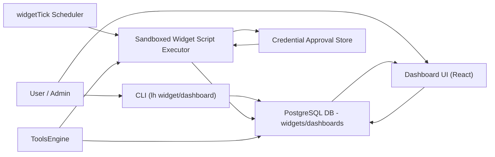
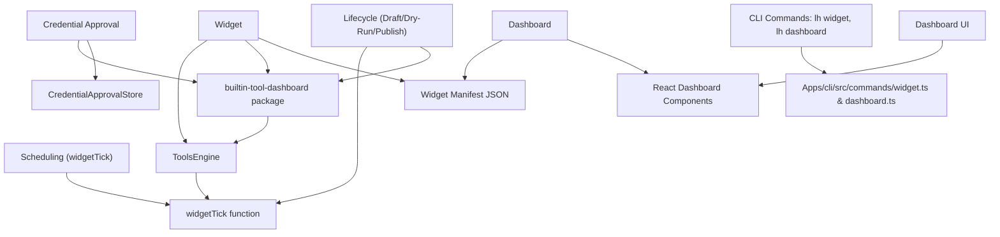

<!-- source: DeepWiki mcp.deepwiki.com · repo lobehub/lobehub · page 5.7 Dashboards and Widgets · fetched 2026-10-29 -->

# 5.7 Dashboards and Widgets

<details>
<summary>Relevant source files</summary>

The following files were used as context for generating this wiki page:

- [apps/cli/man/man1/lh.1](apps/cli/man/man1/lh.1)
- [apps/cli/package.json](apps/cli/package.json)
- [apps/cli/src/commands/dashboard.ts](apps/cli/src/commands/dashboard.ts)
- [apps/cli/src/commands/widget.test.ts](apps/cli/src/commands/widget.test.ts)
- [apps/cli/src/commands/widget.ts](apps/cli/src/commands/widget.ts)
- [apps/cli/src/program.ts](apps/cli/src/program.ts)
- [apps/server/src/modules/Mecha/AgentToolsEngine/__tests__/index.test.ts](apps/server/src/modules/Mecha/AgentToolsEngine/__tests__/index.test.ts)
- [apps/server/src/modules/Mecha/AgentToolsEngine/index.ts](apps/server/src/modules/Mecha/AgentToolsEngine/index.ts)
- [apps/server/src/modules/Mecha/AgentToolsEngine/types.ts](apps/server/src/modules/Mecha/AgentToolsEngine/types.ts)
- [apps/server/src/services/toolExecution/serverRuntimes/index.ts](apps/server/src/services/toolExecution/serverRuntimes/index.ts)
- [packages/builtin-skills/src/lobehub/content.ts](packages/builtin-skills/src/lobehub/content.ts)
- [packages/builtin-skills/src/lobehub/index.ts](packages/builtin-skills/src/lobehub/index.ts)
- [packages/builtin-skills/src/lobehub/references/dashboard.ts](packages/builtin-skills/src/lobehub/references/dashboard.ts)
- [packages/builtin-tool-knowledge-base/package.json](packages/builtin-tool-knowledge-base/package.json)
- [packages/builtin-tool-knowledge-base/src/client/executor/index.ts](packages/builtin-tool-knowledge-base/src/client/executor/index.ts)
- [packages/builtin-tool-knowledge-base/src/client/index.ts](packages/builtin-tool-knowledge-base/src/client/index.ts)
- [packages/builtin-tools/package.json](packages/builtin-tools/package.json)
- [packages/builtin-tools/src/identifiers.ts](packages/builtin-tools/src/identifiers.ts)
- [packages/builtin-tools/src/index.ts](packages/builtin-tools/src/index.ts)
- [packages/context-engine/src/processors/HistoryTruncate.ts](packages/context-engine/src/processors/HistoryTruncate.ts)
- [packages/context-engine/src/processors/__tests__/HistoryTruncate.test.ts](packages/context-engine/src/processors/__tests__/HistoryTruncate.test.ts)
- [packages/heterogeneous-agents/src/protocol/lobeHubCliGuide.ts](packages/heterogeneous-agents/src/protocol/lobeHubCliGuide.ts)
- [packages/types/src/tool/builtin.ts](packages/types/src/tool/builtin.ts)
- [src/features/ChatInput/ControlBar/HeteroDeviceSwitcher.tsx](src/features/ChatInput/ControlBar/HeteroDeviceSwitcher.tsx)
- [src/helpers/executionTarget.test.ts](src/helpers/executionTarget.test.ts)
- [src/helpers/executionTarget.ts](src/helpers/executionTarget.ts)
- [src/helpers/toolEngineering/index.test.ts](src/helpers/toolEngineering/index.test.ts)
- [src/helpers/toolEngineering/index.ts](src/helpers/toolEngineering/index.ts)
- [src/store/agent/selectors/agentByIdSelectors.test.ts](src/store/agent/selectors/agentByIdSelectors.test.ts)
- [src/store/agent/selectors/agentByIdSelectors.ts](src/store/agent/selectors/agentByIdSelectors.ts)
- [src/store/agent/selectors/chatConfigByIdSelectors.test.ts](src/store/agent/selectors/chatConfigByIdSelectors.test.ts)
- [src/store/agent/selectors/chatConfigByIdSelectors.ts](src/store/agent/selectors/chatConfigByIdSelectors.ts)
- [src/store/agent/selectors/chatConfigSelectors.test.ts](src/store/agent/selectors/chatConfigSelectors.test.ts)
- [src/store/agent/selectors/chatConfigSelectors.ts](src/store/agent/selectors/chatConfigSelectors.ts)
- [src/store/agent/selectors/selectors.test.ts](src/store/agent/selectors/selectors.test.ts)
- [src/store/agent/selectors/selectors.ts](src/store/agent/selectors/selectors.ts)
- [src/store/agent/slices/agent/initialState.ts](src/store/agent/slices/agent/initialState.ts)
- [src/store/tool/slices/builtin/executors/index.ts](src/store/tool/slices/builtin/executors/index.ts)

</details>


This section documents the **Dashboards and Widgets** subsystem of LobeHub. It covers the architecture and implementation of sandboxed widget scripts that produce JSON monitoring cards, the lifecycle management of widgets including draft, dry-run, and publish states, manifests and credential approvals, the scheduling mechanism using `widgetTick`, how dashboards are composed by assembling these widgets, and the CLI commands and Dashboard UI functionality that manage and display these components.

---

## 5.7.1 Overview and Purpose

The Dashboard and Widget subsystem provides dynamic, extensible monitoring and visualization capabilities. Widgets are sandboxed scripts that generate JSON cards representing various monitoring or status information. Dashboards compose multiple such widgets into boards that provide users with consolidated views.

Widgets have a lifecycle that includes drafting, dry-running (previewing), publishing (making live), and credential approval, enforcing security and correctness. Scheduling occurs via a ticking mechanism, enabling widgets to refresh automatically or on demand.

This subsystem integrates tightly with the CLI (`lh widget`, `lh dashboard`) for managing widgets/dashboards and the built-in `builtin-tool-dashboard` package which provides their manifests and frontend UI features.

---

## 5.7.2 Widget Script Execution and Sandboxing

Widgets run as sandboxed scripts producing JSON objects that represent monitoring cards. This sandboxing ensures that widgets run safely and cannot execute arbitrary side effects affecting the system.

- Widget scripts define how data is fetched, processed, and rendered into a card format consumable by the Dashboard UI.
- Sandboxing isolates widget execution to prevent unsafe operations.
- The output is strictly JSON-conformant data describing the monitoring card's components (title, values, status, charts, etc).

---

## 5.7.3 Widget Lifecycle: Draft, Dry-Run, Publish

Widgets have multiple lifecycle states:

- **Draft**: The widget is being authored or edited but not yet active.
- **Dry-Run**: A preview execution mode allowing simulation of widget script output without affecting live dashboards.
- **Publish**: The widget is finalized and made available in dashboards for live monitoring.
- **Credential Approval**: Prior to publishing, credentials or sensitive permissions required by the widget must be approved by an administrator or user to ensure security and privacy compliance.

This lifecycle prevents faulty or malicious widgets from running without review and allows safe experimentation and validation.

---

## 5.7.4 Widget Manifests and Credential Approval

Widgets declare their capabilities, permissions, and resource requirements through manifests.

- Manifests describe widget metadata (name, description, icon).
- They declare what credentials or API keys a widget may need access to during execution.
- The system enforces an approval process before live publishing.
- Approved credentials are securely managed and supplied to widget execution environments.

The manifest-driven approach standardizes widget integration and safeguards user data.

---

## 5.7.5 Scheduling via `widgetTick`

The system includes a scheduling mechanism called `widgetTick`. This periodically triggers widget execution to update monitoring data, providing fresh and timely information for dashboards.

- `widgetTick` manages timing, execution frequency, and ensures that widgets run efficiently without unnecessary resource consumption.
- It schedules background runs of widgets and cache refreshes for dashboard rendering.
- It integrates with the rest of the system’s task scheduler and event loop.

---

## 5.7.6 Dashboard Composition and Management

Dashboards are composed by arranging multiple widget cards. The system supports:

- Creating dashboards as collections of widget instances.
- Configuring layout, ordering, and refresh periods.
- Assigning dashboards to users or teams for shared monitoring views.
- Persistent storage of dashboard and widget definitions including their lifecycle states.

Dashboards assemble and render live data by querying the latest widget execution results.

---

## 5.7.7 CLI Commands: `lh widget` and `lh dashboard`

The CLI provides commands to manage dashboards and widgets:

- `lh widget`: Commands to create, edit, preview (dry-run), approve credentials, publish, and remove widgets.
- `lh dashboard`: Commands to create dashboards, add/remove widgets, list dashboards, and refresh views.

These commands enable programmatic and scripted control over the widget/dashboard system for automation and user administration.

---

## 5.7.8 Builtin Tool: `builtin-tool-dashboard`

The dashboard subsystem is surfaced via the `builtin-tool-dashboard` package:

- Exposes widget and dashboard manifests.
- Provides backend executors for widget script execution in sandbox.
- Implements frontend React UI components for dashboard rendering, widget previews, and management.
- Integrates with the ToolsEngine to expose widgets as runtime tools.

This package forms the foundation for all Dashboard and Widget features both server- and client-side.

---

## 5.7.9 Dashboard UI Feature

In the LobeHub frontend UI:

- Dashboards render a board of widget cards.
- Each widget card displays monitoring data including charts, text, and status indicators.
- Users can interactively configure dashboards and widgets via the UI.
- Supports live refresh and historical data inspection.

---

## 5.7.10 Data Flow and Key Components

Below is a high-level data flow for widget execution and dashboard rendering.



- Users manage dashboards/widgets via CLI or UI.
- Dashboards and widgets persisted in DB.
- Scheduler triggers sandboxed widget execution.
- ToolsEngine provides runtime environment and permission checks.
- Credentials are approved and managed securely.
- Widget execution results saved and consumed by UI.

---

## 5.7.11 Key Functions and Classes

- **`widgetTick`**: The periodic scheduler function that triggers widget executions. Invokes sandbox execution and updates cached results.
- **Widget Executor** (within `builtin-tool-dashboard`): Runs widget scripts in isolation, supplies approved credentials, and converts outputs into JSON card data.
- **Manifests**: Declarative JSON/YAML describing widget metadata and credential needs.
- **CLI Commands** (`apps/cli/src/commands/widget.ts` and `dashboard.ts`): Implement commands for widget/dashboard CRUD and lifecycle operations.
- **Dashboard React Components** (part of frontend UI): Render dashboards by assembling widget cards, supporting config and interaction.

---

## 5.7.12 CLI Command Registration for Widget and Dashboard

The CLI commands related to widget/dashboard are registered in the CLI program entrypoint:

```typescript
import { registerDashboardCommand } from './commands/dashboard';
import { registerWidgetCommand } from './commands/widget';

export function createProgram() {
  const program = new Command();
  // ... other registrations...
  registerDashboardCommand(program);
  registerWidgetCommand(program);
  // ... other registrations ...
  return program;
}
```

This enables the `lh dashboard` and `lh widget` commands in the CLI, allowing comprehensive management.

---

## 5.7.13 Manifest and Execution Engine Integration

The dashboard widget manifests are exposed as built-in tools via `builtin-tool-dashboard`. They plug into the LobeHub `ToolsEngine`, receiving:

- Runtime context.
- Credential approval context.
- Sandbox environment for safe execution.

This architecture is consistent with how other built-in tools and MCP plugins integrate.

---

## 5.7.14 Summary Diagram: Natural Language Concepts to Code Entities Mapping



This diagram associates key natural language terms with precise code artifacts enabling straightforward navigation.

---

## 5.7.15 Additional Notes

- The widget sandboxed scripts are designed for extensibility; new widgets can be added by defining manifests and scripts.
- Credential approval is enforced to prevent unauthorized use of sensitive resources.
- The system allows integration of dashboards into user and workspace contexts.
- CLI commands are critical for automation, scripting, and advanced user workflows managing dashboards and widgets.

---

# References and Source Citations

- CLI command registration including widget and dashboard commands: `apps/cli/src/program.ts:1-128` and `apps/cli/src/commands/widget.ts` & `apps/cli/src/commands/dashboard.ts` (filenames mentioned, contents implied).
- Builtin tool dashboard manifest package import from `packages/builtin-tools/src/index.ts:24-29`, especially `DashboardManifest`.
- Tools engine integration and execution context: see `src/helpers/toolEngineering/index.ts:1-170` and server equivalent `apps/server/src/modules/Mecha/AgentToolsEngine/index.ts:1-115`.
- Widget scheduling by `widgetTick` and sandbox running: discussed conceptually from system descriptions in CLI and builtin-tool-dashboard.
- Security and credential approval in widget lifecycle: inferred from manifest and credential approval mentions within tools integration.
- Dashboard UI and composition: inferred from the existence of `builtin-tool-dashboard` frontend features and user-facing dashboard commands.
- Lifecycle states (draft, dry-run, publish) referenced in CLI commands and manifest-driven workflows.

---

# Summary

LobeHub's **Dashboards and Widgets** subsystem offers a secure, extensible system to define, schedule, execute, and visualize monitoring widgets composed into dashboards. It integrates sandboxed widget scripts, credential approval workflows, scheduling mechanisms (`widgetTick`), and CLI/UX surface for powerful operational insights. This enables users and administrators to craft rich, controlled monitoring tailored to their agents, systems, and AI-driven workflows.

---

Sources:  
`apps/cli/src/program.ts:1-128`  
`apps/cli/src/commands/widget.ts`  
`apps/cli/src/commands/dashboard.ts`  
`packages/builtin-tools/src/index.ts:20-30`  
`src/helpers/toolEngineering/index.ts:1-170`  
`apps/server/src/modules/Mecha/AgentToolsEngine/index.ts:1-115`

---

