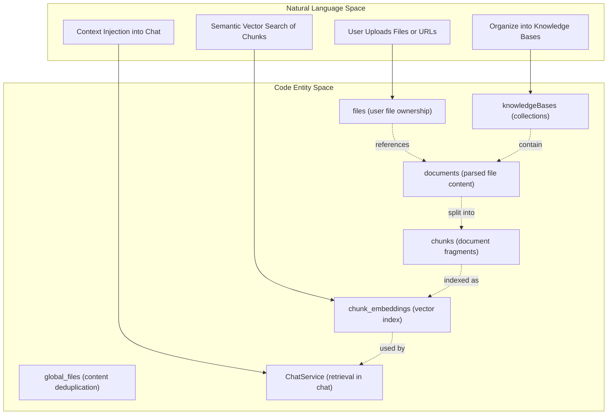
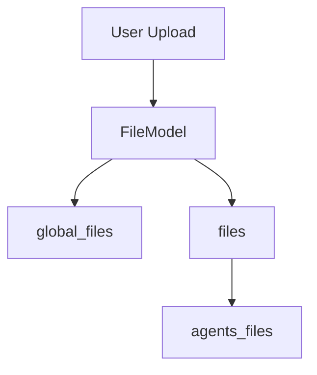
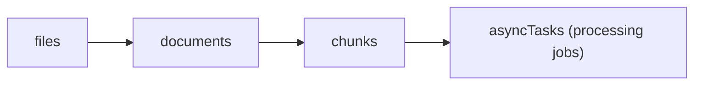
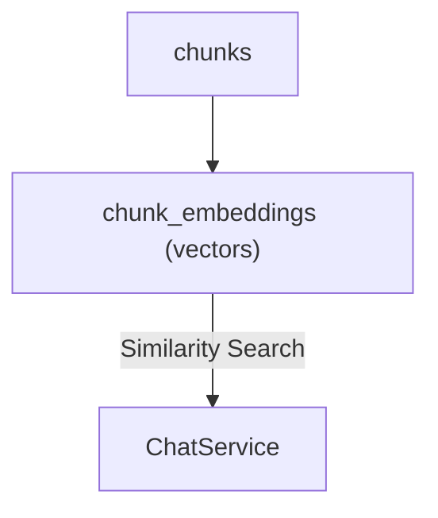
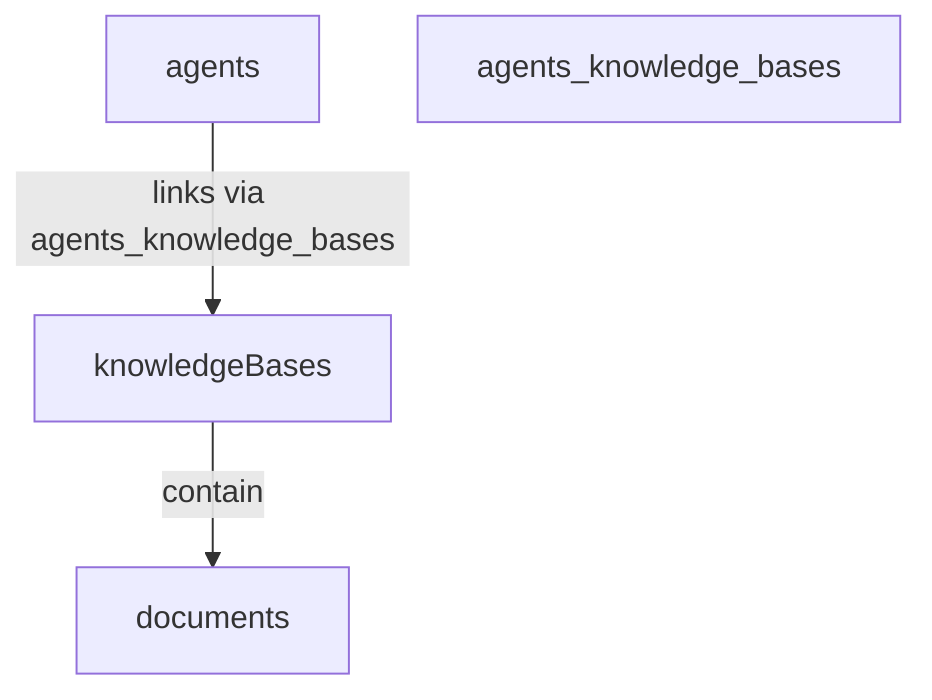
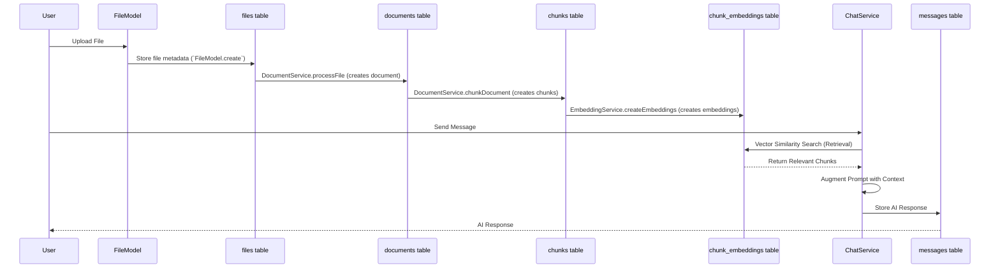

<!-- source: DeepWiki mcp.deepwiki.com · repo lobehub/lobehub · page 6 Knowledge Base and RAG System · fetched 2026-10-29 -->

# Knowledge Base and RAG System

Relevant source files

The following files were used as context for generating this wiki page:

- [apps/server/src/services/document/__tests__/index.test.ts](apps/server/src/services/document/__tests__/index.test.ts)
- [apps/server/src/services/document/index.ts](apps/server/src/services/document/index.ts)
- [docs/development/database-schema.dbml](docs/development/database-schema.dbml)
- [packages/database/migrations/0086_video_generation_schema.sql](packages/database/migrations/0086_video_generation_schema.sql)
- [packages/database/migrations/0177_agent_accounts_live_unique_and_goal_subscriptions.sql](packages/database/migrations/0177_agent_accounts_live_unique_and_goal_subscriptions.sql)
- [packages/database/migrations/0180_task_archived_at.sql](packages/database/migrations/0180_task_archived_at.sql)
- [packages/database/migrations/meta/0086_snapshot.json](packages/database/migrations/meta/0086_snapshot.json)
- [packages/database/migrations/meta/0177_snapshot.json](packages/database/migrations/meta/0177_snapshot.json)
- [packages/database/migrations/meta/0180_snapshot.json](packages/database/migrations/meta/0180_snapshot.json)
- [packages/database/migrations/meta/_journal.json](packages/database/migrations/meta/_journal.json)
- [packages/database/src/models/__tests__/agentAccount.test.ts](packages/database/src/models/__tests__/agentAccount.test.ts)
- [packages/database/src/models/__tests__/document.test.ts](packages/database/src/models/__tests__/document.test.ts)
- [packages/database/src/models/__tests__/drizzleMigration.test.ts](packages/database/src/models/__tests__/drizzleMigration.test.ts)
- [packages/database/src/models/__tests__/topics/topic.create.test.ts](packages/database/src/models/__tests__/topics/topic.create.test.ts)
- [packages/database/src/models/agentAccount.ts](packages/database/src/models/agentAccount.ts)
- [packages/database/src/models/document.ts](packages/database/src/models/document.ts)
- [packages/database/src/schemas/agent.ts](packages/database/src/schemas/agent.ts)
- [packages/database/src/schemas/agentAccount.ts](packages/database/src/schemas/agentAccount.ts)
- [packages/database/src/schemas/agentCronJob.ts](packages/database/src/schemas/agentCronJob.ts)
- [packages/database/src/schemas/apiKey.ts](packages/database/src/schemas/apiKey.ts)
- [packages/database/src/schemas/asyncTask.ts](packages/database/src/schemas/asyncTask.ts)
- [packages/database/src/schemas/chatGroup.ts](packages/database/src/schemas/chatGroup.ts)
- [packages/database/src/schemas/file.ts](packages/database/src/schemas/file.ts)
- [packages/database/src/schemas/generation.ts](packages/database/src/schemas/generation.ts)
- [packages/database/src/schemas/goalSubscription.ts](packages/database/src/schemas/goalSubscription.ts)
- [packages/database/src/schemas/index.ts](packages/database/src/schemas/index.ts)
- [packages/database/src/schemas/message.ts](packages/database/src/schemas/message.ts)
- [packages/database/src/schemas/rag.ts](packages/database/src/schemas/rag.ts)
- [packages/database/src/schemas/relations.ts](packages/database/src/schemas/relations.ts)
- [packages/database/src/schemas/session.ts](packages/database/src/schemas/session.ts)
- [packages/database/src/schemas/task.ts](packages/database/src/schemas/task.ts)
- [packages/database/src/schemas/topic.ts](packages/database/src/schemas/topic.ts)
- [packages/database/src/utils/idGenerator.ts](packages/database/src/utils/idGenerator.ts)
- [packages/types/src/goalSubscription.ts](packages/types/src/goalSubscription.ts)
- [packages/types/src/index.ts](packages/types/src/index.ts)

The Knowledge Base and Retrieval-Augmented Generation (RAG) system in LobeHub provides a robust infrastructure for enabling AI agents to interact effectively with private data sources such as file uploads, web content crawls, and internal documents. It transforms unstructured content into semantically indexed knowledge that can be retrieved contextually during chat interactions.

The system's core pipeline comprises several stages: file ingestion (upload or crawl), document parsing and chunking, vector embedding and similarity indexing, and retrieval-augmented generation integrated in the chat workflow.

---

### System Overview

At a high level, the RAG pipeline translates raw natural language documents into machine-accessible semantic chunks represented as embeddings. These embeddings empower agents to execute similarity-based retrievals and inject relevant external knowledge into AI conversations.

The following diagram connects the natural language concepts—like files, knowledge bases, and semantic search—to the concrete database tables and services in the LobeHub codebase:

**Sources:** [packages/database/src/schemas/file.ts:47-62](), [packages/database/src/schemas/rag.ts:1-26](), [packages/database/src/schemas/index.ts:31-41](), [packages/database/src/models/document.ts:65-183]()

---

### File Management and Storage

LobeHub supports sophisticated file management optimized for multi-tenant and content-addressable storage scenarios. Uploaded files go through a flow where their metadata is stored and deduplicated.

- **Core Tables:**  
  - `global_files` stores immutable, deduplicated file content keyed by hash and tracks general metadata, creator, and access timestamps.  
  - `files` references these global files and tracks ownership, file type, upload sessions, and agent associations.  
  - `agents_files` manages file-to-agent mappings allowing specific agents to access certain files selectively.

- **File Types:** The system supports general files and specialized types such as skill bundles, containing manifest documents and scripts that agents may use as capabilities.

- **File Flow:** The `FileModel` class orchestrates file creation, metadata validation, and associations within the system.

For comprehensive details, see [File Management and Storage](#6.1).

**Sources:** [packages/database/src/schemas/file.ts:69-187](), [packages/database/src/schemas/agent.ts:171-195](), [packages/database/src/models/file.ts:55-141]()

---

### Document Processing and Chunking

After ingestion, raw files undergo parsing where they are transformed into documents that represent the semantic content. Documents may be structured hierarchically, allowing folders and nested pages.

- **Documents Table:** The `documents` table holds content, metadata, source information, and statistics like character and line counts. It supports linkage via `fileId` to the owning file and `knowledgeBaseId` for logical grouping.

- **Document Lifecycle:** `DocumentModel` encapsulates business logic such as scoped access control, folder creation, and document creation with workspace-aware visibility.

- **Chunking:** Documents are segmented into manageable "chunks" tracked in the `chunks` table to enable granular retrieval matching with smaller units of content.

- **Asynchronous Tasks:** Processing and chunking may involve long-running tasks for which `asyncTasks` schema handles progress tracking and orchestration.

For detailed implementation, see [Document Processing and Chunking](#6.2).

**Sources:** [packages/database/src/schemas/file.ts:92-188](), [packages/database/src/models/document.ts:65-183](), [packages/database/src/schemas/rag.ts:1-20](), [packages/database/src/schemas/asyncTask.ts]()

---

### Embeddings, Vector and Full-Text Search

Semantic search is enabled by converting text chunks into high-dimensional vector embeddings stored in a vector database extension for PostgreSQL.

- **Vector Storage:** Introduced in migration `0005_pgvector`, LobeHub uses `pgvector` to store and query embeddings efficiently within the `chunk_embeddings` table.

- **Linkage:** Each embedding is tied to its source chunk, enabling precise back-referencing from search results to corpus text.

- **Retrieval:** The chat pipeline queries this vector index to find relevant chunks based on similarity to user inputs, augmenting AI response generation.

- **Quality and Tracing:** The system records search and retrieval metrics to monitor vector index performance and retrieval accuracy.

For more information, see [Embeddings, Vector and Full-Text Search](#6.3).

**Sources:** [packages/database/migrations/meta/_journal.json:42-45](), [packages/database/src/schemas/rag.ts:22-45](), [packages/database/src/schemas/index.ts:31-41]()

---

### Knowledge Base Organization

Knowledge bases in LobeHub function as logical containers aggregating documents and files into scoped, reusable data sources for agents.

- **Knowledge Bases Table:** The `knowledgeBases` table models individual libraries that group documents, with ownership and workspace scoping.

- **Agent Relations:** The many-to-many relation between agents and knowledge bases is mapped in `agents_knowledge_bases`, enabling agents to selectively access curated knowledge stores.

- **Visibility Controls:** Documents and knowledge bases respect workspace and user-level visibility, toggling between private and public access to enforce data privacy.

- **Use in Agents:** During the context engineering phase of a chat, the system queries linked knowledge bases to retrieve relevant documents and chunks that can enhance AI understanding.

See [Knowledge Base Organization](#6.4) for full details.

**Sources:** [packages/database/src/schemas/file.ts:129-148](), [packages/database/src/schemas/agent.ts:145-169]()

---

### Data Flow Architecture

This sequence diagram summarizes the end-to-end data flow from file upload through RAG-based retrieval to AI chat message generation:

This flow highlights the major code entities and database tables involved in transforming raw file content into enhanced AI chat responses.

**Sources:** [packages/database/src/models/file.ts:86-141](), [packages/database/src/models/document.ts:65-183](), [packages/database/src/schemas/rag.ts:1-45](), [packages/database/src/schemas/message.ts:95-175](), [packages/database/src/utils/idGenerator.ts:8-41]()

---

## Child Pages

For technical deep dives into each sub-system, consult the following child pages:

- [File Management and Storage](#6.1) — Detailed documentation of the upload process, storage options (S3, RustFS), file schemas, FileModel, agent-file relationships, and the ResourceManager UI.
- [Document Processing and Chunking](#6.2) — Implementation details for the DocumentService, file loaders, parsing pipeline, chunking strategies, and document/chunk schema models.
- [Embeddings, Vector and Full-Text Search](#6.3) — Explanation of the RAG database schema (chunk_embeddings), embedding model configurations, vector store (pgvector/ParadeDB) search, Elasticsearch sync scripts, and chat retrieval pipeline.
- [Knowledge Base Organization](#6.4) — Coverage of how knowledge bases are created, linked to agents, scoped per user and workspace, and used during context construction for chat turns.

---

# Summary

LobeHub’s Knowledge Base and RAG system constitutes a comprehensive framework to ingest, process, organize, and retrieve unstructured content efficiently for AI agents. Its modular design maps clearly between natural language concepts and rigorous database schemas and service abstractions. This layered structure empowers agents with rich contextual knowledge while enforcing data isolation and security consistent with multi-tenant workspace models.

**Sources:**  
- [packages/database/migrations/meta/_journal.json:40-46]()  
- [packages/database/src/schemas/file.ts:69-188]()  
- [packages/database/src/schemas/agent.ts:145-169]()  
- [packages/database/src/schemas/rag.ts:1-45]()  
- [packages/database/src/schemas/asyncTask.ts]()  
- [packages/database/src/models/document.ts:65-183]()  
- [packages/database/src/models/file.ts:55-141]()  
- [packages/database/src/schemas/message.ts:37-176]()  
- [packages/database/src/utils/idGenerator.ts:8-57]()

---

