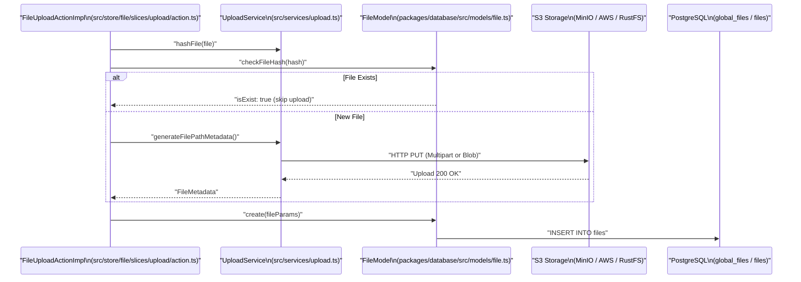
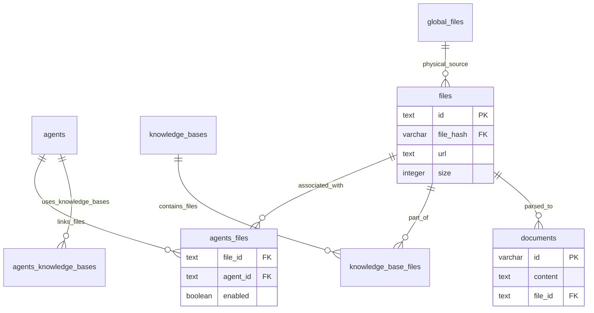
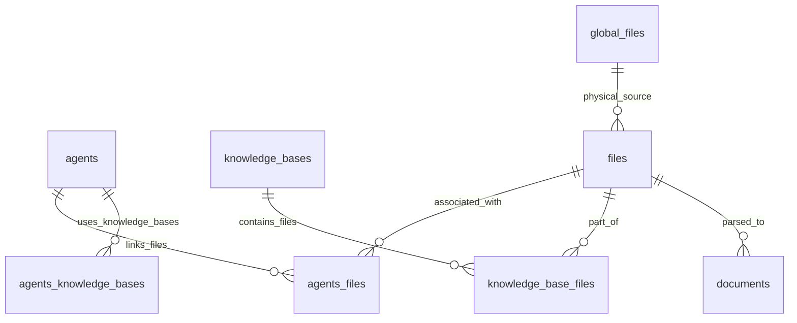

<!-- source: DeepWiki mcp.deepwiki.com · repo lobehub/lobehub · page 6.1 File Management and Storage · fetched 2026-10-29 -->

# File Management and Storage

<details>
<summary>Relevant source files</summary>

The following files were used as context for generating this wiki page:

- [.i18nrc.js](.i18nrc.js)
- [apps/desktop/src/main/controllers/CompletionSoundCtr.ts](apps/desktop/src/main/controllers/CompletionSoundCtr.ts)
- [apps/desktop/src/main/controllers/MenuCtr.ts](apps/desktop/src/main/controllers/MenuCtr.ts)
- [apps/desktop/src/main/controllers/NotificationCtr.mac.ts](apps/desktop/src/main/controllers/NotificationCtr.mac.ts)
- [apps/desktop/src/main/controllers/NotificationCtr.ts](apps/desktop/src/main/controllers/NotificationCtr.ts)
- [apps/desktop/src/main/controllers/ShortcutCtr.ts](apps/desktop/src/main/controllers/ShortcutCtr.ts)
- [apps/desktop/src/main/controllers/__tests__/CompletionSoundCtr.test.ts](apps/desktop/src/main/controllers/__tests__/CompletionSoundCtr.test.ts)
- [apps/desktop/src/main/controllers/__tests__/NotificationCtr.test.ts](apps/desktop/src/main/controllers/__tests__/NotificationCtr.test.ts)
- [apps/desktop/src/main/controllers/index.ts](apps/desktop/src/main/controllers/index.ts)
- [apps/desktop/src/main/controllers/notificationShared.ts](apps/desktop/src/main/controllers/notificationShared.ts)
- [apps/server/src/services/document/__tests__/index.test.ts](apps/server/src/services/document/__tests__/index.test.ts)
- [apps/server/src/services/document/index.ts](apps/server/src/services/document/index.ts)
- [docs/development/database-schema.dbml](docs/development/database-schema.dbml)
- [packages/database/migrations/0086_video_generation_schema.sql](packages/database/migrations/0086_video_generation_schema.sql)
- [packages/database/migrations/0177_agent_accounts_live_unique_and_goal_subscriptions.sql](packages/database/migrations/0177_agent_accounts_live_unique_and_goal_subscriptions.sql)
- [packages/database/migrations/0180_task_archived_at.sql](packages/database/migrations/0180_task_archived_at.sql)
- [packages/database/migrations/meta/0086_snapshot.json](packages/database/migrations/meta/0086_snapshot.json)
- [packages/database/migrations/meta/0177_snapshot.json](packages/database/migrations/meta/0177_snapshot.json)
- [packages/database/migrations/meta/0180_snapshot.json](packages/database/migrations/meta/0180_snapshot.json)
- [packages/database/migrations/meta/_journal.json](packages/database/migrations/meta/_journal.json)
- [packages/database/src/models/__tests__/agentAccount.test.ts](packages/database/src/models/__tests__/agentAccount.test.ts)
- [packages/database/src/models/__tests__/document.test.ts](packages/database/src/models/__tests__/document.test.ts)
- [packages/database/src/models/__tests__/drizzleMigration.test.ts](packages/database/src/models/__tests__/drizzleMigration.test.ts)
- [packages/database/src/models/__tests__/topics/topic.create.test.ts](packages/database/src/models/__tests__/topics/topic.create.test.ts)
- [packages/database/src/models/agentAccount.ts](packages/database/src/models/agentAccount.ts)
- [packages/database/src/models/document.ts](packages/database/src/models/document.ts)
- [packages/database/src/schemas/agent.ts](packages/database/src/schemas/agent.ts)
- [packages/database/src/schemas/agentAccount.ts](packages/database/src/schemas/agentAccount.ts)
- [packages/database/src/schemas/agentCronJob.ts](packages/database/src/schemas/agentCronJob.ts)
- [packages/database/src/schemas/apiKey.ts](packages/database/src/schemas/apiKey.ts)
- [packages/database/src/schemas/asyncTask.ts](packages/database/src/schemas/asyncTask.ts)
- [packages/database/src/schemas/chatGroup.ts](packages/database/src/schemas/chatGroup.ts)
- [packages/database/src/schemas/file.ts](packages/database/src/schemas/file.ts)
- [packages/database/src/schemas/generation.ts](packages/database/src/schemas/generation.ts)
- [packages/database/src/schemas/goalSubscription.ts](packages/database/src/schemas/goalSubscription.ts)
- [packages/database/src/schemas/index.ts](packages/database/src/schemas/index.ts)
- [packages/database/src/schemas/message.ts](packages/database/src/schemas/message.ts)
- [packages/database/src/schemas/rag.ts](packages/database/src/schemas/rag.ts)
- [packages/database/src/schemas/relations.ts](packages/database/src/schemas/relations.ts)
- [packages/database/src/schemas/session.ts](packages/database/src/schemas/session.ts)
- [packages/database/src/schemas/task.ts](packages/database/src/schemas/task.ts)
- [packages/database/src/schemas/topic.ts](packages/database/src/schemas/topic.ts)
- [packages/database/src/utils/idGenerator.ts](packages/database/src/utils/idGenerator.ts)
- [packages/electron-client-ipc/src/types/notification.ts](packages/electron-client-ipc/src/types/notification.ts)
- [packages/electron-mac-notifications/index.d.ts](packages/electron-mac-notifications/index.d.ts)
- [packages/electron-mac-notifications/index.js](packages/electron-mac-notifications/index.js)
- [packages/electron-mac-notifications/native/addon.mm](packages/electron-mac-notifications/native/addon.mm)
- [packages/types/src/files/upload.ts](packages/types/src/files/upload.ts)
- [packages/types/src/goalSubscription.ts](packages/types/src/goalSubscription.ts)
- [packages/types/src/index.ts](packages/types/src/index.ts)
- [src/features/Settings/notification/index.tsx](src/features/Settings/notification/index.tsx)
- [src/services/__tests__/upload.test.ts](src/services/__tests__/upload.test.ts)
- [src/services/electron/completionSound.test.ts](src/services/electron/completionSound.test.ts)
- [src/services/electron/desktopNotification.ts](src/services/electron/desktopNotification.ts)
- [src/services/upload.ts](src/services/upload.ts)
- [src/store/chat/slices/agentRun/actions/lifecycle/types.ts](src/store/chat/slices/agentRun/actions/lifecycle/types.ts)
- [src/store/chat/utils/desktopNotification.test.ts](src/store/chat/utils/desktopNotification.test.ts)
- [src/store/chat/utils/desktopNotification.ts](src/store/chat/utils/desktopNotification.ts)
- [src/store/file/slices/upload/action.test.ts](src/store/file/slices/upload/action.test.ts)
- [src/store/file/slices/upload/action.ts](src/store/file/slices/upload/action.ts)

</details>


LobeHub implements a comprehensive file management and storage subsystem critical for handling multi-modal data such as images, documents, and knowledge base assets. This system integrates tightly with the AI Agent framework and the Retrieval-Augmented Generation (RAG) pipeline to facilitate effective data ingestion, management, and contextual usage by AI agents.

---

## 1. File Upload Flow

The file upload is architected as a multi-stage process that optimizes performance and scalability by leveraging client-side hashing, server-side pre-signed URL generation, and direct uploads to S3-compatible storage backends. This design avoids saturating server resources with large file payloads.

### Upload Workflow Steps

1. **Client-Side Preparation**

   - The upload is initiated in the frontend with the function `uploadWithProgress` in `src/store/file/slices/upload/action.ts` [src/store/file/slices/upload/action.ts:137-148]().

   - Before uploading, the system computes a SHA-based or equivalent hash of the file using `hashFile` in `src/services/upload.ts` [src/services/upload.ts:11-36]() to enable deduplication.

2. **Deduplication Check**

   - The hash is checked against existing entries in the `global_files` table by invoking `fileService.checkFileHash` which interacts with the `FileModel` [packages/database/src/models/file.ts:86-141]().

   - If a matching hash exists, the upload is bypassed to prevent redundant storage.

3. **Metadata Generation**

   - For new files, the client generates structured metadata describing the intended object key/path in the S3 backend with `generateFilePathMetadata` [src/services/upload.ts:25-48]().

   - The path typically incorporates a date-based directory and a UUID filename to ensure uniqueness and orderly grouping.

4. **Pre-Signed URL Acquisition**

   - The client requests a pre-signed PUT URL for direct upload from the server via `UploadService#createS3PreSignedUrl` mutation [src/services/upload.ts:177-190]().

5. **Direct Upload to Storage**

   - Utilizing the pre-signed URL, the client uploads the file directly to the storage backend (e.g., AWS S3, MinIO, or RustFS).

   - For files > 64MB, multipart upload logic `uploadMultipart` is invoked [src/services/upload.ts:172-180]().

   - Smaller files use a straightforward `putBlob` method to upload the entire blob in one request.

   - Progress events during upload are available through `onProgress` callbacks for UI feedback.

6. **Database Registration**

   - Upon successful upload, the `FileModel.create` method inserts metadata records into the `files` table and optionally links the file to a `knowledgeBaseId` [packages/database/src/models/file.ts:135-141]().

   - This finalizes the file's registration making it accessible for downstream workflows and agent use.

### Upload Flow Diagram



**Sources:**  
[src/store/file/slices/upload/action.ts:137-212](), [src/services/upload.ts:11-211](), [packages/database/src/models/file.ts:55-141]().

---

## 2. Storage Configuration

LobeHub's file storage layer utilizes S3-compatible object storage backends. The configuration supports both cloud-hosted providers and self-hosted solutions such as MinIO and RustFS.

- **Path Naming and Organization**

  The uploaded files are organized on storage by date and filename:

  - The `generateFilePathMetadata` function constructs paths of the form:

    ```
    {directory}/{date}/{uuid}.{extension}
    ```

  - The `date` component is derived as the number of hours elapsed since epoch (rounded), providing time-segmented directories for scalability [src/services/upload.ts:25-48]().

- **Multipart Upload Threshold**

  Files larger than 64MB trigger the multipart upload mechanism to maximize transfer reliability and resume capabilities [src/services/upload.ts:17](), [src/services/upload.ts:172-180]().

- **Environment Variables**

  Key environment variables configuring upload paths and credentials include:

  - `NEXT_PUBLIC_S3_FILE_PATH` – base path prefix for file directories on S3 [src/services/upload.ts:59]().

- **Supported Storage Backends**

  - **AWS S3** and compatible vendors
  - **MinIO** – popular self-hosted alternative
  - **RustFS** – another compliant backend option in custom deployments

**Sources:**  
[src/services/upload.ts:17-60](), [src/services/upload.ts:172-207]().

---

## 3. Database Schema

The file management database schema is centered on three key tables to manage file metadata, deduplication, and document parsing.

| Table            | Description                                   | Important Columns                          |
|------------------|----------------------------------------------|-------------------------------------------|
| `global_files`   | Physical file hash deduplication layer       | `hashId` (PK), `url`, `fileType`, `size`, `creatorId` [packages/database/src/schemas/file.ts:69-87]() |
| `files`          | User-owned file entries                       | `id`, `userId`, `fileHash` (foreign key), `name`, `url`, `chunkTaskId` [packages/database/src/schemas/file.ts:170-204]() |
| `documents`      | Parsed content from files for RAG and agents | `id`, `content`, `sourceType`, `fileId` (foreign key), `visibility` [packages/database/src/schemas/file.ts:90-188]() |

### File and Document Attributes

- Files are typed with MIME and custom types like `custom/folder` for virtual folders and `skills/bundle` for agent plugin bundles [packages/database/src/schemas/file.ts:37-49]().

- Documents indicate source types such as `file`, `web`, `api`, `agent`, etc. to classify their ingest origin [packages/database/src/schemas/file.ts:119-122]().

- Visibility is enforced per workspace semantics such that files and documents can be `private` or `public` within the tenant environment [packages/database/src/schemas/file.ts:150-163]().

**Sources:**  
[packages/database/src/schemas/file.ts:1-204]().

---

## 4. File-Agent Associations

To enable AI agents to access relevant files during runtime, LobeHub uses relational linking tables that associate files with agents and their knowledge bases.

### Association Tables:

- **`agents_files`** – Connects specific files to agents with an `enabled` flag for granular inclusion [packages/database/src/schemas/agent.ts:171-187]().

- **`agents_knowledge_bases`** – Links agents to knowledge bases, which aggregate multiple files and documents [packages/database/src/schemas/agent.ts:145-169]().

- **`messages_files`** – Records files attached to chat messages, supporting ephemeral file usage during conversations [packages/database/src/schemas/index.ts:35]().

These tables enable controlled file access scopes allowing agents to fetch files for chat context augmentation, document grounding, or tool invocation.

### Association Schema Diagram



**Sources:**  
[packages/database/src/schemas/agent.ts:145-187](), [packages/database/src/schemas/file.ts:170-204](), [packages/database/src/schemas/index.ts:31-32]().

---

## 5. FileModel Operations

The `FileModel` class encapsulates server-side business logic for managing file lifecycle and relational consistency.

### Key Methods of `FileModel`

- **Creation (`create`)**

  - Inserts a record into the `files` table and conditionally associates it with a global file deduplication entry or a knowledge base [packages/database/src/models/file.ts:130-141]().

- **Deletion (`delete`)**

  - Performs comprehensive cleanup by deleting the file record, its parsed document chunks, async tasks, and mirror documents in the system [packages/database/src/models/file.ts:170-226]().

  - Ensures safe removal by only deleting `global_files` entries if no other `files` reference the same hash [packages/database/src/models/file.ts:218-222]().

- **Ownership and Access Scoping**

  - Enforces user and workspace scoping on queries to maintain multi-tenant data isolation [packages/database/src/models/file.ts:66-70]().

- **Unreferenced File Cleanup**

  - Provides `deleteUnreferenced` to purge transient upload files that were never associated with persistent entities (e.g., messages) [packages/database/src/models/file.ts:233]().

### Ownership Scope Helper Snippet

```ts
private ownership = () =>
  buildWorkspaceWhere(
    {
      callerAgentVisibility: this.callerAgentVisibility,
      userId: this.userId,
      workspaceId: this.workspaceId,
    },
    files,
  );
```

This method constructs the SQL WHERE clause ensuring only files belonging to the user’s permitted workspace and scope are visible.

**Sources:**  
[packages/database/src/models/file.ts:55-233](), [packages/database/src/models/document.ts:50-134]().

---

## 6. ResourceManager UI

LobeHub includes a frontend component `ResourceManager` that centralizes user file and document exploration, management, and interaction.

### UI Components and Hooks

- **MasonryView**

  - A grid-style visual layout for displaying files, implemented by `MasonryView` with individual file cards in `MasonryItem` and specialized components like `ImageFileItem` for previews [src/features/ResourceManager/components/Explorer/MasonryView/MasonryItem/index.tsx](), [src/features/ResourceManager/components/Explorer/MasonryView/MasonryItem/ImageFileItem.tsx]().

- **ListView**

  - An alternative list presentation with detailed info and action buttons for each file item via `FileListItemActions` [src/features/ResourceManager/components/Explorer/ListView/ListItem/FileListItemActions.tsx]().

- **Task Status Monitoring**

  - The `useCheckTaskStatus` React hook polls statuses related to background file processing (chunking, indexing, embedding) to update UI badges or trigger refreshes [src/features/ResourceManager/components/Explorer/useCheckTaskStatus.ts]().

### FileService Client Integration

`FileService` is the primary client-side API interface that abstracts remote interactions with the backend file system API, supporting operations like:

| Method                           | Description                                               | Lines                      |
|---------------------------------|-----------------------------------------------------------|----------------------------|
| `createFile`                    | Uploads a file and registers metadata                      | [src/services/file/index.ts:22-35]()  |
| `getFile`                      | Fetches metadata for a specific file                       | [src/services/file/index.ts:37-54]()  |
| `removeFile`, `removeFiles`     | Deletes files by IDs                                        | [src/services/file/index.ts:56-67]()  |
| `getKnowledgeItems`             | Lists knowledge base files/documents                       | [src/services/file/index.ts:69-79]()  |
| `getKnowledgeItem`              | Retrieves file or document details based on prefix         | [src/services/file/index.ts:90-129]() |
| `checkFileHash`                 | Checks if file hash exists to support deduplication        | [src/services/file/index.ts:135-137]()|
| `updateFile`                   | Updates file metadata                                       | [src/services/file/index.ts:143-152]()|
| `getRecentFiles`, `getRecentPages` | Fetches recently accessed files or document pages         | [src/services/file/index.ts:154-160]()|
| `transferEntity`, `copyEntityToWorkspace` | Manages ownership and copying of files between workspaces | [src/services/file/index.ts:162-188]()|
| `publishFileToWorkspace`, `setFileVisibility` | Controls file visibility within a workspace                 | [src/services/file/index.ts:190-196]()|

**Sources:**  
[src/features/ResourceManager/components/Explorer/MasonryView/MasonryItem/index.tsx](), [src/features/ResourceManager/components/Explorer/MasonryView/MasonryItem/ImageFileItem.tsx](), [src/features/ResourceManager/components/Explorer/ListView/ListItem/FileListItemActions.tsx](), [src/features/ResourceManager/components/Explorer/useCheckTaskStatus.ts](), [src/services/file/index.ts:21-197]().

---

# Summary

The file management and storage system in LobeHub integrates a carefully designed upload flow, robust schema for file and document metadata, and association mechanisms linking files to AI agents and knowledge bases. This comprehensive infrastructure supports secure, scalable, and queryable management of user assets critical to the platform’s AI capabilities. The frontend `ResourceManager` UI rounds out the system by providing an intuitive interface for interacting with these resources.

# Diagrams Recap: Natural Language to Code Entities

```mermaid
graph TB
  UI["FileUploadActionImpl\n(src/store/file/slices/upload/action.ts)"]
  US["UploadService\n(src/services/upload.ts)"]
  FM["FileModel\n(packages/database/src/models/file.ts)"]
  S3["S3 Storage\n(MinIO / AWS / RustFS)"]
  DB["PostgreSQL DB\n(global_files, files)"]

  UI --> US: "hashFile + generateFilePathMetadata"
  UI --> FM: "checkFileHash"
  alt "File exists?"
    FM --> UI: "skip upload"
  else
    US --> S3: "PUT / Multipart Upload"
    S3 --> US: "200 OK"
    US --> UI: "FileMetadata"
  end
  UI --> FM: "create file record"
  FM --> DB: "INSERT"

  classDef natural fill:#fff,stroke:#333,stroke-width:1px
  class UI,US natural
  class FM,DB natural
  class S3 natural
```



---

**Sources:**  
[src/store/file/slices/upload/action.ts:137-212](), [src/services/upload.ts:11-211](), [packages/database/src/models/file.ts:55-233](), [packages/database/src/schemas/file.ts:1-204](), [packages/database/src/schemas/agent.ts:145-187](), [src/features/ResourceManager/components/Explorer/MasonryView/MasonryItem/index.tsx](), [src/features/ResourceManager/components/Explorer/ListView/ListItem/FileListItemActions.tsx](), [src/services/file/index.ts:21-197]().

---

