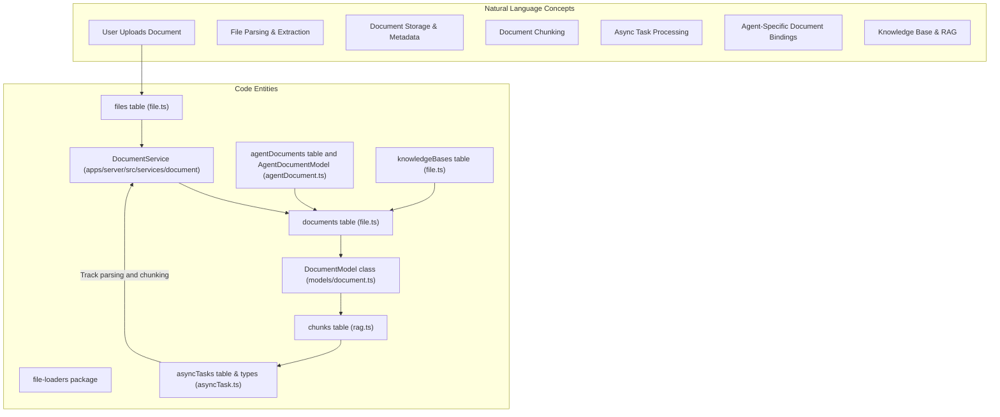

<!-- source: DeepWiki mcp.deepwiki.com · repo lobehub/lobehub · page 6.2 Document Processing and Chunking · fetched 2026-10-29 -->

# Document Processing and Chunking

Relevant source files

The following files were used as context for generating this wiki page:

- [apps/server/src/routers/lambda/webBrowsing.ts](apps/server/src/routers/lambda/webBrowsing.ts)
- [apps/server/src/services/agentDocumentVfs/index.test.ts](apps/server/src/services/agentDocumentVfs/index.test.ts)
- [apps/server/src/services/agentDocumentVfs/index.ts](apps/server/src/services/agentDocumentVfs/index.ts)
- [apps/server/src/services/agentDocuments/headlessEditor.test.ts](apps/server/src/services/agentDocuments/headlessEditor.test.ts)
- [apps/server/src/services/agentDocuments/headlessEditor.ts](apps/server/src/services/agentDocuments/headlessEditor.ts)
- [apps/server/src/services/document/__tests__/index.test.ts](apps/server/src/services/document/__tests__/index.test.ts)
- [apps/server/src/services/document/index.ts](apps/server/src/services/document/index.ts)
- [apps/server/src/services/toolExecution/serverRuntimes/pageAgent.ts](apps/server/src/services/toolExecution/serverRuntimes/pageAgent.ts)
- [apps/server/src/services/webBrowsing/__tests__/index.test.ts](apps/server/src/services/webBrowsing/__tests__/index.test.ts)
- [apps/server/src/services/webBrowsing/index.ts](apps/server/src/services/webBrowsing/index.ts)
- [docs/development/database-schema.dbml](docs/development/database-schema.dbml)
- [packages/builtin-tool-web-browsing/src/ExecutionRuntime/index.ts](packages/builtin-tool-web-browsing/src/ExecutionRuntime/index.ts)
- [packages/database/migrations/0086_video_generation_schema.sql](packages/database/migrations/0086_video_generation_schema.sql)
- [packages/database/migrations/0177_agent_accounts_live_unique_and_goal_subscriptions.sql](packages/database/migrations/0177_agent_accounts_live_unique_and_goal_subscriptions.sql)
- [packages/database/migrations/0180_task_archived_at.sql](packages/database/migrations/0180_task_archived_at.sql)
- [packages/database/migrations/meta/0086_snapshot.json](packages/database/migrations/meta/0086_snapshot.json)
- [packages/database/migrations/meta/0177_snapshot.json](packages/database/migrations/meta/0177_snapshot.json)
- [packages/database/migrations/meta/0180_snapshot.json](packages/database/migrations/meta/0180_snapshot.json)
- [packages/database/migrations/meta/_journal.json](packages/database/migrations/meta/_journal.json)
- [packages/database/src/models/__tests__/agentAccount.test.ts](packages/database/src/models/__tests__/agentAccount.test.ts)
- [packages/database/src/models/__tests__/document.test.ts](packages/database/src/models/__tests__/document.test.ts)
- [packages/database/src/models/__tests__/drizzleMigration.test.ts](packages/database/src/models/__tests__/drizzleMigration.test.ts)
- [packages/database/src/models/__tests__/topics/topic.create.test.ts](packages/database/src/models/__tests__/topics/topic.create.test.ts)
- [packages/database/src/models/agentAccount.ts](packages/database/src/models/agentAccount.ts)
- [packages/database/src/models/agentDocuments/__tests__/agentDocument.copy.test.ts](packages/database/src/models/agentDocuments/__tests__/agentDocument.copy.test.ts)
- [packages/database/src/models/agentDocuments/__tests__/agentDocument.list.test.ts](packages/database/src/models/agentDocuments/__tests__/agentDocument.list.test.ts)
- [packages/database/src/models/agentDocuments/__tests__/agentDocument.test.ts](packages/database/src/models/agentDocuments/__tests__/agentDocument.test.ts)
- [packages/database/src/models/agentDocuments/agentDocument.ts](packages/database/src/models/agentDocuments/agentDocument.ts)
- [packages/database/src/models/agentDocuments/copyDocument.ts](packages/database/src/models/agentDocuments/copyDocument.ts)
- [packages/database/src/models/agentDocuments/types.ts](packages/database/src/models/agentDocuments/types.ts)
- [packages/database/src/models/document.ts](packages/database/src/models/document.ts)
- [packages/database/src/schemas/agent.ts](packages/database/src/schemas/agent.ts)
- [packages/database/src/schemas/agentAccount.ts](packages/database/src/schemas/agentAccount.ts)
- [packages/database/src/schemas/agentCronJob.ts](packages/database/src/schemas/agentCronJob.ts)
- [packages/database/src/schemas/apiKey.ts](packages/database/src/schemas/apiKey.ts)
- [packages/database/src/schemas/asyncTask.ts](packages/database/src/schemas/asyncTask.ts)
- [packages/database/src/schemas/chatGroup.ts](packages/database/src/schemas/chatGroup.ts)
- [packages/database/src/schemas/file.ts](packages/database/src/schemas/file.ts)
- [packages/database/src/schemas/generation.ts](packages/database/src/schemas/generation.ts)
- [packages/database/src/schemas/goalSubscription.ts](packages/database/src/schemas/goalSubscription.ts)
- [packages/database/src/schemas/index.ts](packages/database/src/schemas/index.ts)
- [packages/database/src/schemas/message.ts](packages/database/src/schemas/message.ts)
- [packages/database/src/schemas/rag.ts](packages/database/src/schemas/rag.ts)
- [packages/database/src/schemas/relations.ts](packages/database/src/schemas/relations.ts)
- [packages/database/src/schemas/session.ts](packages/database/src/schemas/session.ts)
- [packages/database/src/schemas/task.ts](packages/database/src/schemas/task.ts)
- [packages/database/src/schemas/topic.ts](packages/database/src/schemas/topic.ts)
- [packages/database/src/utils/idGenerator.ts](packages/database/src/utils/idGenerator.ts)
- [packages/types/src/goalSubscription.ts](packages/types/src/goalSubscription.ts)
- [packages/types/src/index.ts](packages/types/src/index.ts)
- [src/features/AgentDocumentsExplorer/utils/pendingDocument.ts](src/features/AgentDocumentsExplorer/utils/pendingDocument.ts)
- [src/features/AgentDocumentsExplorer/utils/sortDocuments.test.ts](src/features/AgentDocumentsExplorer/utils/sortDocuments.test.ts)
- [src/features/AgentDocumentsExplorer/utils/sortDocuments.ts](src/features/AgentDocumentsExplorer/utils/sortDocuments.ts)
- [src/features/AgentTasks/AgentTaskDetail/useTaskInstructionAutosave.test.ts](src/features/AgentTasks/AgentTaskDetail/useTaskInstructionAutosave.test.ts)
- [src/features/AgentTasks/AgentTaskDetail/useTaskInstructionAutosave.ts](src/features/AgentTasks/AgentTaskDetail/useTaskInstructionAutosave.ts)
- [src/features/ChatInput/InputEditor/plugins.ts](src/features/ChatInput/InputEditor/plugins.ts)
- [src/features/Conversation/ChatItem/components/MessageContent/index.tsx](src/features/Conversation/ChatItem/components/MessageContent/index.tsx)
- [src/features/EditorCanvas/EditorCanvas.test.tsx](src/features/EditorCanvas/EditorCanvas.test.tsx)
- [src/features/EditorCanvas/EditorCanvas.tsx](src/features/EditorCanvas/EditorCanvas.tsx)
- [src/features/EditorCanvas/EditorDataMode.tsx](src/features/EditorCanvas/EditorDataMode.tsx)
- [src/features/EditorCanvas/InternalEditor.readonly.test.tsx](src/features/EditorCanvas/InternalEditor.readonly.test.tsx)
- [src/features/EditorCanvas/InternalEditor.test.tsx](src/features/EditorCanvas/InternalEditor.test.tsx)
- [src/features/EditorCanvas/InternalEditor.tsx](src/features/EditorCanvas/InternalEditor.tsx)
- [src/features/EditorModal/EditorCanvas.tsx](src/features/EditorModal/EditorCanvas.tsx)
- [src/features/EditorModal/index.tsx](src/features/EditorModal/index.tsx)
- [src/features/PageEditor/EditorCanvas/index.tsx](src/features/PageEditor/EditorCanvas/index.tsx)
- [src/services/webBrowsing.ts](src/services/webBrowsing.ts)
- [src/store/tool/slices/builtin/executors/lobe-web-browsing.ts](src/store/tool/slices/builtin/executors/lobe-web-browsing.ts)

This page documents the document processing and chunking subsystem of LobeHub. It explains the details of how files from users and external sources are processed into structured documents, then chunked into manageable content pieces for later embedding and retrieval.

This includes the `DocumentService` and `DocumentModel` classes, the file-loaders package, the parsing and chunking pipeline, chunking strategies, and the schema design for `documents` and `chunks`. It also explains operations on documents and chunks within the `DocumentModel` tree abstractions.

---

## Overview

The purpose of document processing is to transform raw uploaded files or external content into structured documents and then into smaller text chunks optimized for vector embeddings and similarity search, forming the basis of the Knowledge Base and RAG pipeline.

### Document Processing Pipeline Flow

1. **File Ingestion:** Files are uploaded or linked, recorded in the `files` table which tracks raw file metadata and storage location [packages/database/src/schemas/file.ts:69-188]().
2. **Parsing & Text Extraction:** The `DocumentService` handles parsing of various file formats via pluggable loaders in the `file-loaders` package, extracting text content and structural metadata [apps/server/src/services/document/index.ts:1-180]() (implied).
3. **Document Creation:** Parsed content results in new or updated `documents` rows, holding extracted text, metadata, structural page info (e.g., for PDFs), and source attribution [packages/database/src/schemas/file.ts:86-188]() & [packages/database/src/models/document.ts:65-182]().
4. **Chunking:** Large documents are segmented into smaller `chunks`, stored in the `chunks` table, to fit embedding model size constraints. Chunking is controlled by async tasks and can be based on lines or characters [packages/database/src/schemas/rag.ts:1-26]() & [packages/types/src/asyncTask.ts:1-15]().

### Key Components in Codebase

| Concept                | Code Entity                                             | Description                                                                          |
|------------------------|---------------------------------------------------------|--------------------------------------------------------------------------------------|
| File metadata          | `files` table [file.ts:69-188]()                        | Raw files or S3 assets with physical metadata                                        |
| Document metadata      | `documents` table [file.ts:86-188]()                    | Parsed text content and structure with metadata                                      |
| Document operations    | `DocumentModel` class [models/document.ts:65-182]()    | Business logic around CRUD and querying documents                                    |
| Agent-bound docs       | `AgentDocumentModel` [models/agentDocuments/agentDocument.ts:143-195]() | Agent-specific policies and source type bindings                                   |
| Chunk storage          | `chunks` table [schemas/rag.ts:1-26]()                  | Text segments extracted from documents                                              |
| Asynchronous pipeline  | `asyncTasks` table and types [asyncTask.ts:1-15]()      | Background processing via chunking and embedding jobs                               |
| File loaders pipeline  | `file-loaders` package (implied)                        | Parsers for PDF, markdown, text, etc.                                               |

---

## Data Schemas

### files Table

- Stores raw file metadata including storage location (URL), size, file type.
- Tracks upload status via `uploadStatus` enum (pending, processing, etc.).
- Fields include `hashId` (unique file hash), `fileType`, `size`, `url`, `metadata`, `creator`, timestamps [packages/database/src/schemas/file.ts:69-108]().

### documents Table

- Central content store post-parsing.
- Columns:
  - `id`: Unique document id (generated with `idGenerator('documents', 16)`).
  - `content`: Full extracted textual content.
  - `fileType`: MIME type or special types like `custom/folder`, `skills/bundle`.
  - `filename`, `title`, `description`.
  - `pages`: JSON pages structure for PDFs.
  - `sourceType`: Enum like `file`, `web`, `api`, `agent-signal`.
  - `source`: Source URL or filepath.
  - `fileId`: Foreign key to the `files` table.
  - `knowledgeBaseId`: FK to knowledge base grouping.
  - `parentId`: Self-reference for document folder hierarchy.
  - `userId`, `workspaceId` for ownership and multi-tenancy.
  - `visibility`: `public` or `private` controlling access.
  - `updatedAt` and soft delete columns [packages/database/src/schemas/file.ts:85-188]().

---

### chunks Table

- Stores document text chunks ready for embedding.
- Each chunk references its source `documentId`.
- Contains chunk `content`, token counts, start/end offsets in source.
- Tracks embedding status and vector indexes [packages/database/src/schemas/rag.ts]().

---

## DocumentModel Tree and Operations

The `DocumentModel` class is the main server-side abstraction for interacting with documents.

- Manages workspace-aware ownership predicates enforcing user and workspace scoping.
- Supports CRUD operations plus folder creation and querying with pagination and filters.
- Computes scoped metadata by stripping private provenance before returning documents.
- Enforces visibility rules according to workspace sharing semantics.
- Maintains consistent visibility across document folder trees.
- Supports querying documents excluding ones from certain knowledge bases or source types.
- Provides utility methods for finding or creating folders, deleting documents, and listing their children [packages/database/src/models/document.ts:65-182]().

Likewise, `AgentDocumentModel` manages document bindings specialized by agents:

- Maintains per-agent document policies like load position and format.
- Joins agent documents with documents and enforces ownership scoping.
- Converts agent documents to managed skill indexes, used by the skill management subsystem [packages/database/src/models/agentDocuments/agentDocument.ts:140-195]().

---

## File Loaders Package and Parsing Pipeline

LobeHub supports a pluggable architecture for file loaders which extract text and metadata from various file formats.

- File loaders parse PDFs, Markdown, HTML, plain text, and more.
- The `DocumentService` orchestrates invoking loaders on uploaded files, parsing content into plain text and page structures.
- Parsed content is passed to `DocumentModel` for storage.
- The pipeline can be extended with custom loaders as needed, enabling easily adding new supported file types.
- Loader outputs include raw text, pages, line counts, and specialized editor-friendly serialized trees for AI-assisted editing [apps/server/src/services/document/index.ts]().

---

## Chunking Strategies

Chunking divides large documents into smaller, fixed-size units to fit token limits for embedding models and downstream retrieval.

- Chunk sizes typically defined by character count or line count.
- Strategies include sliding windows or fixed boundaries.
- Chunking is implemented as asynchronous tasks tracked by the `asyncTasks` table (`AsyncTaskType.Chunking`).
- On completion, chunks are saved to the `chunks` table, linked to the source document.
- Metadata such as character counts and line counts is maintained during chunking.
- Chunking supports filtering on source types and knowledge base inclusion.
- Chunk content is later embedded for similarity search in the RAG pipeline [packages/database/src/schemas/file.ts:202-212]() & [packages/types/src/asyncTask.ts:1-15]().

---

## Asynchronous Task Integration

The document processing and chunking pipeline is integrated with the system's asynchronous task architecture:

- `asyncTasks` table entries track various pipeline jobs, including parsing, chunking, and embedding.
- Tasks change states through `pending → processing → success/error`.
- This design supports scalable, fault-tolerant processing of large files.

Sources:
- `packages/database/src/schemas/file.ts:202-212`()
- `packages/types/src/asyncTask.ts:1-15`()
- `packages/database/src/models/document.ts:1-182`()
- `apps/server/src/services/document/index.ts`()

---

## Natural Language to Code Entity Mapping

This diagram bridges high-level concepts from document processing to their mapped codebase entities.

Sources:
- `packages/database/src/schemas/file.ts`()
- `packages/database/src/models/document.ts`()
- `packages/database/src/models/agentDocuments/agentDocument.ts`()
- `packages/database/src/schemas/rag.ts`()
- `packages/types/src/asyncTask.ts`()
- `apps/server/src/services/document/index.ts`()

---

## Summary

- The document processing pipeline turns raw files into structured documents (`documents` table), segmented as chunks (`chunks` table).
- `DocumentModel` offers workspace-aware operations on documents, supporting CRUD, folder hierarchies, and visibility.
- `AgentDocumentModel` manages agent-specific document policies and skill bindings.
- The `file-loaders` package enables flexible file parsing with format-specific logic.
- Chunking is a critical asynchronous processing phase tracked via `asyncTasks` and producing chunks for embeddings.
- This pipeline is foundational for the Knowledge Base system and AI Agent retrieval workflows.

---

**References**

- `packages/database/src/schemas/file.ts:69-188`  
- `packages/database/src/schemas/rag.ts:1-26`  
- `packages/database/src/models/document.ts:65-182`  
- `packages/database/src/models/agentDocuments/agentDocument.ts:143-195`  
- `packages/types/src/asyncTask.ts:1-15`  
- `apps/server/src/services/document/index.ts:1-180`

---

