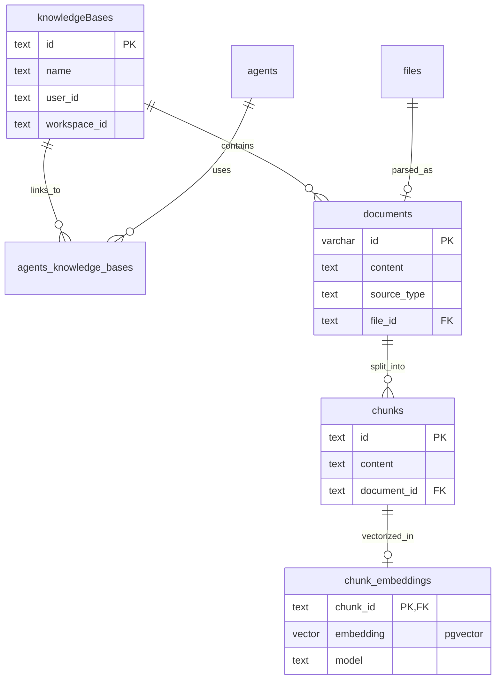
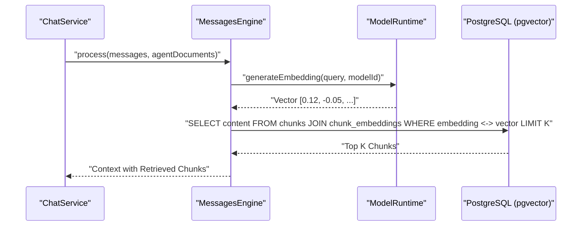
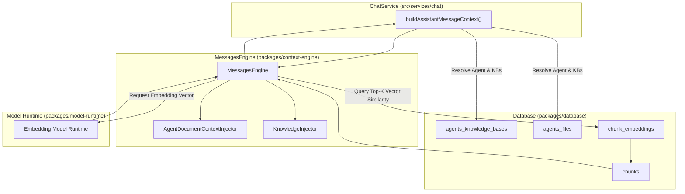

<!-- source: DeepWiki mcp.deepwiki.com · repo lobehub/lobehub · page 6.3 Embeddings, Vector and Full-Text Search · fetched 2026-10-29 -->

# Embeddings, Vector and Full-Text Search

Relevant source files

The following files were used as context for generating this wiki page:

- [.env.example](.env.example)
- [Dockerfile](Dockerfile)
- [apps/server/src/routers/lambda/recent.ts](apps/server/src/routers/lambda/recent.ts)
- [apps/server/src/services/memory/userMemory/__tests__/extract.runtime.test.ts](apps/server/src/services/memory/userMemory/__tests__/extract.runtime.test.ts)
- [apps/server/src/services/memory/userMemory/embedding.ts](apps/server/src/services/memory/userMemory/embedding.ts)
- [docs/self-hosting/advanced/model-list.mdx](docs/self-hosting/advanced/model-list.mdx)
- [docs/self-hosting/advanced/model-list.zh-CN.mdx](docs/self-hosting/advanced/model-list.zh-CN.mdx)
- [docs/self-hosting/environment-variables/model-provider.mdx](docs/self-hosting/environment-variables/model-provider.mdx)
- [docs/self-hosting/environment-variables/model-provider.zh-CN.mdx](docs/self-hosting/environment-variables/model-provider.zh-CN.mdx)
- [packages/database/package.json](packages/database/package.json)
- [packages/database/src/models/__tests__/recent.test.ts](packages/database/src/models/__tests__/recent.test.ts)
- [packages/database/src/models/recent.ts](packages/database/src/models/recent.ts)
- [packages/types/src/recent.ts](packages/types/src/recent.ts)
- [packages/utils/package.json](packages/utils/package.json)
- [packages/utils/src/tokenizer/embedding.test.ts](packages/utils/src/tokenizer/embedding.test.ts)
- [packages/utils/src/tokenizer/embedding.ts](packages/utils/src/tokenizer/embedding.ts)
- [src/const/topic.ts](src/const/topic.ts)
- [src/features/Home/Recents/AllRecentsDrawer.tsx](src/features/Home/Recents/AllRecentsDrawer.tsx)
- [src/features/Home/Recents/ConnectedItem.tsx](src/features/Home/Recents/ConnectedItem.tsx)
- [src/features/Home/Recents/List.tsx](src/features/Home/Recents/List.tsx)
- [src/features/Home/Recents/useDropdownMenu.tsx](src/features/Home/Recents/useDropdownMenu.tsx)
- [src/hooks/useSyncRecents.ts](src/hooks/useSyncRecents.ts)
- [src/services/recent/index.ts](src/services/recent/index.ts)
- [src/store/home/slices/recent/action.test.ts](src/store/home/slices/recent/action.test.ts)
- [src/store/home/slices/recent/action.ts](src/store/home/slices/recent/action.ts)
- [src/store/home/slices/recent/initialState.ts](src/store/home/slices/recent/initialState.ts)
- [src/store/home/slices/recent/projection.ts](src/store/home/slices/recent/projection.ts)
- [src/store/home/slices/recent/selectors.ts](src/store/home/slices/recent/selectors.ts)

LobeHub implements a sophisticated Retrieval-Augmented Generation (RAG) system that integrates embeddings, vector similarity search, and full-text search to empower AI Agents with rich contextual memory and external knowledge. This page provides an in-depth technical overview of the RAG schema (focusing on the `chunk_embeddings` table), embedding model configuration, the usage of PostgreSQL extensions (`pgvector`/`paradedb`) for similarity search, Elasticsearch reindexing and synchronization utilities, and the retrieval pipeline invoked during chat sessions.

---

## RAG Database Schema and Data Model

The foundation of LobeHub’s RAG functionality lies in its PostgreSQL database schema, orchestrated through Drizzle ORM. The schema partitions knowledge into distinct tables to handle logical knowledge base constructs, documents/files, their derived text chunks for granular indexing, and corresponding embeddings for vector search.

### Key Tables and Their Roles

| Table Name         | Purpose                                                                 | Important Columns                            |
|--------------------|-------------------------------------------------------------------------|----------------------------------------------|
| `knowledge_bases`  | Represents collections (logical containers) of files/documents that serve as the agent’s knowledge sources. | `id`, `name`, `user_id`, `workspace_id`     |
| `documents`        | Stores metadata and content extracted from uploaded files, web results, or API sources. | `id`, `file_id`, `source_type` (e.g., `file`, `web`, `api`), `slug` |
| `chunks`           | Contains fine-grained text segments split from documents for more precise retrieval. | `id`, `document_id`, `content`               |
| `chunk_embeddings` | Holds vector embeddings corresponding to chunks, stored as `vector` type for efficient similarity queries. | `chunk_id` (primary key and FK), `embedding` (pgvector), `model` (embedding model used) |

The `chunk_embeddings` table is designed using PostgreSQL's `pgvector` type (or alternative extensions like `paradedb`) to store high-dimensional dense vectors, enabling KNN (k-nearest neighbors) vector similarity queries directly inside the database.

#### Schema Snapshots

- The `chunk_embeddings` table was first introduced in migration `0005_pgvector` [packages/database/migrations/meta/_journal.json:43-45]().
- Refinements ensuring robust indexing and foreign key integrity on embeddings followed in `0007_fix_embedding_table` [packages/database/migrations/meta/_journal.json:57-59]().
- `documents` support multiple source types such as `file`, `web`, or `topic` to facilitate diverse ingestion [packages/database/src/schemas/index.ts:20-23]().

### RAG Schema Relationships — Bridging Natural Language to Code Entity Space

This ER diagram shows the relational flow between core entities that tie external natural language sources to indexed vector representations and agent knowledge connections.

**Sources:**  
[docs/development/database-schema.dbml:72-89](), [packages/database/src/schemas/agent.ts:145-169](), [packages/database/src/schemas/rag.ts](), [packages/database/src/utils/idGenerator.ts:18-30]()

---

## Embedding Model Configuration

LobeHub supports a variety of embedding models through its modular AI infra provisioning, bridging static model definitions (`model-bank`) and runtime execution (`model-runtime`).

### Identification and Management

- Each embedding model is uniquely identified and managed via the AI infra layer, which merges global and user-specific configurations.
- Database schemas such as `agents` and `ai_infra` retain provider and model identity via `provider` and `model` fields, associating embedding configurations to agents [packages/database/src/schemas/agent.ts:87-89]().
- IDs for entities use the `idGenerator` to ensure unique, prefixed IDs (e.g., `agt_` for agents, `kb_` for knowledge bases), consistent across the system [packages/database/src/utils/idGenerator.ts:15-30]().

### Model Attributes

Embedding models follow the `AIChatModelCard` and `AIBaseModelCard` typings and distinguish themselves as embedding-specific via:

- Model type declarations.
- Support for embedding dimension sizes (e.g., OpenAI’s `text-embedding-3-small` with dimension 1536).
- Provider linkage to services like OpenAI, Google AI, AWS Bedrock, etc.

This abstraction enables seamless swapping and configuration of underlying embedding services.

### Provider Environment Variables and Model List Configuration

LobeHub accepts environment variables to enable and configure embedding model providers, including OpenAI, Anthropic, Azure OpenAI, Google AI, and others. Examples:

- `OPENAI_API_KEY` to provide an OpenAI API key.
- `OPENAI_MODEL_LIST` controls the visible and enabled models, with syntax supports adding (+), hiding (-), renaming (=), and extending model capabilities via angle-bracketed extensions (e.g., `<8192:fc:vision>`).

The extension capabilities specify parameters such as max token length, function calling support (`fc`), vision (`vision`), search capability (`search`), file upload (`file`), and image generation (`imageOutput`). Customizing these lists is explained in detail in [docs/self-hosting/advanced/model-list.mdx]() and its localized variants.

**Sources:**  
[packages/database/src/schemas/aiInfra.ts](), [packages/database/src/schemas/agent.ts:87-89](), [docs/self-hosting/environment-variables/model-provider.mdx](), [docs/self-hosting/advanced/model-list.mdx](), [packages/database/src/utils/idGenerator.ts:15-56]()

---

## Vector Similarity Search

LobeHub leverages PostgreSQL extensions (`pgvector` primarily, with `paradedb` as an alternative) to conduct efficient high-dimensional vector similarity queries for semantic search.

### Similarity Search Characteristics

- Supports K-Nearest Neighbors (KNN) using the PostgreSQL `<->` operator or specialized pgvector index types.
- SQL queries directly compare query embeddings to stored chunk embeddings for fast nearest vector retrieval.
- Embeddings are stored densely in the `chunk_embeddings.embedding` column leveraging the vector type.

### Retrieval Flow in Pipeline

1. **Query Vectorization:** Incoming user inputs or messages are vectorized by the configured embedding model (e.g., OpenAI embeddings model) generating a dense vector embedding.
2. **Database Query:** Using the stored embeddings in the `chunk_embeddings` table, the system selects the top-K nearest chunks based on vector similarity.
3. **Aggregation & Injection:** Retrieved chunks are aggregated and inserted into the prompt context for the LLM to leverage during response generation.

### Vector Search Pipeline and Code Mapping

This sequence maps system components to concrete code artifacts for similarity search orchestration.

**Sources:**  
[packages/database/migrations/meta/_journal.json:43-52](), [packages/context-engine/src/engine/messages/MessagesEngine.ts:30-68](), [packages/database/src/schemas/rag.ts]()

---

## Elasticsearch Reindexing and Sync Scripts

In addition to PostgreSQL vector search, LobeHub supports full-text search indexing via Elasticsearch, providing fast textual search capabilities across documents and messages.

### Reindex and Sync Utilities

- The system includes CLI scripts for Elasticsearch feature:

  - **Elasticsearch Reindexing:** Bundled CLI for reindexing entire datasets — implemented in `scripts/elasticsearchReindex/index.ts`.
  - **Elasticsearch Sync:** CLI for syncing incremental changes to Elasticsearch indices — implemented in `scripts/elasticsearchSync/cli.ts`.
  - **PostgreSQL Search Cleanup:** Clean-up script for PostgreSQL full-text search artifacts — `scripts/pgSearchCleanup/index.ts`.

- These scripts are bundled using `esbuild` during the Docker image build process for runtime usage [Dockerfile:100-102]().

These scripts keep the Elasticsearch full-text index synchronized and performant alongside the primary Postgres data.

**Sources:**  
[Dockerfile:100-102]()

---

## Retrieval Pipeline during Chat

Integration of vector similarity and full-text retrieval occurs transparently in the chat message generation flow, enriching the prompt context for the AI Agent during conversations.

### Retrieval Pipeline Details

- Using `ChatService.createAssistantMessageContext` and related workflows, the system:

  - Resolves the agent and its linked knowledge bases (`agents_knowledge_bases`) and files (`agents_files`) [packages/database/src/schemas/agent.ts:145-188]().
  - Invokes `MessagesEngine` hooks (`AgentDocumentContextInjector` and `KnowledgeInjector`) to inject text chunks retrieved via vector search and/or full-text retrieval into the assistant message context [packages/context-engine/src/engine/messages/MessagesEngine.ts:32-47]().

- Retrieval and embedding token usage is tracked for cost estimation and metadata annotation in the `message` schema and topic aggregates [packages/database/src/schemas/message.ts:112-114](), [packages/database/src/schemas/topic.ts:64-70]().

- Retrieval depth and embedding effort are configured per-agent via their `chatConfig` and enabled memory/retrieval levels ensuring tailored prompt augmentation [src/services/chat/index.ts:177-195]().

### Chat Retrieval Pipeline Diagram — Bridging System names to Code Entities ("Natural Language Space" to "Code Entity Space")

This diagram shows the flow from chat input through embedding generation, vector similarity search in the database, and context injection into chat messages.

**Sources:**  
[src/services/chat/index.ts:136-195](), [packages/context-engine/src/engine/messages/MessagesEngine.ts:178-207](), [packages/database/src/schemas/topic.ts:64-70](), [packages/database/src/models/file.ts:170-205]()

---

# Summary

LobeHub’s embedding, vector, and full-text search functionalities provide the backbone for enhanced contextual AI interactions. Core features include:

- A detailed RAG schema modelling knowledge bases, documents, chunks, and embeddings.
- Support for multiple embedding model providers configured through agent and AI infra layers.
- Use of `pgvector`/`paradedb` for efficient vector similarity search inside PostgreSQL.
- Additional full-text search integration powered by Elasticsearch, with dedicated reindex and sync CLIs.
- A modular retrieval pipeline tightly woven into the chat service, dynamically injecting relevant knowledge into agent prompts.

This architecture enables LobeHub agents to consult both local and external knowledge sources effectively during conversations, augmenting AI capabilities with retrieval-augmented generation.

---

**Sources:**

- [packages/database/migrations/meta/_journal.json:43-59]()
- [packages/database/src/schemas/agent.ts:145-188]()
- [packages/database/src/schemas/rag.ts]()
- [packages/database/src/utils/idGenerator.ts:15-56]()
- [docs/development/database-schema.dbml:72-89]()
- [packages/context-engine/src/engine/messages/MessagesEngine.ts:30-68;178-207]()
- [src/services/chat/index.ts:136-195]()
- [packages/database/src/schemas/topic.ts:64-70]()
- [packages/database/src/models/file.ts:170-205]()
- [Dockerfile:100-102]()

---

