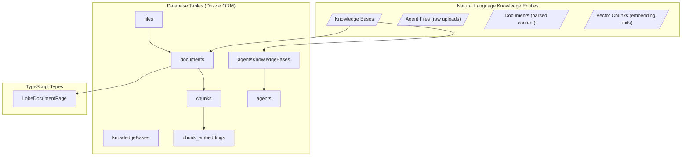
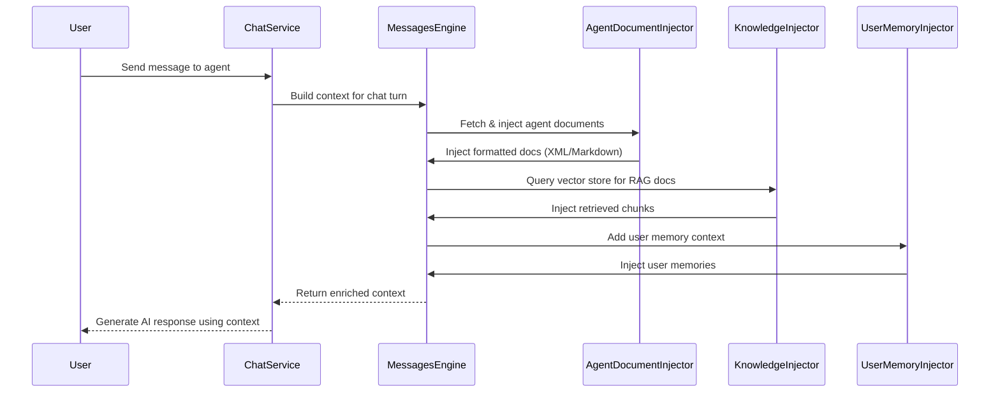
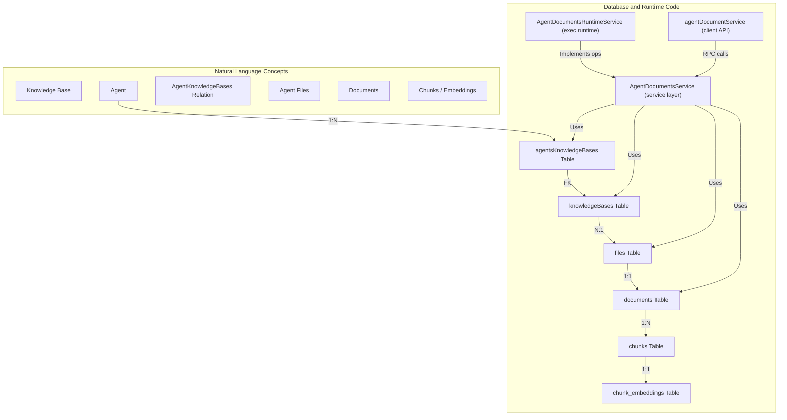
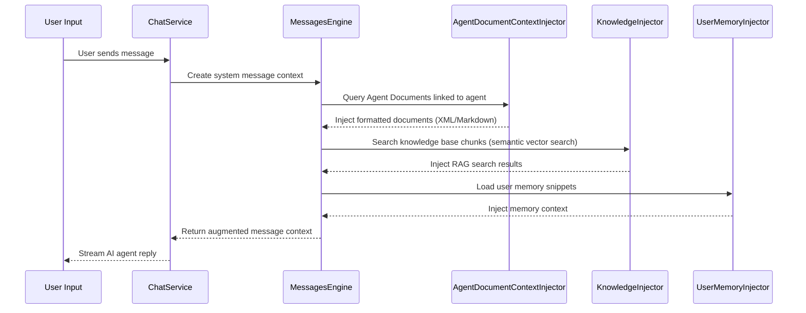

<!-- source: DeepWiki mcp.deepwiki.com · repo lobehub/lobehub · page 6.4 Knowledge Base Organization · fetched 2026-10-29 -->

# Knowledge Base Organization

<details>
<summary>Relevant source files</summary>

The following files were used as context for generating this wiki page:

- [apps/server/src/routers/lambda/agentDocument.ts](apps/server/src/routers/lambda/agentDocument.ts)
- [apps/server/src/services/agentDocuments/index.test.ts](apps/server/src/services/agentDocuments/index.test.ts)
- [apps/server/src/services/agentDocuments/index.ts](apps/server/src/services/agentDocuments/index.ts)
- [apps/server/src/services/toolExecution/serverRuntimes/__tests__/agentDocuments.test.ts](apps/server/src/services/toolExecution/serverRuntimes/__tests__/agentDocuments.test.ts)
- [apps/server/src/services/toolExecution/serverRuntimes/agentDocuments.ts](apps/server/src/services/toolExecution/serverRuntimes/agentDocuments.ts)
- [packages/builtin-tool-agent-documents/package.json](packages/builtin-tool-agent-documents/package.json)
- [packages/builtin-tool-agent-documents/src/ExecutionRuntime/index.test.ts](packages/builtin-tool-agent-documents/src/ExecutionRuntime/index.test.ts)
- [packages/builtin-tool-agent-documents/src/ExecutionRuntime/index.ts](packages/builtin-tool-agent-documents/src/ExecutionRuntime/index.ts)
- [packages/builtin-tool-agent-documents/src/executor/index.test.ts](packages/builtin-tool-agent-documents/src/executor/index.test.ts)
- [packages/builtin-tool-agent-documents/src/executor/index.ts](packages/builtin-tool-agent-documents/src/executor/index.ts)
- [packages/builtin-tool-agent-documents/src/manifest.ts](packages/builtin-tool-agent-documents/src/manifest.ts)
- [packages/builtin-tool-agent-documents/src/systemRole.test.ts](packages/builtin-tool-agent-documents/src/systemRole.test.ts)
- [packages/builtin-tool-agent-documents/src/systemRole.ts](packages/builtin-tool-agent-documents/src/systemRole.ts)
- [packages/builtin-tool-agent-documents/src/types.ts](packages/builtin-tool-agent-documents/src/types.ts)
- [packages/builtin-tool-agent-documents/vitest.config.mts](packages/builtin-tool-agent-documents/vitest.config.mts)
- [packages/builtin-tool-knowledge-base/src/systemRole.test.ts](packages/builtin-tool-knowledge-base/src/systemRole.test.ts)
- [packages/builtin-tool-knowledge-base/vitest.config.mts](packages/builtin-tool-knowledge-base/vitest.config.mts)
- [packages/context-engine/src/providers/AgentDocumentInjector/shared.ts](packages/context-engine/src/providers/AgentDocumentInjector/shared.ts)
- [packages/context-engine/src/providers/__tests__/AgentDocumentInjector.test.ts](packages/context-engine/src/providers/__tests__/AgentDocumentInjector.test.ts)
- [packages/prompts/src/prompts/agentDocuments/formatResults.test.ts](packages/prompts/src/prompts/agentDocuments/formatResults.test.ts)
- [packages/prompts/src/prompts/agentDocuments/formatResults.ts](packages/prompts/src/prompts/agentDocuments/formatResults.ts)
- [packages/prompts/src/prompts/agentDocuments/index.ts](packages/prompts/src/prompts/agentDocuments/index.ts)
- [src/features/AgentDocumentsExplorer/DocumentExplorerToolbar.tsx](src/features/AgentDocumentsExplorer/DocumentExplorerToolbar.tsx)
- [src/features/AgentDocumentsExplorer/DocumentExplorerTree.test.tsx](src/features/AgentDocumentsExplorer/DocumentExplorerTree.test.tsx)
- [src/features/AgentDocumentsExplorer/DocumentExplorerTree.tsx](src/features/AgentDocumentsExplorer/DocumentExplorerTree.tsx)
- [src/features/AgentDocumentsExplorer/hooks/useDocumentTreeOps.ts](src/features/AgentDocumentsExplorer/hooks/useDocumentTreeOps.ts)
- [src/features/Conversation/WorkingSidebar/ResourcesSection/index.tsx](src/features/Conversation/WorkingSidebar/ResourcesSection/index.tsx)
- [src/features/ExplorerTree/adapter/index.ts](src/features/ExplorerTree/adapter/index.ts)
- [src/features/ExplorerTree/adapter/path.test.ts](src/features/ExplorerTree/adapter/path.test.ts)
- [src/features/ExplorerTree/adapter/path.ts](src/features/ExplorerTree/adapter/path.ts)
- [src/features/ExplorerTree/documentTreeStyle.test.ts](src/features/ExplorerTree/documentTreeStyle.test.ts)
- [src/features/ExplorerTree/documentTreeStyle.ts](src/features/ExplorerTree/documentTreeStyle.ts)
- [src/features/ExplorerTree/folderIconStyle.test.ts](src/features/ExplorerTree/folderIconStyle.test.ts)
- [src/features/ExplorerTree/folderIconStyle.ts](src/features/ExplorerTree/folderIconStyle.ts)
- [src/features/ExplorerTree/index.tsx](src/features/ExplorerTree/index.tsx)
- [src/features/ExplorerTree/types.ts](src/features/ExplorerTree/types.ts)
- [src/features/ExplorerTree/view/ExplorerTree.test.tsx](src/features/ExplorerTree/view/ExplorerTree.test.tsx)
- [src/features/ExplorerTree/view/ExplorerTree.tsx](src/features/ExplorerTree/view/ExplorerTree.tsx)
- [src/services/agentDocument.ts](src/services/agentDocument.ts)
- [src/store/tool/slices/builtin/executors/lobe-agent-documents.ts](src/store/tool/slices/builtin/executors/lobe-agent-documents.ts)
- [src/utils/__tests__/agentDocumentContextMapping.test.ts](src/utils/__tests__/agentDocumentContextMapping.test.ts)
- [src/utils/agentDocumentContextMapping.ts](src/utils/agentDocumentContextMapping.ts)

</details>


LobeHub organizes knowledge within an extensible Retrieval-Augmented Generation (RAG) system. This system manages hierarchical knowledge entities—primarily **Knowledge Bases**, **Documents**, and **Files**—which are scoped per user and workspace, linked explicitly to agents, and queried during the chat pipeline’s *Context Engineering* phase to enrich AI assistant responses. This page provides an in-depth technical overview of how these components are implemented, linked, and queried.

---

## 1. Knowledge Entity Model

### Core Knowledge Entities

- **Knowledge Bases**:  
  Collections that aggregate related documents and files. They represent higher-level corpora accessible by agents. These are persisted in the `knowledgeBases` table, which supports user and workspace scoping [packages/database/src/schemas/agent.ts:36-143]().

- **Documents**:  
  Structured, parsed content units derived from files or web clipping sources. They contain markdown or XML content and metadata and are stored in the `documents` table with hierarchical parent-child relations [packages/database/src/schemas/file.ts:77-176]().

- **Files**:  
  The original uploaded or ingested binary sources, such as PDFs or text files, tracked via the `files` table [packages/database/src/schemas/file.ts:182-387]().

- **Chunks & Embeddings**:  
  Document content is split into smaller chunks for vector search. Each chunk’s embedding is stored in `chunk_embeddings` and linked back to the document in `chunks` [packages/database/src/schemas/rag.ts:13-75]().

- **Agent-Knowledge Linking**:  
  Through the `agentsKnowledgeBases` table, multiple knowledge bases can be associated to agents. This allows agents to customize their knowledge context [packages/database/src/schemas/agent.ts:145-169]().

### Data Relations Diagram: Natural Language to Code Entities



**Sources:**  
[packages/database/src/schemas/agent.ts:36-169](),  
[packages/database/src/schemas/file.ts:77-176](),  
[packages/database/src/schemas/rag.ts:13-40](),  
[packages/database/src/models/file.ts:120-132]()

---

## 2. Knowledge Base Creation and Linking to Agents

### Knowledge Base Lifecycle & Agent Associations

Knowledge bases are entities created and managed per user/workspace to organize documents/files that agents will access in conversations. They are linked explicitly to agents to control what knowledge each agent includes during prompt context construction.

- The `agentsKnowledgeBases` table relates agents (`agentId`) with knowledge bases (`knowledgeBaseId`). This relation includes a user ID and optional workspace ID to guarantee proper multi-tenant scoping.

- Each knowledge base can have many associated files, linked in `knowledgeBaseFiles` (not detailed here but part of the underlying schema), which in turn map to parsed documents.

- This linking enables dynamic enabling/disabling or updating of knowledge sources an agent uses.

### Code Components

- The `AgentDocumentsService` class (in `apps/server/src/services/agentDocuments/index.ts`) manages documents and their attachment to agents, including creation, listing, and modification operations. It supports nesting of documents in a tree structure (documents and folders) for organizational flexibility.

- The `AgentDocumentService` (in `src/services/agentDocument.ts`) provides client-facing APIs over RPC delegating to server methods for creating documents, associating them with agents, and querying them.

### Example: Creating and Associating Documents for an Agent

The service API supports creation of new documents optionally nested under a parent (`parentId`), with a hint if the document should be treated as a skill (`hintIsSkill`), and the knowledge scope (`agent` or `currentTopic`).

```ts
agentDocumentService.createDocument({
  agentId,
  content: 'Document content in Markdown',
  title: 'Document Title',
  parentId: optionalParentDocumentId,
  hintIsSkill: false,
  // implicit scope defaults to 'agent'
});
```

Subsequently, documents or knowledge bases are linked to agents for retrieval in chat context.

### Document Tree and Folder Support

- Documents support hierarchical nesting beneath folders or other documents.

- The document tree’s shape and organization is exposed via the UI component `DocumentExplorerTree` (in `src/features/AgentDocumentsExplorer/DocumentExplorerTree.tsx`), which uses flat data nodes with parent IDs to compose tree views.

- Folders are special documents marked with `fileType` equal to `"custom/folder"`, used purely for grouping with no direct content.

---

## 3. User and Workspace Scoping

### Multi-Tenant Data Partitioning

All major knowledge entities embed `userId` and (where appropriate) `workspaceId` fields for data isolation:

- **User Ownership**: Only the owning user can access their knowledge bases, files, and documents.

- **Workspace Isolation**: If present, the workspace ID scopes knowledge to that workspace, enabling team-shared knowledge bases or exclusive private scopes.

- Agent-to-knowledge-base associations also reflect this scoping to enforce authorization and clarity about the data context.

### Scoping in Code

- Database query filters utilize both `userId` and `workspaceId` to ensure multi-tenant data isolation, as seen in services like `AgentDocumentsService` and knowledge base repositories.

- The frontend store, e.g., `useAgentStore` and `useChatStore`, drive the selected agent and workspace contexts used to request scoped knowledge [src/features/AgentDocumentsExplorer/DocumentExplorerTree.tsx]().

---

## 4. Querying Knowledge During Chat Context Engineering

### Context Engineering Phase Overview

When a user sends a chat message, LobeHub’s chat pipeline initiates *context engineering*, which constructs an augmented prompt incorporating relevant knowledge based on the active agent’s linked knowledge bases.

The pipeline calls into the `MessagesEngine` from the `context-engine` package, which sequentially runs injectors and processors that:

- Retrieve agent documents linked to the agent

- Pull knowledge base files and documents (flat or hierarchical)

- Fetch relevant vector-based chunks (RAG) via embedding similarity

- Collect user memory or other contextual data

### Key Injectors for Knowledge

- **AgentDocumentContextInjector** injects agent documents content in XML/Markdown format [packages/context-engine/src/engine/messages/MessagesEngine.ts:15-137]().

- **KnowledgeInjector** incorporates Knowledge Base search results from the RAG vector store [packages/context-engine/src/engine/messages/MessagesEngine.ts:85-107]().

- **TopicReferenceContextInjector** and **UserMemoryInjector** add additional relevant context from topics and memory [packages/context-engine/src/engine/messages/MessagesEngine.ts]().

### Sequence Diagram: Knowledge Query at Chat Turn



### Runtime Execution

- The `AgentDocumentsRuntimeService` interface (in `packages/builtin-tool-agent-documents/src/ExecutionRuntime/index.ts`) defines operations like `listDocuments`, `readDocument`, `createDocument`, and `moveDocuments` used in runtime to interact with the knowledge graph.

- Paging and filtering are supported during lists to limit data retrieved per turn to manageable sizes.

- The system supports creating folders and nested document structures for organizational clarity.

---

## 5. Summary of Knowledge Base Organization

| Aspect                          | Description                                                                                      |
|--------------------------------|------------------------------------------------------------------------------------------------|
| Knowledge Entity Types          | Knowledge Bases, Documents, Files, Chunks/Embeddings                                           |
| Data Relationships              | Agents ↔ KnowledgeBases ↔ Files ↔ Documents ↔ Chunks ↔ Embeddings                              |
| Multi-Tenant Scoping            | Data isolation enforced via `userId` and `workspaceId` fields                                  |
| Agent Linking                  | Agents explicitly linked with knowledge bases; knowledge drives prompt context enrichment       |
| Context Engineering Phase      | MessagesEngine injects agent documents and knowledge base contents during chat context assembly |
| Document Hierarchy             | Nested documents and folders, searchable and modifiable                                       |
| Runtime APIs and Services      | `AgentDocumentsService` and `AgentDocumentService` implement creation, retrieval, modification operations |

---

# Diagram: Linking Natural Language Concepts to Code Entities for Knowledge Base and Agents



---

# Diagram: Chat Pipeline Context Engineering - Knowledge Query Flow



---

# Additional Notes

- Agent documents are distinct from knowledge base files: documents are scoped to agents and represent notes, workflows, or skills authored or used by the agent.

- The Knowledge Base tool and Agent Documents tool are segmented by design, with different system roles, usage scopes, and permissions, described in `packages/builtin-tool-agent-documents/src/systemRole.ts`.

- Document content supports advanced operations using LiteXML node-level edits for fine-grained modification and patching (e.g., `modifyNodes` API).

- Pagination and filters (titleContains, parentId, scope) allow efficient document listing in large knowledge bases.

---

# References and Sources

- [packages/database/src/schemas/agent.ts:36-169]()  
- [packages/database/src/schemas/file.ts:77-176]()  
- [packages/database/src/schemas/rag.ts:13-75]()  
- [src/services/chat/index.ts:125-196]()  
- [src/services/chat/mecha/contextEngineering.ts:142-166]()  
- [packages/context-engine/src/engine/messages/MessagesEngine.ts:15-137]()  
- [packages/builtin-tool-agent-documents/src/ExecutionRuntime/index.ts:1-207]()  
- [apps/server/src/services/agentDocuments/index.ts:187-197]()  
- [src/services/agentDocument.ts:45-216]()  
- [src/features/AgentDocumentsExplorer/DocumentExplorerTree.tsx:1-163]()  
- [packages/builtin-tool-agent-documents/src/systemRole.ts:1-55]()

---

