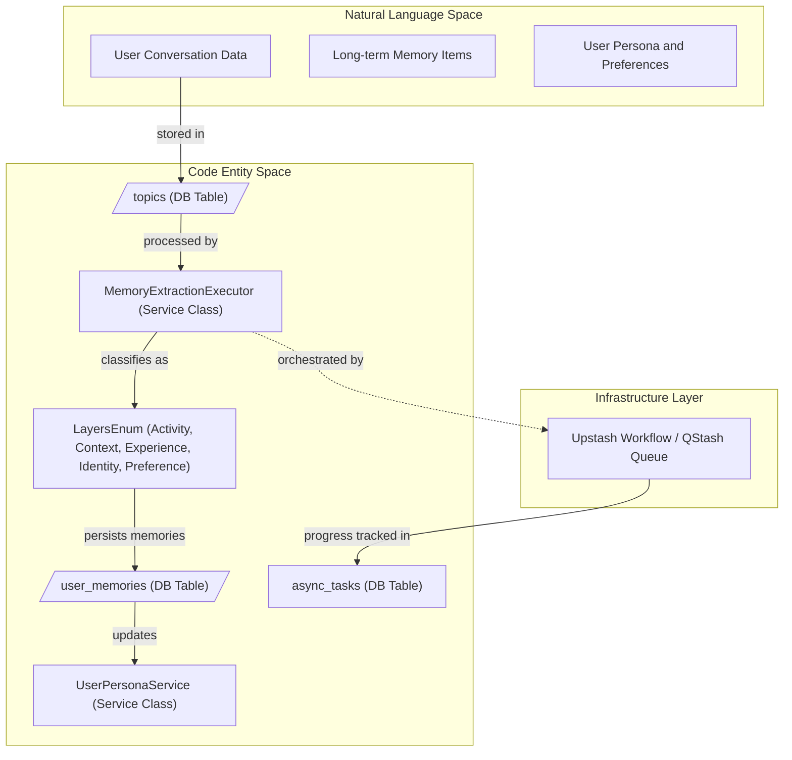
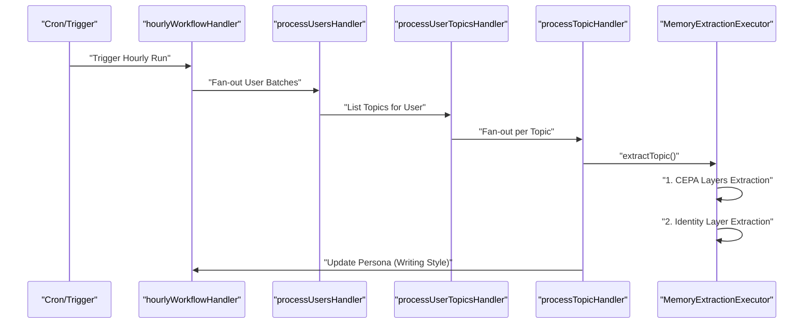

<!-- source: DeepWiki mcp.deepwiki.com · repo lobehub/lobehub · page 7 User Memory System · fetched 2026-10-29 -->

# User Memory System

Relevant source files

The following files were used as context for generating this wiki page:

- [apps/server/src/services/document/__tests__/index.test.ts](apps/server/src/services/document/__tests__/index.test.ts)
- [apps/server/src/services/document/index.ts](apps/server/src/services/document/index.ts)
- [docs/development/database-schema.dbml](docs/development/database-schema.dbml)
- [packages/database/migrations/0086_video_generation_schema.sql](packages/database/migrations/0086_video_generation_schema.sql)
- [packages/database/migrations/0177_agent_accounts_live_unique_and_goal_subscriptions.sql](packages/database/migrations/0177_agent_accounts_live_unique_and_goal_subscriptions.sql)
- [packages/database/migrations/0180_task_archived_at.sql](packages/database/migrations/0180_task_archived_at.sql)
- [packages/database/migrations/meta/0086_snapshot.json](packages/database/migrations/meta/0086_snapshot.json)
- [packages/database/migrations/meta/0177_snapshot.json](packages/database/migrations/meta/0177_snapshot.json)
- [packages/database/migrations/meta/0180_snapshot.json](packages/database/migrations/meta/0180_snapshot.json)
- [packages/database/migrations/meta/_journal.json](packages/database/migrations/meta/_journal.json)
- [packages/database/src/models/__tests__/agentAccount.test.ts](packages/database/src/models/__tests__/agentAccount.test.ts)
- [packages/database/src/models/__tests__/document.test.ts](packages/database/src/models/__tests__/document.test.ts)
- [packages/database/src/models/__tests__/drizzleMigration.test.ts](packages/database/src/models/__tests__/drizzleMigration.test.ts)
- [packages/database/src/models/__tests__/topics/topic.create.test.ts](packages/database/src/models/__tests__/topics/topic.create.test.ts)
- [packages/database/src/models/agentAccount.ts](packages/database/src/models/agentAccount.ts)
- [packages/database/src/models/document.ts](packages/database/src/models/document.ts)
- [packages/database/src/schemas/agent.ts](packages/database/src/schemas/agent.ts)
- [packages/database/src/schemas/agentAccount.ts](packages/database/src/schemas/agentAccount.ts)
- [packages/database/src/schemas/agentCronJob.ts](packages/database/src/schemas/agentCronJob.ts)
- [packages/database/src/schemas/apiKey.ts](packages/database/src/schemas/apiKey.ts)
- [packages/database/src/schemas/asyncTask.ts](packages/database/src/schemas/asyncTask.ts)
- [packages/database/src/schemas/chatGroup.ts](packages/database/src/schemas/chatGroup.ts)
- [packages/database/src/schemas/file.ts](packages/database/src/schemas/file.ts)
- [packages/database/src/schemas/generation.ts](packages/database/src/schemas/generation.ts)
- [packages/database/src/schemas/goalSubscription.ts](packages/database/src/schemas/goalSubscription.ts)
- [packages/database/src/schemas/index.ts](packages/database/src/schemas/index.ts)
- [packages/database/src/schemas/message.ts](packages/database/src/schemas/message.ts)
- [packages/database/src/schemas/rag.ts](packages/database/src/schemas/rag.ts)
- [packages/database/src/schemas/relations.ts](packages/database/src/schemas/relations.ts)
- [packages/database/src/schemas/session.ts](packages/database/src/schemas/session.ts)
- [packages/database/src/schemas/task.ts](packages/database/src/schemas/task.ts)
- [packages/database/src/schemas/topic.ts](packages/database/src/schemas/topic.ts)
- [packages/database/src/utils/idGenerator.ts](packages/database/src/utils/idGenerator.ts)
- [packages/types/src/goalSubscription.ts](packages/types/src/goalSubscription.ts)
- [packages/types/src/index.ts](packages/types/src/index.ts)

The User Memory System in LobeHub is a background processing pipeline designed to extract and persist long-term user memories from conversation data. It processes chat content to generate structured memory artifacts organized into five distinct layers, enabling AI agents to retain a personalized and persistent understanding of the user across sessions and conversations.

This page provides a high-level overview of the User Memory System architecture, the core concepts of the five memory layers, and their integration within the larger LobeHub ecosystem. Detailed implementation and configuration information is found in the child pages.

---

## Architecture Overview

The User Memory System orchestrates asynchronous workflows that extract memory items from user conversations stored in the database. The system uses Upstash Workflow and QStash queue services to manage scalable, distributed execution with retries and progress tracking.

At the heart of the extraction process is the `MemoryExtractionExecutor` service class, which processes conversation topics and divides memory data into five layers based on predefined classification enums (`LayersEnum`). Extracted memories are persisted in the `user_memories` database table, and overall user persona information is continuously updated to reflect the user's style and preferences.

The memory extraction workflow is tracked by the `async_tasks` table, which records task progress states and error counts for observability and diagnostics.

### Bridging Conceptual and Code Entities

The following diagram illustrates the connection from natural language concepts about user memory to the concrete code entities and infrastructure components within LobeHub:

This diagram helps developers link abstract concepts like user conversation and memory layers to concrete database tables, service classes, and workflow orchestration seen in the codebase.

**Sources:**  
- [packages/database/src/models/topic.ts:25-60]()  
- [apps/server/src/routers/lambda/userMemory.ts:1-120]()  
- [packages/database/src/schemas/userMemories.ts:1-53]()  
- [packages/database/src/schemas/asyncTask.ts:1-15]()  

---

## The Five Layers of User Memory

LobeHub groups extracted memory data into five thematic layers, each representing a different aspect of the user's interactions and context:

| Layer       | Code Symbol            | Description                                                                                       |
|-------------|-----------------------|-------------------------------------------------------------------------------------------------|
| Activity    | `LayersEnum.Activity`  | Captures discrete user actions, behaviors, and activity signals detected during conversations.  |
| Context     | `LayersEnum.Context`   | Contains environmental and situational information relevant to user interactions.               |
| Experience  | `LayersEnum.Experience` | Records significant events, milestones, and past interactions referenced by the user.           |
| Identity    | `LayersEnum.Identity`  | Holds personal identity attributes such as name, roles, and demographic data.                   |
| Preference  | `LayersEnum.Preference`| Stores user preferences including likes, dislikes, and AI instruction overrides.                |

All memory records are persisted in the `user_memories` table with metadata that enables efficient querying and filtering by layer and user context.

For full technical details about the data schemas, enumerations, and memory extraction class implementation, see the child page: [Memory Storage and Extraction](#7.1).

**Sources:**  
- [packages/database/src/schemas/userMemories.ts:1-53]()  

---

## Memory Processing Pipeline

The memory extraction process is implemented as an asynchronous, scalable workflow to avoid impact on frontend responsiveness and to handle many users and topics efficiently. This is orchestrated using the Upstash Workflow platform with QStash for queuing and retries.

The workflow stages proceed as follows:

### Key Components

- **`MemoryExtractionExecutor`**: Service class that uses AI models to parse conversations and produce JSON-formatted memory artifacts for each of the five layers.
- **Upstash Workflow and QStash Queue**: External services that manage the distributed stateful execution, retries, and scaling for memory extraction tasks.
- **`async_tasks` Table**: Database table used for tracking extraction task statuses, progress counts, errors, and timestamps.
- **`topics` Table Metadata**: Each chat topic stores extraction status in the `metadata.userMemoryExtractStatus` field to prevent redundant processing.

The memory extraction pipeline allows for detailed processing of conversation data without blocking user interaction, and supports continuous incremental updates as new conversations accumulate.

For detailed workflow code, task management, and extraction logic, see the child page: [Memory Storage and Extraction](#7.1).

**Sources:**  
- [apps/server/src/routers/lambda/userMemory.ts:20-100]()  
- [packages/database/src/models/topic.ts:30-60]()  
- [packages/database/src/schemas/asyncTask.ts:1-15]()  

---

## Configuration and Observability

The User Memory System supports flexible configuration and observability features:

- **Model Roles**: Different AI models can be selected separately for Gatekeeper filtering and Layer Extractor roles, allowing optimized settings per extraction stage.
- **Agent Configuration**: Memory extraction can be toggled on or off per agent via their `chatConfig` settings stored in the `agents` table.
- **UI Controls**: User memory enabled state and related parameters are exposed in the agent configuration UI for adjustment.
- **Instrumentation**: The entire extraction pipeline is instrumented using OpenTelemetry (OTEL) to collect latencies, token usage, and error metrics.
- **Monitoring Dashboards**: Grafana dashboards visualize memory extraction workflow performance, helping identify issues or bottlenecks.

For comprehensive information about configuration options and monitoring setup, refer to the child page: [Memory Configuration and Observability](#7.2).

**Sources:**  
- [packages/database/src/schemas/agent.ts:30-129]()  
- [apps/server/src/routers/lambda/userMemory.ts:1-120]()  

---

## Summary and Next Steps

This page gave a concise overview of the User Memory System’s purpose, architecture, memory layer model, asynchronous extraction pipeline, and configuration/observability features within LobeHub.

To dive deeper into the technical details, please consult the following child pages:

- [Memory Storage and Extraction](#7.1) — Covers data models, executor class, workflow orchestration, and persistence details.  
- [Memory Configuration and Observability](#7.2) — Describes agent memory settings UI, configuration, builtin memory tool, and telemetry dashboard integration.  

Together, these pages provide developers with a full understanding of how LobeHub processes conversation data into long-term, structured user memories.

---

**Sources:**  
- [packages/database/src/models/topic.ts:25-60]()  
- [apps/server/src/routers/lambda/userMemory.ts:1-120]()  
- [packages/database/src/schemas/userMemories.ts:1-53]()  
- [packages/database/src/schemas/asyncTask.ts:1-15]()  
- [packages/database/src/schemas/agent.ts:30-129]()

---

