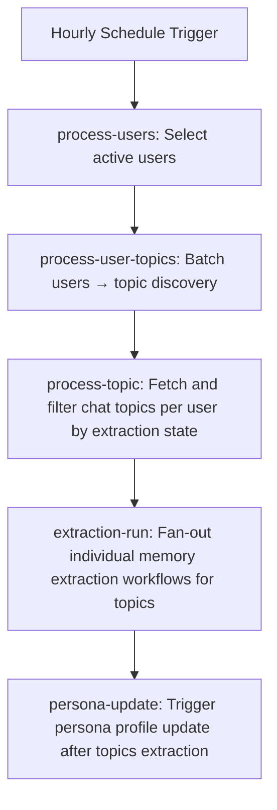
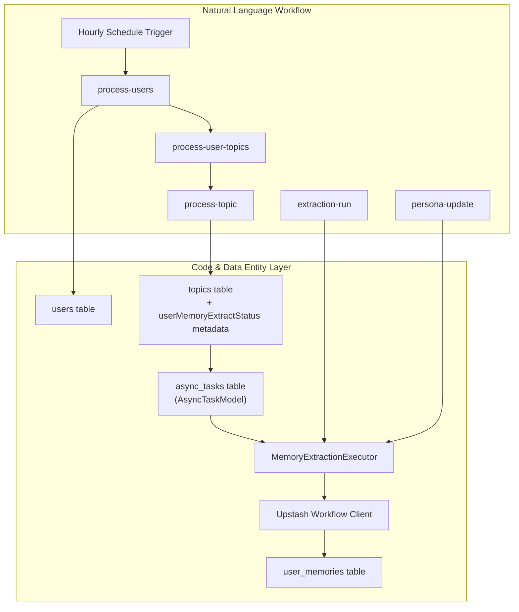
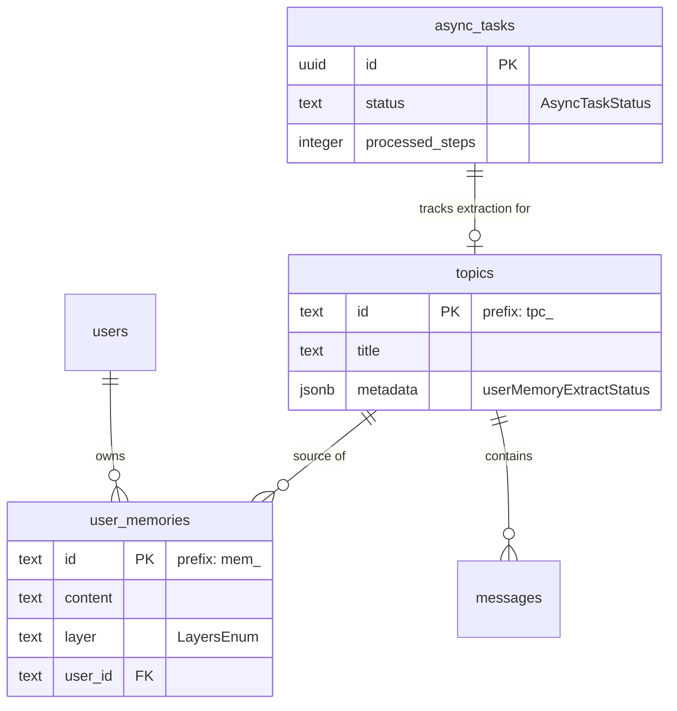

<!-- source: DeepWiki mcp.deepwiki.com · repo lobehub/lobehub · page 7.1 Memory Storage and Extraction · fetched 2026-10-29 -->

# Memory Storage and Extraction

<details>
<summary>Relevant source files</summary>

The following files were used as context for generating this wiki page:

- [apps/cli/src/commands/task/lifecycle.test.ts](apps/cli/src/commands/task/lifecycle.test.ts)
- [apps/cli/src/commands/task/lifecycle.ts](apps/cli/src/commands/task/lifecycle.ts)
- [apps/server/src/routers/lambda/recent.ts](apps/server/src/routers/lambda/recent.ts)
- [apps/server/src/services/memory/userMemory/__tests__/extract.runtime.test.ts](apps/server/src/services/memory/userMemory/__tests__/extract.runtime.test.ts)
- [apps/server/src/services/memory/userMemory/embedding.ts](apps/server/src/services/memory/userMemory/embedding.ts)
- [apps/server/src/services/taskRunner/buildTaskPrompt.test.ts](apps/server/src/services/taskRunner/buildTaskPrompt.test.ts)
- [apps/server/src/services/taskRunner/buildTaskPrompt.ts](apps/server/src/services/taskRunner/buildTaskPrompt.ts)
- [apps/server/src/services/taskRunner/taskSkill.test.ts](apps/server/src/services/taskRunner/taskSkill.test.ts)
- [apps/server/src/services/verify/__tests__/acceptanceLifecycle.test.ts](apps/server/src/services/verify/__tests__/acceptanceLifecycle.test.ts)
- [apps/server/src/services/verify/__tests__/carryForward.db.test.ts](apps/server/src/services/verify/__tests__/carryForward.db.test.ts)
- [apps/server/src/services/verify/__tests__/carryForward.test.ts](apps/server/src/services/verify/__tests__/carryForward.test.ts)
- [apps/server/src/services/verify/__tests__/driveTaskFromVerify.test.ts](apps/server/src/services/verify/__tests__/driveTaskFromVerify.test.ts)
- [apps/server/src/services/verify/__tests__/evidenceCoverage.test.ts](apps/server/src/services/verify/__tests__/evidenceCoverage.test.ts)
- [apps/server/src/services/verify/__tests__/executor.test.ts](apps/server/src/services/verify/__tests__/executor.test.ts)
- [apps/server/src/services/verify/__tests__/goalReview.test.ts](apps/server/src/services/verify/__tests__/goalReview.test.ts)
- [apps/server/src/services/verify/__tests__/goalReviewEvidence.test.ts](apps/server/src/services/verify/__tests__/goalReviewEvidence.test.ts)
- [apps/server/src/services/verify/__tests__/judgePrompt.test.ts](apps/server/src/services/verify/__tests__/judgePrompt.test.ts)
- [apps/server/src/services/verify/__tests__/lifecycleClaim.test.ts](apps/server/src/services/verify/__tests__/lifecycleClaim.test.ts)
- [apps/server/src/services/verify/__tests__/modelFrames.test.ts](apps/server/src/services/verify/__tests__/modelFrames.test.ts)
- [apps/server/src/services/verify/carryForward.ts](apps/server/src/services/verify/carryForward.ts)
- [apps/server/src/services/verify/evidenceCoverage.ts](apps/server/src/services/verify/evidenceCoverage.ts)
- [apps/server/src/services/verify/executor.ts](apps/server/src/services/verify/executor.ts)
- [apps/server/src/services/verify/goalReview.ts](apps/server/src/services/verify/goalReview.ts)
- [apps/server/src/services/verify/lifecycle.ts](apps/server/src/services/verify/lifecycle.ts)
- [apps/server/src/services/verify/modelFrames.ts](apps/server/src/services/verify/modelFrames.ts)
- [apps/server/src/services/verify/planInstantiation.ts](apps/server/src/services/verify/planInstantiation.ts)
- [apps/server/src/services/verify/repairService.ts](apps/server/src/services/verify/repairService.ts)
- [apps/server/src/services/verify/reviewPredictor.ts](apps/server/src/services/verify/reviewPredictor.ts)
- [apps/server/src/services/verify/settle.ts](apps/server/src/services/verify/settle.ts)
- [packages/builtin-skills/src/task/SKILL.md](packages/builtin-skills/src/task/SKILL.md)
- [packages/database/package.json](packages/database/package.json)
- [packages/database/src/models/__tests__/recent.test.ts](packages/database/src/models/__tests__/recent.test.ts)
- [packages/database/src/models/recent.ts](packages/database/src/models/recent.ts)
- [packages/prompts/src/chains/verify.test.ts](packages/prompts/src/chains/verify.test.ts)
- [packages/prompts/src/chains/verify.ts](packages/prompts/src/chains/verify.ts)
- [packages/prompts/src/prompts/task/index.test.ts](packages/prompts/src/prompts/task/index.test.ts)
- [packages/prompts/src/prompts/task/index.ts](packages/prompts/src/prompts/task/index.ts)
- [packages/prompts/src/prompts/verify/index.ts](packages/prompts/src/prompts/verify/index.ts)
- [packages/types/src/recent.ts](packages/types/src/recent.ts)
- [packages/utils/package.json](packages/utils/package.json)
- [packages/utils/src/tokenizer/embedding.test.ts](packages/utils/src/tokenizer/embedding.test.ts)
- [packages/utils/src/tokenizer/embedding.ts](packages/utils/src/tokenizer/embedding.ts)
- [src/const/topic.ts](src/const/topic.ts)
- [src/features/Home/Recents/AllRecentsDrawer.tsx](src/features/Home/Recents/AllRecentsDrawer.tsx)
- [src/features/Home/Recents/ConnectedItem.tsx](src/features/Home/Recents/ConnectedItem.tsx)
- [src/features/Home/Recents/List.tsx](src/features/Home/Recents/List.tsx)
- [src/features/Home/Recents/useDropdownMenu.tsx](src/features/Home/Recents/useDropdownMenu.tsx)
- [src/hooks/useSyncRecents.ts](src/hooks/useSyncRecents.ts)
- [src/services/recent/index.ts](src/services/recent/index.ts)
- [src/store/home/slices/recent/action.test.ts](src/store/home/slices/recent/action.test.ts)
- [src/store/home/slices/recent/action.ts](src/store/home/slices/recent/action.ts)
- [src/store/home/slices/recent/initialState.ts](src/store/home/slices/recent/initialState.ts)
- [src/store/home/slices/recent/projection.ts](src/store/home/slices/recent/projection.ts)
- [src/store/home/slices/recent/selectors.ts](src/store/home/slices/recent/selectors.ts)

</details>


This section documents the internal design and implementation details of LobeHub's user memory system. The focus is on the `MemoryExtractionExecutor` class, the `LayersEnum` enumeration defining the five semantic memory layers, the Upstash Workflow distributed pipeline for memory extraction, the `AsyncTaskModel` for progress tracking, memory persistence in the database, and the structure of the `memory-user-memory` package.

The user memory system transforms ephemeral conversational data spanning chat topics into persistent, semantically organized memory entries. These memories augment AI Agent capabilities by providing long-term, structured personal context.

---

## Memory Extraction Architecture

### `MemoryExtractionExecutor`

`MemoryExtractionExecutor` is the central orchestrator that runs the memory extraction workflow. It is responsible for:

- Initializing extraction tasks for a user, optionally filtering by a begin timestamp.
- Querying the user's chat topics from the `topics` table, paying attention to per-topic extraction state metadata.
- Paginating through topics to batch extraction runs in manageable chunks.
- Dispatching extraction operations asynchronously via the Upstash Workflow pipeline.
- Tracking extraction progress and status using the `AsyncTaskModel`.
- Marking extraction completion for consistent incremental extraction.

This executor integrates the database layer, Async Task tracking, and the Upstash Workflow client to perform distributed, scalable memory extraction.

The executor uses the following key components and logic:

- Querying `topics` for a user, filtering by `userMemoryExtractStatus`, which tracks extraction state at a per-topic granularity.
- Using `AsyncTaskModel` to create an async task for the extraction run. If a relevant active task exists, it resumes or avoids duplication.
- Coordinating calls into the Upstash Workflow client to kick off workflows that extract memories across all layers.

This class is defined and referenced primarily in the server memory service layers and invoked during extraction workflows.[apps/server/src/services/memory/userMemory/extract.ts:1-120]()

---

### Five Memory Layers (`LayersEnum`)

User memory is organized semantically into five discrete layers defined in the enum `LayersEnum`:

| Layer Name | Enum Value     | Description                                         |
|------------|----------------|-----------------------------------------------------|
| Activity   | `Activity`     | User's behaviors, habits, and activity history.     |
| Context    | `Context`      | Situational context and environmental details.      |
| Experience | `Experience`   | Historical user interactions and experiential info. |
| Identity   | `Identity`     | Core user attributes, biographical information.     |
| Preference | `Preference`   | User preferences, likes/dislikes, and settings.     |

These layers enable fine-grained classification and retrieval of memories according to their semantic role in agent cognition.

The enum is defined as a Typescript union type with string literals matching those above. This enum governs how extracted memories are labeled and stored in the DB.

```typescript
export type LayersEnum = 'Activity' | 'Context' | 'Experience' | 'Identity' | 'Preference';
```
[packages/types/src/userMemory.ts:6-12]()

---

## Upstash Workflow Distributed Memory Extraction Pipeline

LobeHub employs a scalable, asynchronous multi-stage pipeline powered by Upstash Workflow to execute the memory extraction.

### Workflow Overview

The workflow implements a top-down extraction process triggered on an hourly schedule:



- `process-users` queries active users to run memory extraction on.
- `process-user-topics` batch processes users to discover their user topics.
- `process-topic` queries per-user topics that require extraction (using extraction metadata stored per-topic).
- `extraction-run` fans out memory extraction runs per individual topic. These runs orchestrate extraction across all five memory layers.
- `persona-update` updates the user persona memory aggregates once topic extractions are completed.

This pipeline supports large-scale, incremental extraction with fault tolerance and batching.

---

### Workflow Entity Mapping Diagram

The diagram below maps the natural language workflow stages to corresponding core code entities and database tables.



This illustrates how user selection, topic querying, async tasks, and extraction execution interconnect from natural language concepts to code components.

(Sources: [packages/database/src/schemas/user.ts:13-68](), [packages/database/src/schemas/topic.ts:25-106](), [packages/database/src/schemas/asyncTask.ts:13-39](), [packages/database/src/schemas/userMemories.ts:31-70]()) 

---

## AsyncTaskModel for Progress Tracking

Memory extraction runs are represented as individual tasks in the `async_tasks` table, managed by `AsyncTaskModel`. This model tracks extraction lifecycle details and progress metrics:

| Feature         | Description                                                                            |
|-----------------|----------------------------------------------------------------------------------------|
| Task Status     | Tracks lifecycle states using `AsyncTaskStatus` enum: Pending, Processing, Success, Failed, etc. |
| Step Progress   | Tracks `totalSteps` and `processedSteps` for fine-grained progress monitoring in UI.   |
| Error Capture   | Stores error details on failure for diagnostics.                                      |
| Deduplication   | Checks active tasks to avoid duplicate extractions running concurrently.               |

`AsyncTaskModel` exposes methods to create, query, update, mark progress, and complete tasks, which `MemoryExtractionExecutor` uses to manage extraction jobs reliably.

This task-tracking infrastructure supports resilient background execution with observable progress.

(Sources: [packages/database/src/schemas/asyncTask.ts:13-39](), [packages/types/src/asyncTask.ts:4-13]())

---

## Memory Persistence and Storage

### Database Schema Highlights

User memories are persistently stored in the `user_memories` table with the following relevant columns:

| Column       | Type   | Description                               |
|--------------|---------|------------------------------------------|
| `id`         | text    | Primary key, generated with prefix "mem_" in `idGenerator.ts` |
| `content`    | text    | Extracted factual or semantic knowledge text |
| `layer`      | text    | One of the `LayersEnum` values indicating memory layer |
| `userId`     | text    | Foreign key to `users` table for owner   |
| `topicId`    | text    | Foreign key to `topics` table origin     |

The memories link back to the conversational topics and users, integrating tightly with natural dialogue data.

---

### Data Relationship Diagram



This diagram shows user memories related to topics and tracked extraction tasks, demonstrating integrated data relationships in the system.

(Sources: [packages/database/src/schemas/userMemories.ts:31-70](), [packages/database/src/schemas/topic.ts:25-106](), [packages/database/src/schemas/asyncTask.ts:13-39]()) 

---

## `memory-user-memory` Package Overview

The `memory-user-memory` package centralizes memory persistence models, extraction logic, and database integration.

- Defines types for user memory entries and extraction states.
- Implements model classes such as `UserMemoryModel` and `UserMemoryActivityModel` to interact with DB layers.
- Contains functions related to the Upstash Workflow pipeline and extraction orchestration.
- Facilitates creation, updating, and querying of memory entries across the five layers.
- Provides utilities for embedding and retrieval integration.

This package is essential for managing structured user memory as a persistent and queryable knowledge base.

(Sources: [apps/server/src/routers/lambda/userMemory.ts](), [apps/server/src/services/memory/userMemory/extract.ts]())

---

## Memory Usage in the Agent Runtime

Extracted user memory entries are surfaced to AI Agents primarily through the built-in Memory tool, allowing:

- Access to semantic memories spanning identity, experience, preferences, context, and activities.
- Enrichment of dialogue context with personal long-term knowledge.
- Dynamic retrieval and injection of relevant memories to improve personalization and reasoning.
- Selective maintenance: pruning or updating memories as user context evolves.

These capabilities close the loop between ephemeral chat histories and enduring personal knowledge representations within agent interactions.

(Sources: [packages/types/src/userMemory.ts:1-20](), [packages/database/src/schemas/userMemories.ts:1-10]())

---

# Summary

The Memory Storage and Extraction subsystem in LobeHub consists of:

- **MemoryExtractionExecutor**: Orchestrates topic discovery and dispatches extraction workflows.
- **LayersEnum**: Enumerates the five semantic layers of extracted user memories.
- **Upstash Workflow Pipeline**: A distributed, scalable, asynchronous pipeline for memory extraction, progressing from user selection through topic extraction to persona profile updates.
- **AsyncTaskModel**: Tracks extraction jobs progress, status, and errors in the `async_tasks` table.
- **Persistent Memory Storage**: Uses the `user_memories` table keyed by user and topic, tagged by memory layer.
- **memory-user-memory package**: Encapsulates models, extraction code, and workflow integrations for user memory.

Together, these components enable robust long-term personalized semantic memory that enhances AI Agent contextual awareness and user experience.

---

Sources:  
- [apps/server/src/services/memory/userMemory/extract.ts:1-120]()  
- [packages/types/src/userMemory.ts:6-12]()  
- [packages/database/src/schemas/userMemories.ts:31-70]()  
- [packages/database/src/schemas/topic.ts:25-106]()  
- [packages/database/src/schemas/asyncTask.ts:13-39]()  
- [packages/types/src/asyncTask.ts:4-13]()  
- [apps/server/src/routers/lambda/userMemory.ts]()

---

