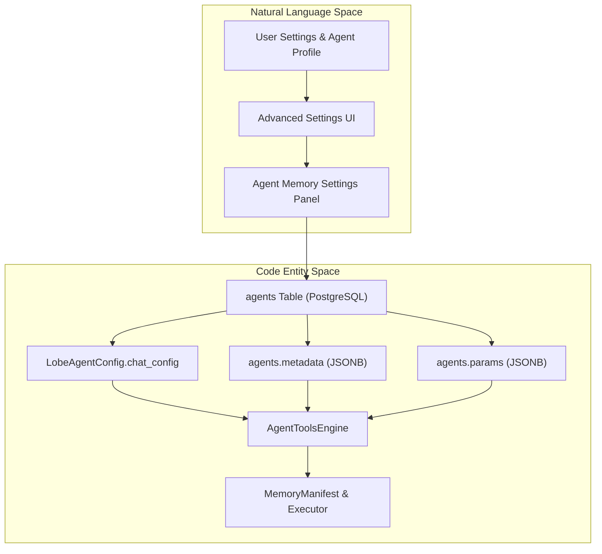
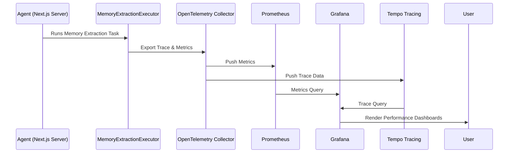

<!-- source: DeepWiki mcp.deepwiki.com · repo lobehub/lobehub · page 7.2 Memory Configuration and Observability · fetched 2026-10-29 -->

# Memory Configuration and Observability

Relevant source files

The following files were used as context for generating this wiki page:

- [apps/server/src/featureFlags/index.test.ts](apps/server/src/featureFlags/index.test.ts)
- [apps/server/src/featureFlags/index.ts](apps/server/src/featureFlags/index.ts)
- [apps/server/src/globalConfig/getServerGlobalConfig.test.ts](apps/server/src/globalConfig/getServerGlobalConfig.test.ts)
- [apps/server/src/globalConfig/index.ts](apps/server/src/globalConfig/index.ts)
- [apps/server/src/routers/lambda/_helpers/__tests__/agentShareFeatureGate.test.ts](apps/server/src/routers/lambda/_helpers/__tests__/agentShareFeatureGate.test.ts)
- [apps/server/src/routers/lambda/_helpers/agentShareFeatureGate.ts](apps/server/src/routers/lambda/_helpers/agentShareFeatureGate.ts)
- [apps/server/src/routers/lambda/config/index.test.ts](apps/server/src/routers/lambda/config/index.test.ts)
- [apps/server/src/runtimeConfig/types.ts](apps/server/src/runtimeConfig/types.ts)
- [docker-compose/deploy/.env.example](docker-compose/deploy/.env.example)
- [docker-compose/deploy/.env.zh-CN.example](docker-compose/deploy/.env.zh-CN.example)
- [docker-compose/deploy/docker-compose.yml](docker-compose/deploy/docker-compose.yml)
- [docker-compose/dev/docker-compose.yml](docker-compose/dev/docker-compose.yml)
- [docker-compose/production/grafana/docker-compose.yml](docker-compose/production/grafana/docker-compose.yml)
- [docker-compose/setup.sh](docker-compose/setup.sh)
- [docs/self-hosting/advanced/feature-flags.mdx](docs/self-hosting/advanced/feature-flags.mdx)
- [docs/self-hosting/advanced/feature-flags.zh-CN.mdx](docs/self-hosting/advanced/feature-flags.zh-CN.mdx)
- [docs/self-hosting/environment-variables/basic.mdx](docs/self-hosting/environment-variables/basic.mdx)
- [docs/self-hosting/environment-variables/basic.zh-CN.mdx](docs/self-hosting/environment-variables/basic.zh-CN.mdx)
- [docs/self-hosting/platform/docker-compose.mdx](docs/self-hosting/platform/docker-compose.mdx)
- [docs/self-hosting/platform/docker-compose.zh-CN.mdx](docs/self-hosting/platform/docker-compose.zh-CN.mdx)
- [locales/en-US/setting.json](locales/en-US/setting.json)
- [locales/zh-CN/setting.json](locales/zh-CN/setting.json)
- [packages/app-config/src/featureFlags/schema.test.ts](packages/app-config/src/featureFlags/schema.test.ts)
- [packages/app-config/src/featureFlags/schema.ts](packages/app-config/src/featureFlags/schema.ts)
- [packages/env/src/__tests__/gateway.test.ts](packages/env/src/__tests__/gateway.test.ts)
- [packages/env/src/gateway.ts](packages/env/src/gateway.ts)
- [packages/locales/src/default/setting.ts](packages/locales/src/default/setting.ts)
- [packages/types/src/serverConfig.ts](packages/types/src/serverConfig.ts)
- [scripts/dockerComposeDeploy.test.ts](scripts/dockerComposeDeploy.test.ts)
- [scripts/serverLauncher/startServer.js](scripts/serverLauncher/startServer.js)
- [scripts/serverLauncher/startServer.test.ts](scripts/serverLauncher/startServer.test.ts)

This page provides a detailed technical overview of how memory features are configured and managed in LobeHub at the agent level, the user interface components for adjusting memory settings, the builtin tool for memory management, and the observability stack employed to monitor memory workflows and related background tasks.

---

## 1. Memory Enablement Per Agent

Memory in LobeHub is enabled and configured specifically per agent, allowing flexible and fine-grained control.

### Agent Schema Fields for Memory Configuration

- The `agents` PostgreSQL table includes important columns to support memory:
  - `chat_config` (JSONB) stores the agent’s chat configuration, using the `LobeAgentChatConfig` type. This includes parameters that control conversation context and memory behavior (e.g., history management flags) [packages/database/src/schemas/agent.ts:84-91]().

  - `metadata` (JSONB) acts as an extensible bag of JSON data used to store additional agent-related information, possibly including extra memory-related metadata [packages/database/src/schemas/agent.ts:61-64]().

  - `params` (JSONB) contains LLM-specific extended parameters that can influence memory interaction and processing [packages/database/src/schemas/agent.ts:87-92]().

These fields allow agents to store memory settings alongside other configuration, enabling each agent to control how memory extraction and retrieval behave in their conversations.

Sources:
- [packages/database/src/schemas/agent.ts:36-129]()

---

## 2. Memory Settings User Interface

The memory system and related agent iteration features are controlled through the user preferences and advanced settings UI:

### Experimental Features Gated by UserLab Settings

Memory tooling and iteration features are gated under the `UserLab` feature flags in the user preferences profile, which can be toggled in advanced settings:

- **enableAgentSelfIteration**: Enables agent self-reflection and reasoning capabilities.

- **enableAgentGraphRuntime**: Enables advanced graph execution flow for agents with memory.

- **enableInputMarkdown**: Enables rendering of markdown input in chat, often useful for memory content presentation.

These settings are controlled via actions like `updateLab` and toggled in the advanced settings React page in the `src/app/(main)/settings/(advanced)/page.tsx` UI component. The same page also provides toggles for diagnostic and developer modes (e.g., `isDevMode`), which aid memory troubleshooting and observability.

### Enabling/Disabling Gateway Mode and Dev Mode

- `disableGatewayMode` can be toggled via the UI to enable or disable the default agent gateway connectivity, affecting memory routing in some scenarios [locales/en-US/setting.json:48-110]().

Sources:
- [locales/en-US/setting.json:45-110]()

---

## 3. Builtin Memory Tool Integration

Memory is surfaced as a builtin tool within LobeHub:

- The `MemoryManifest` is included among default builtin tools in both frontend and server contexts, identified by a constant `MemoryManifest.identifier` [packages/builtin-tools/src/index.ts:31-59]().

- The memory tool executor is registered in the builtin tool executor registry and invoked for memory-related tool calls [src/store/tool/slices/builtin/executors/index.ts:25-111]().

- This builtin tool handles memory storage, retrieval, and integration with the agent runtime during chat interactions.

Sources:
- [packages/builtin-tools/src/index.ts:31-66]()
- [src/store/tool/slices/builtin/executors/index.ts:25-111]()
- [apps/server/src/modules/Mecha/AgentToolsEngine/index.ts:1-181]()

---

## 4. Observability Stack for Memory Workflows

LobeHub includes a comprehensive observability stack, especially when deployed in Docker Compose mode, to monitor memory extraction workflows, background jobs, database state, and performance.

### Observability Stack Components

- **OpenTelemetry (OTEL) Collector**: Collects traces and metrics from the Next.js server and worker processes.

- **Prometheus**: Scrapes metrics exposed by services including Redis, Postgres, and the app.

- **Grafana**: Provides dashboards visualizing metrics, logs, and traces with rich query capabilities.

- **Tempo**: Offers distributed tracing storage and query, capturing detailed traces of memory extraction tasks.

The OTEL collector is configured in the Docker environment variables and deployment scripts, with connections pointing at the appropriate observability backend endpoints.

### Application-Level Instrumentation

- The Next.js backend is instrumented to export OpenTelemetry-compatible traces representing memory workflows such as `MemoryExtractionExecutor` task executions [packages/database/src/schemas/asyncTask.ts:1-20]().

- Traces and metrics are correlated via environment variables such as `REDIS_URL`, `DATABASE_URL`, and `NEXT_PUBLIC_SENTRY_DSN` for integration with error tracking and tracing systems.

Sources:
- [packages/database/src/schemas/asyncTask.ts:1-20]()
- [Dockerfile:139-210]()

---

## 5. Data Flow Diagrams

### 5.1 Memory Enablement Data Flow: Natural Language to Code Entity

Sources:
- [packages/database/src/schemas/agent.ts:36-129]()
- [packages/builtin-tools/src/index.ts:31-66]()
- [apps/server/src/modules/Mecha/AgentToolsEngine/index.ts:1-181]()

### 5.2 Observability Pipeline for Memory Workflows

Sources:
- [packages/database/src/schemas/asyncTask.ts:1-20]()
- [Dockerfile:139-210]()

---

## 6. Environment Variables Impacting Memory and Observability

| Variable                  | Type   | Description                                                                                   |
|---------------------------|--------|-----------------------------------------------------------------------------------------------|
| `FEATURE_FLAGS`            | string | Enables/disables memory-related feature flags and UI controls [Dockerfile:163]()              |
| `REDIS_URL`               | string | Redis connection for async task queues and workflow states [ .env.example:29]()               |
| `DATABASE_URL`             | string | PostgreSQL connection for memory persistence (`user_memories` table) [Dockerfile:169]()       |
| `KEY_VAULTS_SECRET`        | string | Secret for encrypting provider credentials used in memory extraction [Dockerfile:167]()       |
| `SYSTEM_AGENT`             | string | Configures built-in system agents (e.g., memory summarization agents) [Dockerfile:162]()     |
| `NEXT_PUBLIC_SENTRY_DSN`   | string | Data Source Name for Sentry error and performance monitoring [Dockerfile:50-52]()             |

Sources:
- [Dockerfile:139-210]()
- [.env.example:1-42]()

---

## 7. Summary

- Memory in LobeHub is enabled per agent via fields within the `agents` database table, primarily within `chat_config`, `metadata`, and `params` JSONB columns.

- The memory tool is included as a builtin tool manifest and executed by the `AgentToolsEngine` during agent runtime.

- User memory and related agent iteration features toggle in the advanced settings UI, backed by feature flags controlled in `UserLab` state.

- The observability stack, using OpenTelemetry, Prometheus, Grafana, and Tempo, is fully integrated into the deployed system for comprehensive monitoring of memory workflows and backend health.

---

# Sources

- [packages/database/src/schemas/agent.ts:36-129]()
- [locales/en-US/setting.json:45-110]()
- [packages/builtin-tools/src/index.ts:31-66]()
- [src/store/tool/slices/builtin/executors/index.ts:25-111]()
- [apps/server/src/modules/Mecha/AgentToolsEngine/index.ts:1-181]()
- [Dockerfile:139-210]()
- [.env.example:1-42]()
- [packages/database/src/schemas/index.ts:1-56]()
- [packages/database/src/schemas/asyncTask.ts:1-20]()

---

