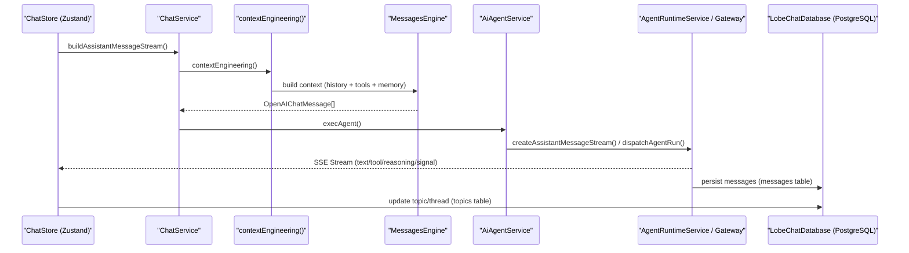
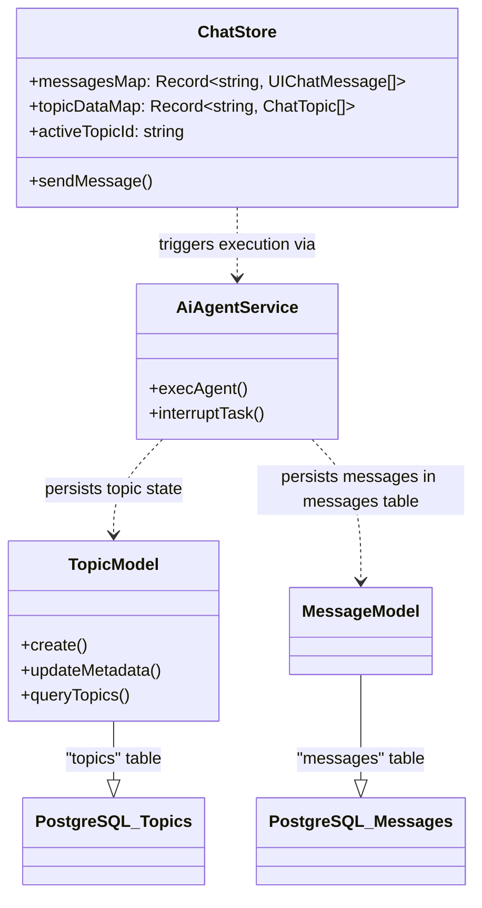
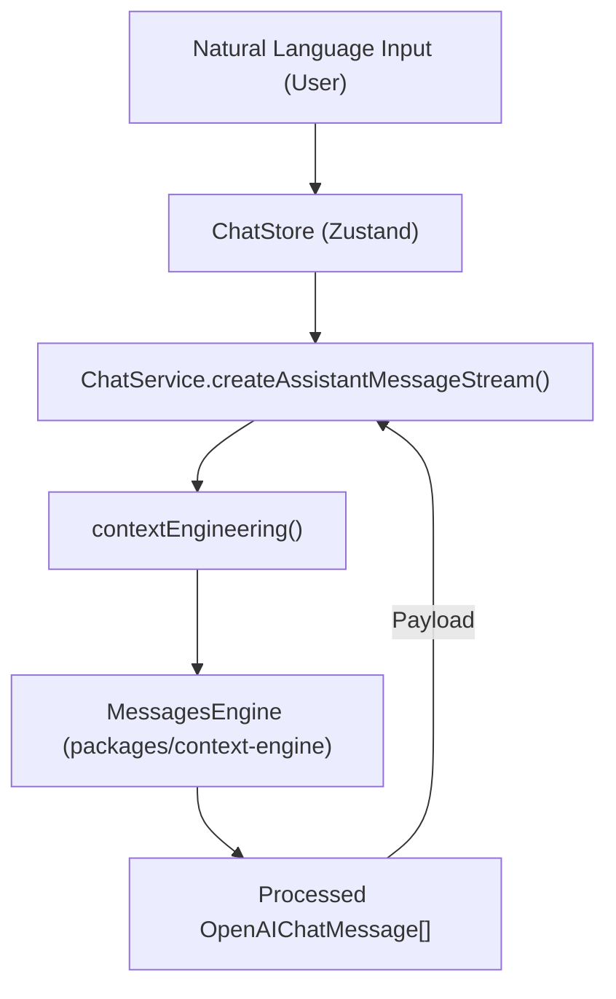

<!-- source: DeepWiki mcp.deepwiki.com · repo lobehub/lobehub · page 8 Chat and Conversation System · fetched 2026-10-29 -->

# Chat and Conversation System

<details>
<summary>Relevant source files</summary>

The following files were used as context for generating this wiki page:

- [apps/server/src/modules/AgentRuntime/adapters/serverCallLlmContextBuilder.ts](apps/server/src/modules/AgentRuntime/adapters/serverCallLlmContextBuilder.ts)
- [apps/server/src/modules/Mecha/ContextEngineering/__tests__/serverMessagesEngine.test.ts](apps/server/src/modules/Mecha/ContextEngineering/__tests__/serverMessagesEngine.test.ts)
- [apps/server/src/modules/Mecha/ContextEngineering/index.ts](apps/server/src/modules/Mecha/ContextEngineering/index.ts)
- [apps/server/src/modules/Mecha/ContextEngineering/types.ts](apps/server/src/modules/Mecha/ContextEngineering/types.ts)
- [packages/context-engine/src/engine/messages/MessagesEngine.ts](packages/context-engine/src/engine/messages/MessagesEngine.ts)
- [packages/context-engine/src/engine/messages/__tests__/MessagesEngine.test.ts](packages/context-engine/src/engine/messages/__tests__/MessagesEngine.test.ts)
- [packages/context-engine/src/engine/messages/types.ts](packages/context-engine/src/engine/messages/types.ts)
- [packages/context-engine/src/providers/TodoInjector.ts](packages/context-engine/src/providers/TodoInjector.ts)
- [packages/context-engine/src/providers/index.ts](packages/context-engine/src/providers/index.ts)
- [packages/prompts/src/prompts/index.ts](packages/prompts/src/prompts/index.ts)
- [src/app/(backend)/webapi/chat/[provider]/route.test.ts](src/app/(backend)/webapi/chat/[provider]/route.test.ts)
- [src/app/(backend)/webapi/chat/[provider]/route.ts](src/app/(backend)/webapi/chat/[provider]/route.ts)
- [src/features/Settings/provider/features/ProviderConfig/Checker.test.tsx](src/features/Settings/provider/features/ProviderConfig/Checker.test.tsx)
- [src/features/Settings/provider/features/ProviderConfig/Checker.tsx](src/features/Settings/provider/features/ProviderConfig/Checker.tsx)
- [src/services/chat/chat.test.ts](src/services/chat/chat.test.ts)
- [src/services/chat/index.ts](src/services/chat/index.ts)
- [src/services/chat/mecha/agentConfigResolver.test.ts](src/services/chat/mecha/agentConfigResolver.test.ts)
- [src/services/chat/mecha/agentConfigResolver.ts](src/services/chat/mecha/agentConfigResolver.ts)
- [src/services/chat/mecha/contextEngineering.test.ts](src/services/chat/mecha/contextEngineering.test.ts)
- [src/services/chat/mecha/contextEngineering.ts](src/services/chat/mecha/contextEngineering.ts)
- [src/store/chat/slices/translate/action.test.ts](src/store/chat/slices/translate/action.test.ts)
- [src/store/chat/slices/translate/action.ts](src/store/chat/slices/translate/action.ts)

</details>


The Chat and Conversation System in LobeHub orchestrates the entire lifecycle of AI-driven interactions. It spans from capturing user input, through assembling rich contextual prompts, dispatching the calls to AI models (including multi-agent scenarios), streaming the AI responses in real-time, to persisting messages and maintaining conversation state.

This high-level overview presents the primary components and data flows before diving into the specialized child pages that document each aspect in detail.

---

## System Overview

LobeHub’s chat pipeline integrates frontend user interface state with backend AI runtime services and persistent storage. It converts raw chat input into a structured context-enhanced payload, sends it to providers (OpenAI, Anthropic, Claude, etc.), streams partial responses back to the UI, and persists messages and metadata for full session continuity.

### End-to-End Chat Flow Diagram

This sequence diagram highlights the flow from user input through the core system components to message persistence:



The system bridges natural language inputs and AI responses with the underlying code entities managing agents, context, threading, and persistence.

**Sources:**  
- [src/services/chat/index.ts:149-188]()  
- [src/services/chat/mecha/contextEngineering.ts:121-190]()  
- [packages/context-engine/src/engine/messages/MessagesEngine.ts:90-134]()  
- [apps/server/src/modules/AgentRuntime/index.ts:10]()  

---

## Core Components

### 8.1 Chat Service and Context Engineering

`ChatService` is the central interface for initiating AI chat completions. It assembles the prompt by merging user messages with extensive context, including system roles, user memory, tool manifests, and conversation history.

- The service relies on `agentConfigResolver` to obtain a fully resolved configuration for the responding agent, considering runtime overrides, permissions, plugins, and tools.
- The `contextEngineering` function (from the `context-engine` package) constructs the prompt context by injecting documents, memories, tool usage, and variable placeholders, producing a ready-to-send array of `OpenAIChatMessage`s.
- The `MessagesEngine` then processes these messages through a chain of processors that handle placeholder substitutions, system role injections, message trimming, tool calls, and group chat orchestrations.

This layered design ensures modularity and extensibility between context resolution and message payload construction.

For detailed documentation, see [Chat Service and Context Engineering](#8.1).

**Sources:**  
- [src/services/chat/index.ts:149-188]()  
- [src/services/chat/mecha/contextEngineering.ts:121-190]()  
- [packages/context-engine/src/engine/messages/MessagesEngine.ts:90-134]()  
- [src/services/chat/mecha/agentConfigResolver.ts:30-64]()  

### 8.2 Conversation Hierarchy

LobeHub models conversations with a four-level hierarchy managed in the database and Zustand stores:

1. **Session**: Top-level container often linked to a specific agent context.
2. **Topic**: The main thread or theme within a session.
3. **Thread**: Branches within a topic enabling parallel conversations, isolation, or eval attempts.
4. **Messages**: Individual user or assistant messages composing a thread.

This structure supports granular navigation, management, and state persistence across user interactions.

For more details, see [Conversation Hierarchy](#8.2).

**Sources:**  
- [packages/database/src/models/topic.ts:108-126]()  
- [src/store/chat/slices/agentRun/actions/entries/conversationLifecycle.ts:115-140]()  

### 8.3 Message Groups and Threading

The system supports advanced conversation threading using message groups and multiple thread types:

- Message groups cluster related messages facilitating conversation flow analysis.
- Thread types support continuation, isolation, standalone, or evaluation branches.
- Branching conversations and `/compact` commands enable summarization and history compression for efficient context usage.

This enables rich conversational experiences and helps users manage branching AI responses.

For details, see [Message Groups and Threading](#8.3).

**Sources:**  
- [src/store/chat/slices/agentRun/actions/entries/conversationLifecycle.ts:60-92]()  
- [packages/types/src/agentExecution/index.ts:120-140]()  

### 8.4 Message Rendering and Enhancements

Messages in LobeHub are enhanced beyond plain text:

- **Chain-of-Thought Visualization**: Displays model reasoning steps streamed in real-time.
- **Artifacts**: Supports rendering of structured outputs, code blocks, and tool results.
- **Search Grounding**: Renders external search results and references within messages.
- **Voice Integration**: Supports TTS/STT for voice-enabled interactions.

This layered rendering supports interactive, transparent, and multimodal chat experiences.

For in-depth coverage, see [Message Rendering and Enhancements](#8.4).

**Sources:**  
- [src/services/chat/index.ts:10-22]()  
- [src/features/Conversation/Messages/components/SearchGrounding.tsx:1-10]()  
- [packages/types/src/agentExecution/index.ts:30-45]()  

### 8.5 Response Streaming and Protocol

The runtime implements a custom Server-Sent Events (SSE) streaming protocol enabling:

- Partial delivery of AI text, tool calls, reasoning, and signal updates.
- Support for multi-agent runs via the `AgentGateway` and streaming clients.
- Management of streaming lifecycle with `StreamingExecutor` and `StreamingHandler`.

This system enables fluid, low-latency user experiences with real-time AI thought and tool execution feedback.

For a detailed description, see [Response Streaming and Protocol](#8.5).

**Sources:**  
- [src/store/chat/slices/agentRun/actions/transports/gateway/gateway.ts:2-60]()  
- [src/services/chat/index.ts:90-115]()  

### 8.6 Daily Brief and Home Inbox

To provide at-a-glance updates and aggregate user activity, LobeHub features:

- **DailyBrief**: A summary feed that extracts key info and activities for review.
- **HomeInbox**: Displays recent topics, ongoing tasks, goals, and recommended templates.

These components encourage continual engagement and surface relevant conversations and goals.

For full details, see [Daily Brief and Home Inbox](#8.6).

**Sources:**  
- [packages/types/src/agentExecution/index.ts:30-45]()  
- [packages/database/src/models/topic.ts:62-66]()  

---

## Data Model and Persistence

### State and Persistence Mapping

The following class diagram illustrates the linkage between frontend state management and backend persistence layers:



This shows how UI state drives AI execution, which then commits conversational data to PostgreSQL tables for sessions, topics, threads, messages, and groups.

**Sources:**  
- [apps/server/src/modules/AgentRuntime/index.ts:10]()  
- [packages/database/src/models/topic.ts:96-107]()  
- [src/store/chat/slices/agentRun/actions/transports/gateway/gateway.ts:25-32]()  

### Topic and Message Metadata Usage

Execution context is tracked via metadata fields on topics and messages for features like multi-agent orchestration and device binding:

| Level       | Field               | Purpose                                               |
|-------------|---------------------|-------------------------------------------------------|
| **Topic**   | `heteroSessionId`   | Session ID for external heterogeneous agents (e.g., Claude Code). |
| **Topic**   | `autoSummary`       | Watermark added by background topic-summary process. |
| **Topic**   | `boundDeviceId`     | Ties topic to a specific device for agent execution.  |
| **Message** | `orchestrationRole` | Role in group orchestrated chats ('supervisor' or 'member'). |
| **Message** | `agentSignal`       | Flags message as part of memory or background runs.   |

These metadata fields enable advanced multitasking, group coordination, and UX improvements across chat contexts.

**Sources:**  
- [packages/types/src/topic/topic.ts:110-130]()  
- [packages/types/src/agentExecution/index.ts:130-160]()  

---

# Summary

The Chat and Conversation System forms the core user-facing and backend engine of LobeHub’s AI interaction experience. Its design tightly couples sophisticated context engineering, multi-agent orchestration, rich message streaming, and persistent state management.

This parent overview links to the following child pages for deeper documentation on focused subtopics:

- **[Chat Service and Context Engineering](#8.1)**  
- **[Conversation Hierarchy](#8.2)**  
- **[Message Groups and Threading](#8.3)**  
- **[Message Rendering and Enhancements](#8.4)**  
- **[Response Streaming and Protocol](#8.5)**  
- **[Daily Brief and Home Inbox](#8.6)**

---

# Diagrams Bridging Natural Language and Code Entities

## Diagram 1: Natural Language Space to ChatService and Context Engineering Components



**Explanation:**  
- User inputs conversation text via the UI (ChatStore).  
- ChatService controls the creation of assistant message streams.  
- ContextEngineering enriches messages with system roles, tools, memory, and other context.  
- MessagesEngine processes the assembled prompt to prepare a clean LLM input payload.

**Sources:**  
- [src/services/chat/index.ts:149-188]()  
- [src/services/chat/mecha/contextEngineering.ts:121-190]()  
- [packages/context-engine/src/engine/messages/MessagesEngine.ts:90-134]()  

---

## Diagram 2: ChatService Interaction with Agent Runtime and Persistence Layers

```mermaid
graph TD
    CS["ChatService"] -->|execAgent()| AAS["AiAgentService"]
    AAS -->|dispatchAgentRun()| RTS["AgentRuntimeService / Gateway"]
    RTS -->|SSE Stream| UI["ChatStore (Zustand)"]
    RTS -->|Persist messages| DBM["MessagesModel (PostgreSQL)"]
    RTS -->|Update topic/thread| DBT["TopicsModel (PostgreSQL)"]
    UI -->|Update UI state| CS
```

**Explanation:**  
- ChatService triggers agent execution through AiAgentService.  
- AiAgentService dispatches runs to runtime services via the Agent Gateway.  
- Runtime streams AI responses back to the UI over SSE.  
- Runtime persists messages and topics in PostgreSQL tables.  
- UI updates state accordingly, maintaining conversation continuity.

**Sources:**  
- [src/services/chat/index.ts:149-188]()  
- [apps/server/src/modules/AgentRuntime/index.ts:10]()  
- [src/store/chat/slices/agentRun/actions/transports/gateway/gateway.ts:3-60]()  

---

This overview provides a foundational understanding of how LobeHub processes chat conversations end-to-end. Refer to the linked child pages for comprehensive technical details and implementation specifics.

---

