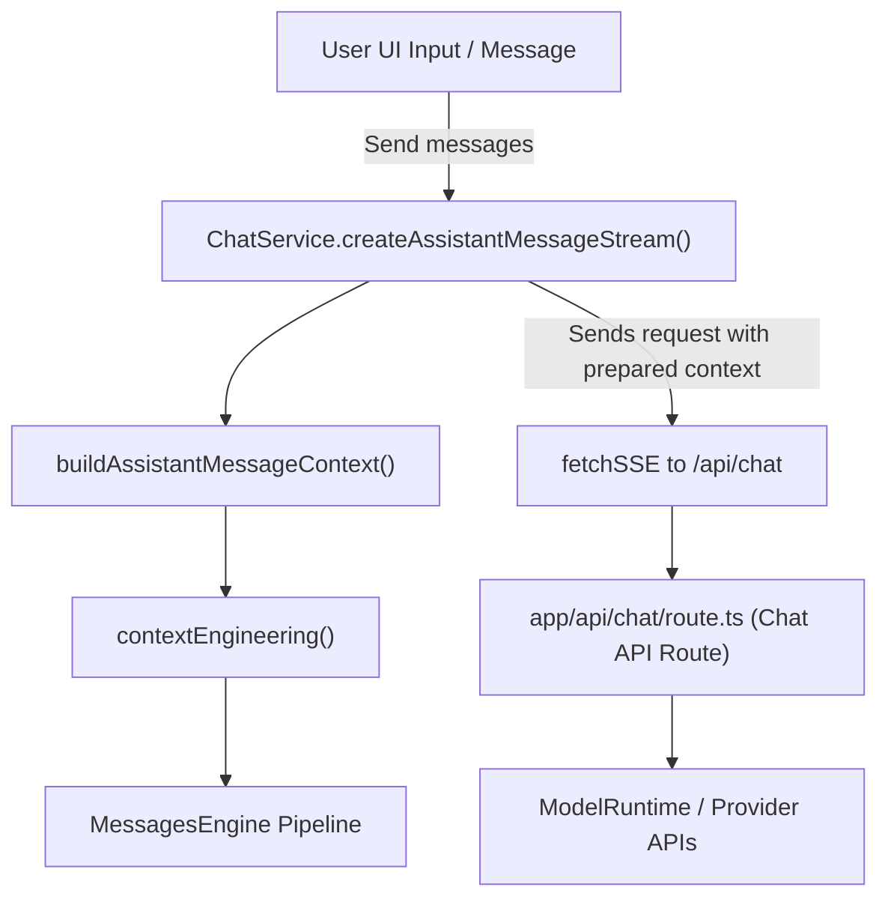
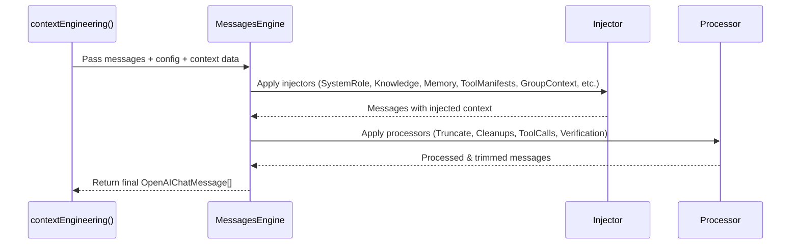
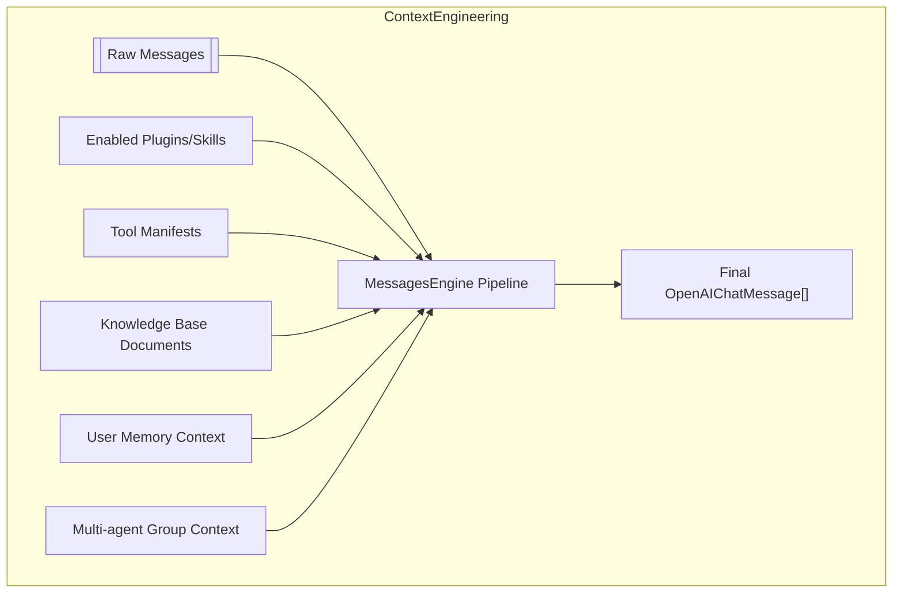
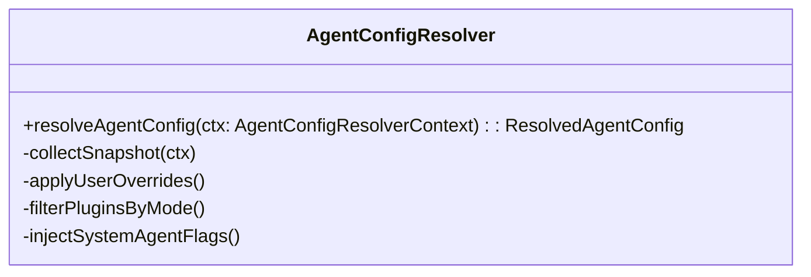
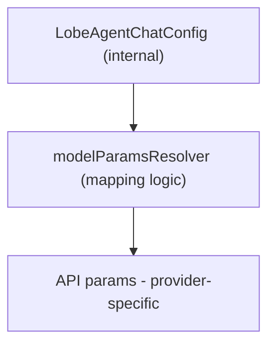
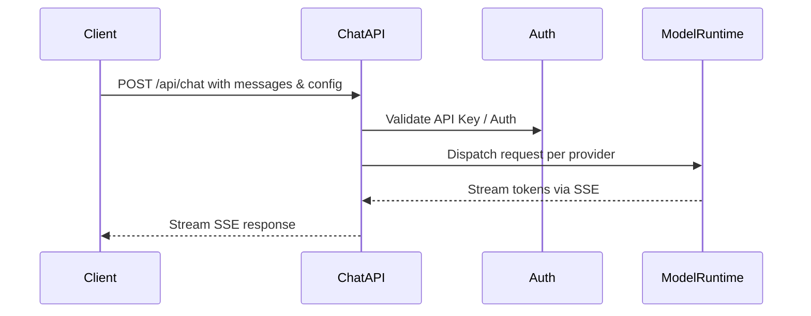
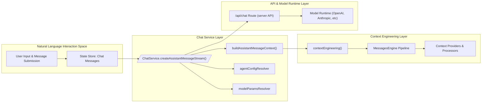
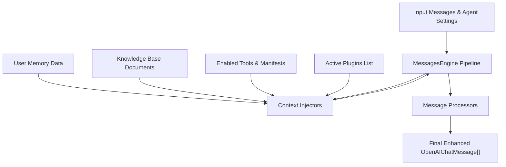

<!-- source: DeepWiki mcp.deepwiki.com · repo lobehub/lobehub · page 8.1 Chat Service and Context Engineering · fetched 2026-10-29 -->

# Chat Service and Context Engineering

Relevant source files

The following files were used as context for generating this wiki page:

- [apps/server/src/modules/AgentRuntime/adapters/ServerLLMTransport.test.ts](apps/server/src/modules/AgentRuntime/adapters/ServerLLMTransport.test.ts)
- [apps/server/src/modules/AgentRuntime/adapters/serverCallLlmContextBuilder.ts](apps/server/src/modules/AgentRuntime/adapters/serverCallLlmContextBuilder.ts)
- [apps/server/src/modules/AgentRuntime/adapters/serverCallLlmContextHints.test.ts](apps/server/src/modules/AgentRuntime/adapters/serverCallLlmContextHints.test.ts)
- [apps/server/src/modules/AgentRuntime/adapters/serverCallLlmContextHints.ts](apps/server/src/modules/AgentRuntime/adapters/serverCallLlmContextHints.ts)
- [apps/server/src/modules/Mecha/ContextEngineering/__tests__/serverMessagesEngine.test.ts](apps/server/src/modules/Mecha/ContextEngineering/__tests__/serverMessagesEngine.test.ts)
- [apps/server/src/modules/Mecha/ContextEngineering/index.ts](apps/server/src/modules/Mecha/ContextEngineering/index.ts)
- [apps/server/src/modules/Mecha/ContextEngineering/providers/index.ts](apps/server/src/modules/Mecha/ContextEngineering/providers/index.ts)
- [apps/server/src/modules/Mecha/ContextEngineering/providers/serverContextFactProviders.test.ts](apps/server/src/modules/Mecha/ContextEngineering/providers/serverContextFactProviders.test.ts)
- [apps/server/src/modules/Mecha/ContextEngineering/types.ts](apps/server/src/modules/Mecha/ContextEngineering/types.ts)
- [apps/server/src/modules/Mecha/ModelParams/providers.ts](apps/server/src/modules/Mecha/ModelParams/providers.ts)
- [apps/server/src/routers/lambda/market/creds.test.ts](apps/server/src/routers/lambda/market/creds.test.ts)
- [apps/server/src/routers/lambda/market/creds.ts](apps/server/src/routers/lambda/market/creds.ts)
- [apps/server/src/services/agentRuntime/credentialFacts.test.ts](apps/server/src/services/agentRuntime/credentialFacts.test.ts)
- [apps/server/src/services/agentRuntime/credentialFacts.ts](apps/server/src/services/agentRuntime/credentialFacts.ts)
- [apps/server/src/services/aiAgent/pipeline/__tests__/toolDiscovery.installedPlugins.test.ts](apps/server/src/services/aiAgent/pipeline/__tests__/toolDiscovery.installedPlugins.test.ts)
- [apps/server/src/services/aiAgent/pipeline/__tests__/toolDiscovery.shareGate.test.ts](apps/server/src/services/aiAgent/pipeline/__tests__/toolDiscovery.shareGate.test.ts)
- [apps/server/src/services/aiAgent/pipeline/toolDiscovery.ts](apps/server/src/services/aiAgent/pipeline/toolDiscovery.ts)
- [packages/context-engine/src/engine/messages/MessagesEngine.ts](packages/context-engine/src/engine/messages/MessagesEngine.ts)
- [packages/context-engine/src/engine/messages/__tests__/MessagesEngine.test.ts](packages/context-engine/src/engine/messages/__tests__/MessagesEngine.test.ts)
- [packages/context-engine/src/engine/messages/types.ts](packages/context-engine/src/engine/messages/types.ts)
- [packages/context-engine/src/providers/TodoInjector.ts](packages/context-engine/src/providers/TodoInjector.ts)
- [packages/context-engine/src/providers/index.ts](packages/context-engine/src/providers/index.ts)
- [packages/mecha/src/contextEngineering/facts/gatherContextFacts.test.ts](packages/mecha/src/contextEngineering/facts/gatherContextFacts.test.ts)
- [packages/mecha/src/contextEngineering/facts/gatherContextFacts.ts](packages/mecha/src/contextEngineering/facts/gatherContextFacts.ts)
- [packages/mecha/src/contextEngineering/facts/officialTools.ts](packages/mecha/src/contextEngineering/facts/officialTools.ts)
- [packages/mecha/src/contextEngineering/facts/types.ts](packages/mecha/src/contextEngineering/facts/types.ts)
- [packages/mecha/src/modelParams/resolveModelParams.test.ts](packages/mecha/src/modelParams/resolveModelParams.test.ts)
- [packages/mecha/src/modelParams/resolveModelParams.ts](packages/mecha/src/modelParams/resolveModelParams.ts)
- [packages/mecha/src/toolSet/discoveryPool.test.ts](packages/mecha/src/toolSet/discoveryPool.test.ts)
- [packages/mecha/src/toolSet/discoveryPool.ts](packages/mecha/src/toolSet/discoveryPool.ts)
- [packages/model-runtime/src/providers/volcengine/index.test.ts](packages/model-runtime/src/providers/volcengine/index.test.ts)
- [packages/model-runtime/src/providers/volcengine/index.ts](packages/model-runtime/src/providers/volcengine/index.ts)
- [packages/prompts/src/prompts/index.ts](packages/prompts/src/prompts/index.ts)
- [packages/types/src/agentExecution/modelFacts.ts](packages/types/src/agentExecution/modelFacts.ts)
- [src/app/(backend)/webapi/chat/[provider]/route.test.ts](src/app/(backend)/webapi/chat/[provider]/route.test.ts)
- [src/app/(backend)/webapi/chat/[provider]/route.ts](src/app/(backend)/webapi/chat/[provider]/route.ts)
- [src/features/Settings/provider/features/ProviderConfig/Checker.test.tsx](src/features/Settings/provider/features/ProviderConfig/Checker.test.tsx)
- [src/features/Settings/provider/features/ProviderConfig/Checker.tsx](src/features/Settings/provider/features/ProviderConfig/Checker.tsx)
- [src/services/chat/chat.test.ts](src/services/chat/chat.test.ts)
- [src/services/chat/index.ts](src/services/chat/index.ts)
- [src/services/chat/mecha/agentConfigResolver.test.ts](src/services/chat/mecha/agentConfigResolver.test.ts)
- [src/services/chat/mecha/agentConfigResolver.ts](src/services/chat/mecha/agentConfigResolver.ts)
- [src/services/chat/mecha/contextEngineering.test.ts](src/services/chat/mecha/contextEngineering.test.ts)
- [src/services/chat/mecha/contextEngineering.ts](src/services/chat/mecha/contextEngineering.ts)
- [src/store/chat/slices/translate/action.test.ts](src/store/chat/slices/translate/action.test.ts)
- [src/store/chat/slices/translate/action.ts](src/store/chat/slices/translate/action.ts)

This page documents the **Chat Service** architecture and the **Context Engineering** process used in LobeHub for constructing rich AI chat completions. It covers the key server-side entry point `ChatService.createAssistantMessageStream()`, the `@lobechat/context-engine` package (including `MessagesEngine`, providers, processors), the `agentConfigResolver`, the `modelParamsResolver`, and the chat API route implementation.

---

## Overview

LobeHub’s chat system orchestrates interactions between the frontend UI, server services, context engineering layers, and AI model runtimes. Its responsibilities include:

- Assembling an enriched prompt context from raw messages, agent configurations, user memory, and tools/plugins.
- Resolving the agent configuration and model parameters according to AI provider capabilities.
- Coordinating a modular and structured message processing pipeline using injectors and processors.
- Streaming AI assistant responses back to the client via Server-Sent Events (SSE).

This architecture ensures consistent, extensible, and efficient AI chat completion generation tailored to agent capabilities and context.

---

## ChatService: `createAssistantMessageStream()`

The `ChatService` class, implemented in `src/services/chat/index.ts`, is the main orchestration point for generating assistant message streams.

### Purpose

- Accepts incoming chat request payloads with conversation messages, agent and group context, and configuration.
- Constructs a fully resolved and enriched chat context by leveraging `contextEngineering`.
- Resolves the agent's effective configuration and maps model parameters appropriately.
- Initiates asynchronous streaming of AI model responses back to the client by calling the internal `/api/chat` endpoint.
- Handles request metadata, error mapping, and loading state notifications.

### Implementation Details

- The method `createAssistantMessageStream` receives a payload of type `GetChatCompletionPayload` containing user messages, resolved agent configuration, topic and group IDs, and optionally file attachments.
- Internally, it calls `buildAssistantMessageContext()` which:
  - Merges default settings with agent-specific override parameters.
  - Determines enabled tools and plugins, disabled ones filtered by user or system config.
  - Utilizes `contextEngineering()` to generate a detailed and augmented message array of type `OpenAIChatMessage[]`.
  - Resolves final model parameters using `modelParamsResolver`.
  - Constructs request options including headers for authentication and trace context.
- Afterwards, it calls `fetchSSE()` to open an SSE stream to `/api/chat`, providing the serialized messages, model parameters, and additional metadata.
- The SSE response is returned as a readable stream, allowing progressive token delivery on the client side.
- Abort controllers and error callbacks enable cancellation and graceful failure handling.

This method acts as the central bridge from UI message state to backend LLM execution with rich context injection.

**Sources:** [src/services/chat/index.ts:115-266](), [src/services/chat/mecha/contextEngineering.ts:121-187](), [packages/context-engine/src/engine/messages/MessagesEngine.ts:1-133](), [apps/server/src/app/api/chat/route.ts:1-69]()

---

## Context Engineering Package (`@lobechat/context-engine`)

At the core of prompt preparation is the `context-engine` package, designed to modularize context assembly through a pipeline of context providers (injectors) and processors.

### MessagesEngine

- The `MessagesEngine` class is the high-level engine that runs messages through multiple layers of processors.
- The pipeline consists of:
  - **Context Injectors**: Add system prompts, agent identity, knowledge documents, user memory, tool API specs, group context, onboarding hints, and other rich context layers.
  - **Processors**: Modify messages post-injection by truncating history, removing placeholders, ordering tool call results, trimming stale outputs, verifying content, and flattening group messages.
- This engine transforms a base message array into a fully enhanced sequence of `OpenAIChatMessage[]` ready for LLM consumption.

### Context Engineering Process

The function `contextEngineering` (in `src/services/chat/mecha/contextEngineering.ts`) orchestrates:

- Gathering agent documents, user memories, tool manifests, and group member info from various caches and stores.
- Handling disabling/enabling of plugins, filtering disabled skills from injection.
- Combining knowledge base documents with user-specific context for retrieval-augmented generation cues.
- Injecting system roles, onboarding hints, project instructions, and runtime-specific placeholder variables (e.g., current date).
- Supporting multi-agent group contexts such as supervisors/participants with corresponding role injection.
- Handling runtime capabilities, e.g., whether the model supports function calling, vision, audio, or video.

The result is a seamlessly composed, context-rich and agent-aware prompt input set that maximizes AI effectiveness.

**Sources:** [src/services/chat/mecha/contextEngineering.ts:1-191](), [packages/context-engine/src/engine/messages/MessagesEngine.ts:1-133]()

---

## Agent Config Resolver

The `agentConfigResolver` module (`src/services/chat/mecha/agentConfigResolver.ts`) is responsible for resolving the effective agent configuration used for chat completions.

### Responsibilities

- Reads agent state and configuration from client-side stores (`agentStore`, `userStore`, `agentGroupStore`).
- Merges stored agent config, chat config, group memberships, user overrides, and runtime dev flags.
- Applies logical defaults and runtime rules, such as tool disabling, enabling/disabling chat or agent mode.
- Supports nuanced permission checks (e.g., can current user manage this agent?).
- Handles special system agents like compression or translation configured via system flags.
- Resolves the proper agent slug and locale to influence prompt localization.

### Usage

The function `resolveAgentConfig(ctx)` returns a fully qualified `ResolvedAgentConfig` object that includes:

- `agentConfig`: Model, parameters, TTS config.
- `chatConfig`: Chat-specific flags like search mode, agent mode.
- `enabledManifests` and `enabledToolIds`: The matched enabled tools and plugins.
- `plugins`: Enabled plugin identifiers.
- Permission flags and user overrides.

This resolver is called by `ChatService.createAssistantMessageStream()` to ensure consistent agent context.

**Sources:** [src/services/chat/mecha/agentConfigResolver.ts:1-78]()

---

## Model Params Resolver

`modelParamsResolver` handles mapping the internal LobeHub agent chat configuration fields to concrete provider-specific API parameters.

### Purpose

- Converts abstract internal config values (`reasoningBudgetToken`, `thinkingLevel`, etc.) to normalized parameter names and values expected by AI providers.
- Supports multiple providers (OpenAI-compatible, Azure, DeepSeek, Qwen, etc.) with different parameter naming conventions.
- Allows runtime adjustments depending on call triggers or model capabilities.
- Ensures parameters like temperature, max tokens, top_p, reasoning effort levels align precisely with backend APIs.

### Data Flow

This mapping is used by `buildAssistantMessageContext` within `ChatService` to finalize the payload before sending the chat completion request.

**Sources:** [src/services/chat/index.ts:64-80](), [src/services/chat/mecha/modelParamsResolver.ts:1-78]()

---

## Chat API Route

The `/api/chat` endpoint, implemented in `apps/server/src/app/api/chat/[provider]/route.ts`, serves as the server API interface to handle chat completion requests.

### Responsibilities

- Receives chat completion requests POSTed from clients or internal services.
- Authenticates requests (API keys, OAuth, or other mechanisms).
- Parses the incoming messages and parameters.
- Dispatches the request to the chosen AI provider runtime, such as OpenAI-compatible, Anthropic, or custom runtimes.
- Supports streaming the output tokens back using SSE (Server-Sent Events) for low-latency UI updates.
- Handles errors and provides diagnostic telemetry tracing.

### Interaction Flow

This route is the final step that links LobeHub’s chat service pipeline to actual LLM execution.

**Sources:** [apps/server/src/app/api/chat/[provider]/route.ts:1-69]()

---

## Bridging Natural Language Space to Code Entity Space Diagrams

### Diagram 1: End-to-End Chat Completion Request Flow

### Diagram 2: Context Engineering Subsystem Components and Flow

---

## Summary Table: Key Chat-Related Code Entities

| Entity                                  | Path                                           | Description                                             |
|----------------------------------------|------------------------------------------------|---------------------------------------------------------|
| `ChatService`                          | `src/services/chat/index.ts`                    | Main chat orchestration service                          |
| `createAssistantMessageStream`        | `src/services/chat/index.ts` (lines 115-266)   | Initiates streaming assistant message calls             |
| `buildAssistantMessageContext`        | `src/services/chat/index.ts`                    | Builds prepared chat context with resolved agent config |
| `contextEngineering`                   | `src/services/chat/mecha/contextEngineering.ts`| Core context building logic with injectors/processors   |
| `MessagesEngine`                       | `packages/context-engine/src/engine/messages/MessagesEngine.ts` | Processing pipeline engine                               |
| `agentConfigResolver`                  | `src/services/chat/mecha/agentConfigResolver.ts` | Resolves final agent config for requests                |
| `modelParamsResolver`                  | `src/services/chat/mecha/modelParamsResolver.ts` | Maps agent chat configs to model API parameters         |
| `/api/chat` route                      | `apps/server/src/app/api/chat/[provider]/route.ts` | HTTP API route that handles chat completions             |

---

# References

- `src/services/chat/index.ts` lines 115-266: `ChatService` class and key method implementations.
- `src/services/chat/mecha/contextEngineering.ts` lines 1-191: contextEngineering function.
- `packages/context-engine/src/engine/messages/MessagesEngine.ts` lines 1-133: MessagesEngine pipeline.
- `src/services/chat/mecha/agentConfigResolver.ts` lines 1-79: Agent config resolution.
- `src/services/chat/mecha/modelParamsResolver.ts` lines 1-78: Model parameters resolver.
- `apps/server/src/app/api/chat/[provider]/route.ts`: `/api/chat` route handler.

---

This page completes the documentation for the chat service architecture and context engineering in LobeHub, enabling developers to understand message streaming, prompt construction, configuration resolution, and the AI request lifecycle.

---

