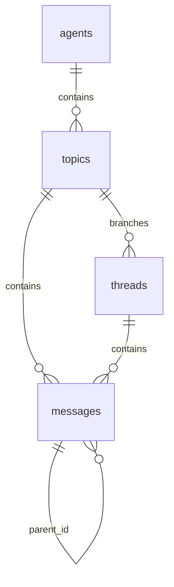
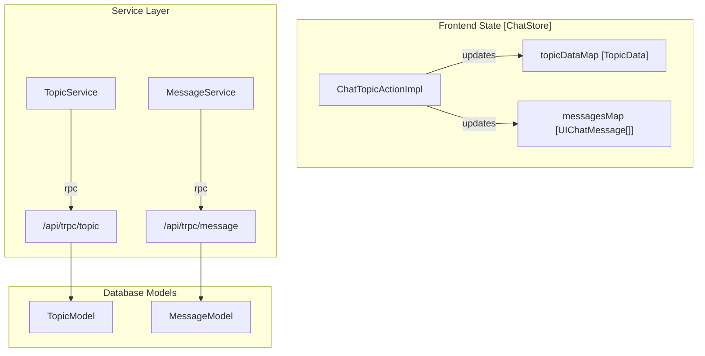
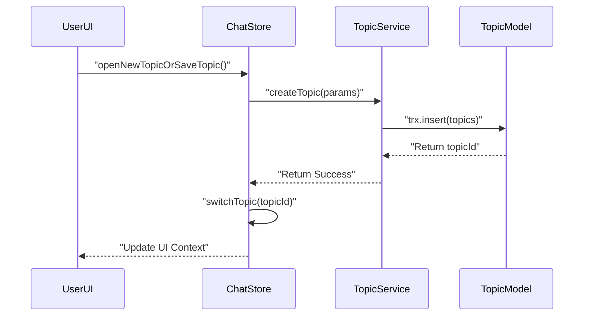
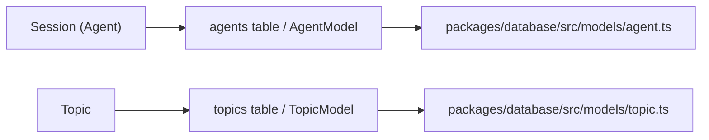
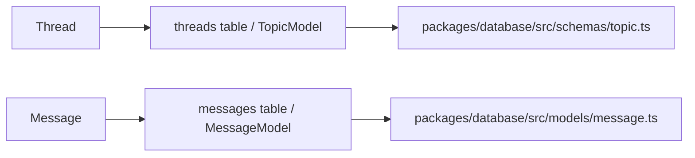
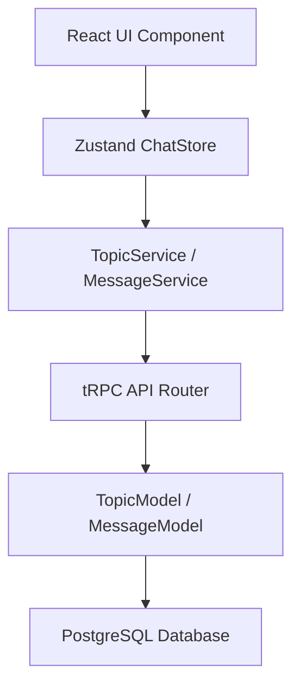

<!-- source: DeepWiki mcp.deepwiki.com · repo lobehub/lobehub · page 8.2 Conversation Hierarchy · fetched 2026-10-29 -->

# Conversation Hierarchy

Relevant source files

The following files were used as context for generating this wiki page:

- [apps/server/src/routers/lambda/message.ts](apps/server/src/routers/lambda/message.ts)
- [apps/server/src/routers/lambda/topic.ts](apps/server/src/routers/lambda/topic.ts)
- [apps/server/src/services/aiAgent/__tests__/execAgent.files.test.ts](apps/server/src/services/aiAgent/__tests__/execAgent.files.test.ts)
- [apps/server/src/services/file/resolveAttachments.test.ts](apps/server/src/services/file/resolveAttachments.test.ts)
- [apps/server/src/services/file/resolveAttachments.ts](apps/server/src/services/file/resolveAttachments.ts)
- [apps/server/src/services/message/__tests__/index.test.ts](apps/server/src/services/message/__tests__/index.test.ts)
- [apps/server/src/services/message/index.ts](apps/server/src/services/message/index.ts)
- [locales/en-US/topic.json](locales/en-US/topic.json)
- [locales/zh-CN/topic.json](locales/zh-CN/topic.json)
- [packages/context-engine/src/engine/index.ts](packages/context-engine/src/engine/index.ts)
- [packages/context-engine/src/engine/messages/index.ts](packages/context-engine/src/engine/messages/index.ts)
- [packages/context-engine/src/engine/topicReference/__tests__/resolveTopicReferences.test.ts](packages/context-engine/src/engine/topicReference/__tests__/resolveTopicReferences.test.ts)
- [packages/context-engine/src/engine/topicReference/index.ts](packages/context-engine/src/engine/topicReference/index.ts)
- [packages/context-engine/src/engine/topicReference/resolveTopicReferences.ts](packages/context-engine/src/engine/topicReference/resolveTopicReferences.ts)
- [packages/context-engine/src/processors/MessageContent.ts](packages/context-engine/src/processors/MessageContent.ts)
- [packages/context-engine/src/processors/__tests__/MessageContent.test.ts](packages/context-engine/src/processors/__tests__/MessageContent.test.ts)
- [packages/context-engine/src/processors/__tests__/MessageContent.unsupportedImageFormat.test.ts](packages/context-engine/src/processors/__tests__/MessageContent.unsupportedImageFormat.test.ts)
- [packages/context-engine/src/providers/TopicReferenceContextInjector.ts](packages/context-engine/src/providers/TopicReferenceContextInjector.ts)
- [packages/context-engine/src/providers/__tests__/TopicReferenceContextInjector.test.ts](packages/context-engine/src/providers/__tests__/TopicReferenceContextInjector.test.ts)
- [packages/database/src/models/__tests__/messages/message.create.test.ts](packages/database/src/models/__tests__/messages/message.create.test.ts)
- [packages/database/src/models/__tests__/messages/message.delete.test.ts](packages/database/src/models/__tests__/messages/message.delete.test.ts)
- [packages/database/src/models/__tests__/messages/message.query.test.ts](packages/database/src/models/__tests__/messages/message.query.test.ts)
- [packages/database/src/models/__tests__/messages/message.stats.test.ts](packages/database/src/models/__tests__/messages/message.stats.test.ts)
- [packages/database/src/models/__tests__/messages/message.update.test.ts](packages/database/src/models/__tests__/messages/message.update.test.ts)
- [packages/database/src/models/__tests__/messages/messageWithTask.test.ts](packages/database/src/models/__tests__/messages/messageWithTask.test.ts)
- [packages/database/src/models/__tests__/messages/queryWithMessageGroup.test.ts](packages/database/src/models/__tests__/messages/queryWithMessageGroup.test.ts)
- [packages/database/src/models/__tests__/thread.test.ts](packages/database/src/models/__tests__/thread.test.ts)
- [packages/database/src/models/__tests__/topic.test.ts](packages/database/src/models/__tests__/topic.test.ts)
- [packages/database/src/models/__tests__/topicCreator.test.ts](packages/database/src/models/__tests__/topicCreator.test.ts)
- [packages/database/src/models/__tests__/topics/topic.delete.test.ts](packages/database/src/models/__tests__/topics/topic.delete.test.ts)
- [packages/database/src/models/__tests__/topics/topic.query.test.ts](packages/database/src/models/__tests__/topics/topic.query.test.ts)
- [packages/database/src/models/__tests__/topics/topic.stats.test.ts](packages/database/src/models/__tests__/topics/topic.stats.test.ts)
- [packages/database/src/models/__tests__/topics/topicUsage.race.test.ts](packages/database/src/models/__tests__/topics/topicUsage.race.test.ts)
- [packages/database/src/models/__tests__/topics/topicUsage.test.ts](packages/database/src/models/__tests__/topics/topicUsage.test.ts)
- [packages/database/src/models/message.ts](packages/database/src/models/message.ts)
- [packages/database/src/models/thread.ts](packages/database/src/models/thread.ts)
- [packages/database/src/models/topic.ts](packages/database/src/models/topic.ts)
- [packages/database/src/models/topicCreator.ts](packages/database/src/models/topicCreator.ts)
- [packages/database/src/models/topicUsage.ts](packages/database/src/models/topicUsage.ts)
- [packages/locales/src/default/topic.ts](packages/locales/src/default/topic.ts)
- [packages/types/src/message/common/image.ts](packages/types/src/message/common/image.ts)
- [packages/types/src/message/ui/audio.ts](packages/types/src/message/ui/audio.ts)
- [packages/types/src/topic/thread.ts](packages/types/src/topic/thread.ts)
- [packages/types/src/topic/topic.ts](packages/types/src/topic/topic.ts)
- [packages/utils/src/client/topic.test.ts](packages/utils/src/client/topic.test.ts)
- [packages/utils/src/client/topic.ts](packages/utils/src/client/topic.ts)
- [src/features/AgentSidebar/Topic/List/Item/MetaHoverCard.tsx](src/features/AgentSidebar/Topic/List/Item/MetaHoverCard.tsx)
- [src/features/AgentSidebar/Topic/List/Item/index.test.tsx](src/features/AgentSidebar/Topic/List/Item/index.test.tsx)
- [src/features/AgentSidebar/Topic/List/Item/index.tsx](src/features/AgentSidebar/Topic/List/Item/index.tsx)
- [src/features/AgentSidebar/Topic/List/Item/metaCardData.ts](src/features/AgentSidebar/Topic/List/Item/metaCardData.ts)
- [src/features/TopicCreatorAvatar/index.test.tsx](src/features/TopicCreatorAvatar/index.test.tsx)
- [src/features/TopicCreatorAvatar/index.tsx](src/features/TopicCreatorAvatar/index.tsx)
- [src/hooks/useIsMobile.ts](src/hooks/useIsMobile.ts)
- [src/routes/(main)/group/_layout/Sidebar/Topic/List/Item/index.tsx](src/routes/(main)/group/_layout/Sidebar/Topic/List/Item/index.tsx)
- [src/routes/(main)/group/_layout/Sidebar/Topic/TopicListContent/ByTimeMode/index.tsx](src/routes/(main)/group/_layout/Sidebar/Topic/TopicListContent/ByTimeMode/index.tsx)
- [src/routes/(main)/group/_layout/Sidebar/Topic/TopicListContent/FlatMode/index.tsx](src/routes/(main)/group/_layout/Sidebar/Topic/TopicListContent/FlatMode/index.tsx)
- [src/services/message/__tests__/hydrateProjectedTools.test.ts](src/services/message/__tests__/hydrateProjectedTools.test.ts)
- [src/services/message/hydrateProjectedTools.ts](src/services/message/hydrateProjectedTools.ts)
- [src/services/message/index.ts](src/services/message/index.ts)
- [src/services/topic/index.ts](src/services/topic/index.ts)
- [src/store/chat/initialState.ts](src/store/chat/initialState.ts)
- [src/store/chat/slices/topic/action.test.ts](src/store/chat/slices/topic/action.test.ts)
- [src/store/chat/slices/topic/action.ts](src/store/chat/slices/topic/action.ts)
- [src/store/chat/slices/topic/initialState.ts](src/store/chat/slices/topic/initialState.ts)
- [src/store/chat/slices/topic/justArchived.test.ts](src/store/chat/slices/topic/justArchived.test.ts)
- [src/store/chat/slices/topic/justArchived.ts](src/store/chat/slices/topic/justArchived.ts)
- [src/store/chat/slices/topic/reducer.test.ts](src/store/chat/slices/topic/reducer.test.ts)
- [src/store/chat/slices/topic/reducer.ts](src/store/chat/slices/topic/reducer.ts)
- [src/store/chat/slices/topic/selectors.test.ts](src/store/chat/slices/topic/selectors.test.ts)
- [src/store/chat/slices/topic/selectors.ts](src/store/chat/slices/topic/selectors.ts)
- [src/store/chat/slices/topic/topicListCache.integration.test.ts](src/store/chat/slices/topic/topicListCache.integration.test.ts)
- [src/store/chat/store.ts](src/store/chat/store.ts)
- [src/store/session/index.ts](src/store/session/index.ts)
- [src/store/session/initialState.ts](src/store/session/initialState.ts)
- [src/store/session/selectors.ts](src/store/session/selectors.ts)
- [src/store/session/slices/session/action.test.ts](src/store/session/slices/session/action.test.ts)
- [src/store/session/slices/session/action.ts](src/store/session/slices/session/action.ts)
- [src/store/session/slices/session/initialState.ts](src/store/session/slices/session/initialState.ts)
- [src/store/session/slices/session/selectors/index.ts](src/store/session/slices/session/selectors/index.ts)
- [src/store/session/slices/session/selectors/list.test.ts](src/store/session/slices/session/selectors/list.test.ts)
- [src/store/session/slices/session/selectors/list.ts](src/store/session/slices/session/selectors/list.ts)
- [src/store/session/slices/session/selectors/meta.test.ts](src/store/session/slices/session/selectors/meta.test.ts)
- [src/store/session/slices/session/selectors/meta.ts](src/store/session/slices/session/selectors/meta.ts)
- [src/store/session/store.ts](src/store/session/store.ts)

Purpose and Scope: This document details the four-level conversation hierarchy within the LobeHub repository (`sessions`, `topics`, `threads`, and `messages`), their corresponding PostgreSQL database models, Zustand state management slices, and navigation flows between them.

---

## 1. Hierarchy Overview

LobeHub organizes user interactions into a structured four-level hierarchy to facilitate multi-agent management, context isolation, and effective handling of LLM context window limitations.

| Level  | Entity        | Responsibility                                        | Database Table     |
|--------|---------------|-----------------------------------------------------|--------------------|
| **L1** | **Session**   | Top-level container, typically an Agent or Group Chat | `agents`           |
| **L2** | **Topic**     | Logical grouping of messages (e.g., "Feature Discussion") | `topics`           |
| **L3** | **Thread**    | Sub-conversation or branch inside a topic for isolation | `threads`          |
| **L4** | **Message**   | Individual content unit, e.g., user/assistant/tool messages | `messages`         |

### Entity Relationships

Title: "Conversation Hierarchy Entity Relationships"

Sources: `[packages/database/src/schemas/index.ts:1-56]()`, `[packages/database/src/schemas/topic.ts:25-147]`, `[packages/database/src/models/message.ts:64-82]()`

---

## 2. Technical Implementation

### 2.1 Database Schema and Models

The hierarchy is persisted via PostgreSQL using Drizzle ORM:
- **Sessions (Agents):** Represented by the `agents` table storing assistant configuration, models, providers, and metadata `[packages/database/src/models/agent.ts:1-129]()`.
- **Topics:** Stored in the `topics` table, linked to `agentId` or `groupId`, containing metadata such as summaries, usage, and status `[packages/database/src/models/topic.ts:1-174]()`.
- **Threads:** Stored in the `threads` table with references to `topicId`, `sourceMessageId`, and optionally `parentThreadId` `[packages/database/src/schemas/topic.ts:114-147]()`.
- **Messages:** Stored in the `messages` table, referencing `topicId` and optionally `threadId` and `parentId` for threaded branching `[packages/database/src/models/message.ts:208-209]()`.

Sources: `[packages/database/src/models/agent.ts:1-129]()`, `[packages/database/src/models/topic.ts:1-174]()`, `[packages/database/src/models/message.ts:208-209]()`

### 2.2 Zustand Store Architecture

Frontend state management uses `ChatStore` (Zustand) to mirror the database hierarchy:
- `topicDataMap`: a dictionary keyed by composite keys `{ agentId, groupId }` storing current topic lists `[src/store/chat/slices/topic/selectors.ts:26-36]()`.
- `messagesMap`: stores arrays of messages indexed by keys to isolate messages per conversation or thread `[src/store/chat/slices/topic/action.test.ts:187-195]()`.
- Active IDs (`activeAgentId`, `activeTopicId`, `activeThreadId`, `activeMessageId`) track current context `[src/store/chat/slices/topic/action.ts:100-115]()`.

Title: "Zustand Store and Database Architecture"

Sources: `[src/store/chat/slices/topic/selectors.ts:26-36]()`, `[src/store/chat/slices/topic/action.ts:100-115]()`, `[src/services/topic/index.ts:50-125]()`

### 2.3 ID Generation

Entities use prefixed NanoID-generated string IDs:
- Agent: `agt_`
- Topic: `tpc_`
- Thread: `thd_`
- Message: `msg_`

Sources: `[packages/database/src/utils/idGenerator.ts:1-46]()`

---

## 3. Navigation and Lifecycle

### 3.1 Topic Management
- **Topic Creation:** `TopicService.createTopic` creates a new topic, snapshotting model and provider settings `[src/services/topic/index.ts:54-59]()`.
- **Save Conversation to Topic:** `saveToTopic` collects unsaved messages and binds them into a newly created topic `[src/store/chat/slices/topic/action.ts:186-202]()`.
- **Switch Topic:** `switchTopic` changes the active topic context in the store `[src/store/chat/slices/topic/action.ts:135-185]()`.

Sources: `[src/services/topic/index.ts:54-59]()`, `[src/store/chat/slices/topic/action.ts:135-202]()`

### 3.2 Thread and Message Branching
- Threads provide sub-discussions with types like `continuation`, `standalone`, `isolation`, and `eval` `[packages/database/src/schemas/topic.ts:114-147]()`.
- Messages form trees via `parentId` references `[packages/database/src/models/message.ts:64-82]()`.

Sources: `[packages/database/src/schemas/topic.ts:114-147]`, `[packages/database/src/models/message.ts:64-82]()`

### 3.3 UI Interaction Flow

Title: "Topic Creation Sequence Diagram"

Sources: `[src/store/chat/slices/topic/action.ts:135-202]()`, `[src/services/topic/index.ts:54-59]()`

---

## 4. Natural Language Space to Code Entity Space Mapping

Title: "Natural Language to Code Entities Mapping - Part 1"

Sources: `[packages/database/src/models/agent.ts:1-129]()`, `[packages/database/src/models/topic.ts:1-174]()`

Title: "Natural Language to Code Entities Mapping - Part 2"

Sources: `[packages/database/src/schemas/topic.ts:114-147]`, `[packages/database/src/models/message.ts:208-209]()`

---

## 5. Data Flow: From UI Interaction to Database

Title: "Conversation Hierarchy Data Flow"

Sources: `[src/store/chat/slices/topic/action.ts:135-202]()`, `[src/services/topic/index.ts:50-125]()`

---

