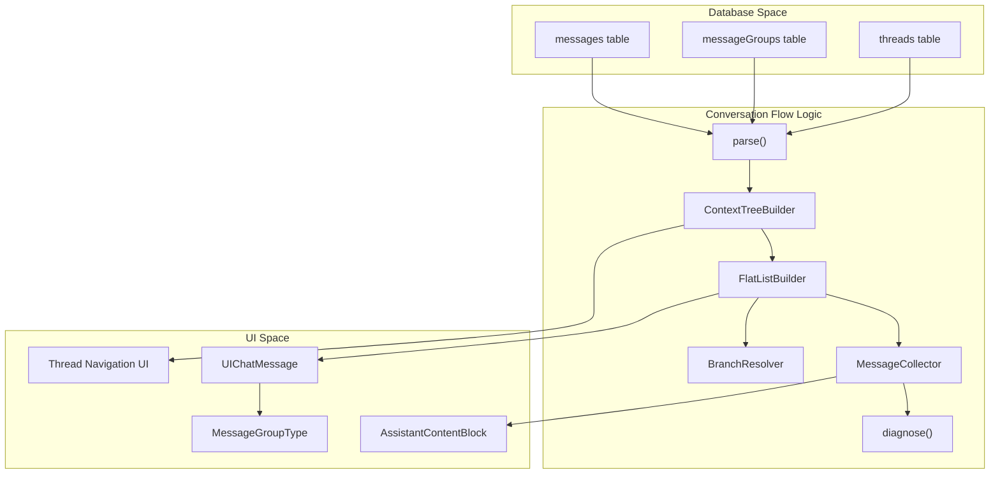
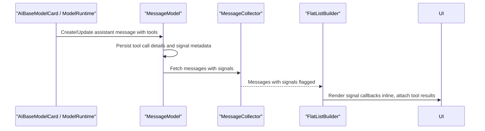

<!-- source: DeepWiki mcp.deepwiki.com · repo lobehub/lobehub · page 8.3 Message Groups and Threading · fetched 2026-10-29 -->

# Message Groups and Threading

Relevant source files

The following files were used as context for generating this wiki page:

- [.agents/skills/debug-frontend-with-browser/SKILL.md](.agents/skills/debug-frontend-with-browser/SKILL.md)
- [.agents/skills/debug-frontend-with-browser/agents/openai.yaml](.agents/skills/debug-frontend-with-browser/agents/openai.yaml)
- [.agents/skills/debug-frontend-with-browser/references/pitfalls.md](.agents/skills/debug-frontend-with-browser/references/pitfalls.md)
- [apps/server/src/routers/lambda/message.ts](apps/server/src/routers/lambda/message.ts)
- [apps/server/src/services/aiAgent/__tests__/execAgent.files.test.ts](apps/server/src/services/aiAgent/__tests__/execAgent.files.test.ts)
- [apps/server/src/services/file/resolveAttachments.test.ts](apps/server/src/services/file/resolveAttachments.test.ts)
- [apps/server/src/services/file/resolveAttachments.ts](apps/server/src/services/file/resolveAttachments.ts)
- [apps/server/src/services/message/__tests__/index.test.ts](apps/server/src/services/message/__tests__/index.test.ts)
- [apps/server/src/services/message/index.ts](apps/server/src/services/message/index.ts)
- [packages/context-engine/src/engine/index.ts](packages/context-engine/src/engine/index.ts)
- [packages/context-engine/src/engine/messages/index.ts](packages/context-engine/src/engine/messages/index.ts)
- [packages/context-engine/src/engine/topicReference/__tests__/resolveTopicReferences.test.ts](packages/context-engine/src/engine/topicReference/__tests__/resolveTopicReferences.test.ts)
- [packages/context-engine/src/engine/topicReference/index.ts](packages/context-engine/src/engine/topicReference/index.ts)
- [packages/context-engine/src/engine/topicReference/resolveTopicReferences.ts](packages/context-engine/src/engine/topicReference/resolveTopicReferences.ts)
- [packages/context-engine/src/processors/MessageContent.ts](packages/context-engine/src/processors/MessageContent.ts)
- [packages/context-engine/src/processors/__tests__/MessageContent.test.ts](packages/context-engine/src/processors/__tests__/MessageContent.test.ts)
- [packages/context-engine/src/processors/__tests__/MessageContent.unsupportedImageFormat.test.ts](packages/context-engine/src/processors/__tests__/MessageContent.unsupportedImageFormat.test.ts)
- [packages/context-engine/src/providers/TopicReferenceContextInjector.ts](packages/context-engine/src/providers/TopicReferenceContextInjector.ts)
- [packages/context-engine/src/providers/__tests__/TopicReferenceContextInjector.test.ts](packages/context-engine/src/providers/__tests__/TopicReferenceContextInjector.test.ts)
- [packages/conversation-flow/src/__tests__/deepChain.test.ts](packages/conversation-flow/src/__tests__/deepChain.test.ts)
- [packages/conversation-flow/src/__tests__/dualForm.test.ts](packages/conversation-flow/src/__tests__/dualForm.test.ts)
- [packages/conversation-flow/src/__tests__/fixtures/outputs/agentCouncil/with-supervisor-reply.json](packages/conversation-flow/src/__tests__/fixtures/outputs/agentCouncil/with-supervisor-reply.json)
- [packages/conversation-flow/src/__tests__/fixtures/outputs/agentGroup/speak-different-agent.json](packages/conversation-flow/src/__tests__/fixtures/outputs/agentGroup/speak-different-agent.json)
- [packages/conversation-flow/src/__tests__/groupMemberReply.test.ts](packages/conversation-flow/src/__tests__/groupMemberReply.test.ts)
- [packages/conversation-flow/src/__tests__/indexing.test.ts](packages/conversation-flow/src/__tests__/indexing.test.ts)
- [packages/conversation-flow/src/__tests__/parse.test.ts](packages/conversation-flow/src/__tests__/parse.test.ts)
- [packages/conversation-flow/src/__tests__/stringTimestamp.test.ts](packages/conversation-flow/src/__tests__/stringTimestamp.test.ts)
- [packages/conversation-flow/src/__tests__/structuring.test.ts](packages/conversation-flow/src/__tests__/structuring.test.ts)
- [packages/conversation-flow/src/doctor/diagnose.ts](packages/conversation-flow/src/doctor/diagnose.ts)
- [packages/conversation-flow/src/indexing.ts](packages/conversation-flow/src/indexing.ts)
- [packages/conversation-flow/src/parse.ts](packages/conversation-flow/src/parse.ts)
- [packages/conversation-flow/src/structuring.ts](packages/conversation-flow/src/structuring.ts)
- [packages/conversation-flow/src/transformation/BranchResolver.ts](packages/conversation-flow/src/transformation/BranchResolver.ts)
- [packages/conversation-flow/src/transformation/ContextTreeBuilder.ts](packages/conversation-flow/src/transformation/ContextTreeBuilder.ts)
- [packages/conversation-flow/src/transformation/FlatListBuilder.ts](packages/conversation-flow/src/transformation/FlatListBuilder.ts)
- [packages/conversation-flow/src/transformation/MessageCollector.ts](packages/conversation-flow/src/transformation/MessageCollector.ts)
- [packages/conversation-flow/src/transformation/__tests__/BranchResolver.test.ts](packages/conversation-flow/src/transformation/__tests__/BranchResolver.test.ts)
- [packages/conversation-flow/src/transformation/__tests__/ContextTreeBuilder.test.ts](packages/conversation-flow/src/transformation/__tests__/ContextTreeBuilder.test.ts)
- [packages/conversation-flow/src/transformation/__tests__/FlatListBuilder.test.ts](packages/conversation-flow/src/transformation/__tests__/FlatListBuilder.test.ts)
- [packages/conversation-flow/src/transformation/__tests__/MessageCollector.test.ts](packages/conversation-flow/src/transformation/__tests__/MessageCollector.test.ts)
- [packages/conversation-flow/src/transformation/index.ts](packages/conversation-flow/src/transformation/index.ts)
- [packages/conversation-flow/src/types/contextTree.ts](packages/conversation-flow/src/types/contextTree.ts)
- [packages/conversation-flow/src/types/flatMessageList.ts](packages/conversation-flow/src/types/flatMessageList.ts)
- [packages/conversation-flow/src/types/index.ts](packages/conversation-flow/src/types/index.ts)
- [packages/conversation-flow/src/types/shared.ts](packages/conversation-flow/src/types/shared.ts)
- [packages/conversation-flow/src/utils/timestamp.ts](packages/conversation-flow/src/utils/timestamp.ts)
- [packages/database/src/models/__tests__/messages/message.create.test.ts](packages/database/src/models/__tests__/messages/message.create.test.ts)
- [packages/database/src/models/__tests__/messages/message.delete.test.ts](packages/database/src/models/__tests__/messages/message.delete.test.ts)
- [packages/database/src/models/__tests__/messages/message.query.test.ts](packages/database/src/models/__tests__/messages/message.query.test.ts)
- [packages/database/src/models/__tests__/messages/message.stats.test.ts](packages/database/src/models/__tests__/messages/message.stats.test.ts)
- [packages/database/src/models/__tests__/messages/message.update.test.ts](packages/database/src/models/__tests__/messages/message.update.test.ts)
- [packages/database/src/models/__tests__/messages/messageWithTask.test.ts](packages/database/src/models/__tests__/messages/messageWithTask.test.ts)
- [packages/database/src/models/__tests__/messages/queryWithMessageGroup.test.ts](packages/database/src/models/__tests__/messages/queryWithMessageGroup.test.ts)
- [packages/database/src/models/__tests__/thread.test.ts](packages/database/src/models/__tests__/thread.test.ts)
- [packages/database/src/models/__tests__/topics/topic.delete.test.ts](packages/database/src/models/__tests__/topics/topic.delete.test.ts)
- [packages/database/src/models/__tests__/topics/topic.stats.test.ts](packages/database/src/models/__tests__/topics/topic.stats.test.ts)
- [packages/database/src/models/__tests__/topics/topicUsage.race.test.ts](packages/database/src/models/__tests__/topics/topicUsage.race.test.ts)
- [packages/database/src/models/__tests__/topics/topicUsage.test.ts](packages/database/src/models/__tests__/topics/topicUsage.test.ts)
- [packages/database/src/models/message.ts](packages/database/src/models/message.ts)
- [packages/database/src/models/thread.ts](packages/database/src/models/thread.ts)
- [packages/database/src/models/topicUsage.ts](packages/database/src/models/topicUsage.ts)
- [packages/types/src/message/common/base.ts](packages/types/src/message/common/base.ts)
- [packages/types/src/message/common/image.ts](packages/types/src/message/common/image.ts)
- [packages/types/src/message/common/metadata.test.ts](packages/types/src/message/common/metadata.test.ts)
- [packages/types/src/message/common/metadata.ts](packages/types/src/message/common/metadata.ts)
- [packages/types/src/message/ui/audio.ts](packages/types/src/message/ui/audio.ts)
- [packages/types/src/message/ui/chat.ts](packages/types/src/message/ui/chat.ts)
- [packages/types/src/topic/thread.ts](packages/types/src/topic/thread.ts)
- [src/features/Conversation/ChatList/components/EarlierHistorySkeleton.tsx](src/features/Conversation/ChatList/components/EarlierHistorySkeleton.tsx)
- [src/services/message/__tests__/hydrateProjectedTools.test.ts](src/services/message/__tests__/hydrateProjectedTools.test.ts)
- [src/services/message/hydrateProjectedTools.ts](src/services/message/hydrateProjectedTools.ts)
- [src/services/message/index.ts](src/services/message/index.ts)
- [src/store/chat/slices/builtinTool/actions/__tests__/search.test.ts](src/store/chat/slices/builtinTool/actions/__tests__/search.test.ts)
- [src/store/chat/slices/builtinTool/actions/search.ts](src/store/chat/slices/builtinTool/actions/search.ts)
- [src/store/chat/slices/message/actions/publicApi.ts](src/store/chat/slices/message/actions/publicApi.ts)
- [src/store/chat/slices/message/selectors/displayMessage.test.ts](src/store/chat/slices/message/selectors/displayMessage.test.ts)
- [src/store/chat/slices/message/selectors/displayMessage.ts](src/store/chat/slices/message/selectors/displayMessage.ts)
- [src/store/chat/slices/plugin/actions/publicApi.ts](src/store/chat/slices/plugin/actions/publicApi.ts)
- [src/store/chat/slices/plugin/actions/workflow.ts](src/store/chat/slices/plugin/actions/workflow.ts)
- [src/store/chat/utils/evictMessageCache.ts](src/store/chat/utils/evictMessageCache.ts)

LobeHub employs a sophisticated conversation hierarchy that extends beyond simple linear message lists. By utilizing **Message Groups** and **Threads**, the system supports complex interaction patterns such as multi-agent collaboration, branching conversations, asynchronous sub-task execution, and threaded follow-ups.

---

## Core Concepts and Data Model

The conversation structure is defined by relationships among `messages`, `messageGroups`, and `threads`, which together provide flexible organization and threading of conversations.

### Message Groups

A **MessageGroup** aggregates multiple messages into a single logical unit. Its primary usages include:

- **Multi-agent Orchestration**: Groups responses authored by different agents within a group chat, enabling coordinated conversational turns.  
- **Compare Mode**: Organizes messages to enable side-by-side response comparisons for a given user query.

The `messageGroups` table captures metadata for these groups and is linked via `groupId` references on messages [packages/database/src/models/message.ts:70-85]().

### Threads

**Threads** represent specialized execution paths or conversational sub-contexts associated with a topic. They often branch from a specific message (e.g., a user or assistant message) and allow isolated or sandboxed dialogue flows.

- Threads are persisted in the `threads` table, with attributes including `sourceMessageId` (link to origin message) and `type` (thread subtype) [packages/database/src/models/message.ts:80-96]().
- The thread lifecycle and CRUD operations are managed by `threadService` in the chat store, with notable methods such as `createThreadWithMessage` and `getThreads` [packages/database/src/models/thread.ts:1-50]().

#### Thread Types

LobeHub defines multiple thread types (aliased as `IThreadType`) to handle various AI workflows:

| Thread Type    | Description                                                  | Code Reference                      |
|----------------|--------------------------------------------------------------|-----------------------------------|
| `Continuation` | A standard follow-up thread continuing an existing branch. | `ThreadType.Continuation`          |
| `Standalone`   | An independent thread isolated from the main conversation. | `ThreadType.Standalone`            |
| `Isolation`    | Sandboxed thread preventing context leakage.                | `ThreadType.Isolation`             |
| `Eval`         | Thread specifically for agent evaluation and benchmarking. | `ThreadType.Eval`                  |

These types enable granular control of conversational branching and evaluation scenarios [packages/database/src/models/message.ts:17-39]().

Sources:
- [packages/database/src/models/message.ts:1-96]()
- [packages/database/src/models/thread.ts:1-50]()

---

## Conversation Flow Parsing with the `conversation-flow` Package

The `packages/conversation-flow` package orchestrates the transformation of raw persisted messages into structured UI data that supports complex threading, grouping, and interaction patterns. It employs three principal builder classes:

### 1. FlatListBuilder

- Creates a **flat, chronological list of messages** representing the active conversational path, suitable for chat UI rendering [packages/conversation-flow/src/transformation/FlatListBuilder.ts:53-71]().

- Implements **recursive traversal** following the active branches using explicit stack management (`runFlatListWork`) to flatten nested threads and branches without call-stack overflows [packages/conversation-flow/src/transformation/FlatListBuilder.ts:29-51]().

- Generates **virtual messages** such as:
  - `assistantGroup`: Virtual grouping of one assistant message plus its tool call results [packages/conversation-flow/src/transformation/FlatListBuilder.ts:58-60]().
  - `tasks` or `groupTasks`: Aggregations of multiple task messages spawned from a tool call [packages/conversation-flow/src/transformation/FlatListBuilder.ts:150-163]().
  - Recognizes `supervisor` role messages for displaying orchestration content properly [packages/conversation-flow/src/transformation/FlatListBuilder.ts:17-18]().

- Applies **stable chronological sorting** by message creation timestamp, ensuring consistent UI order while preserving group membership [packages/conversation-flow/src/transformation/FlatListBuilder.ts:129-130]().

- Uses the helper function `isSupervisorMessage` that checks message metadata fields like `metadata.orchestrationRole` or legacy `metadata.isSupervisor` flags to detect supervisor messages [packages/conversation-flow/src/transformation/FlatListBuilder.ts:17-18]().

### 2. MessageCollector

- Responsible for **collecting related messages** such as:
  - Members of a message group (filtered by `groupId`) [packages/conversation-flow/src/transformation/MessageCollector.ts:136-138]().
  - Tool result messages attached to an assistant message (mapped via `tool_call_id` and `result_msg_id`) [packages/conversation-flow/src/transformation/MessageCollector.ts:143-176]().
  - Complete assistant chains that include alternating assistant and tool messages by the same agent [packages/conversation-flow/src/transformation/MessageCollector.ts:74-81]().

- Provides logic to detect **tool chain heads**, i.e., toolless assistant messages that form the start of a multi-step tool execution chain [packages/conversation-flow/src/transformation/MessageCollector.ts:179-182]().

- Handles **signals** on messages from external events such as tool stdout, callbacks, or task completions, enabling reactive UI updates [packages/conversation-flow/src/transformation/MessageCollector.ts:24-45]().

### 3. ContextTreeBuilder

- Converts the **tree of message IDs (`IdNode`)** with child relations into a structured tree of **`ContextNode`** types for UI rendering.

- Recognizes and creates multiple context node types, including:
  - **Compare nodes** (for "compare" mode that shows multi-column response comparisons).
  - **AssistantGroup nodes** (grouping an assistant with its tools).
  - **AgentCouncil nodes** (for broadcast council multi-agent collaboration).
  - **Tasks nodes** (aggregating multiple task children).
  - **Branches** where multiple sibling messages exist, supporting branching conversations.

Sources:
- [packages/conversation-flow/src/transformation/FlatListBuilder.ts:1-132]()
- [packages/conversation-flow/src/transformation/MessageCollector.ts:1-182]()

---

### Data Flow Diagram: Message Entities to UI Components

This diagram illustrates the flow from raw persisted messages and groups in the database to the UI presentation models via the `conversation-flow` package.

Sources:
- [packages/conversation-flow/src/parse.ts:1-10]()
- [packages/conversation-flow/src/doctor/diagnose.ts:1-30]()
- [packages/database/src/models/message.ts:80-96]()

---

## Branching and Navigation in Conversations

LobeHub supports sophisticated branching in conversations, allowing users and agents to explore alternative continuations from the same parent message. This branching is represented and resolved in the UI as follows:

### BranchResolver and Active Path

- Every message (except the roots) has a `parentId`. When a parent has multiple children (i.e., messages branching off), a "branch" exists [packages/conversation-flow/src/transformation/BranchResolver.ts:1-50]().

- The **BranchResolver** maintains which child branch is currently active/displayed.

- The **FlatListBuilder** walks recursively starting at `rootParentId`, following the active branch among siblings determined by `BranchResolver`, to generate a flat "active path" list [packages/conversation-flow/src/transformation/FlatListBuilder.ts:96-132]().

### Virtual Node Types for Branching and Grouping

| Virtual Role        | Trigger/Event                                                       | Description                                                                                   |
|---------------------|--------------------------------------------------------------------|-----------------------------------------------------------------------------------------------|
| `assistantGroup`    | Assistant message with attached tools                              | Groups an LLM's narration plus its tool calls and tool result messages into one UI bubble [packages/conversation-flow/src/transformation/FlatListBuilder.ts:58-68](). |
| `tasks` / `groupTasks`  | Multiple task messages with the same parent (tool message)         | Aggregates multiple asynchronously running sub-tasks spawned from one tool step [packages/conversation-flow/src/transformation/FlatListBuilder.ts:150-163]().         |
| `supervisor`        | Message authored by an agent with an orchestration supervisor role  | Renders content produced by a group's supervisor agent to coordinate group behavior [packages/conversation-flow/src/transformation/FlatListBuilder.ts:17-18]().      |
| `branch`            | Multiple child messages from a single parent, resolved by BranchResolver | Represents UI branching conversation paths and allows navigation between them.      |
| `compare`           | Message groups in compare mode                                     | Renders side-by-side comparison columns for different AI agent outputs.                 |
| `agentCouncil`      | Broadcast council multi-agent collaboration                        | Groups multiple assistant messages from broadcast members and the supervisor's post-council reply. |

Sources:
- [packages/conversation-flow/src/transformation/BranchResolver.ts:1-50]()
- [packages/conversation-flow/src/transformation/FlatListBuilder.ts:17-132]()

---

## External Signals, Callbacks, and Threaded Message Execution

LobeHub supports reactive callback turns and complex tool interaction patterns via **signal metadata** on messages.

### Signal Metadata in Messages

- Specialized threading is used to handle messages labeled with external signals in `metadata.signal` such as:
  - `tool-stdout`
  - `tool-callback`
  - `task-completion`  

These signals denote reactive turns originating from tool execution or task completions [packages/conversation-flow/src/transformation/MessageCollector.ts:24-45]().

- `tool-stdout` and `tool-callback` are rendered inside signal callback UI components (e.g., accordion blocks) [packages/conversation-flow/src/transformation/MessageCollector.ts:47-49]().  
- `task-completion` messages appear as summaries after a group of task messages [packages/conversation-flow/src/transformation/MessageCollector.ts:51-53]().

### Signal Execution Flow

The signal messages update and extend the conversation asynchronously:

Sources:
- [packages/conversation-flow/src/transformation/MessageCollector.ts:24-55]()
- [packages/database/src/models/message.ts:70-96]()

---

## Message Chain Doctor and Diagnose Utility

LobeHub includes a **doctor/diagnose** utility within `packages/conversation-flow` to detect and repair issues in message threading and grouping such as:

- Concurrent forks that split conversations unexpectedly.
- Lost content messages that failed to persist.
- Orphan callbacks attached to the wrong messages.
- Segment splits when conversation sections get broken off.
- Stale branch indices pointing to non-existent branches.

The doctor assists in diagnosing UI inconsistencies related to threading and grouping and attempts automated repairs where feasible [packages/conversation-flow/src/doctor/diagnose.ts:1-50](), also exposed via the user interface as "Check Message Chain" actions.

Sources:
- [packages/conversation-flow/src/doctor/diagnose.ts:1-50]()

---

# Summary

LobeHub's **Message Groups and Threading** subsystem enables complex, multi-agent conversations with branching dialogue flows, tool integrations, and atomic task execution tracked as threads. The `conversation-flow` package's builders and collectors convert raw data into enriched UI nodes, handling virtual groups and branches seamlessly. Diagnostic tooling supports smooth usage and troubleshooting of these advanced conversation patterns.

Sources:
- [packages/conversation-flow/src/parse.ts:1-10]()
- [packages/database/src/models/message.ts:1-96]()

---

