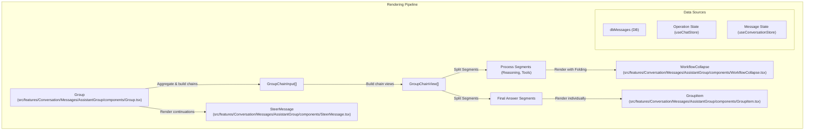
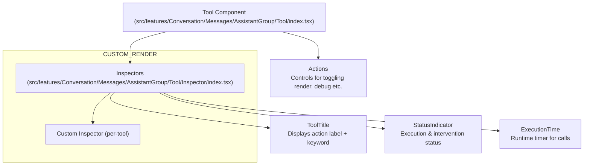
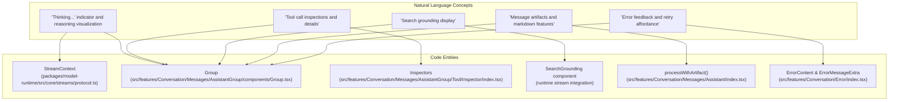

<!-- source: DeepWiki mcp.deepwiki.com · repo lobehub/lobehub · page 8.4 Message Rendering and Enhancements · fetched 2026-10-29 -->

# Message Rendering and Enhancements

Relevant source files

The following files were used as context for generating this wiki page:

- [apps/server/src/services/bot/platforms/utils.test.ts](apps/server/src/services/bot/platforms/utils.test.ts)
- [apps/server/src/services/bot/platforms/utils.ts](apps/server/src/services/bot/platforms/utils.ts)
- [locales/en-US/common.json](locales/en-US/common.json)
- [locales/en-US/error.json](locales/en-US/error.json)
- [locales/zh-CN/common.json](locales/zh-CN/common.json)
- [locales/zh-CN/error.json](locales/zh-CN/error.json)
- [packages/builtin-tool-claude-code/src/client/Inspector/BrowserMcp.tsx](packages/builtin-tool-claude-code/src/client/Inspector/BrowserMcp.tsx)
- [packages/builtin-tool-claude-code/src/client/Inspector/browserMcpLabels.ts](packages/builtin-tool-claude-code/src/client/Inspector/browserMcpLabels.ts)
- [packages/builtin-tool-claude-code/src/client/Render/displayControls.test.ts](packages/builtin-tool-claude-code/src/client/Render/displayControls.test.ts)
- [packages/builtin-tool-claude-code/src/client/Render/displayControls.ts](packages/builtin-tool-claude-code/src/client/Render/displayControls.ts)
- [packages/builtin-tool-claude-code/src/client/labels.ts](packages/builtin-tool-claude-code/src/client/labels.ts)
- [packages/locales/src/default/common.ts](packages/locales/src/default/common.ts)
- [packages/locales/src/default/error.ts](packages/locales/src/default/error.ts)
- [packages/shared-tool-ui/src/components/FilePathDisplay.tsx](packages/shared-tool-ui/src/components/FilePathDisplay.tsx)
- [packages/utils/src/timing.test.ts](packages/utils/src/timing.test.ts)
- [packages/utils/src/timing.ts](packages/utils/src/timing.ts)
- [src/business/client/features/ChatErrorSupportAction/index.tsx](src/business/client/features/ChatErrorSupportAction/index.tsx)
- [src/features/AgentGoals/ProcessControl/useElapsed.ts](src/features/AgentGoals/ProcessControl/useElapsed.ts)
- [src/features/Conversation/ChatItem/ChatItem.tsx](src/features/Conversation/ChatItem/ChatItem.tsx)
- [src/features/Conversation/ChatItem/type.ts](src/features/Conversation/ChatItem/type.ts)
- [src/features/Conversation/Error/TraceIdError.tsx](src/features/Conversation/Error/TraceIdError.tsx)
- [src/features/Conversation/Error/index.test.tsx](src/features/Conversation/Error/index.test.tsx)
- [src/features/Conversation/Error/index.tsx](src/features/Conversation/Error/index.tsx)
- [src/features/Conversation/Error/useFailedMessage.test.ts](src/features/Conversation/Error/useFailedMessage.test.ts)
- [src/features/Conversation/Error/useFailedMessage.ts](src/features/Conversation/Error/useFailedMessage.ts)
- [src/features/Conversation/Markdown/plugins/ScmEvent/Render.tsx](src/features/Conversation/Markdown/plugins/ScmEvent/Render.tsx)
- [src/features/Conversation/Markdown/plugins/ScmEvent/parseScmEvent.test.ts](src/features/Conversation/Markdown/plugins/ScmEvent/parseScmEvent.test.ts)
- [src/features/Conversation/Markdown/plugins/ScmEvent/parseScmEvent.ts](src/features/Conversation/Markdown/plugins/ScmEvent/parseScmEvent.ts)
- [src/features/Conversation/Markdown/plugins/ScmEvent/remarkScmEventBlock.ts](src/features/Conversation/Markdown/plugins/ScmEvent/remarkScmEventBlock.ts)
- [src/features/Conversation/Messages/Assistant/Extra/index.tsx](src/features/Conversation/Messages/Assistant/Extra/index.tsx)
- [src/features/Conversation/Messages/Assistant/index.tsx](src/features/Conversation/Messages/Assistant/index.tsx)
- [src/features/Conversation/Messages/AssistantGroup/Tool/Actions/index.tsx](src/features/Conversation/Messages/AssistantGroup/Tool/Actions/index.tsx)
- [src/features/Conversation/Messages/AssistantGroup/Tool/Debug/index.tsx](src/features/Conversation/Messages/AssistantGroup/Tool/Debug/index.tsx)
- [src/features/Conversation/Messages/AssistantGroup/Tool/Inspector/ExecutionTime.test.tsx](src/features/Conversation/Messages/AssistantGroup/Tool/Inspector/ExecutionTime.test.tsx)
- [src/features/Conversation/Messages/AssistantGroup/Tool/Inspector/ExecutionTime.tsx](src/features/Conversation/Messages/AssistantGroup/Tool/Inspector/ExecutionTime.tsx)
- [src/features/Conversation/Messages/AssistantGroup/Tool/Inspector/StatusIndicator.tsx](src/features/Conversation/Messages/AssistantGroup/Tool/Inspector/StatusIndicator.tsx)
- [src/features/Conversation/Messages/AssistantGroup/Tool/Inspector/ToolTitle.test.tsx](src/features/Conversation/Messages/AssistantGroup/Tool/Inspector/ToolTitle.test.tsx)
- [src/features/Conversation/Messages/AssistantGroup/Tool/Inspector/ToolTitle.tsx](src/features/Conversation/Messages/AssistantGroup/Tool/Inspector/ToolTitle.tsx)
- [src/features/Conversation/Messages/AssistantGroup/Tool/Inspector/extractToolKeyword.test.ts](src/features/Conversation/Messages/AssistantGroup/Tool/Inspector/extractToolKeyword.test.ts)
- [src/features/Conversation/Messages/AssistantGroup/Tool/Inspector/extractToolKeyword.ts](src/features/Conversation/Messages/AssistantGroup/Tool/Inspector/extractToolKeyword.ts)
- [src/features/Conversation/Messages/AssistantGroup/Tool/Inspector/index.tsx](src/features/Conversation/Messages/AssistantGroup/Tool/Inspector/index.tsx)
- [src/features/Conversation/Messages/AssistantGroup/Tool/index.tsx](src/features/Conversation/Messages/AssistantGroup/Tool/index.tsx)
- [src/features/Conversation/Messages/AssistantGroup/Tools.tsx](src/features/Conversation/Messages/AssistantGroup/Tools.tsx)
- [src/features/Conversation/Messages/AssistantGroup/components/ContentBlock.test.tsx](src/features/Conversation/Messages/AssistantGroup/components/ContentBlock.test.tsx)
- [src/features/Conversation/Messages/AssistantGroup/components/ContentBlock.tsx](src/features/Conversation/Messages/AssistantGroup/components/ContentBlock.tsx)
- [src/features/Conversation/Messages/AssistantGroup/components/Group.test.tsx](src/features/Conversation/Messages/AssistantGroup/components/Group.test.tsx)
- [src/features/Conversation/Messages/AssistantGroup/components/Group.tsx](src/features/Conversation/Messages/AssistantGroup/components/Group.tsx)
- [src/features/Conversation/Messages/AssistantGroup/components/GroupItem.tsx](src/features/Conversation/Messages/AssistantGroup/components/GroupItem.tsx)
- [src/features/Conversation/Messages/AssistantGroup/components/MessageContent.test.tsx](src/features/Conversation/Messages/AssistantGroup/components/MessageContent.test.tsx)
- [src/features/Conversation/Messages/AssistantGroup/components/MessageContent.tsx](src/features/Conversation/Messages/AssistantGroup/components/MessageContent.tsx)
- [src/features/Conversation/Messages/AssistantGroup/components/WorkflowCollapse.test.tsx](src/features/Conversation/Messages/AssistantGroup/components/WorkflowCollapse.test.tsx)
- [src/features/Conversation/Messages/AssistantGroup/components/WorkflowCollapse.tsx](src/features/Conversation/Messages/AssistantGroup/components/WorkflowCollapse.tsx)
- [src/features/Conversation/Messages/AssistantGroup/components/groupChain.ts](src/features/Conversation/Messages/AssistantGroup/components/groupChain.ts)
- [src/features/Conversation/Messages/AssistantGroup/components/segments.test.ts](src/features/Conversation/Messages/AssistantGroup/components/segments.test.ts)
- [src/features/Conversation/Messages/AssistantGroup/components/segments.ts](src/features/Conversation/Messages/AssistantGroup/components/segments.ts)
- [src/features/Conversation/Messages/AssistantGroup/components/types.ts](src/features/Conversation/Messages/AssistantGroup/components/types.ts)
- [src/features/Conversation/Messages/AssistantGroup/constants.ts](src/features/Conversation/Messages/AssistantGroup/constants.ts)
- [src/features/Conversation/Messages/AssistantGroup/index.tsx](src/features/Conversation/Messages/AssistantGroup/index.tsx)
- [src/features/Conversation/Messages/AssistantGroup/toolDisplayNames.test.ts](src/features/Conversation/Messages/AssistantGroup/toolDisplayNames.test.ts)
- [src/features/Conversation/Messages/AssistantGroup/toolDisplayNames.ts](src/features/Conversation/Messages/AssistantGroup/toolDisplayNames.ts)
- [src/features/Conversation/Messages/AssistantGroup/toolRenderRules.test.ts](src/features/Conversation/Messages/AssistantGroup/toolRenderRules.test.ts)
- [src/features/Conversation/Messages/AssistantGroup/toolRenderRules.ts](src/features/Conversation/Messages/AssistantGroup/toolRenderRules.ts)
- [src/features/Conversation/Messages/Task/index.tsx](src/features/Conversation/Messages/Task/index.tsx)
- [src/features/Conversation/Messages/Tasks/shared/TaskMessages.tsx](src/features/Conversation/Messages/Tasks/shared/TaskMessages.tsx)
- [src/features/Conversation/Messages/Tool/Tool/index.tsx](src/features/Conversation/Messages/Tool/Tool/index.tsx)
- [src/features/Conversation/Messages/User/components/ScmEventSender.tsx](src/features/Conversation/Messages/User/components/ScmEventSender.tsx)
- [src/features/Conversation/Messages/User/index.tsx](src/features/Conversation/Messages/User/index.tsx)
- [src/features/Conversation/Messages/components/MessageActionBar/actions/branching.ts](src/features/Conversation/Messages/components/MessageActionBar/actions/branching.ts)
- [src/features/Conversation/Messages/components/Reasoning.tsx](src/features/Conversation/Messages/components/Reasoning.tsx)
- [src/features/Conversation/Messages/index.tsx](src/features/Conversation/Messages/index.tsx)
- [src/features/Conversation/store/selectors.test.ts](src/features/Conversation/store/selectors.test.ts)
- [src/features/Conversation/store/slices/data/selectors.test.ts](src/features/Conversation/store/slices/data/selectors.test.ts)
- [src/features/Conversation/store/slices/data/selectors.ts](src/features/Conversation/store/slices/data/selectors.ts)
- [src/features/Conversation/store/slices/messageState/selectors.ts](src/features/Conversation/store/slices/messageState/selectors.ts)
- [src/features/Conversation/store/utils/effectiveModel.test.ts](src/features/Conversation/store/utils/effectiveModel.test.ts)
- [src/features/Conversation/types/operation.ts](src/features/Conversation/types/operation.ts)
- [src/features/Electron/HeterogeneousAgent/StatusGuide/GuideActions.tsx](src/features/Electron/HeterogeneousAgent/StatusGuide/GuideActions.tsx)
- [src/features/Electron/HeterogeneousAgent/StatusGuide/GuideShell.tsx](src/features/Electron/HeterogeneousAgent/StatusGuide/GuideShell.tsx)
- [src/features/Electron/HeterogeneousAgent/StatusGuide/index.tsx](src/features/Electron/HeterogeneousAgent/StatusGuide/index.tsx)
- [src/features/Electron/HeterogeneousAgent/StatusGuide/states/CliDetectionTimeoutState.tsx](src/features/Electron/HeterogeneousAgent/StatusGuide/states/CliDetectionTimeoutState.tsx)
- [src/features/Electron/HeterogeneousAgent/StatusGuide/states/OverloadedState.tsx](src/features/Electron/HeterogeneousAgent/StatusGuide/states/OverloadedState.tsx)
- [src/features/Electron/HeterogeneousAgent/StatusGuide/states/RateLimitState.tsx](src/features/Electron/HeterogeneousAgent/StatusGuide/states/RateLimitState.tsx)
- [src/features/Electron/HeterogeneousAgent/StatusGuide/types.ts](src/features/Electron/HeterogeneousAgent/StatusGuide/types.ts)
- [src/features/HomeSidebar/hooks/useCreateMenuItems.tsx](src/features/HomeSidebar/hooks/useCreateMenuItems.tsx)
- [src/features/VisibilityConfirmContent/index.test.tsx](src/features/VisibilityConfirmContent/index.test.tsx)
- [src/hooks/useOperationState.ts](src/hooks/useOperationState.ts)
- [src/store/electron/actions/__tests__/app.test.ts](src/store/electron/actions/__tests__/app.test.ts)

This section documents the comprehensive message rendering and enhancement systems in the LobeHub codebase [src/features/Conversation/Messages/AssistantGroup/components/Group.tsx:1-183](). These systems extend basic textual chat messages with rich interactive content, multi-step tool executions, Chain-of-Thought visualizations, structured artifacts, and sophisticated error handling, enabling an enriched conversational user experience.

---

## 1. AssistantGroup Renderer: Orchestrating Complex Assistant Responses

The `AssistantGroup` renderer is the primary React component responsible for rendering complex AI assistant responses that involve multi-step workflows including reasoning, tool calls, and final answers [src/features/Conversation/Messages/AssistantGroup/components/Group.tsx:38-66](). It aggregates multiple content blocks (text, images, reasoning, tool outputs) of an assistant message turn into a coherent UI presentation.

### Key Responsibilities and Features
- Aggregates blocks and continuations of assistant steps into *chains* [src/features/Conversation/Messages/AssistantGroup/components/Group.tsx:67-70]().
- Differentiates workflow segments (intermediate reasoning, tools) from the final answer [src/features/Conversation/Messages/AssistantGroup/components/Group.tsx:139-148]().
- Supports folding completed workflows under a "Processed" header while keeping the final answer visible.
- Tracks active generation and operation states to manage rendering state and folding logic [src/features/Conversation/Messages/AssistantGroup/components/Group.tsx:71-100]().
- Supports collapsing entire assistant messages and disables editing based on props [src/features/Conversation/Messages/AssistantGroup/components/Group.tsx:38-52]().

### Data Flow and Implementation Details

1. **Chain Assembly**: Chains are constructed by combining the primary assistant content block with any *continuations*—further assistant turns steering or extending the same thought flow [src/features/Conversation/Messages/AssistantGroup/components/Group.tsx:67-70]().

2. **State Selection**:
   - Collapse status and generation flags are selected from the conversation store via message state selectors [src/features/Conversation/Messages/AssistantGroup/components/Group.tsx:71-81]().
   - Active operations related to each chain are queried from the chat store operation selectors, filtering only active statuses (`pending`, `paused`, `running`), treating operations with `visibleLoadingDone` true as completed [src/features/Conversation/Messages/AssistantGroup/components/Group.tsx:88-100]().
   - Timing information such as block creation times and total turn durations are computed based on the aggregated database messages [src/features/Conversation/Messages/AssistantGroup/components/Group.tsx:126-133]().

3. **Render Logic**:
   - Chains are transformed into views representing split segments [src/features/Conversation/Messages/AssistantGroup/components/Group.tsx:139-148]().
   - Segments are split into *process* (reasoning, tools, intermediate content) and *final answer* segments.
   - Folding logic determines if the process part should collapse based on flags like `enableProcessFold`, whether a final answer exists, workflow completion, and operation activity.
   - The final answer remains always visible even when the process is folded.

4. **Rendering**:
   - Each segment renders under a `MessageAggregationContext` for context management [src/features/Conversation/Messages/AssistantGroup/components/Group.tsx:174-180]().
   - The workflow segments render via a collapsible component `WorkflowCollapse` [src/features/Conversation/Messages/AssistantGroup/components/WorkflowCollapse.tsx:146-175]().
   - Final answer segments render inline as distinct `GroupItem` components.
   - Steer messages representing continuation turns render in sequence [src/features/Conversation/Messages/AssistantGroup/components/Group.tsx:67-70]().

### Folding and Visual Behavior

- For **non-latest turns** that are complete, detailed workflow steps are folded away to reduce clutter, using a "Processed {duration}" header [src/features/Conversation/Messages/AssistantGroup/components/Group.tsx:182-183]().
- The **latest turn** stays fully expanded while generating or until complete final answer is available.
- Folding respects operation lifecycle, folding only after all related operations end.

---

### AssistantGroup Rendering Architecture

**Sources:**  
- `src/features/Conversation/Messages/AssistantGroup/components/Group.tsx:38-183`  
- `src/features/Conversation/Messages/AssistantGroup/components/WorkflowCollapse.tsx:1-175`  

---

## 2. Tool Inspectors: Detailed Tool Execution Visualization

Tool inspectors enrich tool call bubbles in assistant messages by providing detailed breakdowns of tool arguments, execution status, result content, and intervention states [src/features/Conversation/Messages/AssistantGroup/Tool/index.tsx:36-128]().

### Implementation Highlights

- `Tool` component subscribes selectively to tool data in conversation store to avoid unnecessary re-renders [src/features/Conversation/Messages/AssistantGroup/Tool/index.tsx:36-40]().
- Uses runtime-determined render/display controls to decide whether to render actions inline, collapsed, or expanded [src/features/Conversation/Messages/AssistantGroup/Tool/index.tsx:54-67]().
- Provides toggles between custom rendering and fallback argument rendering, and support for debug views [src/features/Conversation/Messages/AssistantGroup/Tool/index.tsx:57-61]().
- Tracks execution status via intervention state (`pending`, `rejected`, `aborted`) [src/features/Conversation/Messages/AssistantGroup/Tool/index.tsx:62-64]().
- Displays operation timing and success/error status icons.
- Delegates detail rendering to per-tool inspectors keyed by tool `identifier` and `apiName` [src/features/Conversation/Messages/AssistantGroup/Tool/index.tsx:162-170]().

### Inspector Component Composition

- `Inspectors` component renders the tool's title using `ToolTitle` [src/features/Conversation/Messages/AssistantGroup/Tool/Inspector/index.tsx:10-40]().
- Shows status indicators reflecting execution state and errors.
- On expansion, renders custom per-tool inspector UI inside an error boundary [src/features/Conversation/Messages/AssistantGroup/Tool/index.tsx:162-168]().
- Handles streaming of tool arguments and result content gracefully [src/features/Conversation/Messages/AssistantGroup/Tool/index.tsx:68-77]().

---

### Tool Inspector Rendering Flow

**Sources:**  
- `src/features/Conversation/Messages/AssistantGroup/Tool/index.tsx:36-170`  
- `src/features/Conversation/Messages/AssistantGroup/Tool/Inspector/index.tsx:10-50`  

---

## 3. Search Grounding in Messages

The system integrates web search results and external grounding data into message content to enhance response factuality.

- Grounding information arrives as special stream chunks of type `"grounding"` in the model runtime streams [packages/model-runtime/src/core/streams/protocol.ts:127-135]().
- Only citations with valid URLs are included after filtration.
- Grounding enhances context and can be included in the conversation message blocks for rendering.

**Sources:**  
- `packages/model-runtime/src/core/streams/protocol.ts:127-135`  

---

## 4. Chain-of-Thought (CoT) Reasoning Visualization

LobeHub visualizes the LLM's internal reasoning process and distinguishes it from final answers to convey the AI's thought process transparently.

### Stream Protocol Support

- The stream protocol identifies reasoning chunks via:
  - Native `reasoning` chunk types for structured reasoning messages [packages/model-runtime/src/core/streams/protocol.ts:20-60]().
  - Tag-based detection toggling a `thinkingInContent` flag for `<think>` tags.
  - Google Gemini signature identification via `thoughtSignature` property.

### Rendering of Reasoning

- The `MessageContent` component normalizes reasoning tags using `normalizeThinkTags` [src/features/Conversation/Messages/Assistant/index.tsx:104-105]().
- Reasoning blocks can show partial thoughts, durations, and editing options.
- The `Reasoning` component renders reasoning content with smooth streaming and composable UI.

**Sources:**  
- `src/features/Conversation/Messages/Assistant/index.tsx:104-105`  
- `packages/model-runtime/src/core/streams/protocol.ts:20-60`  

---

## 5. Artifacts and Markdown Enhancements

- Message content supports enhanced Markdown processing with rich interactive artifact components [src/features/Conversation/Messages/Assistant/index.tsx:104-105]().
- The `processWithArtifact` method detects artifact tags in Markdown and prepares them for specialized rendering [src/features/Conversation/Messages/Assistant/index.tsx:104-105]().
- Inline base64 images are extracted and replaced seamlessly during streaming.
- Artifact rendering supports embedded non-textual content like code or structured UI blocks.

**Sources:**  
- `src/features/Conversation/Messages/Assistant/index.tsx:104-105`  

---

## 6. Error Components: Robust Error Presentation

To ensure clear user feedback on chat and assistant errors, LobeHub implements a flexible error display system [src/features/Conversation/Error/index.tsx:1-40]().

### Features

- Extracts and formats error messages from multiple types of error payloads [src/features/Conversation/Error/index.tsx:52-81]().
- Renders error UI using `ErrorContent` component with custom retry and alert capabilities [src/features/Conversation/Error/index.tsx:14-17]().
- Supports dynamic business logic error rendering and heterogeneous agent error guides [src/features/Conversation/Error/index.tsx:14-26]().
- Handles specific known errors with dedicated UI components loaded dynamically [src/features/Conversation/Error/index.tsx:98-125]().
- Supports retry and regeneration on errors at message and tool-call levels.

**Sources:**  
- `src/features/Conversation/Error/index.tsx:1-125`  

---

## 7. Technical Entity Mapping: Natural Language Concepts to Code Entities

This diagram maps how natural language message enhancements are realized in code artifacts.

**Sources:**  
- `src/features/Conversation/Messages/AssistantGroup/components/Group.tsx:1-183`  
- `src/features/Conversation/Messages/AssistantGroup/Tool/Inspector/index.tsx:1-50`  
- `src/features/Conversation/Messages/Assistant/index.tsx:104-105`  
- `src/features/Conversation/Error/index.tsx:1-125`  
- `packages/model-runtime/src/core/streams/protocol.ts:20-135`

---

