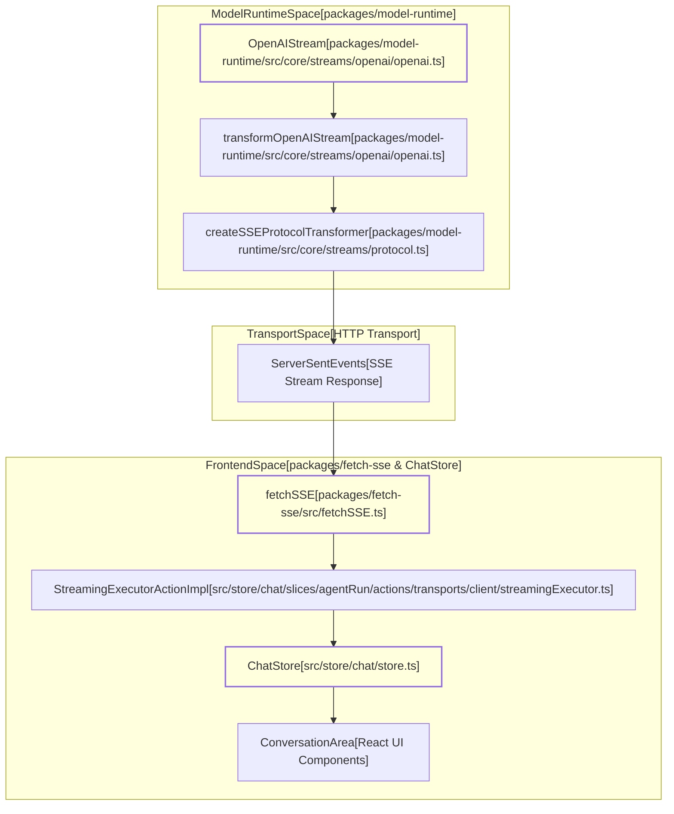
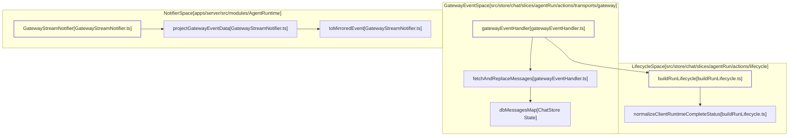

<!-- source: DeepWiki mcp.deepwiki.com · repo lobehub/lobehub · page 8.5 Response Streaming and Protocol · fetched 2026-10-29 -->

# Response Streaming and Protocol

<details>
<summary>Relevant source files</summary>

The following files were used as context for generating this wiki page:

- [apps/server/src/modules/AgentRuntime/AgentRuntimeCoordinator.ts](apps/server/src/modules/AgentRuntime/AgentRuntimeCoordinator.ts)
- [apps/server/src/modules/AgentRuntime/AgentStateManager.ts](apps/server/src/modules/AgentRuntime/AgentStateManager.ts)
- [apps/server/src/modules/AgentRuntime/GatewayStreamNotifier.ts](apps/server/src/modules/AgentRuntime/GatewayStreamNotifier.ts)
- [apps/server/src/modules/AgentRuntime/InMemoryAgentStateManager.ts](apps/server/src/modules/AgentRuntime/InMemoryAgentStateManager.ts)
- [apps/server/src/modules/AgentRuntime/__tests__/AgentRuntimeCoordinator.test.ts](apps/server/src/modules/AgentRuntime/__tests__/AgentRuntimeCoordinator.test.ts)
- [apps/server/src/modules/AgentRuntime/__tests__/AgentStateManager.test.ts](apps/server/src/modules/AgentRuntime/__tests__/AgentStateManager.test.ts)
- [apps/server/src/modules/AgentRuntime/__tests__/GatewayStreamNotifier.test.ts](apps/server/src/modules/AgentRuntime/__tests__/GatewayStreamNotifier.test.ts)
- [apps/server/src/modules/AgentRuntime/__tests__/InMemoryAgentStateManager.test.ts](apps/server/src/modules/AgentRuntime/__tests__/InMemoryAgentStateManager.test.ts)
- [apps/server/src/modules/AgentRuntime/adapters/ServerSubAgentTransport.ts](apps/server/src/modules/AgentRuntime/adapters/ServerSubAgentTransport.ts)
- [apps/server/src/modules/AgentRuntime/context.ts](apps/server/src/modules/AgentRuntime/context.ts)
- [apps/server/src/modules/AgentRuntime/llmErrorClassification.ts](apps/server/src/modules/AgentRuntime/llmErrorClassification.ts)
- [apps/server/src/modules/AgentRuntime/types.ts](apps/server/src/modules/AgentRuntime/types.ts)
- [apps/server/src/routers/lambda/__tests__/aiAgent.test.ts](apps/server/src/routers/lambda/__tests__/aiAgent.test.ts)
- [apps/server/src/services/agentRuntime/__tests__/agentSignalHooks.integration.test.ts](apps/server/src/services/agentRuntime/__tests__/agentSignalHooks.integration.test.ts)
- [apps/server/src/services/agentRuntime/__tests__/executeStep.test.ts](apps/server/src/services/agentRuntime/__tests__/executeStep.test.ts)
- [apps/server/src/services/agentRuntime/__tests__/hooksIntegration.test.ts](apps/server/src/services/agentRuntime/__tests__/hooksIntegration.test.ts)
- [apps/server/src/services/agentSignal/services/selfIteration/review/proposal.ts](apps/server/src/services/agentSignal/services/selfIteration/review/proposal.ts)
- [apps/server/src/services/aiAgent/__tests__/execAgent.modelOverride.test.ts](apps/server/src/services/aiAgent/__tests__/execAgent.modelOverride.test.ts)
- [packages/agent-gateway-client/PROTOCOL_V2.md](packages/agent-gateway-client/PROTOCOL_V2.md)
- [packages/agent-gateway-client/src/client.test.ts](packages/agent-gateway-client/src/client.test.ts)
- [packages/agent-gateway-client/src/client.ts](packages/agent-gateway-client/src/client.ts)
- [packages/agent-gateway-client/src/index.ts](packages/agent-gateway-client/src/index.ts)
- [packages/agent-gateway-client/src/mux/GatewayMuxClient.test.ts](packages/agent-gateway-client/src/mux/GatewayMuxClient.test.ts)
- [packages/agent-gateway-client/src/mux/GatewayMuxClient.ts](packages/agent-gateway-client/src/mux/GatewayMuxClient.ts)
- [packages/agent-gateway-client/src/mux/createOperationClient.test.ts](packages/agent-gateway-client/src/mux/createOperationClient.test.ts)
- [packages/agent-gateway-client/src/mux/createOperationClient.ts](packages/agent-gateway-client/src/mux/createOperationClient.ts)
- [packages/agent-gateway-client/src/mux/types.ts](packages/agent-gateway-client/src/mux/types.ts)
- [packages/agent-gateway-client/src/types.ts](packages/agent-gateway-client/src/types.ts)
- [packages/agent-runtime/src/utils/llmErrorClassifier.test.ts](packages/agent-runtime/src/utils/llmErrorClassifier.test.ts)
- [packages/agent-runtime/src/utils/llmErrorClassifier.ts](packages/agent-runtime/src/utils/llmErrorClassifier.ts)
- [packages/agent-runtime/src/utils/tokenCounter.test.ts](packages/agent-runtime/src/utils/tokenCounter.test.ts)
- [packages/agent-runtime/src/utils/tokenCounter.ts](packages/agent-runtime/src/utils/tokenCounter.ts)
- [packages/context-engine/src/index.ts](packages/context-engine/src/index.ts)
- [packages/context-engine/src/processors/TaskMessage.ts](packages/context-engine/src/processors/TaskMessage.ts)
- [packages/context-engine/src/processors/index.ts](packages/context-engine/src/processors/index.ts)
- [packages/context-engine/src/tokenAccounting/__tests__/attachmentBudget.test.ts](packages/context-engine/src/tokenAccounting/__tests__/attachmentBudget.test.ts)
- [packages/context-engine/src/tokenAccounting/__tests__/index.test.ts](packages/context-engine/src/tokenAccounting/__tests__/index.test.ts)
- [packages/context-engine/src/tokenAccounting/index.ts](packages/context-engine/src/tokenAccounting/index.ts)
- [packages/context-engine/src/tokenAccounting/types.ts](packages/context-engine/src/tokenAccounting/types.ts)
- [packages/fetch-sse/src/__tests__/fetchSSE.test.ts](packages/fetch-sse/src/__tests__/fetchSSE.test.ts)
- [packages/fetch-sse/src/__tests__/reasoningSignature.test.ts](packages/fetch-sse/src/__tests__/reasoningSignature.test.ts)
- [packages/fetch-sse/src/fetchSSE.ts](packages/fetch-sse/src/fetchSSE.ts)
- [packages/model-runtime/src/core/streams/anthropic.test.ts](packages/model-runtime/src/core/streams/anthropic.test.ts)
- [packages/model-runtime/src/core/streams/anthropic.ts](packages/model-runtime/src/core/streams/anthropic.ts)
- [packages/model-runtime/src/core/streams/openai/openai.test.ts](packages/model-runtime/src/core/streams/openai/openai.test.ts)
- [packages/model-runtime/src/core/streams/openai/openai.ts](packages/model-runtime/src/core/streams/openai/openai.ts)
- [packages/model-runtime/src/core/streams/openai/responsesStream.test.ts](packages/model-runtime/src/core/streams/openai/responsesStream.test.ts)
- [packages/model-runtime/src/core/streams/openai/responsesStream.ts](packages/model-runtime/src/core/streams/openai/responsesStream.ts)
- [packages/model-runtime/src/core/streams/protocol.test.ts](packages/model-runtime/src/core/streams/protocol.test.ts)
- [packages/model-runtime/src/core/streams/protocol.ts](packages/model-runtime/src/core/streams/protocol.ts)
- [packages/model-runtime/src/core/streams/qwen.test.ts](packages/model-runtime/src/core/streams/qwen.test.ts)
- [packages/model-runtime/src/core/streams/qwen.ts](packages/model-runtime/src/core/streams/qwen.ts)
- [packages/model-runtime/src/core/streams/spark.test.ts](packages/model-runtime/src/core/streams/spark.test.ts)
- [packages/model-runtime/src/core/streams/spark.ts](packages/model-runtime/src/core/streams/spark.ts)
- [packages/model-runtime/src/errors/modelEmptyCompletion.test.ts](packages/model-runtime/src/errors/modelEmptyCompletion.test.ts)
- [packages/model-runtime/src/errors/modelEmptyCompletion.ts](packages/model-runtime/src/errors/modelEmptyCompletion.ts)
- [packages/model-runtime/src/types/chat.ts](packages/model-runtime/src/types/chat.ts)
- [packages/tool-view-model/package.json](packages/tool-view-model/package.json)
- [packages/tool-view-model/src/index.ts](packages/tool-view-model/src/index.ts)
- [packages/tool-view-model/src/project.test.ts](packages/tool-view-model/src/project.test.ts)
- [packages/tool-view-model/src/project.ts](packages/tool-view-model/src/project.ts)
- [packages/tool-view-model/src/projectToolEvent.test.ts](packages/tool-view-model/src/projectToolEvent.test.ts)
- [packages/tool-view-model/src/projectToolEvent.ts](packages/tool-view-model/src/projectToolEvent.ts)
- [packages/tool-view-model/src/projectors/agentDocuments.ts](packages/tool-view-model/src/projectors/agentDocuments.ts)
- [packages/tool-view-model/src/projectors/grepContent.ts](packages/tool-view-model/src/projectors/grepContent.ts)
- [packages/tool-view-model/src/projectors/localSystem.ts](packages/tool-view-model/src/projectors/localSystem.ts)
- [packages/tool-view-model/src/projectors/projectors.test.ts](packages/tool-view-model/src/projectors/projectors.test.ts)
- [packages/tool-view-model/src/projectors/readFile.ts](packages/tool-view-model/src/projectors/readFile.ts)
- [packages/tool-view-model/src/registry.ts](packages/tool-view-model/src/registry.ts)
- [packages/types/src/message/ui/params.ts](packages/types/src/message/ui/params.ts)
- [src/features/Conversation/Error/PlanLimitCard/budget.test.ts](src/features/Conversation/Error/PlanLimitCard/budget.test.ts)
- [src/features/Conversation/Error/PlanLimitCard/budget.ts](src/features/Conversation/Error/PlanLimitCard/budget.ts)
- [src/features/Conversation/Error/PlanLimitCard/index.tsx](src/features/Conversation/Error/PlanLimitCard/index.tsx)
- [src/features/Conversation/Markdown/plugins/ImageSearchRef/Render.tsx](src/features/Conversation/Markdown/plugins/ImageSearchRef/Render.tsx)
- [src/features/Conversation/Messages/components/Extras/Usage/UsageDetail/TokenProgress.tsx](src/features/Conversation/Messages/components/Extras/Usage/UsageDetail/TokenProgress.tsx)
- [src/features/Conversation/Messages/components/Extras/Usage/UsageDetail/index.tsx](src/features/Conversation/Messages/components/Extras/Usage/UsageDetail/index.tsx)
- [src/features/Conversation/Messages/components/Extras/Usage/UsageDetail/tokens.ts](src/features/Conversation/Messages/components/Extras/Usage/UsageDetail/tokens.ts)
- [src/features/Conversation/Messages/components/SearchGrounding.tsx](src/features/Conversation/Messages/components/SearchGrounding.tsx)
- [src/features/ModelSwitchPanel/components/ControlsForm/ImageAspectRatio2Select.tsx](src/features/ModelSwitchPanel/components/ControlsForm/ImageAspectRatio2Select.tsx)
- [src/store/chat/agents/transports/ClientLLMTransport.test.ts](src/store/chat/agents/transports/ClientLLMTransport.test.ts)
- [src/store/chat/agents/transports/ClientLLMTransport.ts](src/store/chat/agents/transports/ClientLLMTransport.ts)
- [src/store/chat/agents/transports/ClientRuntimeStreamSink.ts](src/store/chat/agents/transports/ClientRuntimeStreamSink.ts)
- [src/store/chat/slices/agentRun/actions/__tests__/gatewayEventHandler.test.ts](src/store/chat/slices/agentRun/actions/__tests__/gatewayEventHandler.test.ts)
- [src/store/chat/slices/agentRun/actions/__tests__/streamingExecutor.test.ts](src/store/chat/slices/agentRun/actions/__tests__/streamingExecutor.test.ts)
- [src/store/chat/slices/agentRun/actions/lifecycle/buildRunLifecycle.test.ts](src/store/chat/slices/agentRun/actions/lifecycle/buildRunLifecycle.test.ts)
- [src/store/chat/slices/agentRun/actions/lifecycle/buildRunLifecycle.ts](src/store/chat/slices/agentRun/actions/lifecycle/buildRunLifecycle.ts)
- [src/store/chat/slices/agentRun/actions/transports/client/streamingExecutor.ts](src/store/chat/slices/agentRun/actions/transports/client/streamingExecutor.ts)
- [src/store/chat/slices/agentRun/actions/transports/gateway/gatewayEventHandler.test.ts](src/store/chat/slices/agentRun/actions/transports/gateway/gatewayEventHandler.test.ts)
- [src/store/chat/slices/agentRun/actions/transports/gateway/gatewayEventHandler.ts](src/store/chat/slices/agentRun/actions/transports/gateway/gatewayEventHandler.ts)
- [src/store/utils/generationStatusPolling.ts](src/store/utils/generationStatusPolling.ts)

</details>


## Purpose and Scope

This document details the response streaming architecture and protocol in LobeHub. It covers the end-to-end data flow from provider-specific AI SDK outputs through the `packages/model-runtime` stream transformation layer, the custom Server-Sent Events (SSE) `StreamProtocolChunk` format, frontend consumption via `fetchSSE`, client-side execution via `StreamingExecutorActionImpl`, and gateway event handling (`gatewayEventHandler.ts`, `GatewayStreamNotifier.ts`) with run lifecycles (`buildRunLifecycle.ts`).

---

## 1. Overview of the Streaming Pipeline

The streaming pipeline translates raw, disparate AI model responses from upstream providers into a unified protocol format (`StreamProtocolChunk`), transmits them over Server-Sent Events (SSE), and consumes them on the frontend to drive reactive updates in the Zustand `ChatStore` and React UI components.


*Diagram 1: Bridging model runtime streaming transforms to frontend Zustand state management.*

Sources: `[packages/model-runtime/src/core/streams/protocol.ts:178-182]`, `[packages/model-runtime/src/core/streams/openai/openai.ts:90-94]`, `[src/store/chat/slices/agentRun/actions/transports/client/streamingExecutor.ts:124-175]()`

---

## 2. The LobeChat Stream Protocol

LobeHub standardizes streamed responses via the `StreamProtocolChunk` interface defined in `packages/model-runtime/src/core/streams/protocol.ts`.

### Chunk Types

| Chunk Type | Description |
| :--- | :--- |
| `text` | Incremental streamed plain text content. |
| `base64_image` | Inline base64-encoded image data. |
| `tool_calls` | Structured data about tool/function calls including parameters and IDs. |
| `reasoning` | Chain-of-thought or thinking text segments (e.g., DeepSeek / o-series). |
| `reasoning_signature` | Verification signatures for reasoning blocks (e.g., Anthropic / Gemini). |
| `reasoning_response_item` | Persisted detailed reasoning objects for stateless replay (`openai.responsesStream.ts`). |
| `reasoning_part` | Multipart reasoning segments (multimodal text/image). |
| `content_part` | Content segments outside reasoning blocks. |
| `grounding` | Search or external source grounding / citation data. |
| `stop` | Indicates streaming completion and reason. |
| `error` | Structured error information for runtime or provider failures. |
| `usage` | Token usage metadata for billing and analytics. |
| `speed` | Performance metrics (token generation speed). |
| `data` | Catch-all for raw or unformatted chunks. |

### Stream Context

The `StreamContext` interface manages transient state during a streaming session:

```ts
export interface StreamContext {
  chunkIndex?: number;
  id: string;
  returnedCitation?: boolean;
  returnedCitationArray?: ChatCitationItem[];
  startReasoning?: boolean;
  thinking?: { id: string; name: string };
  thinkingInContent?: boolean;
  tool?: { id: string; index: number; name: string };
  toolIndex?: number;
  tools?: Record<number, { id: string; index: number; name: string }>;
  usage?: ModelUsage;
  usageMissingDiagnostics?: UsageMissingDiagnostics;
}
```

Sources: `[packages/model-runtime/src/core/streams/protocol.ts:31-80]`

---

## 3. Provider Stream Adapters (Model Runtime)

Adapters translate provider-specific formats into the unified LobeChat protocol.

### OpenAI and Responses Stream Adapters

`transformOpenAIStream` inside `packages/model-runtime/src/core/streams/openai/openai.ts` handles:
- First-chunk error handling via `FIRST_CHUNK_ERROR_KEY`.
- MiniMax business error code mappings (`base_resp.status_code` such as 1008 for insufficient quota, 1004 for invalid API key).
- Tool calls extraction, including OpenRouter's `thoughtSignature`.
- Content policy violation checks (`finish_reason === 'content_filter'`), emitting `ProviderContentPolicyViolation`.
- Citation URL filtering (`filterValidCitations`).

The Responses API adapter (`packages/model-runtime/src/core/streams/openai/responsesStream.ts`) processes event-driven streams from OpenAI's Responses endpoint (`response.created`, `response.output_item.added`, `response.custom_tool_call_input.delta`, `response.reasoning_text.delta`, etc.).

Sources: `[packages/model-runtime/src/core/streams/openai/openai.ts:28-191]`, `[packages/model-runtime/src/core/streams/openai/responsesStream.ts:36-190]`

---

## 4. Client Streaming Execution: `StreamingExecutor`

The `StreamingExecutorActionImpl` class within `src/store/chat/slices/agentRun/actions/transports/client/streamingExecutor.ts` coordinates client-side execution of AI chat runs.

### Responsibilities
- Initializing agent state via `internal_createAgentState`.
- Coordinating tool execution registries (`createClientRuntimeExecutors`).
- Managing step-by-step tool confirmation loops and asynchronous tool halting.

Sources: `[src/store/chat/slices/agentRun/actions/transports/client/streamingExecutor.ts:124-175]`, `[src/store/chat/slices/agentRun/actions/__tests__/streamingExecutor.test.ts:1-30]`

---

## 5. Frontend Stream Handling: `fetchSSE`

The `fetchSSE` utility in `packages/fetch-sse/src/fetchSSE.ts` handles browser-side SSE parsing, automatic retries, and chunk dispatching.

Sources: `[packages/fetch-sse/src/fetchSSE.ts:1-255]`

---

## 6. Gateway Event Handler and Run Lifecycle on Client

When operating in gateway or heterogeneous mode, events flow through `gatewayEventHandler.ts` and `GatewayStreamNotifier.ts`, updating the `ChatStore` and finalizing lifecycles via `buildRunLifecycle.ts`.


*Diagram 2: Gateway event handling, message state reconciliation, and run lifecycle completion.*

Sources: `[src/store/chat/slices/agentRun/actions/transports/gateway/gatewayEventHandler.ts:62-103]`, `[apps/server/src/modules/AgentRuntime/GatewayStreamNotifier.ts:55-105]`, `[src/store/chat/slices/agentRun/actions/lifecycle/buildRunLifecycle.ts:45-85]`

---

