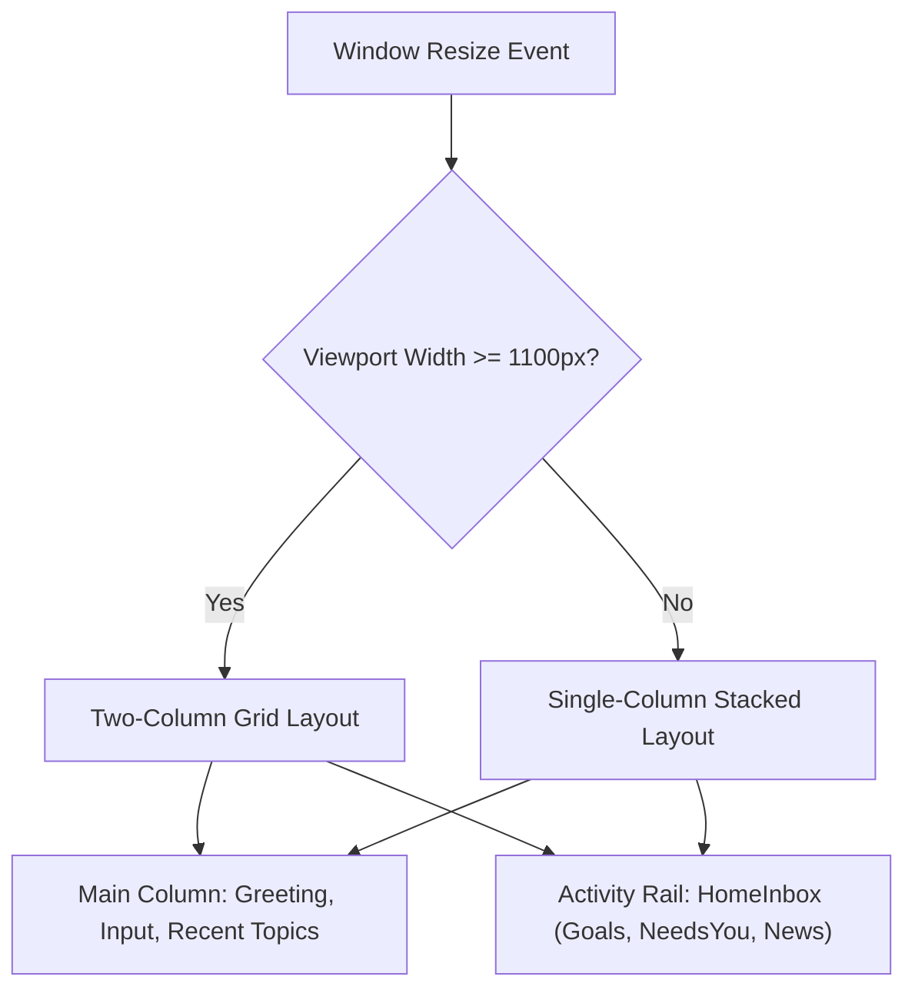
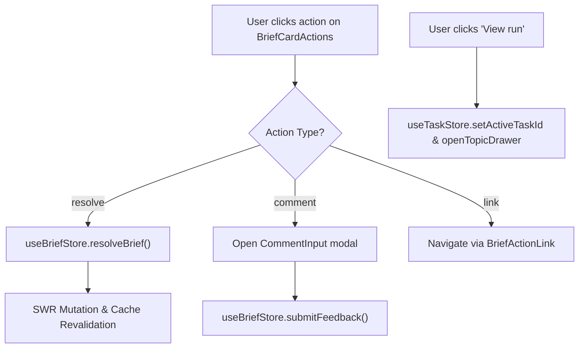
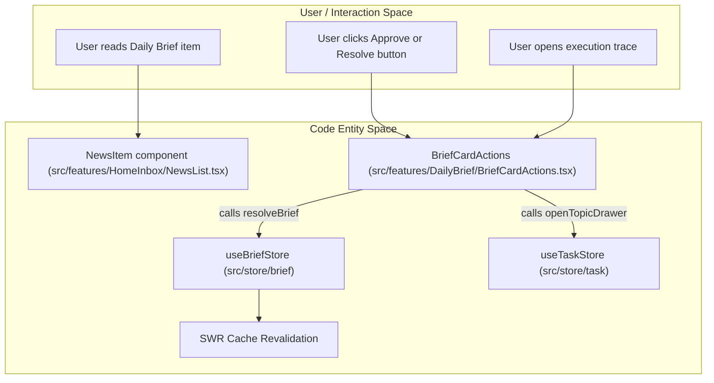
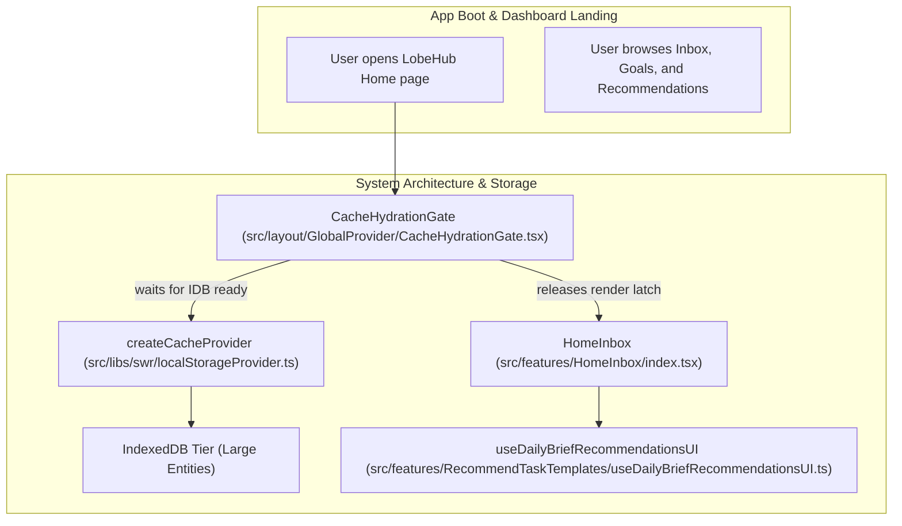

<!-- source: DeepWiki mcp.deepwiki.com · repo lobehub/lobehub · page 8.6 Daily Brief and Home Inbox · fetched 2026-10-29 -->

# Daily Brief and Home Inbox

Relevant source files

The following files were used as context for generating this wiki page:

- [apps/server/src/services/topicReference/index.test.ts](apps/server/src/services/topicReference/index.test.ts)
- [apps/server/src/services/topicReference/index.ts](apps/server/src/services/topicReference/index.ts)
- [locales/en-US/home.json](locales/en-US/home.json)
- [locales/zh-CN/home.json](locales/zh-CN/home.json)
- [packages/builtin-tool-brief/src/manifest.ts](packages/builtin-tool-brief/src/manifest.ts)
- [packages/const/src/taskTemplate.ts](packages/const/src/taskTemplate.ts)
- [packages/locales/src/default/home.ts](packages/locales/src/default/home.ts)
- [src/features/AgentTasks/AgentTaskDetail/TaskBriefCard.tsx](src/features/AgentTasks/AgentTaskDetail/TaskBriefCard.tsx)
- [src/features/DailyBrief/BriefActionLink.tsx](src/features/DailyBrief/BriefActionLink.tsx)
- [src/features/DailyBrief/BriefCardActions.tsx](src/features/DailyBrief/BriefCardActions.tsx)
- [src/features/DailyBrief/BriefPriorityIcon.tsx](src/features/DailyBrief/BriefPriorityIcon.tsx)
- [src/features/DailyBrief/__tests__/BriefCardActions.test.tsx](src/features/DailyBrief/__tests__/BriefCardActions.test.tsx)
- [src/features/DailyBrief/briefPriority.ts](src/features/DailyBrief/briefPriority.ts)
- [src/features/DailyBrief/style.ts](src/features/DailyBrief/style.ts)
- [src/features/HomeInbox/InboxBriefCard.tsx](src/features/HomeInbox/InboxBriefCard.tsx)
- [src/features/HomeInbox/NewsList.tsx](src/features/HomeInbox/NewsList.tsx)
- [src/features/HomeInbox/index.tsx](src/features/HomeInbox/index.tsx)
- [src/features/HomeInbox/splitBriefs.test.ts](src/features/HomeInbox/splitBriefs.test.ts)
- [src/features/HomeInbox/splitBriefs.ts](src/features/HomeInbox/splitBriefs.ts)
- [src/features/RecommendTaskTemplates/DailyBriefRecommendationsView.tsx](src/features/RecommendTaskTemplates/DailyBriefRecommendationsView.tsx)
- [src/features/RecommendTaskTemplates/TaskTemplateCard.tsx](src/features/RecommendTaskTemplates/TaskTemplateCard.tsx)
- [src/features/RecommendTaskTemplates/useDailyBriefRecommendationsUI.test.ts](src/features/RecommendTaskTemplates/useDailyBriefRecommendationsUI.test.ts)
- [src/features/RecommendTaskTemplates/useDailyBriefRecommendationsUI.ts](src/features/RecommendTaskTemplates/useDailyBriefRecommendationsUI.ts)
- [src/features/User/UserInfo.tsx](src/features/User/UserInfo.tsx)
- [src/layout/GlobalProvider/CacheHydrationGate.test.tsx](src/layout/GlobalProvider/CacheHydrationGate.test.tsx)
- [src/layout/GlobalProvider/CacheHydrationGate.tsx](src/layout/GlobalProvider/CacheHydrationGate.tsx)
- [src/layout/GlobalProvider/Query.tsx](src/layout/GlobalProvider/Query.tsx)
- [src/layout/GlobalProvider/coldHydrationGate.integration.test.tsx](src/layout/GlobalProvider/coldHydrationGate.integration.test.tsx)
- [src/libs/swr/cacheHydration.test.ts](src/libs/swr/cacheHydration.test.ts)
- [src/libs/swr/cacheHydration.ts](src/libs/swr/cacheHydration.ts)
- [src/libs/swr/cacheProvider.integration.test.tsx](src/libs/swr/cacheProvider.integration.test.tsx)
- [src/libs/swr/coldHydrationRace.test.tsx](src/libs/swr/coldHydrationRace.test.tsx)
- [src/libs/swr/localStorageProvider.test.ts](src/libs/swr/localStorageProvider.test.ts)
- [src/libs/swr/localStorageProvider.ts](src/libs/swr/localStorageProvider.ts)
- [src/spa/AppLayer.tsx](src/spa/AppLayer.tsx)
- [src/spa/initialize/index.ts](src/spa/initialize/index.ts)
- [src/store/brief/slices/list/action.test.ts](src/store/brief/slices/list/action.test.ts)
- [src/store/brief/slices/list/action.ts](src/store/brief/slices/list/action.ts)
- [src/store/brief/slices/list/initialState.ts](src/store/brief/slices/list/initialState.ts)
- [src/store/brief/slices/list/projection.ts](src/store/brief/slices/list/projection.ts)
- [src/store/brief/slices/list/selectors.test.ts](src/store/brief/slices/list/selectors.test.ts)
- [src/store/brief/slices/list/selectors.ts](src/store/brief/slices/list/selectors.ts)
- [src/store/user/slices/auth/action.test.ts](src/store/user/slices/auth/action.test.ts)
- [src/store/user/slices/common/action.test.ts](src/store/user/slices/common/action.test.ts)
- [src/store/user/slices/common/action.ts](src/store/user/slices/common/action.ts)
- [src/store/user/slices/common/initialState.ts](src/store/user/slices/common/initialState.ts)
- [src/store/user/slices/common/projection.ts](src/store/user/slices/common/projection.ts)
- [src/store/user/slices/common/replica.test.ts](src/store/user/slices/common/replica.test.ts)

The Daily Brief and Home Inbox systems constitute the central dashboard landing surface for LobeHub. They aggregate asynchronous agent activities, running tasks, standing goals, unread message topics, daily news insights, and context-aware task template recommendations. This subsystem bridges autonomous agent background execution with user decision-making and interaction.

Sources: [`src/features/HomeInbox/index.tsx:1-106`](), [`src/features/DailyBrief/BriefCardActions.tsx:1-50`](), [`src/features/RecommendTaskTemplates/useDailyBriefRecommendationsUI.ts:1-40`]()

---

## 1. Home Page Architecture and Layout

The Home dashboard orchestrates the rendering of greeting sections, user portraits, chat/task input composers, and the activity sidebar (`HomeInbox`).

- **Grid Layout**: Utilizes a responsive two-column grid on viewports wider than 1100px. The main content column houses the input composer and recent topics, while the activity rail hosts the `HomeInbox` component.
- **Responsive Stack**: Collapses into a single-column layout on smaller viewports (`<1100px`), stacking the inbox feeds below the primary entry point.
- **Customization Preferences**: Sections can be tailored or hidden based on user dashboard settings and preference slices (`useUserStore`).

Sources: [`src/features/Home/index.tsx:58-160`](), [`src/features/HomeInbox/index.tsx:106-135`]()

---

## 2. Daily Brief System and BriefCardActions

The Daily Brief feature summarizes background agent work, classifying entries into types such as `decision`, `result`, `error`, and `insight`.

### 2.1 BriefCardActions Component

The `BriefCardActions` component [src/features/DailyBrief/BriefCardActions.tsx:60-75]() implements interactive controls for handling briefs:

- **Action Types**:
  - `resolve`: Marks briefs as resolved via `resolveBrief` in `useBriefStore` [src/features/DailyBrief/BriefCardActions.tsx:79-82]().
  - `comment`: Triggers a lazy-loaded `CommentInput` component for user feedback [src/features/DailyBrief/BriefCardActions.tsx:77-116]().
  - `link`: Navigates users to related workspaces or task acceptance views via `BriefActionLink`.
- **Contextual Adaptation**: Result briefs on scheduled tasks render a plain "Confirm" button rather than "Confirm complete" to prevent terminating recurring runs prematurely [src/features/DailyBrief/BriefCardActions.tsx:116-124]().
- **Run Tracing**: Provides a "View run" shortcut (`Workflow` icon) that invokes `setActiveTaskId` and `openTopicDrawer` on `useTaskStore` to inspect execution traces [src/features/DailyBrief/BriefCardActions.tsx:83-114]().

Sources: [`src/features/DailyBrief/BriefCardActions.tsx:60-165`](), [`src/features/DailyBrief/__tests__/BriefCardActions.test.tsx:70-135`]()

---

## 3. Home Inbox Aggregation and Feeds

The `HomeInbox` component [src/features/HomeInbox/index.tsx:122-152]() aggregates multiple asynchronous streams into sidebar or inline blocks:

| Section | Description |
| :--- | :--- |
| **Goals Rail** | Displays active multi-day goals requiring user confirmation, clarification, or sign-off [src/features/HomeInbox/GoalsRailCard.tsx](). |
| **Needs You** | Highlights decision briefs blocking active agents or requiring explicit user approval [src/features/HomeInbox/NeedsYouRailCard.tsx](). |
| **Unread Topics** | Lists completed agent runs with unread last replies, providing immediate context [src/features/HomeInbox/UnreadTopicList.tsx](). |
| **Running Tasks** | Displays a collapsed, single-line rail indicating currently executing agent processes [src/features/HomeInbox/RunningTasksCard.tsx](). |
| **News Feed** | Paginated daily digests of `insight` and `result` briefs grouped by local calendar day [src/features/HomeInbox/NewsList.tsx:84-125](). |

- **Workspace Scoping**: Supports a mine/team toggle. Shared topics filter by triggerer in team view, while per-user briefs (`Needs You`, `News`) remain strictly scoped to the active user.

Sources: [`src/features/HomeInbox/index.tsx:60-152`](), [`src/features/HomeInbox/NewsList.tsx:84-125`]()

---

## 4. Recommended Task Templates

The home dashboard surfaces tailored task template recommendations through `useDailyBriefRecommendationsUI` [src/features/RecommendTaskTemplates/useDailyBriefRecommendationsUI.ts:157-200]().

- **Interest Resolution**: Resolves user interests via `useResolvedInterestKeys` to query the recommendation endpoint.
- **SWR Caching**: Uses `taskTemplateKeys.listDailyRecommend` scoped to user interests, locale, and a session storage refresh seed [src/features/RecommendTaskTemplates/useDailyBriefRecommendationsUI.ts:106-121]().
- **Normalization**: Validates and normalizes server payloads via `normalizeTaskTemplateRecommendations` to guard against version-skewed self-hosted schemas [src/features/RecommendTaskTemplates/useDailyBriefRecommendationsUI.ts:89-96]().
- **Key Validation Helpers**: `isTaskTemplateRecommendationKey` in `src/store/user/slices/common/action.ts` ensures cache mutations target the correct SWR root keys [src/store/user/slices/common/action.ts:53-54]().

Sources: [`src/features/RecommendTaskTemplates/useDailyBriefRecommendationsUI.ts:89-201`](), [`src/store/user/slices/common/action.ts:53-54`]()

---

## 5. Tiered Storage, Caching, and CacheHydrationGate

To prevent layout shifts and flash-of-empty-content during cold boots, LobeHub coordinates SWR caching with identity-scoped persistence:

- **Tiered Cache Provider (`createCacheProvider`)**: Routes SWR writes based on pattern matching:
  - `idb` (IndexedDB): Large business entities (briefs, tasks, topics) without 5MB limits.
  - `local` (localStorage): Small, frequently changing list shells (recents) loaded synchronously [src/libs/swr/localStorageProvider.ts:8-13]().
- **Identity Partitioning**: All cache keys are scoped by `${userId}:${workspaceId}` to isolate multi-tenant data [src/libs/swr/localStorageProvider.ts:15-18]().
- **CacheHydrationGate**: Blocks React first paint until IndexedDB hydration completes for the active scope, backed by an 8-second hung-hydration timeout [src/layout/GlobalProvider/CacheHydrationGate.tsx:26-78]().

Sources: [`src/libs/swr/localStorageProvider.ts:1-180`](), [`src/layout/GlobalProvider/CacheHydrationGate.tsx:26-115`]()

---

## 6. Natural Language to Code Entity Space Mappings

### 6.1 Brief Interaction and Resolution Flow

Sources: [`src/features/HomeInbox/NewsList.tsx:95-125`](), [`src/features/DailyBrief/BriefCardActions.tsx:75-115`]()

### 6.2 Home Dashboard Aggregation and Hydration Pipeline

Sources: [`src/layout/GlobalProvider/CacheHydrationGate.tsx:52-78`](), [`src/libs/swr/localStorageProvider.ts:126-153`](), [`src/features/HomeInbox/index.tsx:122-152`](), [`src/features/RecommendTaskTemplates/useDailyBriefRecommendationsUI.ts:157-200`]()

---

