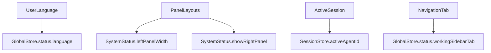
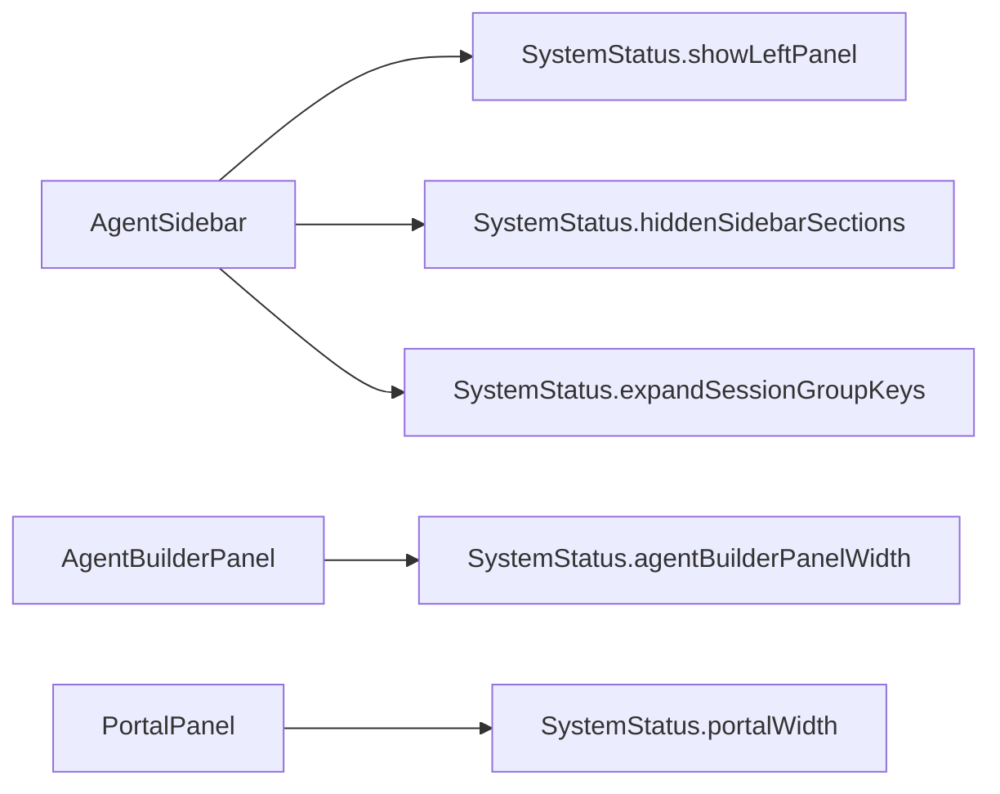

<!-- source: DeepWiki mcp.deepwiki.com · repo lobehub/lobehub · page 9 Frontend Architecture · fetched 2026-10-29 -->

# Frontend Architecture

Relevant source files

The following files were used as context for generating this wiki page:

- [src/const/appVersion.ts](src/const/appVersion.ts)
- [src/features/AgentSidebar/Topic/TopicListScope.tsx](src/features/AgentSidebar/Topic/TopicListScope.tsx)
- [src/features/AgentSidebar/Topic/useScopedTopics.test.ts](src/features/AgentSidebar/Topic/useScopedTopics.test.ts)
- [src/features/AgentSidebar/Topic/useScopedTopics.ts](src/features/AgentSidebar/Topic/useScopedTopics.ts)
- [src/features/Projects/WorkingDirectories/SidebarTopics.tsx](src/features/Projects/WorkingDirectories/SidebarTopics.tsx)
- [src/features/Projects/WorkingDirectories/useProjectTopicReveal.test.ts](src/features/Projects/WorkingDirectories/useProjectTopicReveal.test.ts)
- [src/features/Projects/WorkingDirectories/useProjectTopicReveal.ts](src/features/Projects/WorkingDirectories/useProjectTopicReveal.ts)
- [src/features/Settings/about/features/appVersion.test.ts](src/features/Settings/about/features/appVersion.test.ts)
- [src/features/Settings/about/features/appVersion.ts](src/features/Settings/about/features/appVersion.ts)
- [src/routes/(main)/agent/_layout/index.test.tsx](src/routes/(main)/agent/_layout/index.test.tsx)
- [src/routes/(main)/agent/_layout/index.tsx](src/routes/(main)/agent/_layout/index.tsx)
- [src/routes/(main)/community/_layout/index.tsx](src/routes/(main)/community/_layout/index.tsx)
- [src/routes/(main)/group/_layout/index.tsx](src/routes/(main)/group/_layout/index.tsx)
- [src/store/global/action.test.ts](src/store/global/action.test.ts)
- [src/store/global/actions/__tests__/general.test.ts](src/store/global/actions/__tests__/general.test.ts)
- [src/store/global/actions/general.ts](src/store/global/actions/general.ts)
- [src/store/global/actions/workspacePane.ts](src/store/global/actions/workspacePane.ts)
- [src/store/global/initialState.ts](src/store/global/initialState.ts)
- [src/store/global/selectors/systemStatus.test.ts](src/store/global/selectors/systemStatus.test.ts)
- [src/store/global/selectors/systemStatus.ts](src/store/global/selectors/systemStatus.ts)

The LobeHub frontend is a high-performance React application built primarily on the **Next.js** framework. It incorporates a modular and scalable state management system implemented with **Zustand**, a layered UI architecture leveraging both Ant Design and the custom `@lobehub/ui` library, and a comprehensive internationalization (i18n) solution. The frontend is optimized to deliver consistent experiences across web (PWA), desktop (Electron), and mobile contexts.

Sources: `[src/store/global/initialState.ts:1-220]()`, `[src/store/global/selectors/systemStatus.ts:1-67]()`

---

## State Management with Zustand

LobeHub employs **Zustand** for frontend state management using a "slice" composition pattern. This architecture modularizes state by domain, enabling manageable development and clear boundaries:

- **Global Store**: Centralizes UI state such as system status (`SystemStatus`), panel layouts, expanded/collapsed sections (`expandSessionGroupKeys`, `collapsedTopicGroupKeysByMode`), language preferences, and workspace-specific overlays. The system status state is persisted and dynamically scoped by workspace via `routeOverlayWrites` and `readOverridableField`, allowing workspace-specific UI preferences without polluting personal mode [src/store/global/initialState.ts:145-220](), [src/store/global/selectors/systemStatus.ts:21-65]().

- **Chat Store**: Manages conversation-centric state, including active sessions, topics, message maps, thread portals, and input buffers. It supports thread creation, message replacement, and state transitions for conversation UIs [src/store/global/actions/general.ts:50-112](). 

- **Session Store** and **Agent Store**: Track active agents and sessions, their metadata, and related configurations.

- **AI Infra Store**: Maintains enabled AI model providers and runtime configurations for multi-provider support.

For details, see [State Management with Zustand](#9.1).

Sources: `[src/store/global/initialState.ts:145-220]()`, `[src/store/global/selectors/systemStatus.ts:21-65](), [src/store/global/actions/general.ts:50-112]()`

---

## UI Component Library and Theming

The frontend UI leverages a hybrid component stack:

- **Ant Design (antd)** for mature, accessible base components and consistent interactions.

- **@lobehub/ui** as a custom component library that wraps and extends antd components with LobeHub’s branding, style system, and integration [src/features/Projects/WorkingDirectories/SidebarTopics.tsx:1-5]().

- **Emotion** for CSS-in-JS styling, supporting dynamic theming and scoped styles.

- **StyleRegistry** enables correct style injection for SSR in Next.js and for the Electron environment, ensuring style correctness across platforms.

The UI architecture supports layout elements such as collapsible sidebars (`showLeftPanel`, `showRightPanel`), draggable panels (agent builder, portal sidebar), multi-tab navigation (`workingSidebarTab`), and responsiveness for mobile vs desktop [src/store/global/actions/workspacePane.ts:85-173](). Panel widths and visibility toggles persist in the global system status to maintain UI continuity between sessions [src/store/global/initialState.ts:157-220]().

For details, see [UI Component Library and Theming](#9.2).

Sources: `[src/features/Projects/WorkingDirectories/SidebarTopics.tsx:1-5]()`, `[src/store/global/actions/workspacePane.ts:85-173]()`, `[src/store/global/initialState.ts:157-220]()`

---

## Localization and i18n

LobeHub supports 18+ languages through a layered localization system:

- Translations are maintained in structured default locale source files under `src/locales/default/*.ts`.

- The UI uses the `react-i18next` framework, employing the `useTranslation` hook to consume localized strings reactively [src/features/Projects/WorkingDirectories/SidebarTopics.tsx:49]().

- A dedicated workflow integrates the `lobe-i18n` tool to automate translation updates and manage locale synchronization.

- Namespace files separate translations by feature domain (e.g., `project`, `common`), helping maintain clarity and scalability of language resources.

For details, see [Localization and i18n](#9.3).

Sources: `[src/features/Projects/WorkingDirectories/SidebarTopics.tsx:49]()`

---

## Core Frontend Feature Areas

### Chat Interface
The chat area is a central domain, featuring a session/topic sidebar (`AgentSidebar`, `ProjectDirectoryTopics`), virtualized message rendering, threaded conversation support with portals, and input action bars [src/routes/(main)/agent/_layout/index.tsx:15-32](), [src/features/Projects/WorkingDirectories/SidebarTopics.tsx:30-40](). For details, see [Chat Interface Components](#9.4).

### Settings and Configuration UI
Settings are organized into tabs (`SettingsTabs`) for LLM providers, appearance, agent system parameters, billing, and labs preferences [src/store/global/initialState.ts:58-104](). For details, see [Settings and Configuration UI](#9.5).

### Workspace and Navigation
Sidebar navigation uses `SidebarTabKey` enums and workspace-aware paths (`buildWorkspaceAwarePath`), supporting collapsible groups, dynamic filtering, and custom column widths for resource managers [src/store/global/initialState.ts:8-22](), `[src/store/global/actions/general.ts:70-76]()`. For details, see [Agent and Plugin Marketplace](#9.6), [Progressive Web App and Desktop Shell](#9.7), [Pages and Document Editor](#9.8), and [Chat Terminal and Working Directory](#9.9).

Sources: `[src/routes/(main)/agent/_layout/index.tsx:15-32]()`, `[src/features/Projects/WorkingDirectories/SidebarTopics.tsx:30-40]()`, `[src/store/global/initialState.ts:8-104](), [src/store/global/actions/general.ts:70-76]()`

---

## Frontend Domain to Code Entity Mapping Diagrams

### 1. Frontend Store Domain Mapping

Bridging natural language elements to Zustand store keys:

Sources: `[src/store/global/initialState.ts:1-220]()`, `[src/store/global/selectors/systemStatus.ts:1-67]()`

### 2. UI Layout Persistence Mapping

How UI components map to persisted UI-related system status keys:

Sources: `[src/store/global/initialState.ts:145-220]()`, `[src/store/global/selectors/systemStatus.ts:1-67]()`

---

## Child Pages

For deep technical details on each aspect of the frontend architecture, refer to the following child pages:

- [State Management with Zustand](#9.1) — Zustand store slices, composition, and workspace overlay pattern.
- [UI Component Library and Theming](#9.2) — Use of antd, @lobehub/ui, emotion CSS-in-JS, and theming strategies.
- [Localization and i18n](#9.3) — Translation files, auto-translation flows, and i18n hooks.
- [Chat Interface Components](#9.4) — Chat UI widgets including threads, messages, portals.
- [Settings and Configuration UI](#9.5) — Settings pages for LLM providers, appearance, agent, and billing.
- [Agent and Plugin Marketplace](#9.6) — Marketplace UI and API layers.
- [Progressive Web App and Desktop Shell](#9.7) — PWA setup, Electron shell, IPC, and desktop integration.
- [Pages and Document Editor](#9.8) — Editor runtime, AI-assisted page agents.
- [Chat Terminal and Working Directory](#9.9) — Terminal UI, Git integration, and heterogeneous agent workflows.

Sources: `[src/store/global/initialState.ts:1-220]()`, `[src/store/global/selectors/systemStatus.ts:1-67]()`

---

