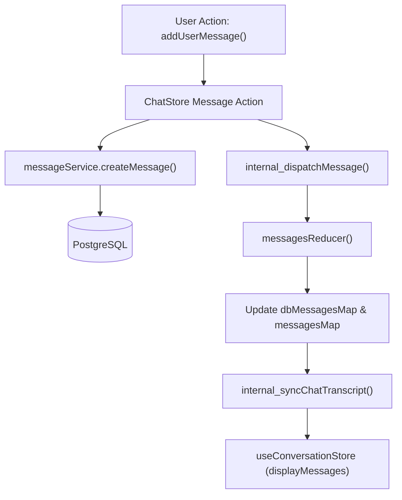
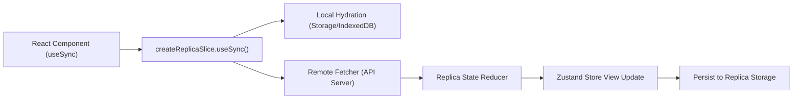
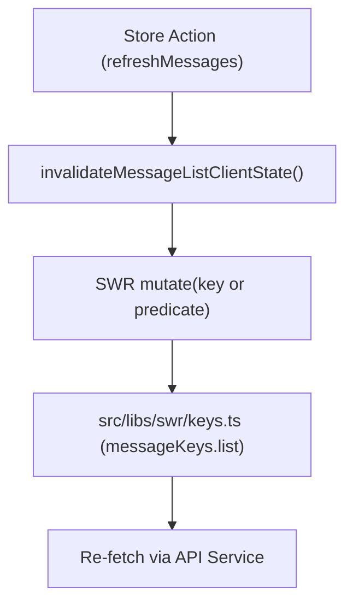
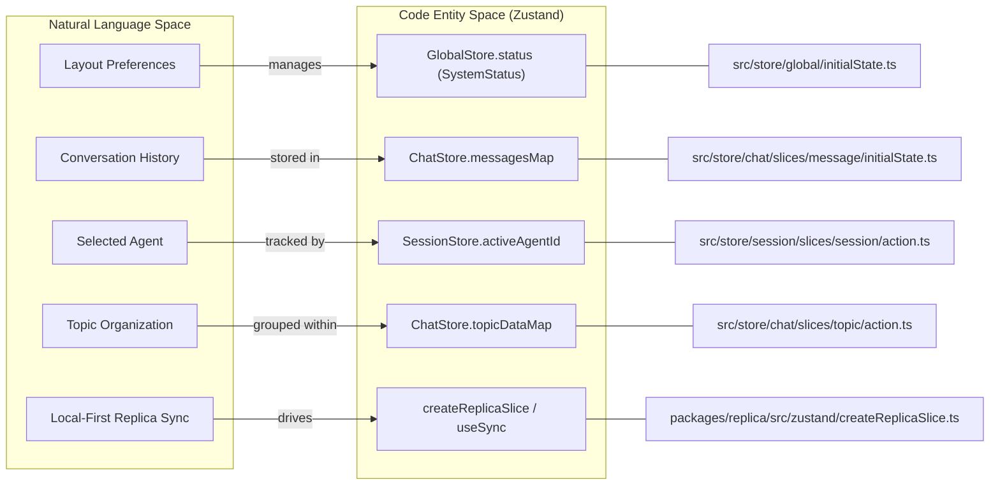

<!-- source: DeepWiki mcp.deepwiki.com · repo lobehub/lobehub · page 9.1 State Management with Zustand · fetched 2026-10-29 -->

# State Management with Zustand

Relevant source files

The following files were used as context for generating this wiki page:

- [apps/server/src/routers/lambda/agentGroup.ts](apps/server/src/routers/lambda/agentGroup.ts)
- [e2e/src/features/home/chat-input.feature](e2e/src/features/home/chat-input.feature)
- [e2e/src/steps/home/chat-input.steps.ts](e2e/src/steps/home/chat-input.steps.ts)
- [e2e/src/support/seedTestUser.ts](e2e/src/support/seedTestUser.ts)
- [packages/database/src/models/__tests__/workspaceUserSettings.test.ts](packages/database/src/models/__tests__/workspaceUserSettings.test.ts)
- [packages/database/src/models/workspaceUserSettings.ts](packages/database/src/models/workspaceUserSettings.ts)
- [packages/database/src/repositories/home/__tests__/privatePinned.test.ts](packages/database/src/repositories/home/__tests__/privatePinned.test.ts)
- [packages/heterogeneous-agents/src/askUser/AskUserBridge.test.ts](packages/heterogeneous-agents/src/askUser/AskUserBridge.test.ts)
- [packages/heterogeneous-agents/src/askUser/AskUserBridge.ts](packages/heterogeneous-agents/src/askUser/AskUserBridge.ts)
- [packages/heterogeneous-agents/src/askUser/constants.ts](packages/heterogeneous-agents/src/askUser/constants.ts)
- [packages/replica/README.md](packages/replica/README.md)
- [packages/replica/src/core/defineReplica.ts](packages/replica/src/core/defineReplica.ts)
- [packages/replica/src/core/engine.ts](packages/replica/src/core/engine.ts)
- [packages/replica/src/core/entity.ts](packages/replica/src/core/entity.ts)
- [packages/replica/src/core/types.ts](packages/replica/src/core/types.ts)
- [packages/replica/src/core/writeQueue.ts](packages/replica/src/core/writeQueue.ts)
- [packages/replica/src/zustand/createReplicaSlice.test.ts](packages/replica/src/zustand/createReplicaSlice.test.ts)
- [packages/replica/src/zustand/createReplicaSlice.ts](packages/replica/src/zustand/createReplicaSlice.ts)
- [packages/replica/src/zustand/pagedSlice.test.ts](packages/replica/src/zustand/pagedSlice.test.ts)
- [src/const/appVersion.ts](src/const/appVersion.ts)
- [src/features/AgentBuilder/AgentBuilderConversation.tsx](src/features/AgentBuilder/AgentBuilderConversation.tsx)
- [src/features/AgentBuilder/AgentBuilderProvider.tsx](src/features/AgentBuilder/AgentBuilderProvider.tsx)
- [src/features/AgentSidebar/Topic/TopicListScope.tsx](src/features/AgentSidebar/Topic/TopicListScope.tsx)
- [src/features/AgentSidebar/Topic/useScopedTopics.test.ts](src/features/AgentSidebar/Topic/useScopedTopics.test.ts)
- [src/features/AgentSidebar/Topic/useScopedTopics.ts](src/features/AgentSidebar/Topic/useScopedTopics.ts)
- [src/features/Conversation/ChatList/index.tsx](src/features/Conversation/ChatList/index.tsx)
- [src/features/Conversation/ConversationProvider.test.tsx](src/features/Conversation/ConversationProvider.test.tsx)
- [src/features/Conversation/ConversationProvider.tsx](src/features/Conversation/ConversationProvider.tsx)
- [src/features/Conversation/Messages/CompressedGroup/index.tsx](src/features/Conversation/Messages/CompressedGroup/index.tsx)
- [src/features/Conversation/Messages/CompressedGroup/useGroupPreferences.test.ts](src/features/Conversation/Messages/CompressedGroup/useGroupPreferences.test.ts)
- [src/features/Conversation/Messages/CompressedGroup/useGroupPreferences.ts](src/features/Conversation/Messages/CompressedGroup/useGroupPreferences.ts)
- [src/features/Conversation/StoreUpdater.tsx](src/features/Conversation/StoreUpdater.tsx)
- [src/features/Conversation/store/action.ts](src/features/Conversation/store/action.ts)
- [src/features/Conversation/store/initialState.ts](src/features/Conversation/store/initialState.ts)
- [src/features/Conversation/store/slices/data/action.test.ts](src/features/Conversation/store/slices/data/action.test.ts)
- [src/features/Conversation/store/slices/data/action.ts](src/features/Conversation/store/slices/data/action.ts)
- [src/features/Conversation/store/slices/data/initialState.ts](src/features/Conversation/store/slices/data/initialState.ts)
- [src/features/Conversation/store/slices/message/action/sendMessage.ts](src/features/Conversation/store/slices/message/action/sendMessage.ts)
- [src/features/Conversation/store/slices/message/action/state.test.ts](src/features/Conversation/store/slices/message/action/state.test.ts)
- [src/features/Conversation/store/slices/message/action/state.ts](src/features/Conversation/store/slices/message/action/state.ts)
- [src/features/PageEditor/Copilot/Conversation.tsx](src/features/PageEditor/Copilot/Conversation.tsx)
- [src/features/PageEditor/PageAgentProvider.test.tsx](src/features/PageEditor/PageAgentProvider.test.tsx)
- [src/features/PageEditor/PageAgentProvider.tsx](src/features/PageEditor/PageAgentProvider.tsx)
- [src/features/Portal/Thread/Chat/index.tsx](src/features/Portal/Thread/Chat/index.tsx)
- [src/features/Projects/WorkingDirectories/SidebarTopics.tsx](src/features/Projects/WorkingDirectories/SidebarTopics.tsx)
- [src/features/Projects/WorkingDirectories/useProjectTopicReveal.test.ts](src/features/Projects/WorkingDirectories/useProjectTopicReveal.test.ts)
- [src/features/Projects/WorkingDirectories/useProjectTopicReveal.ts](src/features/Projects/WorkingDirectories/useProjectTopicReveal.ts)
- [src/features/Settings/about/features/appVersion.test.ts](src/features/Settings/about/features/appVersion.test.ts)
- [src/features/Settings/about/features/appVersion.ts](src/features/Settings/about/features/appVersion.ts)
- [src/libs/queryProjectionStorage/indexedDB.test.ts](src/libs/queryProjectionStorage/indexedDB.test.ts)
- [src/libs/queryProjectionStorage/indexedDB.ts](src/libs/queryProjectionStorage/indexedDB.ts)
- [src/libs/queryProjectionStorage/localStorage.test.ts](src/libs/queryProjectionStorage/localStorage.test.ts)
- [src/libs/queryProjectionStorage/localStorage.ts](src/libs/queryProjectionStorage/localStorage.ts)
- [src/libs/queryProjectionStorage/types.ts](src/libs/queryProjectionStorage/types.ts)
- [src/libs/replica/cacheScope.cycle.test.ts](src/libs/replica/cacheScope.cycle.test.ts)
- [src/libs/replica/index.ts](src/libs/replica/index.ts)
- [src/libs/swr/keys.test.ts](src/libs/swr/keys.test.ts)
- [src/libs/swr/keys.ts](src/libs/swr/keys.ts)
- [src/routes/(main)/agent/(chat)/topicListLoader.test.ts](src/routes/(main)/agent/(chat)/topicListLoader.test.ts)
- [src/routes/(main)/agent/(chat)/topicListLoader.ts](src/routes/(main)/agent/(chat)/topicListLoader.ts)
- [src/routes/(main)/agent/_layout/index.test.tsx](src/routes/(main)/agent/_layout/index.test.tsx)
- [src/routes/(main)/agent/_layout/index.tsx](src/routes/(main)/agent/_layout/index.tsx)
- [src/routes/(main)/agent/features/Conversation/ConversationArea.tsx](src/routes/(main)/agent/features/Conversation/ConversationArea.tsx)
- [src/routes/(main)/agent/features/Conversation/Header/Tags/ThreadSwitcher.tsx](src/routes/(main)/agent/features/Conversation/Header/Tags/ThreadSwitcher.tsx)
- [src/routes/(main)/agent/features/Conversation/Header/Tags/index.tsx](src/routes/(main)/agent/features/Conversation/Header/Tags/index.tsx)
- [src/routes/(main)/community/_layout/index.tsx](src/routes/(main)/community/_layout/index.tsx)
- [src/routes/(main)/group/_layout/index.tsx](src/routes/(main)/group/_layout/index.tsx)
- [src/routes/(main)/group/features/Conversation/ConversationArea.tsx](src/routes/(main)/group/features/Conversation/ConversationArea.tsx)
- [src/routes/(main)/group/profile/features/AgentBuilder/AgentBuilderConversation.tsx](src/routes/(main)/group/profile/features/AgentBuilder/AgentBuilderConversation.tsx)
- [src/services/message/cache.test.ts](src/services/message/cache.test.ts)
- [src/services/message/cache.ts](src/services/message/cache.ts)
- [src/store/chat/slices/message/action.test.ts](src/store/chat/slices/message/action.test.ts)
- [src/store/chat/slices/message/actions/internals.ts](src/store/chat/slices/message/actions/internals.ts)
- [src/store/chat/slices/message/actions/query.ts](src/store/chat/slices/message/actions/query.ts)
- [src/store/chat/slices/message/initialState.ts](src/store/chat/slices/message/initialState.ts)
- [src/store/chat/slices/message/replaceMessages.orphanTool.regression.test.ts](src/store/chat/slices/message/replaceMessages.orphanTool.regression.test.ts)
- [src/store/chat/slices/message/utils/reconcileTools.ts](src/store/chat/slices/message/utils/reconcileTools.ts)
- [src/store/chat/slices/operation/__tests__/actions.test.ts](src/store/chat/slices/operation/__tests__/actions.test.ts)
- [src/store/chat/slices/operation/actions.ts](src/store/chat/slices/operation/actions.ts)
- [src/store/chat/slices/plugin/action.test.ts](src/store/chat/slices/plugin/action.test.ts)
- [src/store/chat/utils/messageMapKey.test.ts](src/store/chat/utils/messageMapKey.test.ts)
- [src/store/chat/utils/messageMapKey.ts](src/store/chat/utils/messageMapKey.ts)
- [src/store/global/action.test.ts](src/store/global/action.test.ts)
- [src/store/global/actions/__tests__/general.test.ts](src/store/global/actions/__tests__/general.test.ts)
- [src/store/global/actions/general.ts](src/store/global/actions/general.ts)
- [src/store/global/actions/workspacePane.ts](src/store/global/actions/workspacePane.ts)
- [src/store/global/initialState.ts](src/store/global/initialState.ts)
- [src/store/global/selectors/systemStatus.test.ts](src/store/global/selectors/systemStatus.test.ts)
- [src/store/global/selectors/systemStatus.ts](src/store/global/selectors/systemStatus.ts)
- [src/store/user/displaySnapshot.ts](src/store/user/displaySnapshot.ts)
- [src/store/user/slices/workspaceUserSettings/action.test.ts](src/store/user/slices/workspaceUserSettings/action.test.ts)
- [src/store/user/slices/workspaceUserSettings/action.ts](src/store/user/slices/workspaceUserSettings/action.ts)
- [src/store/user/slices/workspaceUserSettings/initialState.ts](src/store/user/slices/workspaceUserSettings/initialState.ts)
- [src/store/user/slices/workspaceUserSettings/projection.ts](src/store/user/slices/workspaceUserSettings/projection.ts)
- [src/store/user/slices/workspaceUserSettings/replica.test.ts](src/store/user/slices/workspaceUserSettings/replica.test.ts)

LobeHub utilizes **Zustand** as its primary state management library, adopting a slice-based architecture to efficiently handle complex domain states such as chat history, agent configurations, and system-wide UI status. This page documents the detailed architecture of the Zustand stores including the global store, chat store slices, session/agent/aiInfra/task/tool stores, the slice composition pattern, SWR keys, the replica local-first layer, and their integration.

---

## 1. Store Architecture Overview

LobeHub's frontend state management divides responsibilities across multiple specialized Zustand stores, each encapsulating domain-specific logic and data for modularity and performance.

### 1.1 Global Store

The Global Store maintains application-wide UI state and persistent system configuration, including layout preferences, sidebar settings, and workspace-aware overlays [src/store/global/initialState.ts:10-242](), [src/store/global/selectors/systemStatus.ts:16-63](), [src/store/global/actions/workspacePane.ts:20-188]().

- **SystemStatus**: Tracks persistent UI configurations such as panel widths (e.g., `agentBuilderPanelWidth`, `filePanelWidth`), expanded or collapsed sidebar sections, language selection, and persistent UI flags [src/store/global/initialState.ts:157-220]().
- **Workspace Pane**: Supports workspace overlays, allowing specific UI fields to be overridden when inside a workspace context versus personal mode [src/store/global/selectors/systemStatus.ts:23-65]().
- **Sidebar and Tab State**: Enumerations like `SidebarTabKey` define sidebar panels (Chat, Knowledge, Tasks, etc.), tracking expanded or hidden states [src/store/global/initialState.ts:8-22]().

Sources:
- [src/store/global/initialState.ts:10-242]()
- [src/store/global/selectors/systemStatus.ts:16-63]()
- [src/store/global/actions/workspacePane.ts:20-188]()

### 1.2 Chat Store & Conversation Store

The Chat Store manages client conversations and messaging functionalities through isolated slices:

| Slice / Store | Responsibility | Key Entities |
|---|---|---|
| **Message** | CRUD operations for chat messages, maintaining `messagesMap` cache. | `UIChatMessage`, `messagesMap` [src/store/chat/slices/message/actions/query.ts:1-167]() |
| **Topic** | Handles conversation topics, summaries, and grouping conversations. | `ChatTopic`, `topicDataMap` |
| **Thread** | Manages threaded conversations and branch creation within topics. | `ThreadItem`, `threadMaps` |
| **Portal** | Manages ancillary UI views like artifact inspectors and plugin panes. | `PortalViewType` |
| **Plugin** | Handles tool and plugin invocation state management. | `pluginState` [src/store/chat/slices/plugin/action.test.ts:54-92]() |
| **Conversation Store** | Local view-model store (`useConversationStore`) mirroring chat store buckets [src/features/Conversation/store/slices/data/action.ts:24-54](). | `dbMessages`, `displayMessages` |

Sources:
- [src/features/Conversation/store/slices/data/action.ts:24-54]()
- [src/store/chat/slices/message/actions/query.ts:1-167]()
- [src/store/chat/slices/plugin/action.test.ts:54-92]()

### 1.3 Supporting Stores

- **Session Store:** Manages agent sessions, active session IDs, creation, duplication, and metadata [src/store/session/slices/session/action.ts:57-168]().
- **Agent Store:** Handles AI agent configuration details, system roles, parameters, and runtime info.
- **AI Infra Store:** Centralizes management of AI model and provider lists, status, and enabled models.
- **User Store:** Manages user profiles, authentication state, and preferences.

---

## 2. Slice Composition Pattern & Data Flow

LobeHub employs a **slice pattern with Zustand** where each slice accepts `set`, `get`, and optional `api` arguments, returning an object or class encapsulating actions and selectors.

### Example: Chat Topic and Message Dispatch Flow

Sources:
- [src/store/chat/slices/message/action.test.ts:112-191]()
- [src/features/Conversation/store/slices/data/action.ts:121-176]()

---

## 3. Replica Local-First Layer and Integration

LobeHub implements a robust local-first replica layer (`packages/replica`) that synchronizes state across IndexedDB/localStorage and remote server mutations while driving SWR hooks.

### 3.1 Replica Architecture

The replica layer defines entities, scope management, and local projections:

Sources:
- [packages/replica/src/zustand/createReplicaSlice.test.ts:102-123]()
- [src/libs/replica/index.ts]()

---

## 4. SWR Keys Registry and Integration

LobeHub centralizes SWR cache keys into a single registry (`src/libs/swr/keys.ts`) to ensure consistent cache invalidation and domain-scoped mutations.

### 4.1 SWR Key Registry Structure

- **`messageKeys`**: Key factories for message lists taking normalization context and cache versioning [src/libs/swr/keys.ts:91-102]().
- **`topicKeys`**: Key factories for topic lists, search, and scheduled runs [src/libs/swr/keys.ts:121-137]().
- **Domain Matchers**: Functions like `isMessageListKey` allow matching and invalidating whole domain branches at once (`matchDomain`) [src/libs/swr/keys.ts:111-118]().

Sources:
- [src/libs/swr/keys.ts:1-194]()
- [src/store/chat/slices/message/actions/query.ts:46-79]()

---

## 5. System Entity Mapping

This diagram bridges natural language concepts to concrete Zustand store states and source file implementations.

Sources:
- [src/store/global/initialState.ts:10-242]()
- [src/store/session/slices/session/action.ts:57-168]()
- [src/libs/swr/keys.ts:1-194]()
- [packages/replica/src/zustand/createReplicaSlice.test.ts:1-194]()

---

## Summary Table of Key Stores and Files

| Store / Subsystem | Key Files / Lines | Responsibility |
|---|---|---|
| Global Store | `src/store/global/initialState.ts:10-242` `src/store/global/selectors/systemStatus.ts:16-63` | UI layout state, persistent system config, workspace overlays |
| Chat Message Slices | `src/store/chat/slices/message/actions/query.ts:1-167` `src/store/chat/slices/operation/actions.ts:41-75` | Message CRUD, query revalidation, operation lifecycle |
| Conversation Store | `src/features/Conversation/store/slices/data/action.ts:24-54` | Local view-model store mirroring chat store transcript buckets |
| SWR Keys Registry | `src/libs/swr/keys.ts:1-194` | Centralized SWR cache keys and domain matchers |
| Replica Layer | `packages/replica/src/zustand/createReplicaSlice.test.ts:1-194` | Local-first synchronization layer bridging storage and SWR |

Sources:
- [src/store/global/initialState.ts:10-242]()
- [src/store/global/selectors/systemStatus.ts:16-63]()
- [src/store/chat/slices/message/actions/query.ts:1-167]()
- [src/libs/swr/keys.ts:1-194]()
- [packages/replica/src/zustand/createReplicaSlice.test.ts:1-194]()

---

