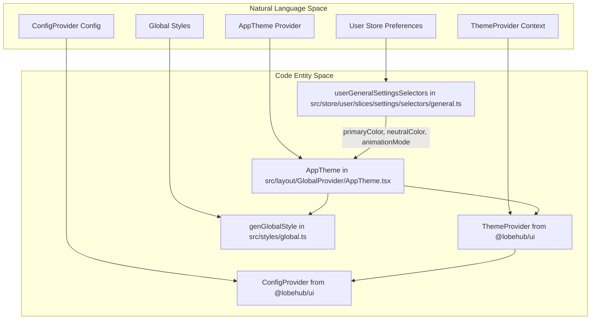
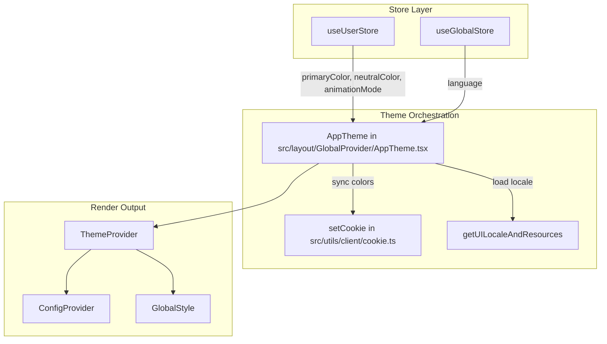

<!-- source: DeepWiki mcp.deepwiki.com · repo lobehub/lobehub · page 9.2 UI Component Library and Theming · fetched 2026-10-29 -->

# UI Component Library and Theming

Relevant source files

The following files were used as context for generating this wiki page:

- [.gitignore](.gitignore)
- [.prettierignore](.prettierignore)
- [.vscode/settings.json](.vscode/settings.json)
- [eslint-suppressions.json](eslint-suppressions.json)
- [eslint.config.mjs](eslint.config.mjs)
- [packages/builtin-tool-notebook/src/systemRole.ts](packages/builtin-tool-notebook/src/systemRole.ts)
- [packages/builtin-tools/src/kimiCode/index.test.ts](packages/builtin-tools/src/kimiCode/index.test.ts)
- [packages/builtin-tools/src/kimiCode/index.tsx](packages/builtin-tools/src/kimiCode/index.tsx)
- [packages/builtin-tools/src/kimiCode/utils.ts](packages/builtin-tools/src/kimiCode/utils.ts)
- [packages/const/src/analytics.ts](packages/const/src/analytics.ts)
- [packages/const/src/discover.ts](packages/const/src/discover.ts)
- [packages/const/src/settings/common.ts](packages/const/src/settings/common.ts)
- [packages/const/src/settings/index.ts](packages/const/src/settings/index.ts)
- [packages/const/src/settings/knowledge.ts](packages/const/src/settings/knowledge.ts)
- [packages/context-engine/src/providers/GroupContextInjector.ts](packages/context-engine/src/providers/GroupContextInjector.ts)
- [packages/context-engine/src/providers/__tests__/GroupContextInjector.test.ts](packages/context-engine/src/providers/__tests__/GroupContextInjector.test.ts)
- [packages/context-engine/src/providers/__tests__/__snapshots__/GroupContextInjector.test.ts.snap](packages/context-engine/src/providers/__tests__/__snapshots__/GroupContextInjector.test.ts.snap)
- [packages/types/src/user/settings/general.ts](packages/types/src/user/settings/general.ts)
- [src/app/manifest.ts](src/app/manifest.ts)
- [src/components/StreamingMarkdown/index.tsx](src/components/StreamingMarkdown/index.tsx)
- [src/features/AgentTasks/features/TaskStatusCascadeModal.tsx](src/features/AgentTasks/features/TaskStatusCascadeModal.tsx)
- [src/features/Billboard/Carousel.tsx](src/features/Billboard/Carousel.tsx)
- [src/features/Billboard/index.tsx](src/features/Billboard/index.tsx)
- [src/features/Conversation/Messages/AgentCouncil/components/AutoScrollShadow.tsx](src/features/Conversation/Messages/AgentCouncil/components/AutoScrollShadow.tsx)
- [src/features/Conversation/Messages/AgentCouncil/components/CouncilMember.tsx](src/features/Conversation/Messages/AgentCouncil/components/CouncilMember.tsx)
- [src/features/Conversation/Messages/AssistantGroup/components/ContentBlocksScroll.test.tsx](src/features/Conversation/Messages/AssistantGroup/components/ContentBlocksScroll.test.tsx)
- [src/features/Conversation/Messages/AssistantGroup/components/ContentBlocksScroll.tsx](src/features/Conversation/Messages/AssistantGroup/components/ContentBlocksScroll.tsx)
- [src/features/Conversation/WorkingSidebar/Review/FileRow.tsx](src/features/Conversation/WorkingSidebar/Review/FileRow.tsx)
- [src/features/Conversation/components/Thinking/index.tsx](src/features/Conversation/components/Thinking/index.tsx)
- [src/features/DevPanel/RenderGallery/fixtures/kimi-code.ts](src/features/DevPanel/RenderGallery/fixtures/kimi-code.ts)
- [src/features/Electron/HeterogeneousAgent/StatusGuide/states/AuthRequiredState.tsx](src/features/Electron/HeterogeneousAgent/StatusGuide/states/AuthRequiredState.tsx)
- [src/features/Electron/system/ZoomHUD/index.test.tsx](src/features/Electron/system/ZoomHUD/index.test.tsx)
- [src/features/Electron/system/ZoomHUD/index.tsx](src/features/Electron/system/ZoomHUD/index.tsx)
- [src/features/PageEditor/DocumentLikes/index.tsx](src/features/PageEditor/DocumentLikes/index.tsx)
- [src/features/Settings/appearance/features/Font/FallbackFontList.tsx](src/features/Settings/appearance/features/Font/FallbackFontList.tsx)
- [src/features/Settings/appearance/features/Font/fontStack.test.ts](src/features/Settings/appearance/features/Font/fontStack.test.ts)
- [src/features/Settings/appearance/features/Font/fontStack.ts](src/features/Settings/appearance/features/Font/fontStack.ts)
- [src/features/Settings/appearance/features/Font/index.tsx](src/features/Settings/appearance/features/Font/index.tsx)
- [src/features/Settings/appearance/features/Font/useFontFallbackStack.test.ts](src/features/Settings/appearance/features/Font/useFontFallbackStack.test.ts)
- [src/features/Settings/appearance/features/Font/useFontFallbackStack.ts](src/features/Settings/appearance/features/Font/useFontFallbackStack.ts)
- [src/features/Settings/appearance/features/useSystemFontOptions.test.ts](src/features/Settings/appearance/features/useSystemFontOptions.test.ts)
- [src/features/Settings/appearance/features/useSystemFontOptions.ts](src/features/Settings/appearance/features/useSystemFontOptions.ts)
- [src/features/SettingsSearch/items.ts](src/features/SettingsSearch/items.ts)
- [src/features/TaskDock/index.tsx](src/features/TaskDock/index.tsx)
- [src/layout/GlobalProvider/AppTheme.tsx](src/layout/GlobalProvider/AppTheme.tsx)
- [src/store/user/slices/settings/selectors/general.test.ts](src/store/user/slices/settings/selectors/general.test.ts)
- [src/store/user/slices/settings/selectors/general.ts](src/store/user/slices/settings/selectors/general.ts)
- [src/store/user/slices/settings/selectors/usage.test.ts](src/store/user/slices/settings/selectors/usage.test.ts)
- [src/styles/antdOverride.ts](src/styles/antdOverride.ts)
- [src/styles/global.ts](src/styles/global.ts)
- [src/styles/index.ts](src/styles/index.ts)
- [src/utils/sanitizeFileName.ts](src/utils/sanitizeFileName.ts)

This page documents the UI component library and theming system used in the LobeHub frontend. It explains the integration and usage of the `@lobehub/ui` component library, Ant Design components, the `AppTheme` wrapper with its theme token management, global styles and antd overrides, style management for Electron and SSR, and the CSS-in-JS patterns using `emotion` and `antd-style`.

---

## 1. UI Component Stack and Theming Architecture

LobeHub’s UI stack is built primarily on:

- **@lobehub/ui**: A custom UI component library that extends Ant Design (`antd`) components with AI-agent-centric features.
- **Ant Design (antd)**: Provides the base component set, theming tokens, and accessibility features.
- **antd-style**: A CSS-in-JS library powered by `emotion` used for theming, dynamic style generation, static style creation, and SSR support.
- **AppTheme**: A React context provider that encapsulates theme selection (dark/light modes), color tokens, font settings, and localization [src/layout/GlobalProvider/AppTheme.tsx:91-204]().
- **GlobalStyle** and **Antd Overrides**: Custom global CSS styles and overrides to Ant Design’s defaults for layout and desktop/Electron-specific customizations [src/styles/global.ts:13-102](), [src/styles/antdOverride.ts:6-31]().
- **StyleRegistry**: Supports style management across Electron and SSR environments to prevent style conflicts and ensure style rehydration.

### Component Architecture and Code Mapping

Title: "UI Architecture to Code Mapping"

Sources:  
[src/layout/GlobalProvider/AppTheme.tsx:91-204]()  
[src/store/user/slices/settings/selectors/general.ts:11-69]()  
[src/styles/global.ts:13-102]()  

---

## 2. AppTheme Component: Implementation Details

`AppTheme` (`[src/layout/GlobalProvider/AppTheme.tsx:91-204]()`) is a memoized React component that initializes theme and UI contexts. It performs the following orchestration:

- Reads language state from `useGlobalStore` [src/layout/GlobalProvider/AppTheme.tsx:100]() and dark mode status via `useIsDark` [src/layout/GlobalProvider/AppTheme.tsx:101]().
- Fetches user preference parameters (primary color, neutral color, animation mode, and font antialiasing settings) from `useUserStore` using `userGeneralSettingsSelectors` and `preferenceSelectors` [src/layout/GlobalProvider/AppTheme.tsx:103-112](), [src/store/user/slices/settings/selectors/general.ts:11-43]().
- Resolves font families via `genFontFamily` and `genFontFamilyCode` [src/layout/GlobalProvider/AppTheme.tsx:113-129]().
- Loads localized UI resources asynchronously via `getUILocaleAndResources` [src/layout/GlobalProvider/AppTheme.tsx:133-149]().
- Syncs primary and neutral colors into client cookies (`LOBE_THEME_PRIMARY_COLOR` and `LOBE_THEME_NEUTRAL_COLOR`) for SSR hydration [src/layout/GlobalProvider/AppTheme.tsx:151-157]().
- Configures `ThemeProvider` with appearance (`dark` or `light`), custom theme tokens, and static style classes [src/layout/GlobalProvider/AppTheme.tsx:178-196]().
- Wraps children with `ConfigProvider` supplying locale resources, custom element mappings (`aAs` linked to Next.js `Link`, `imgAs` linked to `Image`), and optional global CDN configuration [src/layout/GlobalProvider/AppTheme.tsx:167-177]().

### Data Flow for Theming

Title: "AppTheme Initialization Flow"

Sources:  
[src/layout/GlobalProvider/AppTheme.tsx:91-204]()  
[src/store/user/slices/settings/selectors/general.ts:11-69]()  

---

## 3. Global Styles and Ant Design Overrides

### Global Styles (`src/styles/global.ts`)

Global styles are generated by `genGlobalStyle` using `css` from `antd-style` [src/styles/global.ts:13-102](). Key rules include:

- Enforcing viewport dimensions (`height: 100%`, `min-height: 100dvh`, `max-height: 100dvh`) with overscroll prevention [src/styles/global.ts:17-32]().
- Establishing stacking contexts and isolated rendering (`will-change: opacity`, `isolation: isolate`) on `body` [src/styles/global.ts:34-41]().
- Custom scrollbar track, thumb width, and hover styling dependent on theme tokens (`token.colorFill`, `token.colorText`) [src/styles/global.ts:43-65]().
- Dark and light background-color mixing using CSS `color-mix` on desktop viewports [src/styles/global.ts:73-79]().
- Disabling region dragging on button elements (`-webkit-app-region: no-drag`) for desktop window headers [src/styles/global.ts:89-91]().

### Ant Design Style Overrides (`src/styles/antdOverride.ts`)

Ant Design components are adjusted via `antdOverride` [src/styles/antdOverride.ts:6-31](). Key overrides include:

- Popover component z-index adjustment (`z-index: 1100`) [src/styles/antdOverride.ts:7-9]().
- Selected menu items text color consistency enforcement [src/styles/antdOverride.ts:11-15]().
- Modal and drawer mask styling with backdrop blur filters (`backdrop-filter: blur(2px)`) and translucent backgrounds [src/styles/antdOverride.ts:17-20]().
- Desktop-specific adjustments for modal mask blur behavior [src/styles/antdOverride.ts:22-30]().

Sources:  
[src/styles/global.ts:13-102]()  
[src/styles/antdOverride.ts:6-31]()  

---

## 4. Style Management and CSS-in-JS Patterns

- **Static Styles (`createStaticStyles`)**: Used across components to compile scoped CSS rules using design tokens (`cssVar`) without runtime overhead on every render [src/layout/GlobalProvider/AppTheme.tsx:27-80](), [src/features/Billboard/Carousel.tsx:28-124]() [src/features/Conversation/Messages/AssistantGroup/components/ContentBlocksScroll.tsx:13-24]().
- **Dynamic Adaptability**: Styles dynamically update when theme tokens or appearance modes (`dark` vs `light`) change via `ThemeProvider` context bindings [src/layout/GlobalProvider/AppTheme.tsx:178-196]().
- **CSS Variables**: `antd-style` injects CSS custom properties (`--lobe-vars-*`) into the DOM, ensuring seamless interoperability between Ant Design components, custom `@lobehub/ui` elements, and hand-written emotion style blocks [src/layout/GlobalProvider/AppTheme.tsx:188]().

Sources:  
[src/layout/GlobalProvider/AppTheme.tsx:27-80]()  
[src/features/Billboard/Carousel.tsx:28-124]()  
[src/features/Conversation/Messages/AssistantGroup/components/ContentBlocksScroll.tsx:13-24]()  

---

## 5. StyleRegistry for Electron and SSR Modes

- **SSR Compatibility**: During server-side rendering, `antd-style` collects injected styles to prevent Flash of Unstyled Content (FOUC) and hydration mismatches.
- **Electron Desktop Support**: Electron renderer processes operate within localized memory contexts where style rehydration ensures consistent UI rendering across native window frames and web-based views.

Sources:  
[src/layout/GlobalProvider/AppTheme.tsx:1-206]()  
[src/styles/global.ts:13-102]()

---

