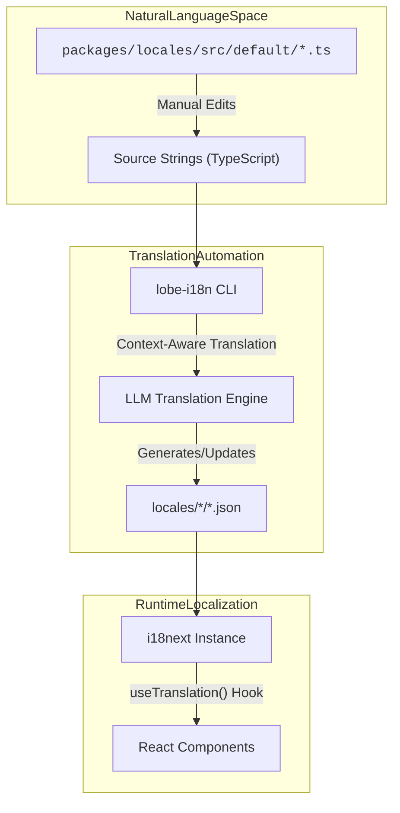
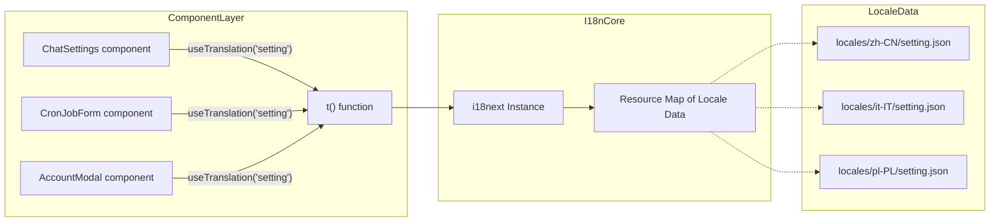

<!-- source: DeepWiki mcp.deepwiki.com · repo lobehub/lobehub · page 9.3 Localization and i18n · fetched 2026-10-29 -->

# Localization and i18n

Relevant source files

The following files were used as context for generating this wiki page:

- [.i18nrc.js](.i18nrc.js)
- [apps/desktop/src/main/controllers/CompletionSoundCtr.ts](apps/desktop/src/main/controllers/CompletionSoundCtr.ts)
- [apps/desktop/src/main/controllers/MenuCtr.ts](apps/desktop/src/main/controllers/MenuCtr.ts)
- [apps/desktop/src/main/controllers/NotificationCtr.mac.ts](apps/desktop/src/main/controllers/NotificationCtr.mac.ts)
- [apps/desktop/src/main/controllers/NotificationCtr.ts](apps/desktop/src/main/controllers/NotificationCtr.ts)
- [apps/desktop/src/main/controllers/ShortcutCtr.ts](apps/desktop/src/main/controllers/ShortcutCtr.ts)
- [apps/desktop/src/main/controllers/__tests__/CompletionSoundCtr.test.ts](apps/desktop/src/main/controllers/__tests__/CompletionSoundCtr.test.ts)
- [apps/desktop/src/main/controllers/__tests__/NotificationCtr.test.ts](apps/desktop/src/main/controllers/__tests__/NotificationCtr.test.ts)
- [apps/desktop/src/main/controllers/index.ts](apps/desktop/src/main/controllers/index.ts)
- [apps/desktop/src/main/controllers/notificationShared.ts](apps/desktop/src/main/controllers/notificationShared.ts)
- [locales/ar/components.json](locales/ar/components.json)
- [locales/ar/setting.json](locales/ar/setting.json)
- [locales/bg-BG/components.json](locales/bg-BG/components.json)
- [locales/de-DE/common.json](locales/de-DE/common.json)
- [locales/de-DE/components.json](locales/de-DE/components.json)
- [locales/de-DE/error.json](locales/de-DE/error.json)
- [locales/de-DE/setting.json](locales/de-DE/setting.json)
- [locales/en-US/components.json](locales/en-US/components.json)
- [locales/es-ES/common.json](locales/es-ES/common.json)
- [locales/es-ES/components.json](locales/es-ES/components.json)
- [locales/es-ES/error.json](locales/es-ES/error.json)
- [locales/es-ES/setting.json](locales/es-ES/setting.json)
- [locales/fr-FR/common.json](locales/fr-FR/common.json)
- [locales/fr-FR/components.json](locales/fr-FR/components.json)
- [locales/fr-FR/error.json](locales/fr-FR/error.json)
- [locales/fr-FR/setting.json](locales/fr-FR/setting.json)
- [locales/it-IT/common.json](locales/it-IT/common.json)
- [locales/it-IT/components.json](locales/it-IT/components.json)
- [locales/it-IT/error.json](locales/it-IT/error.json)
- [locales/it-IT/setting.json](locales/it-IT/setting.json)
- [locales/ja-JP/common.json](locales/ja-JP/common.json)
- [locales/ja-JP/components.json](locales/ja-JP/components.json)
- [locales/ja-JP/error.json](locales/ja-JP/error.json)
- [locales/ja-JP/setting.json](locales/ja-JP/setting.json)
- [locales/ko-KR/common.json](locales/ko-KR/common.json)
- [locales/ko-KR/components.json](locales/ko-KR/components.json)
- [locales/ko-KR/error.json](locales/ko-KR/error.json)
- [locales/ko-KR/setting.json](locales/ko-KR/setting.json)
- [locales/nl-NL/common.json](locales/nl-NL/common.json)
- [locales/nl-NL/components.json](locales/nl-NL/components.json)
- [locales/nl-NL/error.json](locales/nl-NL/error.json)
- [locales/nl-NL/setting.json](locales/nl-NL/setting.json)
- [locales/pl-PL/common.json](locales/pl-PL/common.json)
- [locales/pl-PL/components.json](locales/pl-PL/components.json)
- [locales/pl-PL/error.json](locales/pl-PL/error.json)
- [locales/pl-PL/setting.json](locales/pl-PL/setting.json)
- [locales/pt-BR/common.json](locales/pt-BR/common.json)
- [locales/pt-BR/error.json](locales/pt-BR/error.json)
- [locales/pt-BR/setting.json](locales/pt-BR/setting.json)
- [locales/ru-RU/common.json](locales/ru-RU/common.json)
- [locales/ru-RU/error.json](locales/ru-RU/error.json)
- [locales/ru-RU/setting.json](locales/ru-RU/setting.json)
- [locales/tr-TR/common.json](locales/tr-TR/common.json)
- [locales/tr-TR/error.json](locales/tr-TR/error.json)
- [locales/tr-TR/setting.json](locales/tr-TR/setting.json)
- [locales/vi-VN/components.json](locales/vi-VN/components.json)
- [locales/vi-VN/setting.json](locales/vi-VN/setting.json)
- [locales/zh-CN/components.json](locales/zh-CN/components.json)
- [locales/zh-TW/error.json](locales/zh-TW/error.json)
- [packages/electron-client-ipc/src/types/notification.ts](packages/electron-client-ipc/src/types/notification.ts)
- [packages/electron-mac-notifications/index.d.ts](packages/electron-mac-notifications/index.d.ts)
- [packages/electron-mac-notifications/index.js](packages/electron-mac-notifications/index.js)
- [packages/electron-mac-notifications/native/addon.mm](packages/electron-mac-notifications/native/addon.mm)
- [packages/locales/src/default/components.ts](packages/locales/src/default/components.ts)
- [packages/types/src/files/upload.ts](packages/types/src/files/upload.ts)
- [src/features/Conversation/Markdown/plugins/LocalFile/Render/index.tsx](src/features/Conversation/Markdown/plugins/LocalFile/Render/index.tsx)
- [src/features/Conversation/Messages/User/components/MessageContent.test.tsx](src/features/Conversation/Messages/User/components/MessageContent.test.tsx)
- [src/features/Conversation/Messages/User/components/MessageContent.tsx](src/features/Conversation/Messages/User/components/MessageContent.tsx)
- [src/features/Conversation/hooks/useStartTopicConversation.test.ts](src/features/Conversation/hooks/useStartTopicConversation.test.ts)
- [src/features/Conversation/hooks/useStartTopicConversation.ts](src/features/Conversation/hooks/useStartTopicConversation.ts)
- [src/features/LocalFile/LocalFile.tsx](src/features/LocalFile/LocalFile.tsx)
- [src/features/LocalFile/index.tsx](src/features/LocalFile/index.tsx)
- [src/features/Settings/notification/index.tsx](src/features/Settings/notification/index.tsx)
- [src/services/__tests__/upload.test.ts](src/services/__tests__/upload.test.ts)
- [src/services/electron/completionSound.test.ts](src/services/electron/completionSound.test.ts)
- [src/services/electron/desktopNotification.ts](src/services/electron/desktopNotification.ts)
- [src/services/upload.ts](src/services/upload.ts)
- [src/store/chat/slices/agentRun/actions/lifecycle/types.ts](src/store/chat/slices/agentRun/actions/lifecycle/types.ts)
- [src/store/chat/utils/desktopNotification.test.ts](src/store/chat/utils/desktopNotification.test.ts)
- [src/store/chat/utils/desktopNotification.ts](src/store/chat/utils/desktopNotification.ts)
- [src/store/file/slices/upload/action.test.ts](src/store/file/slices/upload/action.test.ts)
- [src/store/file/slices/upload/action.ts](src/store/file/slices/upload/action.ts)

LobeHub employs a comprehensive internationalization (i18n) system designed to support a global audience by enabling seamless multi-language translations and cultural adaptations. This system leverages TypeScript as a source of truth for localization keys and default values, combined with contextual automatic translation and React integration for runtime consumption.

---

## Architecture and Data Flow

The localization design centers around consistency, automation, and runtime efficiency. The core canonical locale data reside in TypeScript source files under the `packages/locales/src/default/` directory, with JSON files mapping each supported locale under the `locales/` directory.

### Workflow Steps

1. **Source Definition:**  
   Developers author and maintain the canonical strings as TypeScript files inside `packages/locales/src/default/*.ts` (e.g., `setting.ts`, `common.ts`) [packages/locales/src/default/components.ts:1-10]().

2. **Automatic Translation:**  
   The `lobe-i18n` tool automates translating these source strings into the supported target locales by updating corresponding JSON files (e.g., `locales/zh-CN/setting.json`, `locales/ko-KR/setting.json`) [locales/tr-TR/setting.json:1-10]().

3. **Runtime Consumption:**  
   At runtime, React components consume localized strings via i18n hooks that read from an `i18next` instance configured with the loaded JSON resources per locale [locales/ar/setting.json:1-10]().

### Supported Locales

- East Asian: `zh-CN`, `zh-TW`, `ja-JP`, `ko-KR` [locales/ko-KR/setting.json:1-15]()
- European: `en-US`, `fr-FR`, `de-DE`, `es-ES`, `it-IT`, `pl-PL`, `pt-BR`, `nl-NL` [locales/de-DE/setting.json:1-15]()
- Middle Eastern & Others: `ar`, `ru-RU`, `tr-TR`, `vi-VN` [locales/vi-VN/setting.json:1-15]()

### Diagram: Natural Language Space to Code Entity Space

*Figure 1: Data flow bridging natural language translation space to codebase entities.*

**Sources:**  
`packages/locales/src/default/components.ts` [1-10](),  
`locales/tr-TR/setting.json` [1-10](),  
`locales/ko-KR/setting.json` [1-15]()

---

## Locale File Structure and Namespace

Localization files are divided by functional namespaces to improve maintainability and clarity:

| Namespace | Description | TypeScript Source File |
| --------- | ----------- | --------------------- |
| `common`  | General UI elements and common labels | `packages/locales/src/default/common.ts` [packages/locales/src/default/components.ts:1-5]() |
| `chat`    | Chat-related UI elements and terminology | `packages/locales/src/default/chat.ts` [packages/locales/src/default/components.ts:1-5]() |
| `setting` | Settings, account management, subscriptions | `packages/locales/src/default/setting.ts` [packages/locales/src/default/components.ts:1-5]() |
| `model`   | AI Model and provider descriptions | `packages/locales/src/default/model.ts` [packages/locales/src/default/components.ts:1-5]() |
| `plugin`  | Plugin marketplace, tools, and execution strings | `packages/locales/src/default/plugin.ts` [packages/locales/src/default/components.ts:1-5]() |

Each namespace handles related keys specifically. For example, the `setting.json` namespace manages complex workflows like account deletion and agent cron job scheduling with well-structured keys [locales/tr-TR/setting.json:1-95]().

**Sources:**  
`packages/locales/src/default/components.ts` [1-5](),  
`locales/tr-TR/setting.json` [1-95]()

---

## The `lobe-i18n` Automatic Translation Workflow

`lobe-i18n` is a CLI-based automation tool configured via `.i18nrc.js` designed to maintain synchronization between the primary TypeScript source of i18n strings and their translations in multiple target languages. It leverages a large language model (LLM) engine for context-aware, high-quality translations [.i18nrc.js:1-20]().

### Features

- **Context Awareness:** Translates phrases considering usage context to improve accuracy on technical terms [locales/tr-TR/setting.json:48-65]().
- **Interpolation Handling:** Supports dynamic placeholders such as `{{hours}}`, `{{count}}`, or `{{name}}` to enable parameterized translations [locales/tr-TR/setting.json:21-95]().
- **Support for Nested Keys and UI Markup:** Enables complex UI rendering instructions in strings, including component placeholders for React [locales/tr-TR/setting.json:12-18]().

**Sources:**  
`.i18nrc.js` [1-20](),  
`locales/tr-TR/setting.json` [12-95]()

---

## Integration with Frontend Components

Frontend React components consume localization entries by calling the `useTranslation` hook scoped to namespaces. This hook internally retrieves the appropriate string from the `i18next` instance loaded for the active locale [locales/fr-FR/setting.json:1-20]().

### Diagram: Runtime Localization Data Flow

*Figure 2: Runtime resolution flow from React components to loaded JSON resources via i18next.*

### Handling Complex Translation Strings

- **Component Injection in Strings:**  
  Certain key-values embed HTML-like tags for improved UI formatting, such as bold or links within translations (e.g., `accountDeletion.confirmContent` uses `<0></0>` tags) [locales/tr-TR/setting.json:12-12]().

- **Enumerated Translations:**  
  Day names and other enums possess specific keys supporting localization (e.g., `agentCronJobs.weekday.short.monday`) [locales/ko-KR/setting.json:114-114]().

**Sources:**  
`locales/fr-FR/setting.json` [1-20](),  
`locales/tr-TR/setting.json` [12-12](),  
`locales/ko-KR/setting.json` [114-114]()

---

