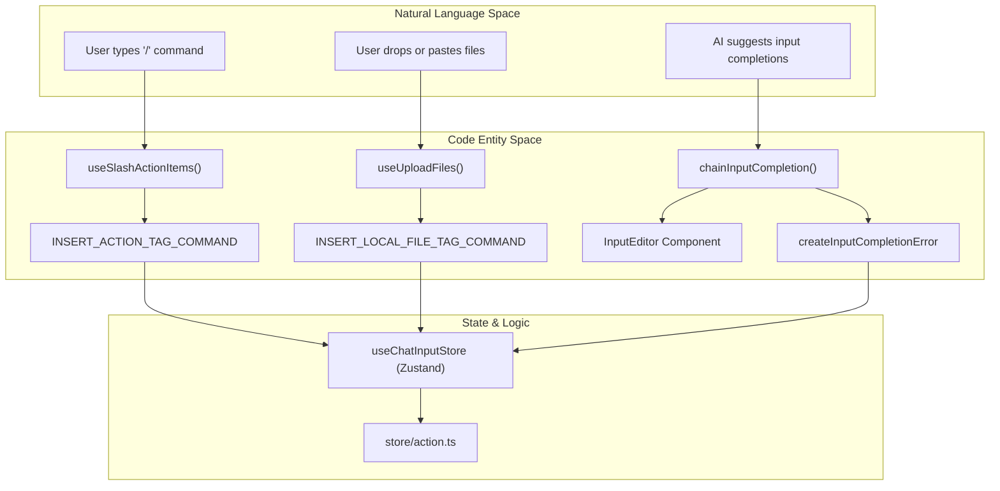
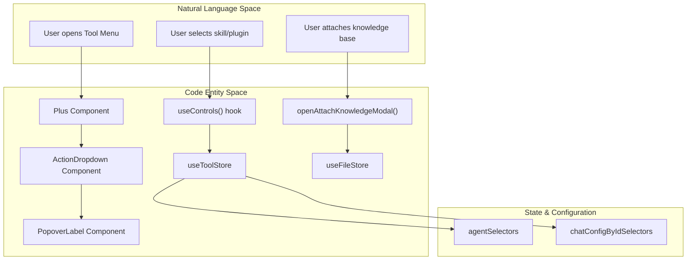
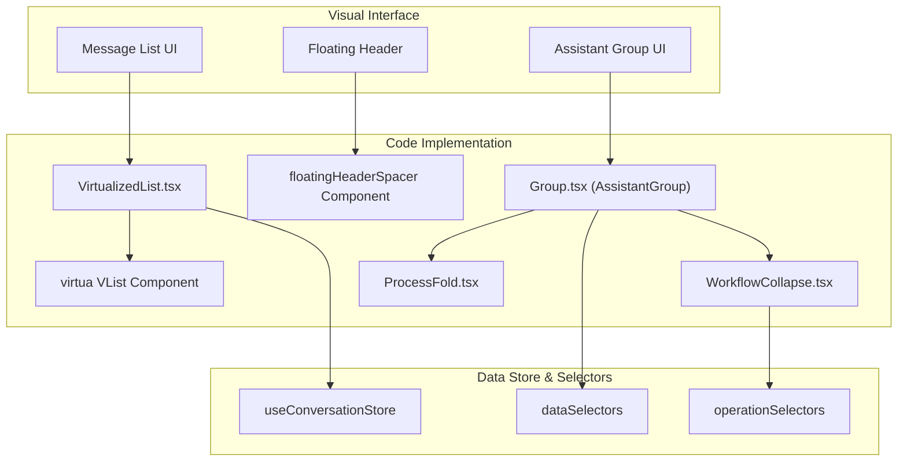

<!-- source: DeepWiki mcp.deepwiki.com · repo lobehub/lobehub · page 9.4 Chat Interface Components · fetched 2026-10-29 -->

# Chat Interface Components

Relevant source files

The following files were used as context for generating this wiki page:

- [.agents/skills/i18n/SKILL.md](.agents/skills/i18n/SKILL.md)
- [.agents/skills/zustand/SKILL.md](.agents/skills/zustand/SKILL.md)
- [e2e/src/features/home/chat-input.feature](e2e/src/features/home/chat-input.feature)
- [e2e/src/steps/home/chat-input.steps.ts](e2e/src/steps/home/chat-input.steps.ts)
- [e2e/src/support/seedTestUser.ts](e2e/src/support/seedTestUser.ts)
- [packages/heterogeneous-agents/src/askUser/AskUserBridge.test.ts](packages/heterogeneous-agents/src/askUser/AskUserBridge.test.ts)
- [packages/heterogeneous-agents/src/askUser/AskUserBridge.ts](packages/heterogeneous-agents/src/askUser/AskUserBridge.ts)
- [packages/heterogeneous-agents/src/askUser/constants.ts](packages/heterogeneous-agents/src/askUser/constants.ts)
- [packages/trpc/src/lambda/index.ts](packages/trpc/src/lambda/index.ts)
- [packages/trpc/src/middleware/databaseError.test.ts](packages/trpc/src/middleware/databaseError.test.ts)
- [packages/trpc/src/middleware/databaseError.ts](packages/trpc/src/middleware/databaseError.ts)
- [packages/trpc/src/middleware/upstreamError.test.ts](packages/trpc/src/middleware/upstreamError.test.ts)
- [packages/trpc/src/middleware/upstreamError.ts](packages/trpc/src/middleware/upstreamError.ts)
- [src/features/AgentBuilder/AgentBuilderConversation.tsx](src/features/AgentBuilder/AgentBuilderConversation.tsx)
- [src/features/AgentBuilder/AgentBuilderProvider.tsx](src/features/AgentBuilder/AgentBuilderProvider.tsx)
- [src/features/AgentSetting/AgentSettings.tsx](src/features/AgentSetting/AgentSettings.tsx)
- [src/features/ChatInput/ActionBar/Knowledge/useControls.tsx](src/features/ChatInput/ActionBar/Knowledge/useControls.tsx)
- [src/features/ChatInput/ActionBar/Plus/index.tsx](src/features/ChatInput/ActionBar/Plus/index.tsx)
- [src/features/ChatInput/ActionBar/Tools/ComposioServerItem.tsx](src/features/ChatInput/ActionBar/Tools/ComposioServerItem.tsx)
- [src/features/ChatInput/ActionBar/Tools/LobehubSkillServerItem.tsx](src/features/ChatInput/ActionBar/Tools/LobehubSkillServerItem.tsx)
- [src/features/ChatInput/ActionBar/Tools/PopoverContent.tsx](src/features/ChatInput/ActionBar/Tools/PopoverContent.tsx)
- [src/features/ChatInput/ActionBar/Tools/SkillRow.tsx](src/features/ChatInput/ActionBar/Tools/SkillRow.tsx)
- [src/features/ChatInput/ActionBar/Tools/ToolItem.tsx](src/features/ChatInput/ActionBar/Tools/ToolItem.tsx)
- [src/features/ChatInput/ActionBar/Tools/ToolsList.tsx](src/features/ChatInput/ActionBar/Tools/ToolsList.tsx)
- [src/features/ChatInput/ActionBar/Tools/constants.ts](src/features/ChatInput/ActionBar/Tools/constants.ts)
- [src/features/ChatInput/ActionBar/Tools/index.tsx](src/features/ChatInput/ActionBar/Tools/index.tsx)
- [src/features/ChatInput/ActionBar/Tools/useControls.tsx](src/features/ChatInput/ActionBar/Tools/useControls.tsx)
- [src/features/ChatInput/ActionBar/Upload/index.tsx](src/features/ChatInput/ActionBar/Upload/index.tsx)
- [src/features/ChatInput/ActionBar/Upload/useKnowledgeMenuItems.test.ts](src/features/ChatInput/ActionBar/Upload/useKnowledgeMenuItems.test.ts)
- [src/features/ChatInput/ActionBar/Upload/useKnowledgeMenuItems.tsx](src/features/ChatInput/ActionBar/Upload/useKnowledgeMenuItems.tsx)
- [src/features/ChatInput/ActionBar/components/ActionDropdown.tsx](src/features/ChatInput/ActionBar/components/ActionDropdown.tsx)
- [src/features/ChatInput/ActionBar/components/ActionPopover.tsx](src/features/ChatInput/ActionBar/components/ActionPopover.tsx)
- [src/features/ChatInput/ActionBar/components/menuCloseVeto.test.ts](src/features/ChatInput/ActionBar/components/menuCloseVeto.test.ts)
- [src/features/ChatInput/ActionBar/config.ts](src/features/ChatInput/ActionBar/config.ts)
- [src/features/ChatInput/ActionBar/index.tsx](src/features/ChatInput/ActionBar/index.tsx)
- [src/features/ChatInput/ChatInputProvider.tsx](src/features/ChatInput/ChatInputProvider.tsx)
- [src/features/ChatInput/Desktop/index.tsx](src/features/ChatInput/Desktop/index.tsx)
- [src/features/ChatInput/InputEditor/InputHistoryPopup.tsx](src/features/ChatInput/InputEditor/InputHistoryPopup.tsx)
- [src/features/ChatInput/InputEditor/Placeholder.tsx](src/features/ChatInput/InputEditor/Placeholder.tsx)
- [src/features/ChatInput/InputEditor/index.tsx](src/features/ChatInput/InputEditor/index.tsx)
- [src/features/ChatInput/SendArea/SendButton.tsx](src/features/ChatInput/SendArea/SendButton.tsx)
- [src/features/ChatInput/StoreUpdater.test.tsx](src/features/ChatInput/StoreUpdater.test.tsx)
- [src/features/ChatInput/StoreUpdater.tsx](src/features/ChatInput/StoreUpdater.tsx)
- [src/features/ChatInput/TypoBar/index.tsx](src/features/ChatInput/TypoBar/index.tsx)
- [src/features/ChatInput/draftStorage.test.ts](src/features/ChatInput/draftStorage.test.ts)
- [src/features/ChatInput/draftStorage.ts](src/features/ChatInput/draftStorage.ts)
- [src/features/ChatInput/hooks/useChatInputDraft.test.tsx](src/features/ChatInput/hooks/useChatInputDraft.test.tsx)
- [src/features/ChatInput/hooks/useChatInputDraft.ts](src/features/ChatInput/hooks/useChatInputDraft.ts)
- [src/features/ChatInput/hooks/useChatInputHistory.test.ts](src/features/ChatInput/hooks/useChatInputHistory.test.ts)
- [src/features/ChatInput/hooks/useChatInputHistory.ts](src/features/ChatInput/hooks/useChatInputHistory.ts)
- [src/features/ChatInput/inputHistoryStorage.test.ts](src/features/ChatInput/inputHistoryStorage.test.ts)
- [src/features/ChatInput/inputHistoryStorage.ts](src/features/ChatInput/inputHistoryStorage.ts)
- [src/features/ChatInput/store/action.test.ts](src/features/ChatInput/store/action.test.ts)
- [src/features/ChatInput/store/action.ts](src/features/ChatInput/store/action.ts)
- [src/features/ChatInput/store/initialState.ts](src/features/ChatInput/store/initialState.ts)
- [src/features/Conversation/ChatInput/index.tsx](src/features/Conversation/ChatInput/index.tsx)
- [src/features/Conversation/ChatInput/utils.test.ts](src/features/Conversation/ChatInput/utils.test.ts)
- [src/features/Conversation/ChatInput/utils.ts](src/features/Conversation/ChatInput/utils.ts)
- [src/features/Conversation/ChatList/index.tsx](src/features/Conversation/ChatList/index.tsx)
- [src/features/Conversation/ConversationProvider.test.tsx](src/features/Conversation/ConversationProvider.test.tsx)
- [src/features/Conversation/ConversationProvider.tsx](src/features/Conversation/ConversationProvider.tsx)
- [src/features/Conversation/Messages/CompressedGroup/index.tsx](src/features/Conversation/Messages/CompressedGroup/index.tsx)
- [src/features/Conversation/Messages/CompressedGroup/useGroupPreferences.test.ts](src/features/Conversation/Messages/CompressedGroup/useGroupPreferences.test.ts)
- [src/features/Conversation/Messages/CompressedGroup/useGroupPreferences.ts](src/features/Conversation/Messages/CompressedGroup/useGroupPreferences.ts)
- [src/features/Conversation/StoreUpdater.tsx](src/features/Conversation/StoreUpdater.tsx)
- [src/features/Conversation/store/action.ts](src/features/Conversation/store/action.ts)
- [src/features/Conversation/store/initialState.ts](src/features/Conversation/store/initialState.ts)
- [src/features/Conversation/store/slices/data/action.test.ts](src/features/Conversation/store/slices/data/action.test.ts)
- [src/features/Conversation/store/slices/data/action.ts](src/features/Conversation/store/slices/data/action.ts)
- [src/features/Conversation/store/slices/data/initialState.ts](src/features/Conversation/store/slices/data/initialState.ts)
- [src/features/Conversation/store/slices/message/action/sendMessage.ts](src/features/Conversation/store/slices/message/action/sendMessage.ts)
- [src/features/Conversation/store/slices/message/action/state.test.ts](src/features/Conversation/store/slices/message/action/state.test.ts)
- [src/features/Conversation/store/slices/message/action/state.ts](src/features/Conversation/store/slices/message/action/state.ts)
- [src/features/Home/InputArea/EditorInput.tsx](src/features/Home/InputArea/EditorInput.tsx)
- [src/features/Home/InputArea/index.tsx](src/features/Home/InputArea/index.tsx)
- [src/features/Home/InputArea/taskAttachments.test.ts](src/features/Home/InputArea/taskAttachments.test.ts)
- [src/features/Home/InputArea/taskAttachments.ts](src/features/Home/InputArea/taskAttachments.ts)
- [src/features/Home/InputArea/useSend.test.ts](src/features/Home/InputArea/useSend.test.ts)
- [src/features/Home/InputArea/useSend.ts](src/features/Home/InputArea/useSend.ts)
- [src/features/PageEditor/Copilot/Conversation.tsx](src/features/PageEditor/Copilot/Conversation.tsx)
- [src/features/PageEditor/PageAgentProvider.test.tsx](src/features/PageEditor/PageAgentProvider.test.tsx)
- [src/features/PageEditor/PageAgentProvider.tsx](src/features/PageEditor/PageAgentProvider.tsx)
- [src/features/Portal/Thread/Chat/index.tsx](src/features/Portal/Thread/Chat/index.tsx)
- [src/features/ProfileEditor/AgentTool.tsx](src/features/ProfileEditor/AgentTool.tsx)
- [src/features/ProfileEditor/AgentUserTools/AgentToolsSection.tsx](src/features/ProfileEditor/AgentUserTools/AgentToolsSection.tsx)
- [src/features/ProfileEditor/AgentUserTools/UserToolsSection.test.tsx](src/features/ProfileEditor/AgentUserTools/UserToolsSection.test.tsx)
- [src/features/ProfileEditor/AgentUserTools/UserToolsSection.tsx](src/features/ProfileEditor/AgentUserTools/UserToolsSection.tsx)
- [src/features/ProfileEditor/PluginTag.tsx](src/features/ProfileEditor/PluginTag.tsx)
- [src/features/ProfileEditor/PopoverContent.tsx](src/features/ProfileEditor/PopoverContent.tsx)
- [src/features/ProfileEditor/profileToolVisibility.test.ts](src/features/ProfileEditor/profileToolVisibility.test.ts)
- [src/features/ProfileEditor/profileToolVisibility.ts](src/features/ProfileEditor/profileToolVisibility.ts)
- [src/features/Settings/chat-appearance/features/ChatAppearance/MermaidPreview.tsx](src/features/Settings/chat-appearance/features/ChatAppearance/MermaidPreview.tsx)
- [src/hooks/useInterceptingRoutes.test.ts](src/hooks/useInterceptingRoutes.test.ts)
- [src/hooks/useInterceptingRoutes.ts](src/hooks/useInterceptingRoutes.ts)
- [src/libs/i18n/serverTranslation.test.ts](src/libs/i18n/serverTranslation.test.ts)
- [src/libs/i18n/serverTranslation.ts](src/libs/i18n/serverTranslation.ts)
- [src/routes/(main)/agent/(chat)/topicListLoader.test.ts](src/routes/(main)/agent/(chat)/topicListLoader.test.ts)
- [src/routes/(main)/agent/(chat)/topicListLoader.ts](src/routes/(main)/agent/(chat)/topicListLoader.ts)
- [src/routes/(main)/agent/features/Conversation/ConversationArea.tsx](src/routes/(main)/agent/features/Conversation/ConversationArea.tsx)
- [src/routes/(main)/agent/features/Conversation/Header/Tags/ThreadSwitcher.tsx](src/routes/(main)/agent/features/Conversation/Header/Tags/ThreadSwitcher.tsx)
- [src/routes/(main)/agent/features/Conversation/Header/Tags/index.tsx](src/routes/(main)/agent/features/Conversation/Header/Tags/index.tsx)
- [src/routes/(main)/agent/profile/features/ProfileEditor/AgentTool.tsx](src/routes/(main)/agent/profile/features/ProfileEditor/AgentTool.tsx)
- [src/routes/(main)/group/features/Conversation/ConversationArea.tsx](src/routes/(main)/group/features/Conversation/ConversationArea.tsx)
- [src/routes/(main)/group/profile/features/AgentBuilder/AgentBuilderConversation.tsx](src/routes/(main)/group/profile/features/AgentBuilder/AgentBuilderConversation.tsx)
- [src/routes/(main)/group/profile/features/MemberProfile/AgentTool.tsx](src/routes/(main)/group/profile/features/MemberProfile/AgentTool.tsx)
- [src/services/message/cache.test.ts](src/services/message/cache.test.ts)
- [src/services/message/cache.ts](src/services/message/cache.ts)
- [src/store/chat/slices/message/action.test.ts](src/store/chat/slices/message/action.test.ts)
- [src/store/chat/slices/message/actions/internals.ts](src/store/chat/slices/message/actions/internals.ts)
- [src/store/chat/slices/message/actions/query.ts](src/store/chat/slices/message/actions/query.ts)
- [src/store/chat/slices/message/initialState.ts](src/store/chat/slices/message/initialState.ts)
- [src/store/chat/slices/message/replaceMessages.orphanTool.regression.test.ts](src/store/chat/slices/message/replaceMessages.orphanTool.regression.test.ts)
- [src/store/chat/slices/message/utils/reconcileTools.ts](src/store/chat/slices/message/utils/reconcileTools.ts)
- [src/store/chat/slices/operation/__tests__/actions.test.ts](src/store/chat/slices/operation/__tests__/actions.test.ts)
- [src/store/chat/slices/operation/actions.ts](src/store/chat/slices/operation/actions.ts)
- [src/store/chat/slices/plugin/action.test.ts](src/store/chat/slices/plugin/action.test.ts)
- [src/store/chat/utils/messageMapKey.test.ts](src/store/chat/utils/messageMapKey.test.ts)
- [src/store/chat/utils/messageMapKey.ts](src/store/chat/utils/messageMapKey.ts)
- [src/store/serverConfig/selectors.test.ts](src/store/serverConfig/selectors.test.ts)
- [src/store/tool/slices/builtin/selectors.test.ts](src/store/tool/slices/builtin/selectors.test.ts)
- [src/store/tool/slices/builtin/selectors.ts](src/store/tool/slices/builtin/selectors.ts)
- [src/utils/machineErrorMessage.test.ts](src/utils/machineErrorMessage.test.ts)
- [src/utils/machineErrorMessage.ts](src/utils/machineErrorMessage.ts)

The chat interface components in LobeHub form a comprehensive and performant React UI layer designed to facilitate seamless interaction with AI agents, including sophisticated support for streaming responses, multi-turn workflows, heterogeneous agents, and rich media. This page details the implementation, data flow, and key classes/functions of the core chat UI elements:

- Session and topic sidebar navigation  
- Conversation view with a virtualized message list (`ChatList`, `VirtualizedList`)  
- Working sidebar for resource and workflow tracking  
- Chat input editor (`InputEditor`, Lexical framework, auto-completion, mentions)  
- Chat action bar and interaction controls (`ActionBar`, tool controls)  

---

## 1. Chat Input System and Editor

The chat input system is a feature-rich markdown editor built atop the Lexical editor framework (`@lobehub/editor`), extended with AI auto-completion, slash commands, mentions, file uploads, and input history navigation [src/features/ChatInput/InputEditor/index.tsx:11-13]().

### 1.1 Implementation and Data Flow

- **Input Store (`useChatInputStore`)**: Manages local UI state for the composer, holding the Lexical editor instance, slash menu references, draft content, and feature flags [src/features/ChatInput/InputEditor/index.tsx:90-112](). This isolation ensures high typing responsiveness independent of global message stores.
- **`InputEditor` Component**: Integrates the Lexical editor state (`useEditorState`), IME composition handlers (`useIMECompositionEvent`), hotkey bindings, and placeholder management [src/features/ChatInput/InputEditor/index.tsx:18-128]().
- **AI Auto-Completion**: Relies on `chainInputCompletion` from `@lobechat/prompts` via the `ReactAutoCompletePlugin`, monitoring typing patterns and slash-triggered completions [src/features/ChatInput/InputEditor/index.tsx:5-12]().
- **Mentions & Fuzzy Search**: Implements category-based mentions using Fuse.js fuzzy matching (`Fuse`) across agent and resource items [src/features/ChatInput/InputEditor/index.tsx:144-175]().
- **Draft & History**: Persistent draft storage via `useChatInputDraft` and scoped input history navigation (`useChatInputHistory`) allow quick recall of previous inputs with placeholder preview support [src/features/ChatInput/InputEditor/index.tsx:41-42, 115-141]().
- **Desktop Wrapper (`DesktopChatInput`)**: Arranges the input editor alongside the action bar, control bar (`ControlBar`), and typo bar on desktop viewports [src/features/ChatInput/Desktop/index.tsx:113-133]().

Sources:  
[src/features/ChatInput/InputEditor/index.tsx:4-178](),  
[src/features/ChatInput/Desktop/index.tsx:113-133](),  
[src/features/ChatInput/ChatInputProvider.tsx:14-33]()

---

## 2. Chat Action Bar and Tool Controls

The action bar overlays the input area, supplying buttons for attachment uploads, plugin management, and tool configurations.

### 2.1 Action Bar Structure and Plus Menu

- **`ActionBar` Component**: Hosts action items, drop zones, and extension slots [src/features/ChatInput/ActionBar/index.tsx:10-60]().
- **Plus Menu (`Plus`)**: Provides an action dropdown (`ActionDropdown`) to attach knowledge bases, tools, skills, and goals (`insertGoalTag`) [src/features/ChatInput/ActionBar/Plus/index.tsx:45-52](). It uses `PopoverLabel` to anchor tool detail popovers without dismissing the active menu [src/features/ChatInput/ActionBar/Plus/index.tsx:157-192]().
- **Tool Controls (`useControls`)**: Manages skill policy modes (`pinned`, `auto`, `disabled`), MCP servers, and third-party integrations (e.g., Composio, LobeHub skills) [src/features/ChatInput/ActionBar/Tools/useControls.tsx:82-130]().

Sources:  
[src/features/ChatInput/ActionBar/Plus/index.tsx:45-228](),  
[src/features/ChatInput/ActionBar/Tools/useControls.tsx:82-140]()

---

## 3. Conversation View and Virtualized Message List

The conversation view renders message histories, scaling across thousands of messages using virtualization and precise offset tracking.

### 3.1 Virtualized List Implementation (`VirtualizedList`)

- **Virtua Integration**: Leverages `virtua` to render performant scrollable message lists with sticky headers and scroll position persistence per conversation context [src/features/Conversation/ChatList/components/VirtualizedList.tsx:54-181]().
- **Transcript Management (`ChatList`)**: Synchronizes with the chat store transcript, handling streaming updates, pending interventions (`hasPendingInterventions`), and background run hints [src/features/Conversation/ChatList/index.tsx:128-152]().
- **Message Rendering (`MessageItem`)**: Routes messages to role-specific renderers like `UserMessage`, `AssistantMessage`, or `AssistantGroup` [src/features/Conversation/Messages/index.tsx:145-200]().
- **Assistant Workflow Grouping (`AssistantGroup`)**: Manages workflow collapse states (`WorkflowCollapse`), tool-call execution lists, and process folding [src/features/Conversation/Messages/AssistantGroup/components/Group.tsx:30-90]().

Sources:  
[src/features/Conversation/ChatList/index.tsx:128-156](),  
[src/features/Conversation/ChatList/components/VirtualizedList.tsx:54-181](),  
[src/features/Conversation/Messages/index.tsx:145-200]()

---

## 4. Working Sidebar and Heterogeneous Agent Workflow

LobeHub includes a `WorkingSidebar` to track tasks, file attachments, and heterogeneous runtime integrations.

### 4.1 Heterogeneous Agent Integration

- **Agent Routing (`ConversationArea`)**: Conditionally switches chat input variants [src/routes/(main)/agent/features/Conversation/ConversationArea.tsx:30-90](). For heterogeneous agents (such as Claude Code via `HeterogeneousChatInput`), external runtimes manage local tools and context [src/routes/(main)/agent/features/Conversation/ConversationArea.tsx:79-84]().
- **State Synchronization (`OperationActionsImpl`)**: Manages active run operations, auto-retry states, and conversation context switching [src/store/chat/slices/operation/actions.ts:69-118]().
- **Transcript Syncing (`dataSlice`)**: Mirrors chat store buckets into the conversation store for high-performance rendering without stale references [src/features/Conversation/store/slices/data/action.ts:24-43]().

Sources:  
[src/routes/(main)/agent/features/Conversation/ConversationArea.tsx:30-90](),  
[src/store/chat/slices/operation/actions.ts:69-118](),  
[src/features/Conversation/store/slices/data/action.ts:24-43]()

---

# References

- `src/features/ChatInput/InputEditor/index.tsx` [lines 1-178]()  
- `src/features/ChatInput/Desktop/index.tsx` [lines 113-133]()  
- `src/features/ChatInput/ActionBar/Plus/index.tsx` [lines 45-228]()  
- `src/features/ChatInput/ActionBar/Tools/useControls.tsx` [lines 82-140]()  
- `src/features/Conversation/ChatList/index.tsx` [lines 128-156]()  
- `src/features/Conversation/ChatList/components/VirtualizedList.tsx` [lines 54-181]()  
- `src/routes/(main)/agent/features/Conversation/ConversationArea.tsx` [lines 30-90]()  
- `src/store/chat/slices/operation/actions.ts` [lines 69-118]()  
- `src/features/Conversation/store/slices/data/action.ts` [lines 24-43]()

---

