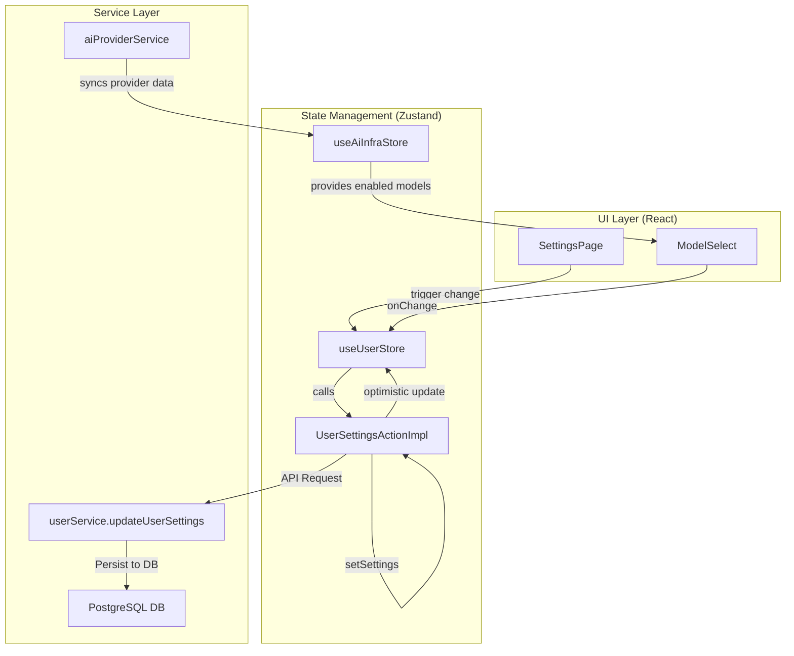
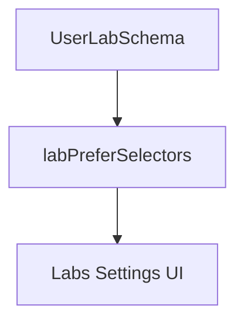
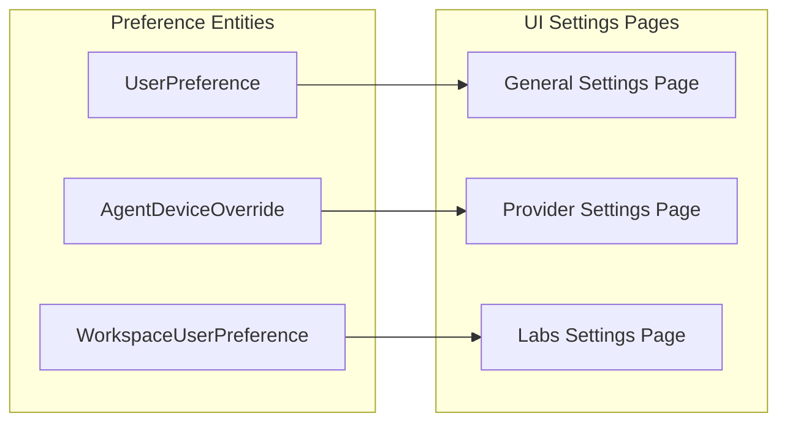

<!-- source: DeepWiki mcp.deepwiki.com · repo lobehub/lobehub · page 9.5 Settings and Configuration UI · fetched 2026-10-29 -->

# Settings and Configuration UI

Relevant source files

The following files were used as context for generating this wiki page:

- [locales/en-US/labs.json](locales/en-US/labs.json)
- [locales/en-US/setting.json](locales/en-US/setting.json)
- [locales/zh-CN/labs.json](locales/zh-CN/labs.json)
- [locales/zh-CN/setting.json](locales/zh-CN/setting.json)
- [packages/const/src/user.ts](packages/const/src/user.ts)
- [packages/heterogeneous-agents/src/spawn/input/buildAgentInput.test.ts](packages/heterogeneous-agents/src/spawn/input/buildAgentInput.test.ts)
- [packages/heterogeneous-agents/src/spawn/input/buildAgentInput.ts](packages/heterogeneous-agents/src/spawn/input/buildAgentInput.ts)
- [packages/locales/src/default/labs.ts](packages/locales/src/default/labs.ts)
- [packages/locales/src/default/setting.ts](packages/locales/src/default/setting.ts)
- [packages/types/src/user/preference.ts](packages/types/src/user/preference.ts)
- [src/components/ModelSelect/index.tsx](src/components/ModelSelect/index.tsx)
- [src/features/ChatInput/VoiceMessage/index.tsx](src/features/ChatInput/VoiceMessage/index.tsx)
- [src/features/ChatInput/VoiceMessage/useVoiceMessageCapability.test.ts](src/features/ChatInput/VoiceMessage/useVoiceMessageCapability.test.ts)
- [src/features/ChatInput/VoiceMessage/useVoiceMessageCapability.ts](src/features/ChatInput/VoiceMessage/useVoiceMessageCapability.ts)
- [src/features/ChatInput/hooks/effectiveAgentModePreference.ts](src/features/ChatInput/hooks/effectiveAgentModePreference.ts)
- [src/features/Conversation/ChatInput/voiceMessageCapability.test.ts](src/features/Conversation/ChatInput/voiceMessageCapability.test.ts)
- [src/features/Conversation/ChatInput/voiceMessageCapability.ts](src/features/Conversation/ChatInput/voiceMessageCapability.ts)
- [src/features/ModelSwitchPanel/components/List/GenerationListItemRenderer.tsx](src/features/ModelSwitchPanel/components/List/GenerationListItemRenderer.tsx)
- [src/features/ModelSwitchPanel/components/List/GenerationMultipleProvidersItem.tsx](src/features/ModelSwitchPanel/components/List/GenerationMultipleProvidersItem.tsx)
- [src/features/ModelSwitchPanel/components/List/ListItemRenderer.tsx](src/features/ModelSwitchPanel/components/List/ListItemRenderer.tsx)
- [src/features/ModelSwitchPanel/components/List/MultipleProvidersModelItem.tsx](src/features/ModelSwitchPanel/components/List/MultipleProvidersModelItem.tsx)
- [src/features/ModelSwitchPanel/components/List/__tests__/MultipleProvidersModelItem.test.tsx](src/features/ModelSwitchPanel/components/List/__tests__/MultipleProvidersModelItem.test.tsx)
- [src/features/ModelSwitchPanel/components/List/index.tsx](src/features/ModelSwitchPanel/components/List/index.tsx)
- [src/features/ModelSwitchPanel/components/ModelDetailPanel.tsx](src/features/ModelSwitchPanel/components/ModelDetailPanel.tsx)
- [src/features/ModelSwitchPanel/components/PanelContent.tsx](src/features/ModelSwitchPanel/components/PanelContent.tsx)
- [src/features/ModelSwitchPanel/const.ts](src/features/ModelSwitchPanel/const.ts)
- [src/features/ModelSwitchPanel/hooks/useBuildListItems.test.ts](src/features/ModelSwitchPanel/hooks/useBuildListItems.test.ts)
- [src/features/ModelSwitchPanel/hooks/useBuildListItems.ts](src/features/ModelSwitchPanel/hooks/useBuildListItems.ts)
- [src/features/ModelSwitchPanel/hooks/usePanelHandlers.test.ts](src/features/ModelSwitchPanel/hooks/usePanelHandlers.test.ts)
- [src/features/ModelSwitchPanel/hooks/usePanelHandlers.ts](src/features/ModelSwitchPanel/hooks/usePanelHandlers.ts)
- [src/features/ModelSwitchPanel/hooks/usePanelWidthConstraints.test.ts](src/features/ModelSwitchPanel/hooks/usePanelWidthConstraints.test.ts)
- [src/features/ModelSwitchPanel/hooks/usePanelWidthConstraints.ts](src/features/ModelSwitchPanel/hooks/usePanelWidthConstraints.ts)
- [src/features/ModelSwitchPanel/index.tsx](src/features/ModelSwitchPanel/index.tsx)
- [src/features/ModelSwitchPanel/styles.ts](src/features/ModelSwitchPanel/styles.ts)
- [src/features/ModelSwitchPanel/types.ts](src/features/ModelSwitchPanel/types.ts)
- [src/features/ModelSwitchPanel/utils.ts](src/features/ModelSwitchPanel/utils.ts)
- [src/features/Settings/labs/features.ts](src/features/Settings/labs/features.ts)
- [src/features/Settings/labs/index.test.tsx](src/features/Settings/labs/index.test.tsx)
- [src/hooks/useMediaUploadAbility.test.ts](src/hooks/useMediaUploadAbility.test.ts)
- [src/hooks/useMediaUploadAbility.ts](src/hooks/useMediaUploadAbility.ts)
- [src/store/user/slices/preference/selectors.test.ts](src/store/user/slices/preference/selectors.test.ts)
- [src/store/user/slices/preference/selectors/labPrefer.ts](src/store/user/slices/preference/selectors/labPrefer.ts)

LobeHub provides an extensive settings and configuration UI allowing users to manage AI model providers, agent configurations, text-to-speech settings, system agents, experimental features (Labs), and model selection interfaces. This page details the implementation, data flow, and key components that compose this UI.

The settings architecture is built using React and Next.js, with state managed largely via Zustand slices (`useUserStore`, `useAiInfraStore`, etc.), and backend persistence performed through API services like `userService`. The UI is localized and supports advanced preferences scoped per user and workspace.

---

## Architecture Overview

The settings UI uses optimistic update flows: user interactions immediately update the local Zustand store while asynchronously syncing with backend services. This approach ensures a responsive UX with eventual consistency.

Data flows through distinct layers:

- **UI Layer:** React components such as SettingsPage, ModelSelect, ModelSwitchPanel render controls and capture user events.
- **State Management:** Zustand slices managing user preferences (`useUserStore`) and AI infrastructure state (`useAiInfraStore`).
- **Service Layer:** API service calls to persist settings to the database.

Sources: [src/store/user/slices/settings/action.ts:89-194](), [src/store/aiInfra/slices/aiProvider/action.ts:19-20]()

---

## AI Provider and Model Configuration

Management of AI providers and their models is centralized in the `useAiInfraStore` Zustand slice. This slice maintains the list of available AI providers and their individual model configurations, including feature flags like vision, files, function calls, audio, and video capabilities.

### Model Selection and Representation

- **ModelSelect Component:** A dropdown UI allowing users to select models from enabled providers. It shows model metadata, provider logos, usage tags, and contextual information [src/components/ModelSelect/index.tsx:1-237]().
- **ModelInfoTags:** Renders icons and tags that represent model abilities, such as file support, image output, video, audio, and function call features [src/components/ModelSelect/index.tsx:58-180]().
- **ModelSwitchPanel:** A menu-based UI that allows quick switching between available models and providers with support for showing pricing modes, ability badges, and new/pro labels [src/features/ModelSwitchPanel/index.tsx:16-65]().

### Multi-Provider Model Handling

Models that exist on multiple providers (e.g., Llama 3 offered by several providers) are rendered with the `MultipleProvidersModelItem` component which provides a submenu to pick among matching providers, showing restriction status and additional labels [src/features/ModelSwitchPanel/components/List/MultipleProvidersModelItem.tsx:42-170]().

### Component Summary

| Component                       | Responsibility                                                | Source File / Lines                    |
|--------------------------------|---------------------------------------------------------------|--------------------------------------|
| `ModelSelect`                  | Model selection dropdown, displays model abilities and info  | src/components/ModelSelect/index.tsx:1-237 |
| `ModelInfoTags`                | Displays model ability icons (files, vision, audio, etc.)    | src/components/ModelSelect/index.tsx:58-180 |
| `ModelSwitchPanel`             | Dropdown menu to switch models with provider and pricing     | src/features/ModelSwitchPanel/index.tsx:16-65 |
| `MultipleProvidersModelItem`   | Renders multi-provider models with provider sub-selection    | src/features/ModelSwitchPanel/components/List/MultipleProvidersModelItem.tsx:42-170 |

Sources: [src/components/ModelSelect/index.tsx:1-237](), [src/features/ModelSwitchPanel/index.tsx:16-65](), [src/features/ModelSwitchPanel/components/List/MultipleProvidersModelItem.tsx:42-170]()

---

## Experimental Features ("Labs") Configuration

LobeHub includes an experimental Labs settings section exposing feature flags for alpha and beta capabilities.

### Labs Schema and Preferences

- Defined by `UserLabSchema` in TypeScript, containing boolean flags for each experimental feature [packages/types/src/user/preference.ts:155-168]().
- Preferences are selected from the store via `labPreferSelectors` which provide default fallbacks [src/store/user/slices/preference/selectors/labPrefer.ts:1-38]().
- Examples of experimental features:
  - Agent Graph runtime configuration (`enableAgentGraphConfig`)
  - Artifact deployment feature (`enableArtifactDeployment`)
  - Claude Code SDK integration (`enableClaudeCodeSdk`)
  - Task delivery verification UI (`enableTaskVerify`)

### Labs Feature Stability Labels

Localized labels in `packages/locales/src/default/labs.ts`, `locales/en-US/labs.json`, and `locales/zh-CN/labs.json` define the status and descriptions of labs features, e.g., Alpha and Beta stages [packages/locales/src/default/labs.ts:1-78](), [locales/en-US/labs.json:1-54](), [locales/zh-CN/labs.json:1-54]().

Sources: [packages/types/src/user/preference.ts:155-168](), [src/store/user/slices/preference/selectors/labPrefer.ts:1-38](), [packages/locales/src/default/labs.ts:1-78](), [locales/en-US/labs.json:1-54](), [locales/zh-CN/labs.json:1-54]()

---

## User Preferences and Localization (i18n)

User preferences are stored and persisted in user-specific and workspace-scoped DB tables, with rich interfaces for lifecycle management and localization.

### Major Preference Data Structures

- **`UserPreference`** stores general user settings, including guides, lab flags, and topic display modes [packages/const/src/user.ts:5-20]().
- **`WorkspaceUserPreference`** stores per-user-per-workspace preferences such as agent device overrides and notification settings [packages/types/src/user/preference.ts:65-123]().
- **Agent device execution targets** can be overridden at workspace membership level, allowing independent choice of execution environment (Cloud Sandbox, local machine, etc.) [packages/types/src/user/preference.ts:29-34]().

### Localization

Settings UI strings are maintained in default locale files:

- `packages/locales/src/default/setting.ts` provides base keys/values [packages/locales/src/default/setting.ts:1-107]().
- Localized JSON files under `locales/{locale}/setting.json` provide translations with extensive keys for account deletion, cron jobs, advanced agent configurations, and more [locales/en-US/setting.json:1-101](), [locales/zh-CN/setting.json:1-143]().

### Key User Settings in UI

- **Account Deletion UI:** Provides a safe deletion process with a cooling-off period, user feedback, and workspace ownership checks [locales/en-US/setting.json:4-44]().
- **Agent Scheduled Tasks (Cron Jobs):** Users can automate agents via cron expressions for recurrent task execution [locales/en-US/setting.json:48-101]().
- **Sidebar Preferences:** Users can hide or reorder sidebar sections; see `SidebarLayoutPreference` [packages/types/src/user/preference.ts:58-63]().

### Preference to UI Mapping Diagram

Sources: [packages/types/src/user/preference.ts:29-123](), [packages/const/src/user.ts:5-20](), [locales/en-US/setting.json:1-101](), [locales/zh-CN/setting.json:1-143](), [packages/locales/src/default/setting.ts:1-107]()

---

# Summary

The Settings and Configuration UI in LobeHub integrates multiple complex domains:

- **LLM Provider and Model Settings:** Using `useAiInfraStore`, `ModelSelect`, and `ModelSwitchPanel` for provider and model management.
- **Agent and Execution Overrides:** Via workspace-scoped workspace user preferences to customize agent execution targets.
- **Text-to-Speech and System Agents:** Settings configured via dedicated preference stores and localized UI entries.
- **Labs Experimental Features:** Flagged in preferences (`UserLabSchema`), exposed as toggleable UI with alpha/beta status.
- **Localization and User Lifecycle:** Multi-language support and full account control flows including deletion and scheduled automation.

This setup enables flexible, extensible configuration management, optimized for user convenience and advanced agent tailoring.

---

# References

- `src/store/user/slices/settings/action.ts` lines 89-194  
- `src/store/aiInfra/slices/aiProvider/action.ts` lines 19-20  
- `src/components/ModelSelect/index.tsx` lines 1-237  
- `src/features/ModelSwitchPanel/index.tsx` lines 16-65  
- `src/features/ModelSwitchPanel/components/List/MultipleProvidersModelItem.tsx` lines 42-170  
- `packages/types/src/user/preference.ts` lines 29-168  
- `src/store/user/slices/preference/selectors/labPrefer.ts` lines 1-38  
- `packages/locales/src/default/setting.ts` lines 1-107  
- `locales/en-US/setting.json` lines 1-101  
- `locales/zh-CN/setting.json` lines 1-143  
- `locales/en-US/labs.json` lines 1-54  
- `locales/zh-CN/labs.json` lines 1-54  
- `packages/locales/src/default/labs.ts` lines 1-78  
- `packages/const/src/user.ts` lines 5-20

---

