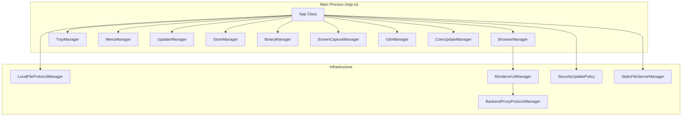
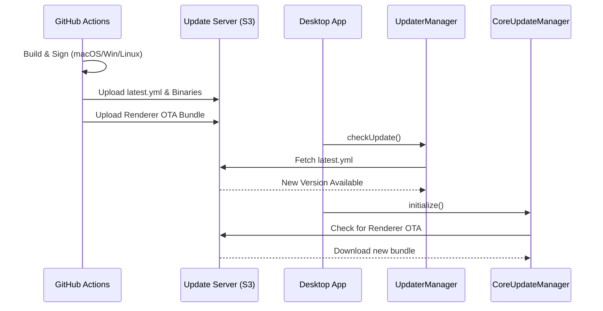

<!-- source: DeepWiki mcp.deepwiki.com · repo lobehub/lobehub · page 9.7 Progressive Web App and Desktop Shell · fetched 2026-10-29 -->

# Progressive Web App and Desktop Shell

Relevant source files

The following files were used as context for generating this wiki page:

- [.github/actions/desktop-build-setup/action.yml](.github/actions/desktop-build-setup/action.yml)
- [.github/actions/desktop-publish-s3/action.yml](.github/actions/desktop-publish-s3/action.yml)
- [.github/actions/desktop-upload-artifacts/action.yml](.github/actions/desktop-upload-artifacts/action.yml)
- [.github/workflows/manual-build-desktop.yml](.github/workflows/manual-build-desktop.yml)
- [.github/workflows/pr-build-desktop.yml](.github/workflows/pr-build-desktop.yml)
- [.github/workflows/pr-build-docker.yml](.github/workflows/pr-build-docker.yml)
- [.github/workflows/release-desktop-beta.yml](.github/workflows/release-desktop-beta.yml)
- [.github/workflows/release-desktop-canary.yml](.github/workflows/release-desktop-canary.yml)
- [.github/workflows/release-desktop-stable.yml](.github/workflows/release-desktop-stable.yml)
- [.github/workflows/release-docker.yml](.github/workflows/release-docker.yml)
- [apps/cli/src/tools/file.ts](apps/cli/src/tools/file.ts)
- [apps/cli/src/tools/index.test.ts](apps/cli/src/tools/index.test.ts)
- [apps/cli/src/tools/index.ts](apps/cli/src/tools/index.ts)
- [apps/cli/src/tools/localSystemRuntime.ts](apps/cli/src/tools/localSystemRuntime.ts)
- [apps/desktop/resources/locales/en/menu.json](apps/desktop/resources/locales/en/menu.json)
- [apps/desktop/resources/locales/zh-CN/menu.json](apps/desktop/resources/locales/zh-CN/menu.json)
- [apps/desktop/scripts/__tests__/buildCoreManifest.test.mjs](apps/desktop/scripts/__tests__/buildCoreManifest.test.mjs)
- [apps/desktop/scripts/__tests__/buildCoreV4.test.mjs](apps/desktop/scripts/__tests__/buildCoreV4.test.mjs)
- [apps/desktop/scripts/buildCoreManifest.mjs](apps/desktop/scripts/buildCoreManifest.mjs)
- [apps/desktop/scripts/buildCoreV4.mjs](apps/desktop/scripts/buildCoreV4.mjs)
- [apps/desktop/scripts/buildRendererManifest.mjs](apps/desktop/scripts/buildRendererManifest.mjs)
- [apps/desktop/src/main/__mocks__/node-mac-permissions.ts](apps/desktop/src/main/__mocks__/node-mac-permissions.ts)
- [apps/desktop/src/main/__mocks__/setup.ts](apps/desktop/src/main/__mocks__/setup.ts)
- [apps/desktop/src/main/appBrowsers.ts](apps/desktop/src/main/appBrowsers.ts)
- [apps/desktop/src/main/const/env.ts](apps/desktop/src/main/const/env.ts)
- [apps/desktop/src/main/const/store.ts](apps/desktop/src/main/const/store.ts)
- [apps/desktop/src/main/controllers/BrowserWindowsCtr.ts](apps/desktop/src/main/controllers/BrowserWindowsCtr.ts)
- [apps/desktop/src/main/controllers/LocalFileCtr.ts](apps/desktop/src/main/controllers/LocalFileCtr.ts)
- [apps/desktop/src/main/controllers/SystemCtr.ts](apps/desktop/src/main/controllers/SystemCtr.ts)
- [apps/desktop/src/main/controllers/__tests__/LocalFileCtr.test.ts](apps/desktop/src/main/controllers/__tests__/LocalFileCtr.test.ts)
- [apps/desktop/src/main/controllers/__tests__/SystemCtr.test.ts](apps/desktop/src/main/controllers/__tests__/SystemCtr.test.ts)
- [apps/desktop/src/main/core/App.ts](apps/desktop/src/main/core/App.ts)
- [apps/desktop/src/main/core/__tests__/App.test.ts](apps/desktop/src/main/core/__tests__/App.test.ts)
- [apps/desktop/src/main/core/browser/Browser.ts](apps/desktop/src/main/core/browser/Browser.ts)
- [apps/desktop/src/main/core/browser/BrowserManager.ts](apps/desktop/src/main/core/browser/BrowserManager.ts)
- [apps/desktop/src/main/core/browser/WindowThemeManager.ts](apps/desktop/src/main/core/browser/WindowThemeManager.ts)
- [apps/desktop/src/main/core/browser/__tests__/Browser.test.ts](apps/desktop/src/main/core/browser/__tests__/Browser.test.ts)
- [apps/desktop/src/main/core/browser/__tests__/BrowserManager.test.ts](apps/desktop/src/main/core/browser/__tests__/BrowserManager.test.ts)
- [apps/desktop/src/main/core/browser/__tests__/WindowThemeManager.test.ts](apps/desktop/src/main/core/browser/__tests__/WindowThemeManager.test.ts)
- [apps/desktop/src/main/core/infrastructure/LocalFileProtocolManager.ts](apps/desktop/src/main/core/infrastructure/LocalFileProtocolManager.ts)
- [apps/desktop/src/main/core/infrastructure/__tests__/LocalFileProtocolManager.test.ts](apps/desktop/src/main/core/infrastructure/__tests__/LocalFileProtocolManager.test.ts)
- [apps/desktop/src/main/core/ui/MenuManager.ts](apps/desktop/src/main/core/ui/MenuManager.ts)
- [apps/desktop/src/main/core/ui/TrayManager.ts](apps/desktop/src/main/core/ui/TrayManager.ts)
- [apps/desktop/src/main/core/ui/__tests__/TrayManager.test.ts](apps/desktop/src/main/core/ui/__tests__/TrayManager.test.ts)
- [apps/desktop/src/main/env.ts](apps/desktop/src/main/env.ts)
- [apps/desktop/src/main/locales/default/menu.ts](apps/desktop/src/main/locales/default/menu.ts)
- [apps/desktop/src/main/menus/impls/BaseMenuPlatform.test.ts](apps/desktop/src/main/menus/impls/BaseMenuPlatform.test.ts)
- [apps/desktop/src/main/menus/impls/BaseMenuPlatform.ts](apps/desktop/src/main/menus/impls/BaseMenuPlatform.ts)
- [apps/desktop/src/main/menus/impls/linux.test.ts](apps/desktop/src/main/menus/impls/linux.test.ts)
- [apps/desktop/src/main/menus/impls/linux.ts](apps/desktop/src/main/menus/impls/linux.ts)
- [apps/desktop/src/main/menus/impls/macOS.test.ts](apps/desktop/src/main/menus/impls/macOS.test.ts)
- [apps/desktop/src/main/menus/impls/macOS.ts](apps/desktop/src/main/menus/impls/macOS.ts)
- [apps/desktop/src/main/menus/impls/windows.test.ts](apps/desktop/src/main/menus/impls/windows.test.ts)
- [apps/desktop/src/main/menus/impls/windows.ts](apps/desktop/src/main/menus/impls/windows.ts)
- [apps/desktop/src/main/menus/trayMenu.test.ts](apps/desktop/src/main/menus/trayMenu.test.ts)
- [apps/desktop/src/main/menus/trayMenu.ts](apps/desktop/src/main/menus/trayMenu.ts)
- [apps/desktop/src/main/menus/types.ts](apps/desktop/src/main/menus/types.ts)
- [apps/desktop/src/main/services/__tests__/zoomSrv.test.ts](apps/desktop/src/main/services/__tests__/zoomSrv.test.ts)
- [apps/desktop/src/main/services/zoomSrv.ts](apps/desktop/src/main/services/zoomSrv.ts)
- [apps/desktop/src/main/types/store.ts](apps/desktop/src/main/types/store.ts)
- [apps/desktop/src/main/utils/permissions.ts](apps/desktop/src/main/utils/permissions.ts)
- [apps/desktop/tsconfig.json](apps/desktop/tsconfig.json)
- [apps/desktop/vitest.config.mts](apps/desktop/vitest.config.mts)
- [packages/device-control/src/__tests__/projectFileIndex.test.ts](packages/device-control/src/__tests__/projectFileIndex.test.ts)
- [packages/device-control/src/projectFileIndex.ts](packages/device-control/src/projectFileIndex.ts)
- [packages/electron-client-ipc/src/events/system.ts](packages/electron-client-ipc/src/events/system.ts)
- [packages/electron-client-ipc/src/events/zoom.ts](packages/electron-client-ipc/src/events/zoom.ts)
- [packages/electron-client-ipc/src/types/localSystem.ts](packages/electron-client-ipc/src/types/localSystem.ts)
- [packages/electron-client-ipc/src/types/system.ts](packages/electron-client-ipc/src/types/system.ts)
- [packages/electron-client-ipc/src/types/tray.ts](packages/electron-client-ipc/src/types/tray.ts)
- [packages/electron-client-ipc/src/types/window.ts](packages/electron-client-ipc/src/types/window.ts)
- [packages/local-file-shell/src/file/index.ts](packages/local-file-shell/src/file/index.ts)
- [packages/local-file-shell/src/file/readImage.ts](packages/local-file-shell/src/file/readImage.ts)
- [packages/local-file-shell/src/types.ts](packages/local-file-shell/src/types.ts)
- [src/business/client/features/NavPanelUpgradeEntry.tsx](src/business/client/features/NavPanelUpgradeEntry.tsx)
- [src/features/Electron/connection/DeviceGateway.tsx](src/features/Electron/connection/DeviceGateway.tsx)
- [src/features/Electron/system/macWindowFullscreen.ts](src/features/Electron/system/macWindowFullscreen.ts)
- [src/features/Electron/system/useMacWindowFullscreen.ts](src/features/Electron/system/useMacWindowFullscreen.ts)
- [src/features/Electron/titlebar/RecentlyViewed/storage.ts](src/features/Electron/titlebar/RecentlyViewed/storage.ts)
- [src/features/Electron/titlebar/TabBar/TabItem.tsx](src/features/Electron/titlebar/TabBar/TabItem.tsx)
- [src/features/Electron/titlebar/TabBar/hooks/useStripWidth.ts](src/features/Electron/titlebar/TabBar/hooks/useStripWidth.ts)
- [src/features/Electron/titlebar/TabBar/hooks/useTabDrag.ts](src/features/Electron/titlebar/TabBar/hooks/useTabDrag.ts)
- [src/features/Electron/titlebar/TabBar/index.tsx](src/features/Electron/titlebar/TabBar/index.tsx)
- [src/features/Electron/titlebar/TabBar/motion.ts](src/features/Electron/titlebar/TabBar/motion.ts)
- [src/features/Electron/titlebar/TabBar/resolveTab.test.ts](src/features/Electron/titlebar/TabBar/resolveTab.test.ts)
- [src/features/Electron/titlebar/TabBar/storage.test.ts](src/features/Electron/titlebar/TabBar/storage.test.ts)
- [src/features/Electron/titlebar/TabBar/storage.ts](src/features/Electron/titlebar/TabBar/storage.ts)
- [src/features/Electron/titlebar/TabBar/styles.test.ts](src/features/Electron/titlebar/TabBar/styles.test.ts)
- [src/features/Electron/titlebar/TabBar/styles.ts](src/features/Electron/titlebar/TabBar/styles.ts)
- [src/features/Electron/titlebar/TabBar/tabDrag.test.ts](src/features/Electron/titlebar/TabBar/tabDrag.test.ts)
- [src/features/Electron/titlebar/TabBar/tabDrag.ts](src/features/Electron/titlebar/TabBar/tabDrag.ts)
- [src/features/Electron/titlebar/TabBar/tabLayout.test.ts](src/features/Electron/titlebar/TabBar/tabLayout.test.ts)
- [src/features/Electron/titlebar/TabBar/tabLayout.ts](src/features/Electron/titlebar/TabBar/tabLayout.ts)
- [src/features/Electron/titlebar/TabBar/types.ts](src/features/Electron/titlebar/TabBar/types.ts)
- [src/features/Electron/titlebar/TitleBar.tsx](src/features/Electron/titlebar/TitleBar.tsx)
- [src/features/Electron/titlebar/layout.test.ts](src/features/Electron/titlebar/layout.test.ts)
- [src/features/Electron/titlebar/layout.ts](src/features/Electron/titlebar/layout.ts)
- [src/features/Home/HomeNavHeader.tsx](src/features/Home/HomeNavHeader.tsx)
- [src/features/NavPanel/components/NavPanelDraggable.tsx](src/features/NavPanel/components/NavPanelDraggable.tsx)
- [src/features/Portal/LocalFile/Body.test.tsx](src/features/Portal/LocalFile/Body.test.tsx)
- [src/features/Portal/LocalFile/Body.tsx](src/features/Portal/LocalFile/Body.tsx)
- [src/features/Portal/LocalFile/MarkdownImage.test.tsx](src/features/Portal/LocalFile/MarkdownImage.test.tsx)
- [src/features/Portal/LocalFile/MarkdownImage.tsx](src/features/Portal/LocalFile/MarkdownImage.tsx)
- [src/features/Portal/LocalFile/PreviewToolbar.tsx](src/features/Portal/LocalFile/PreviewToolbar.tsx)
- [src/layout/GlobalProvider/ElectronAppStateSync.desktop.tsx](src/layout/GlobalProvider/ElectronAppStateSync.desktop.tsx)
- [src/services/electron/gatewayConnection.ts](src/services/electron/gatewayConnection.ts)
- [src/services/electron/localFileService.test.ts](src/services/electron/localFileService.test.ts)
- [src/services/electron/localFileService.ts](src/services/electron/localFileService.ts)
- [src/services/electron/system.ts](src/services/electron/system.ts)
- [src/services/projectFile.test.ts](src/services/projectFile.test.ts)
- [src/services/projectFile.ts](src/services/projectFile.ts)
- [src/spa/BootShell/geometry.ts](src/spa/BootShell/geometry.ts)
- [src/store/electron/actions/__tests__/tabPages.test.ts](src/store/electron/actions/__tests__/tabPages.test.ts)
- [src/store/electron/actions/app.ts](src/store/electron/actions/app.ts)
- [src/store/electron/actions/recentPages.ts](src/store/electron/actions/recentPages.ts)
- [src/store/electron/actions/tabPages.ts](src/store/electron/actions/tabPages.ts)

This page documents the LobeHub application's distribution as both a Progressive Web App (PWA) and a native Desktop application using the Electron shell. It covers the configuration for web adaptation, PWA manifests, and the internal architecture of the Electron application including IPC communication, window management, tray and menus, tab bar, and update services.

---

## Progressive Web App (PWA)

LobeHub is designed to be fully adaptive across desktop and mobile browsers by leveraging PWA capabilities. The PWA configuration includes manifest settings, static assets such as favicons and icons, and mobile-specific adaptations for installation and display.

### PWA Configuration and Static Assets

- **Manifest Configuration**: The application uses a dynamic manifest file in `src/app/manifest.ts`. This file exports the PWA manifest details such as app name, description, theme colors, display mode, and icons. Icons are designed in various sizes and formats to accommodate different devices and platforms. The manifest also defines `start_url` and scope for navigation [src/app/manifest.ts:1-20]().

- **Static Assets for Icons and Favicons**: Favicons and app icons reside in the `public/` directory. These assets support multiple formats for iOS, Android, and Windows tiles. The build process generates or copies suitable icon assets for platforms and ensures their availability on web and desktop environments [public directory, implied from manifest.ts and standard PWA practice].

- **Service Worker**: The project incorporates a service worker setup (historically Serwist / Workbox) for offline caching and resource management to provide faster load times and offline functionality, though the exact service worker scripts are generated and not shown in provided code excerpts.

### Mobile Adaptation and Installation

- **Installation Prompt Hook**: The React hook `usePWAInstall` is designed to detect whether the PWA is installable and to manage the deferred installation prompt lifecycle on mobile devices. It handles state to show installation UIs and triggers the native prompt when user action requests it [src/hooks/usePWAInstall.ts:1-15]().

- **PWA Installation UI**: The `PWAInstall` feature provides a user-facing interface element (modal or banner) that encourages users to install the app on their mobile device home screen. It interfaces with the above hook and gracefully degrades if installation is unsupported by the platform [src/features/PWAInstall/index.tsx:1-20]().

**Sources:**  
[src/app/manifest.ts:1-20](), [src/hooks/usePWAInstall.ts:1-15](), [src/features/PWAInstall/index.tsx:1-20](), [.gitignore:90-92]().

---

## Desktop Application (Electron)

The LobeHub Desktop app provides a native wrapper and shell around the web UI for deeper OS integration, functional extensions, and optimized user experience. This section delves into the architecture and key modules of the Electron main process.

### Core Architecture: `App` Class

At the heart of the desktop shell is the `App` class defined in `apps/desktop/src/main/core/App.ts`. It orchestrates the Electron application lifecycle, initializing key managers, controllers, services, IPC, and protocol handlers.

- **Initialization and Logging**: At construction, `App` logs host OS, CPU cores, RAM, path, and locale information to aid diagnostics [apps/desktop/src/main/core/App.ts:110-120]().

- **Path and Environment Setup**: The app environment augments the system `PATH` variable with CLI wrapper directories so spawned shells can run bundled commands like `lobehub`, `lh`, or `lobe` [apps/desktop/src/main/core/App.ts:125-126]().

- **Protocol Registration**: Custom URL schemes `app://` and `localfile://` are registered as privileged schemes early to enable trusted internal routing and local file access [apps/desktop/src/main/core/App.ts:143-146]().

- **Manager Instantiations**: The app instantiates managers for:  
  - Browsers (`BrowserManager`)  
  - UI Menus (`MenuManager`)  
  - Tray icon (`TrayManager`)  
  - Global shortcuts (`ShortcutManager`)  
  - Update management (`UpdaterManager`, `CoreUpdateManager`)  
  - Protocol interception (`ProtocolManager`, `LocalFileProtocolManager`, `BackendProxyProtocolManager`)  
  - Store persistence (`StoreManager`)  
  - Binary tools (`BinaryManager`)  
  - Internationalization (`I18nManager`)  
  - Screen capture (`ScreenCaptureManager`) [apps/desktop/src/main/core/App.ts:66-81]().

- **Controller and Service Loading**:  
  Controllers and services are dynamically loaded via `import.meta.glob` to register IPC handlers modularly [apps/desktop/src/main/core/App.ts:149-154]().

---

### Desktop Core Entity Interaction Diagram

This diagram visualizes the relationships and dependencies of core app components, revealing how `App` ties managers and protocol interceptors to provide key desktop features.

**Sources:**  
[apps/desktop/src/main/core/App.ts:66-81](), [apps/desktop/src/main/core/App.ts:137-146]().

---

### Browser and Window Management

The Electron window management is encapsulated by the `Browser` and `BrowserManager` classes.

#### `Browser` Class

- Manages individual Electron `BrowserWindow` instances.
- Handles window creation with parameters such as width, height, frame style, and platform-specific visual effects like vibrancy [apps/desktop/src/main/core/browser/Browser.ts:168-176]().

- **Web Preferences**: Configures web preferences, including context isolation, sandboxing, preload scripts, and custom arguments (e.g. system language) passed to the renderer [apps/desktop/src/main/core/browser/Browser.ts:204-219]().

- **Window State Manager**: Persists and restores window size and position to provide consistent user experience across sessions [apps/desktop/src/main/core/browser/Browser.ts:172-175]().

- **Theme Manager**: Controls light/dark modes and platform-specific appearance configurations such as title bar overlays and transparency effects [apps/desktop/src/main/core/browser/Browser.ts:176]().

- **Navigation Controls**:  
  The browser ensures that links to external hosts open outside the app (in the OS default browser) if they match configured external navigation hosts. This behavior protects the app from opening irrelevant windows [apps/desktop/src/main/core/browser/Browser.ts:26-64]().

- **Deferred Window Initialization**: The window is kept hidden until ready, improving perceived load performance [apps/desktop/src/main/core/browser/Browser.ts:95-97]().

#### `BrowserManager` Class

- Manages multiple `Browser` instances by identifiers.
- Supports different window templates (e.g. main window, popup windows for topics).
- Maintains window lifecycle, including retrieval, creation, showing and destruction [apps/desktop/src/main/core/browser/BrowserManager.ts:141-184]().

**Sources:**
[apps/desktop/src/main/core/browser/Browser.ts:26-64](), [apps/desktop/src/main/core/browser/Browser.ts:95-97](), [apps/desktop/src/main/core/browser/Browser.ts:168-176](), [apps/desktop/src/main/core/browser/Browser.ts:172-175](), [apps/desktop/src/main/core/browser/Browser.ts:176](), [apps/desktop/src/main/core/browser/Browser.ts:204-219](), [apps/desktop/src/main/core/browser/BrowserManager.ts:141-184]().

---

### IPC Communication and Controllers

LobeHub follows a modular controller pattern for IPC event handling between the Electron main process and renderer processes:

- **Controller Modules**: Controllers are classes registered dynamically and grouped by feature (`SystemCtr`, `BrowserWindowsCtr`, etc.) [apps/desktop/src/main/core/App.ts:131-136]().

- **`SystemCtr` Controller**: Provides system-level IPC methods. This includes getting desktop app and user environment state, requesting permissions (accessibility, microphone, screen capture), prompting full disk access on macOS, opening external URLs, and folder selection dialogs [apps/desktop/src/main/controllers/SystemCtr.ts:31-75](), [apps/desktop/src/main/controllers/SystemCtr.ts:119-169]().

- **`BrowserWindowsCtr` Controller**: Offers IPC methods for Electron window controls like minimize, maximize, and close, enabling the renderer to control native window behavior [apps/desktop/src/main/controllers/BrowserWindowsCtr.ts:1-10]().

**Sources:**
[apps/desktop/src/main/core/App.ts:131-136](), [apps/desktop/src/main/controllers/SystemCtr.ts:31-75](), [apps/desktop/src/main/controllers/SystemCtr.ts:119-169](), [apps/desktop/src/main/controllers/BrowserWindowsCtr.ts:1-10]().

---

### Desktop Tab Bar UI

The Desktop application includes a sophisticated tab bar rendered in the title bar area, supporting multiple chat contexts and windows.

- Implements drag-and-drop reorder with `@dnd-kit/core` and `@dnd-kit/sortable`.
- Supports keyboard navigation and tab pinning.
- Tabs dynamically resize according to available width, switching among `full`, `compact`, and `icon` tiers for optimal display.
- Supports overflow menus and contextual tab closing operations [src/features/Electron/titlebar/TabBar/index.tsx:56-82](), [src/features/Electron/titlebar/TabBar/styles.ts:117-159]().

**Sources:**
[src/features/Electron/titlebar/TabBar/index.tsx:56-82](), [src/features/Electron/titlebar/TabBar/styles.ts:117-159]().

---

## Desktop Infrastructure Services

### Update Systems

The desktop app uses a dual-update strategy:

1.  **Application-Level Update**  
    Managed by an `UpdaterManager` that integrates with `electron-updater`. It checks for binary app updates, guided by channels like `stable`, `beta`, and `canary`. Users install app updates which may require app restart.

2.  **Renderer Over-the-Air (OTA) Update**  
    `CoreUpdateManager` manages OTA updates for the web part of the app (React/Next.js bundled UI). This enables quick UI updates without a full app restart [apps/desktop/src/main/core/App.ts:77]().

**Sources:**
[apps/desktop/src/main/core/App.ts:77]().

---

### Native UI Components

- **Menus**: Platform-aware menu implementations are in `apps/desktop/src/main/menus/impls/macOS.ts` (and similarly for Windows/Linux). The menus provide app menu bar control, contextual menus, and dock/tray menu handling [apps/desktop/src/main/menus/impls/macOS.ts:22-31]().

- **Tray**: `TrayManager` creates a system tray icon providing rapid access to pinned agents and recent topics, with a dynamically generated context menu [apps/desktop/src/main/core/App.ts:72](), [apps/desktop/src/main/menus/trayMenu.ts]().

- **Shortcuts**: `ShortcutManager` enables global hotkeys, allowing key bindings for quick chat or agent activation [apps/desktop/src/main/core/App.ts:71]().

**Sources:**
[apps/desktop/src/main/core/App.ts:71](), [apps/desktop/src/main/core/App.ts:72](), [apps/desktop/src/main/menus/impls/macOS.ts:22-31](), [apps/desktop/src/main/menus/trayMenu.ts]().

---

### Desktop Build and Release Pipeline

The Electron app is built and distributed via `electron-builder` supported by a comprehensive CI/CD pipeline:

-   **Stable Releases**: Triggered by stable production tags, produce signed installers uploaded to S3 and GitHub [apps/desktop/src/main/menus/impls/macOS.ts:1-21]().

-   **Beta and Canary Releases**: Beta is pre-release channel and Canary builds are automated CI testing builds for latest commits, enabling early testing and feedback [apps/desktop/src/main/menus/impls/macOS.ts:1-15]() and [apps/desktop/src/main/menus/impls/macOS.ts:1-17]().

-   **Pull Request Builds**: Automate unsigned builds for preview and validation before merging [apps/desktop/src/main/menus/impls/macOS.ts:1-25]().

---

### Desktop Build and Update Flow Diagram

This illustrates the CI/CD interaction with S3 as the update host and the app's runtime update managers [apps/desktop/src/main/core/App.ts:77]().

**Sources:**
[apps/desktop/src/main/core/App.ts:77](), [.github/workflows/release-desktop-stable.yml:1-21](), [.github/workflows/release-desktop-beta.yml:1-15](), [.github/workflows/release-desktop-canary.yml:1-17](), [.github/workflows/pr-build-desktop.yml:1-25]().

---

## Local File Protocol and File Operations

The Electron app includes a local file protocol manager (`LocalFileProtocolManager`) and controller (`LocalFileCtr`) for secure local file access and previewing.

-   **`LocalFileCtr`**: Handles IPC commands related to local filesystem actions such as opening files/folders via Electron shell, reading file contents, listing directories, moving and renaming files, and generating preview URLs.  
    It employs safe path restrictions, expands tilde paths to user home directories, and integrates with the system shell for opening items or folders [apps/desktop/src/main/controllers/LocalFileCtr.ts:1-201]().

-   **Preview Logic**: Supports previewing images (base64 encoding), text, PDF, and documents inside the app UI using appropriate components [src/features/Portal/LocalFile/Body.tsx:20-209]().

This infrastructure allows LobeHub's desktop shell to tightly integrate local file browsing and inspection capabilities, important for knowledge base and agent workflows.

**Sources:**
[apps/desktop/src/main/controllers/LocalFileCtr.ts:1-201](), [src/features/Portal/LocalFile/Body.tsx:20-209]().

---

# Summary

The LobeHub frontend supports Progressive Web App capabilities by exposing manifest and service worker configurations for cross-platform mobile and desktop web experiences. The desktop shell is powered by an Electron app that wraps the web UI with native OS integration, multi-window and tab management, IPC controller-based communication, and robust update delivery systems. Core architecture centers on the `App` class coordinating managers for windowing, menus, tray, protocol handling, and updates. The `Browser` class manages native windows with custom handling of external links and appearance. The desktop UI includes a draggable tab bar supporting pinning and overflow. The system layer exposes rich IPC handling for OS integration, local filesystem operations, and permissions.

---

**Sources:**  
[src/app/manifest.ts:1-20](), [src/hooks/usePWAInstall.ts:1-15](), [src/features/PWAInstall/index.tsx:1-20](),  
[apps/desktop/src/main/core/App.ts:66-81](), [apps/desktop/src/main/core/App.ts:110-120](), [apps/desktop/src/main/core/App.ts:125-126](), [apps/desktop/src/main/core/App.ts:131-136](), [apps/desktop/src/main/core/App.ts:137-146](), [apps/desktop/src/main/core/App.ts:149-154](), [apps/desktop/src/main/core/App.ts:77](),  
[apps/desktop/src/main/core/browser/Browser.ts:26-64](), [apps/desktop/src/main/core/browser/Browser.ts:95-97](), [apps/desktop/src/main/core/browser/Browser.ts:168-176](), [apps/desktop/src/main/core/browser/Browser.ts:172-175](), [apps/desktop/src/main/core/browser/Browser.ts:176](), [apps/desktop/src/main/core/browser/Browser.ts:204-219](), [apps/desktop/src/main/core/browser/BrowserManager.ts:141-184](),  
[apps/desktop/src/main/controllers/SystemCtr.ts:31-75](), [apps/desktop/src/main/controllers/SystemCtr.ts:119-169](), [apps/desktop/src/main/controllers/BrowserWindowsCtr.ts:1-10](),  
[src/features/Electron/titlebar/TabBar/index.tsx:56-82](), [src/features/Electron/titlebar/TabBar/styles.ts:117-159](),  
[apps/desktop/src/main/menus/impls/macOS.ts:22-31](), [apps/desktop/src/main/menus/trayMenu.ts](),  
[.github/workflows/release-desktop-stable.yml:1-21](), [.github/workflows/release-desktop-beta.yml:1-15](), [.github/workflows/release-desktop-canary.yml:1-17](), [.github/workflows/pr-build-desktop.yml:1-25](),  
[apps/desktop/src/main/controllers/LocalFileCtr.ts:1-201](), [src/features/Portal/LocalFile/Body.tsx:20-209]()

---

