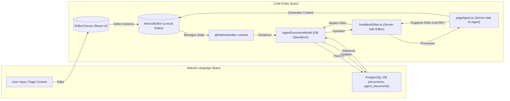

<!-- source: DeepWiki mcp.deepwiki.com · repo lobehub/lobehub · page 9.8 Pages and Document Editor · fetched 2026-10-29 -->

# Pages and Document Editor

<details>
<summary>Relevant source files</summary>

The following files were used as context for generating this wiki page:

- [apps/server/src/routers/lambda/webBrowsing.ts](apps/server/src/routers/lambda/webBrowsing.ts)
- [apps/server/src/services/agentDocumentVfs/index.test.ts](apps/server/src/services/agentDocumentVfs/index.test.ts)
- [apps/server/src/services/agentDocumentVfs/index.ts](apps/server/src/services/agentDocumentVfs/index.ts)
- [apps/server/src/services/agentDocuments/headlessEditor.test.ts](apps/server/src/services/agentDocuments/headlessEditor.test.ts)
- [apps/server/src/services/agentDocuments/headlessEditor.ts](apps/server/src/services/agentDocuments/headlessEditor.ts)
- [apps/server/src/services/toolExecution/serverRuntimes/pageAgent.ts](apps/server/src/services/toolExecution/serverRuntimes/pageAgent.ts)
- [apps/server/src/services/webBrowsing/__tests__/index.test.ts](apps/server/src/services/webBrowsing/__tests__/index.test.ts)
- [apps/server/src/services/webBrowsing/index.ts](apps/server/src/services/webBrowsing/index.ts)
- [packages/builtin-tool-web-browsing/src/ExecutionRuntime/index.ts](packages/builtin-tool-web-browsing/src/ExecutionRuntime/index.ts)
- [packages/database/src/models/agentDocuments/__tests__/agentDocument.copy.test.ts](packages/database/src/models/agentDocuments/__tests__/agentDocument.copy.test.ts)
- [packages/database/src/models/agentDocuments/__tests__/agentDocument.list.test.ts](packages/database/src/models/agentDocuments/__tests__/agentDocument.list.test.ts)
- [packages/database/src/models/agentDocuments/__tests__/agentDocument.test.ts](packages/database/src/models/agentDocuments/__tests__/agentDocument.test.ts)
- [packages/database/src/models/agentDocuments/agentDocument.ts](packages/database/src/models/agentDocuments/agentDocument.ts)
- [packages/database/src/models/agentDocuments/copyDocument.ts](packages/database/src/models/agentDocuments/copyDocument.ts)
- [packages/database/src/models/agentDocuments/types.ts](packages/database/src/models/agentDocuments/types.ts)
- [src/features/AgentDocumentsExplorer/DocumentExplorerToolbar.tsx](src/features/AgentDocumentsExplorer/DocumentExplorerToolbar.tsx)
- [src/features/AgentDocumentsExplorer/DocumentExplorerTree.test.tsx](src/features/AgentDocumentsExplorer/DocumentExplorerTree.test.tsx)
- [src/features/AgentDocumentsExplorer/DocumentExplorerTree.tsx](src/features/AgentDocumentsExplorer/DocumentExplorerTree.tsx)
- [src/features/AgentDocumentsExplorer/hooks/useDocumentTreeOps.ts](src/features/AgentDocumentsExplorer/hooks/useDocumentTreeOps.ts)
- [src/features/AgentDocumentsExplorer/utils/pendingDocument.ts](src/features/AgentDocumentsExplorer/utils/pendingDocument.ts)
- [src/features/AgentDocumentsExplorer/utils/sortDocuments.test.ts](src/features/AgentDocumentsExplorer/utils/sortDocuments.test.ts)
- [src/features/AgentDocumentsExplorer/utils/sortDocuments.ts](src/features/AgentDocumentsExplorer/utils/sortDocuments.ts)
- [src/features/AgentTasks/AgentTaskDetail/useTaskInstructionAutosave.test.ts](src/features/AgentTasks/AgentTaskDetail/useTaskInstructionAutosave.test.ts)
- [src/features/AgentTasks/AgentTaskDetail/useTaskInstructionAutosave.ts](src/features/AgentTasks/AgentTaskDetail/useTaskInstructionAutosave.ts)
- [src/features/ChatInput/InputEditor/plugins.ts](src/features/ChatInput/InputEditor/plugins.ts)
- [src/features/Conversation/ChatItem/components/MessageContent/index.tsx](src/features/Conversation/ChatItem/components/MessageContent/index.tsx)
- [src/features/Conversation/WorkingSidebar/ResourcesSection/index.tsx](src/features/Conversation/WorkingSidebar/ResourcesSection/index.tsx)
- [src/features/EditorCanvas/EditorCanvas.test.tsx](src/features/EditorCanvas/EditorCanvas.test.tsx)
- [src/features/EditorCanvas/EditorCanvas.tsx](src/features/EditorCanvas/EditorCanvas.tsx)
- [src/features/EditorCanvas/EditorDataMode.tsx](src/features/EditorCanvas/EditorDataMode.tsx)
- [src/features/EditorCanvas/InternalEditor.readonly.test.tsx](src/features/EditorCanvas/InternalEditor.readonly.test.tsx)
- [src/features/EditorCanvas/InternalEditor.test.tsx](src/features/EditorCanvas/InternalEditor.test.tsx)
- [src/features/EditorCanvas/InternalEditor.tsx](src/features/EditorCanvas/InternalEditor.tsx)
- [src/features/EditorModal/EditorCanvas.tsx](src/features/EditorModal/EditorCanvas.tsx)
- [src/features/EditorModal/index.tsx](src/features/EditorModal/index.tsx)
- [src/features/ExplorerTree/adapter/index.ts](src/features/ExplorerTree/adapter/index.ts)
- [src/features/ExplorerTree/adapter/path.test.ts](src/features/ExplorerTree/adapter/path.test.ts)
- [src/features/ExplorerTree/adapter/path.ts](src/features/ExplorerTree/adapter/path.ts)
- [src/features/ExplorerTree/documentTreeStyle.test.ts](src/features/ExplorerTree/documentTreeStyle.test.ts)
- [src/features/ExplorerTree/documentTreeStyle.ts](src/features/ExplorerTree/documentTreeStyle.ts)
- [src/features/ExplorerTree/folderIconStyle.test.ts](src/features/ExplorerTree/folderIconStyle.test.ts)
- [src/features/ExplorerTree/folderIconStyle.ts](src/features/ExplorerTree/folderIconStyle.ts)
- [src/features/ExplorerTree/index.tsx](src/features/ExplorerTree/index.tsx)
- [src/features/ExplorerTree/types.ts](src/features/ExplorerTree/types.ts)
- [src/features/ExplorerTree/view/ExplorerTree.test.tsx](src/features/ExplorerTree/view/ExplorerTree.test.tsx)
- [src/features/ExplorerTree/view/ExplorerTree.tsx](src/features/ExplorerTree/view/ExplorerTree.tsx)
- [src/features/PageEditor/EditorCanvas/index.tsx](src/features/PageEditor/EditorCanvas/index.tsx)
- [src/services/webBrowsing.ts](src/services/webBrowsing.ts)
- [src/store/tool/slices/builtin/executors/lobe-web-browsing.ts](src/store/tool/slices/builtin/executors/lobe-web-browsing.ts)

</details>


The Pages feature implements a rich-text document editing system tightly integrated with LobeHub's AI agent and knowledge base ecosystem. It combines a runtime-driven Lexical editor state, React rendering canvas components, and AI-augmented page agents that collaborate on content generation and modification. Pages link seamlessly with agents and knowledge bases, enabling AI-assisted editing workflows contextualized to workspaces and user scopes.

---

## 1. Editor Architecture and Runtime

The Pages editor uses a decoupled architecture built on the Lexical editor runtime (`editor-runtime`) combined with React canvases (`EditorCanvas`) and overlay modals (`EditorModal`) for rich document interactions.

### 1.1 Data Schema and Storage

Pages and their content are persisted using a flexible JSONB `editor_data` stored in multiple PostgreSQL tables, primarily:

- `documents` table: Holds standalone rich-text pages and files. Key fields include `content` (raw text or markdown) and `editor_data` (Lexical JSON structure) [packages/database/src/schemas/file.ts:70-91]().

- `agents` table: Contains AI agent profiles including instructions often stored as rich-text JSON data under `editor_data` [packages/database/src/schemas/agent.ts:50-60]().

- `topics` table: Captures conversation topics which can reference documents and additionally store rich-text summaries in `editor_data` [packages/database/src/schemas/topic.ts:30-45]().

- `agent_documents` table: Links agents with specific documents, containing metadata fields for customized editing [packages/database/src/models/agentDocuments/agentDocument.ts:20-22]().

The `editor_data` JSON column is central for storing the editor runtime state, enabling granular text, formatting, and metadata preservation independent of plain-text content.

### 1.2 Editor Runtime (`editor-runtime`)

The `editor-runtime` package provides the headless Lexical editor instance, managing document state, input handling, collaboration, and plugin support. It is UI-framework agnostic, handling:

- State mutation APIs for Lexical nodes and decorations.
- Command and event APIs for input processing.
- Persistence serialization/deserialization between Lexical JSON and database.
- Headless operations for creating and applying snapshots, including LiteXML operations for granular edits [apps/server/src/services/agentDocuments/headlessEditor.ts:1-348]().
- Serialization of editor data to Markdown and LiteXML formats [apps/server/src/services/agentDocuments/headlessEditor.ts:134-144]().
- Handling of concurrent headless document lifecycles to ensure safe serialization [apps/server/src/services/agentDocuments/headlessEditor.ts:97-132]().

This separation allows flexible rendering layers that can leverage runtime state efficiently.

Sources:
- [apps/server/src/services/agentDocuments/headlessEditor.ts:1-348]()
- [apps/server/src/services/agentDocuments/headlessEditor.test.ts:1-373]()
- [packages/database/src/schemas/file.ts:70-91]()
- [packages/database/src/schemas/agent.ts:50-60]()
- [packages/database/src/schemas/topic.ts:30-45]()
- [packages/database/src/models/agentDocuments/agentDocument.ts:20-22]()

### 1.3 EditorCanvas and EditorModal (React UI Components)

Two main React components compose the UI layer:

- **EditorCanvas**: The primary React canvas component that hosts the Lexical editor UI. It renders the editable document area with syntax highlighting, toolbars, and inline actions [src/features/EditorCanvas/EditorCanvas.tsx:1-100](). It supports various plugins like `ReactImagePlugin`, `ReactLinkPlugin`, `ReactLiteXmlPlugin`, `ReactMathPlugin`, `ReactMentionPlugin`, and `ReactTablePlugin` [src/features/EditorCanvas/InternalEditor.tsx:5-13](). It also handles image and file uploads, including rehosting images and picking files from the local system in desktop mode [src/features/EditorCanvas/InternalEditor.tsx:137-150]().

- **EditorModal**: A floating modal overlay that can display editing windows or dialogs related to document operations, e.g., metadata editing, annotations, or AI-assisted copilot tasks [src/features/EditorModal/index.tsx:1-30]().

Together, they provide both immersive full-canvas editing and lightweight modal interactions.

Sources:
- [src/features/EditorCanvas/EditorCanvas.tsx:1-100]()
- [src/features/EditorCanvas/InternalEditor.tsx:5-13]()
- [src/features/EditorCanvas/InternalEditor.tsx:137-150]()
- [src/features/EditorModal/index.tsx:1-30]()
- [src/features/EditorCanvas/InternalEditor.test.tsx]()
- [src/features/EditorCanvas/EditorCanvas.test.tsx]()

---

## 2. Page Agent Integration for AI-Assisted Editing

One of the innovative features of the Pages system is the integration with *Page Agents*. These are specialized AI agents configured to collaborate on page generation, summarization, or refinement tasks.

### 2.1 Page Agent Runtime

Within a page editing context, a *Page Agent* can be activated to:

- Observe the document content and editing state (via the editor runtime).
- Respond to user commands or triggers from the editor UI.
- Generate or modify text based on AI model inference.
- Interact with associated knowledge bases or linked files for grounded document augmentation.

The agent is typically connected via the chat pipeline, receiving rich-text and document context as part of the prompt, and returning edit proposals or injected content. The `pageAgent` server runtime handles operations like `applyLiteXMLOperations` to modify document content based on agent suggestions [apps/server/src/services/toolExecution/serverRuntimes/pageAgent.ts:1-100]().

Sources:
- [apps/server/src/services/toolExecution/serverRuntimes/pageAgent.ts:1-100]()

### 2.2 Copilot Toolbar UI and Topic Selector

The editing UI includes a **Copilot Toolbar** that allows users to:

- Select or switch discussion topics relevant to the page agent [src/features/PageEditor/Copilot/Toolbar.tsx:10-130]().

- Create new AI topics/threads bound to the current page, enabling focused AI conversations integrated into editing workflows.

The toolbar also manages toggling the Page Agent side panel where the AI assistant interface resides.

Sources:
- [src/features/PageEditor/Copilot/Toolbar.tsx:10-130]()

---

## 3. PageEditor UI Components and Document Viewing

The PageEditor UI surfaces the editor canvas, metadata panels, and integration points as cohesive controls.

### 3.1 Document Body and Skill Frontmatter

- The `DocumentExplorerTree` component provides a file-tree-like interface for managing agent documents, including creating new documents and folders, uploading files, and sorting [src/features/AgentDocumentsExplorer/DocumentExplorerTree.tsx:116-122](). It supports inline renaming of documents and folders [src/features/AgentDocumentsExplorer/DocumentExplorerTree.tsx:132-137]().
- Documents can be converted to skills, with a dedicated `SKILL_INDEX_FILENAME` for skill bundles [src/features/AgentDocumentsExplorer/DocumentExplorerTree.tsx:51-51]().
- The `DocumentExplorerToolbar` provides actions for creating new documents/folders, uploading files, and sorting documents [src/features/AgentDocumentsExplorer/DocumentExplorerToolbar.tsx:34-57]().

Sources:
- [src/features/AgentDocumentsExplorer/DocumentExplorerTree.tsx:116-122]()
- [src/features/AgentDocumentsExplorer/DocumentExplorerTree.tsx:132-137]()
- [src/features/AgentDocumentsExplorer/DocumentExplorerTree.tsx:51-51]()
- [src/features/AgentDocumentsExplorer/DocumentExplorerToolbar.tsx:34-57]()
- [src/features/AgentDocumentsExplorer/DocumentExplorerTree.test.tsx:1-532]()

### 3.2 FloatingChatPanel

The **FloatingChatPanel** component allows embedding a chat UI related to the current page or topic, supporting conversations anchored on specific documents and agents [src/features/FloatingChatPanel/index.tsx:1-187]().

- It composes chat message lists, inputs, and toolbars inside a floating modal area.

- Supports agentDocumentId injection for direct document context linking in LLM calls for grounded AI assistance.

Sources:
- [src/features/FloatingChatPanel/index.tsx:1-187]()

### 3.3 Integration with Conversation and Topic Stores

The editing panels use Zustand stores such as `useChatStore`, `useConversationStore`, and document stores to manage reactive state for messages, topics, editing content, and agent bindings [src/features/PageEditor/Copilot/Toolbar.tsx:20-90](), [src/features/FloatingChatPanel/index.tsx:130-180]().

Sources:
- [src/features/PageEditor/Copilot/Toolbar.tsx:20-90]()
- [src/features/FloatingChatPanel/index.tsx:130-180]()

---

## 4. Linking Pages to Agents and Knowledge Bases

The system maintains explicit many-to-many relationships linking pages/documents, agents, and knowledge bases. The `AgentDocumentModel` handles the association of documents with agents, including creation, listing, and management of document policies [packages/database/src/models/agentDocuments/agentDocument.ts:143-159]().

| Entity | Table | Relationship Description |
|--------|-------|--------------------------|
| Page Document | `documents` | Stores rich-text pages and files |
| Agent | `agents` | AI agents with editorData field for instructions |
| Agent-File Link | `agents_files` | Join table linking agents to files/documents  |
| Agent-KnowledgeBase Link | `agents_knowledge_bases` | Connects agents with RAG knowledge bases |
| Agent Document | `agent_documents` | Metadata linkage between agents and documents, including policies for loading and access [packages/database/src/models/agentDocuments/agentDocument.ts:41-53]() |

These tables enable:

- Contextual injection of documents/knowledge in AI conversations.
- Filtering of accessible pages by workspace and visibility [packages/database/src/models/agentDocuments/agentDocument.ts:161-195]().
- Management of document load rules and policies, determining how and when documents are provided to agents [packages/database/src/models/agentDocuments/agentDocument.ts:30-35]().

Sources:
- [packages/database/src/models/agentDocuments/agentDocument.ts:143-159]()
- [packages/database/src/models/agentDocuments/agentDocument.ts:41-53]()
- [packages/database/src/models/agentDocuments/agentDocument.ts:161-195]()
- [packages/database/src/models/agentDocuments/agentDocument.ts:30-35]()
- [packages/database/src/models/agentDocuments/__tests__/agentDocument.test.ts:1-1439]()
- [packages/database/src/models/agentDocuments/__tests__/agentDocument.copy.test.ts]()
- [packages/database/src/models/agentDocuments/__tests__/agentDocument.list.test.ts]()

---

## 5. Editor Data Flow and Synchronization

The following diagrams illustrate how document data flows between storage, the editor runtime, and the AI agent systems.

### 5.1 From Natural Language to Code Entity Space (Page Editing)



This depicts user edits in the React canvas feeding lexical runtime state, synchronized with Zustand stores and persisted in the database. The Page Agent consumes editor content live for AI-assisted operations, with server-side headless editor services handling the application of LiteXML operations.

Sources:
- [src/features/EditorCanvas/InternalEditor.tsx:1-394]()
- [src/features/EditorCanvas/EditorCanvas.tsx:1-100]()
- [apps/server/src/services/agentDocuments/headlessEditor.ts:1-348]()
- [apps/server/src/services/toolExecution/serverRuntimes/pageAgent.ts:1-100]()
- [packages/database/src/models/agentDocuments/agentDocument.ts:1-1899]()

### 5.2 Pages Linking to Agents and Knowledge Bases

```mermaid
classDiagram
  class "documents" as Document {
    +id: string
    +editorData: JSON
    +content: string
    +sourceType: AgentDocumentSourceType
    +fileType: AGENT_DOCUMENT_FILE_TYPE
  }

  class "agents" as Agent {
    +id: string
    +instructions: JSON
  }

  class "agent_documents" as AgentDocument {
    +id: string
    +agentId: string
    +documentId: string
    +policy: AgentDocumentPolicy
    +policyLoad: PolicyLoad
    +policyLoadPosition: DocumentLoadPosition
    +policyLoadRule: DocumentLoadRule
  }

  class "knowledgeBases" as KnowledgeBase {
    +id: string
  }

  class "agents_knowledge_bases" as AgentKnowledgeBase {
    +agentId: string
    +knowledgeBaseId: string
  }

  Document "1" -- "0..N" AgentDocument : "documentId"
  Agent "1" -- "0..N" AgentDocument : "agentId"
  Agent "1" -- "0..N" AgentKnowledgeBase : "agentId"
  KnowledgeBase "1" -- "0..N" AgentKnowledgeBase : "knowledgeBaseId"
```

This clarifies the join structures enabling many-to-many relations between documents, agents, and knowledge bases, supporting retrieval-augmented generation and grounding in AI workflows. The `agent_documents` table explicitly defines policies for how documents are loaded and accessed by agents.

Sources:
- [packages/database/src/models/agentDocuments/agentDocument.ts:41-53]()
- [packages/database/src/models/agentDocuments/types.ts:1-100]()
- [packages/database/src/schemas/file.ts:70-91]()
- [packages/database/src/schemas/agent.ts:50-60]()
- [packages/database/src/schemas/agentDocuments.ts:140-160]()

---

## Summary

The Pages and Document Editor subsystem in LobeHub provides an AI-augmented rich-text editing environment via a layered architecture:

- **Editor Runtime:** Lexical-based JSON editor state runtime, with headless capabilities for server-side processing.
- **React UI:** `EditorCanvas` and `EditorModal` for interactive editing, supporting various plugins and file management.
- **Page Agent:** AI assistants linked to pages via conversation topics, capable of generating and modifying content through LiteXML operations.
- **State Stores:** Zustand persistence and synchronization for reactive UI.
- **Data Links:** Structured relations between documents, agents, and knowledge bases enable grounded AI interactions and workspace-scoped visibility, managed by the `AgentDocumentModel`.

---

## Sources

- [src/features/AgentDocumentsExplorer/DocumentExplorerTree.tsx:1-163]()
- [packages/database/src/models/agentDocuments/agentDocument.ts:1-195]()
- [apps/server/src/services/agentDocuments/headlessEditor.test.ts:1-198]()
- [apps/server/src/services/agentDocuments/headlessEditor.ts:1-218]()
- [src/features/EditorCanvas/InternalEditor.tsx:1-193]()
- [src/features/ExplorerTree/index.tsx:1-27]()
- [src/features/AgentDocumentsExplorer/DocumentExplorerToolbar.tsx:1-146]()
- [src/features/PageEditor/EditorCanvas/index.tsx:1-74]()
- [src/features/ExplorerTree/view/ExplorerTree.tsx:1-181]()
- [src/features/ExplorerTree/view/ExplorerTree.test.tsx:1-188]()
- [packages/database/src/models/agentDocuments/types.ts]()
- [src/features/ChatInput/InputEditor/plugins.ts]()
- [src/store/tool/slices/builtin/executors/lobe-web-browsing.ts]()
- [src/features/EditorModal/EditorCanvas.tsx]()
- [src/features/ExplorerTree/documentTreeStyle.ts]()
- [src/features/ExplorerTree/folderIconStyle.ts]()
- [apps/server/src/services/agentDocumentVfs/index.test.ts]()
- [apps/server/src/services/agentDocumentVfs/index.ts]()
- [src/features/EditorCanvas/EditorCanvas.tsx]()
- [src/features/AgentDocumentsExplorer/utils/pendingDocument.ts]()
- [packages/builtin-tool-web-browsing/src/ExecutionRuntime/index.ts]()
- [src/features/EditorModal/index.tsx]()
- [src/features/ExplorerTree/types.ts]()
- [apps/server/src/services/toolExecution/serverRuntimes/pageAgent.ts]()
- [src/features/EditorCanvas/InternalEditor.test.tsx]()
- [src/features/EditorCanvas/EditorDataMode.tsx]()
- [src/features/EditorCanvas/InternalEditor.readonly.test.tsx]()
- [src/features/Conversation/WorkingSidebar/ResourcesSection/index.tsx]()
- [src/services/webBrowsing.ts]()
- [src/features/Conversation/ChatItem/components/MessageContent/index.tsx]()
- [packages/database/src/models/agentDocuments/__tests__/agentDocument.copy.test.ts]()
- [packages/database/src/models/agentDocuments/copyDocument.ts]()
- [apps/server/src/services/webBrowsing/__tests__/index.test.ts]()
- [src/features/AgentDocumentsExplorer/utils/sortDocuments.ts]()
- [apps/server/src/services/webBrowsing/index.ts]()
- [src/features/AgentDocumentsExplorer/utils/sortDocuments.test.ts]()
- [packages/database/src/models/agentDocuments/__tests__/agentDocument.list.test.ts]()
- [apps/server/src/routers/lambda/webBrowsing.ts]()
- [src/features/ExplorerTree/documentTreeStyle.test.ts]()
- [src/features/EditorCanvas/EditorCanvas.test.tsx]()
- [src/features/ExplorerTree/adapter/index.ts]()
- [src/features/ExplorerTree/adapter/path.ts]()
- [src/features/ExplorerTree/adapter/path.test.ts]()
- [src/features/ExplorerTree/folderIconStyle.test.ts]()
- [src/features/AgentTasks/AgentTaskDetail/useTaskInstructionAutosave.test.ts]()
- [src/features/AgentTasks/AgentTaskDetail/useTaskInstructionAutosave.ts]()

---

