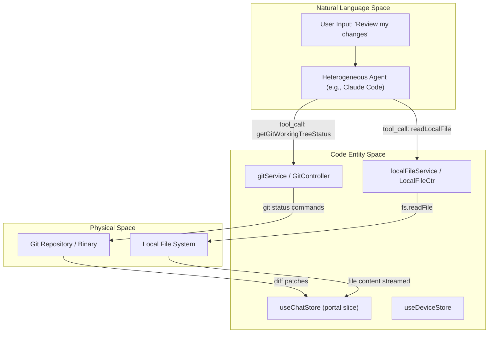
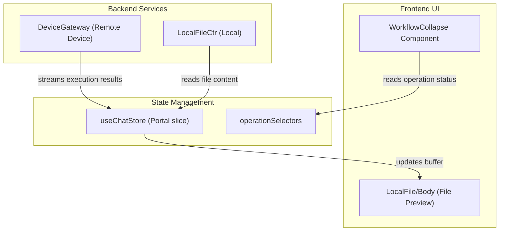
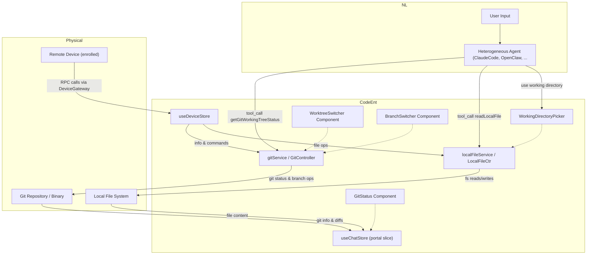

<!-- source: DeepWiki mcp.deepwiki.com · repo lobehub/lobehub · page 9.9 Chat Terminal and Working Directory · fetched 2026-10-29 -->

# Chat Terminal and Working Directory

Relevant source files

The following files were used as context for generating this wiki page:

- [apps/cli/src/tools/file.ts](apps/cli/src/tools/file.ts)
- [apps/cli/src/tools/index.test.ts](apps/cli/src/tools/index.test.ts)
- [apps/cli/src/tools/index.ts](apps/cli/src/tools/index.ts)
- [apps/cli/src/tools/localSystemRuntime.ts](apps/cli/src/tools/localSystemRuntime.ts)
- [apps/desktop/src/main/controllers/LocalFileCtr.ts](apps/desktop/src/main/controllers/LocalFileCtr.ts)
- [apps/desktop/src/main/controllers/__tests__/LocalFileCtr.test.ts](apps/desktop/src/main/controllers/__tests__/LocalFileCtr.test.ts)
- [apps/desktop/src/main/core/infrastructure/LocalFileProtocolManager.ts](apps/desktop/src/main/core/infrastructure/LocalFileProtocolManager.ts)
- [apps/desktop/src/main/core/infrastructure/__tests__/LocalFileProtocolManager.test.ts](apps/desktop/src/main/core/infrastructure/__tests__/LocalFileProtocolManager.test.ts)
- [locales/en-US/device.json](locales/en-US/device.json)
- [locales/zh-CN/device.json](locales/zh-CN/device.json)
- [packages/device-control/src/__tests__/projectFileIndex.test.ts](packages/device-control/src/__tests__/projectFileIndex.test.ts)
- [packages/device-control/src/projectFileIndex.ts](packages/device-control/src/projectFileIndex.ts)
- [packages/electron-client-ipc/src/types/localSystem.ts](packages/electron-client-ipc/src/types/localSystem.ts)
- [packages/local-file-shell/src/file/index.ts](packages/local-file-shell/src/file/index.ts)
- [packages/local-file-shell/src/file/readImage.ts](packages/local-file-shell/src/file/readImage.ts)
- [packages/local-file-shell/src/types.ts](packages/local-file-shell/src/types.ts)
- [packages/locales/src/default/device.ts](packages/locales/src/default/device.ts)
- [src/business/client/hooks/useHeteroAgentCloudConfig.test.ts](src/business/client/hooks/useHeteroAgentCloudConfig.test.ts)
- [src/business/client/hooks/useHeteroAgentCloudConfig.ts](src/business/client/hooks/useHeteroAgentCloudConfig.ts)
- [src/features/ChatInput/ControlBar/BranchSwitcher.tsx](src/features/ChatInput/ControlBar/BranchSwitcher.tsx)
- [src/features/ChatInput/ControlBar/DashedFolderIcon.tsx](src/features/ChatInput/ControlBar/DashedFolderIcon.tsx)
- [src/features/ChatInput/ControlBar/GitStatus.tsx](src/features/ChatInput/ControlBar/GitStatus.tsx)
- [src/features/ChatInput/ControlBar/ProjectDeviceSwitcher.tsx](src/features/ChatInput/ControlBar/ProjectDeviceSwitcher.tsx)
- [src/features/ChatInput/ControlBar/StaleGitSnapshot.tsx](src/features/ChatInput/ControlBar/StaleGitSnapshot.tsx)
- [src/features/ChatInput/ControlBar/WorkingDirectoryPicker.tsx](src/features/ChatInput/ControlBar/WorkingDirectoryPicker.tsx)
- [src/features/ChatInput/ControlBar/WorkingDirectorySection.tsx](src/features/ChatInput/ControlBar/WorkingDirectorySection.tsx)
- [src/features/ChatInput/ControlBar/WorktreeSwitcher.tsx](src/features/ChatInput/ControlBar/WorktreeSwitcher.tsx)
- [src/features/ChatInput/ControlBar/__tests__/GitStatus.test.tsx](src/features/ChatInput/ControlBar/__tests__/GitStatus.test.tsx)
- [src/features/ChatInput/ControlBar/__tests__/WorktreeSwitcher.test.tsx](src/features/ChatInput/ControlBar/__tests__/WorktreeSwitcher.test.tsx)
- [src/features/ChatInput/ControlBar/__tests__/staleSnapshot.test.ts](src/features/ChatInput/ControlBar/__tests__/staleSnapshot.test.ts)
- [src/features/ChatInput/ControlBar/staleSnapshot.ts](src/features/ChatInput/ControlBar/staleSnapshot.ts)
- [src/features/ChatInput/ControlBar/useSwitchWorktree.ts](src/features/ChatInput/ControlBar/useSwitchWorktree.ts)
- [src/features/Portal/LocalFile/Body.test.tsx](src/features/Portal/LocalFile/Body.test.tsx)
- [src/features/Portal/LocalFile/Body.tsx](src/features/Portal/LocalFile/Body.tsx)
- [src/features/Portal/LocalFile/MarkdownImage.test.tsx](src/features/Portal/LocalFile/MarkdownImage.test.tsx)
- [src/features/Portal/LocalFile/MarkdownImage.tsx](src/features/Portal/LocalFile/MarkdownImage.tsx)
- [src/features/Portal/LocalFile/PreviewToolbar.tsx](src/features/Portal/LocalFile/PreviewToolbar.tsx)
- [src/features/WorkingDirectory/RemoteDirectoryBrowser.tsx](src/features/WorkingDirectory/RemoteDirectoryBrowser.tsx)
- [src/features/WorkingDirectory/folderIcons.test.ts](src/features/WorkingDirectory/folderIcons.test.ts)
- [src/features/WorkingDirectory/folderIcons.ts](src/features/WorkingDirectory/folderIcons.ts)
- [src/helpers/claudeCodeTokenCred.test.ts](src/helpers/claudeCodeTokenCred.test.ts)
- [src/helpers/claudeCodeTokenCred.ts](src/helpers/claudeCodeTokenCred.ts)
- [src/helpers/workingDirectoryPath.ts](src/helpers/workingDirectoryPath.ts)
- [src/hooks/useEffectiveWorkingDirectory.test.ts](src/hooks/useEffectiveWorkingDirectory.test.ts)
- [src/hooks/useEffectiveWorkingDirectory.ts](src/hooks/useEffectiveWorkingDirectory.ts)
- [src/hooks/useRemoteAgentDeviceGuard.test.ts](src/hooks/useRemoteAgentDeviceGuard.test.ts)
- [src/hooks/useRemoteAgentDeviceGuard.ts](src/hooks/useRemoteAgentDeviceGuard.ts)
- [src/hooks/useScopedCreds.test.ts](src/hooks/useScopedCreds.test.ts)
- [src/hooks/useScopedCreds.ts](src/hooks/useScopedCreds.ts)
- [src/routes/(main)/agent/features/Conversation/Header/index.tsx](src/routes/(main)/agent/features/Conversation/Header/index.tsx)
- [src/routes/(main)/agent/features/Conversation/HeterogeneousChatInput/index.tsx](src/routes/(main)/agent/features/Conversation/HeterogeneousChatInput/index.tsx)
- [src/routes/(main)/agent/profile/features/ProfileEditor/CloudHeterogeneousConfig.tsx](src/routes/(main)/agent/profile/features/ProfileEditor/CloudHeterogeneousConfig.tsx)
- [src/services/claudeCodeToken.test.ts](src/services/claudeCodeToken.test.ts)
- [src/services/electron/localFileService.test.ts](src/services/electron/localFileService.test.ts)
- [src/services/electron/localFileService.ts](src/services/electron/localFileService.ts)
- [src/services/projectFile.test.ts](src/services/projectFile.test.ts)
- [src/services/projectFile.ts](src/services/projectFile.ts)
- [src/store/device/directoryHooks.test.ts](src/store/device/directoryHooks.test.ts)
- [src/store/device/directoryHooks.ts](src/store/device/directoryHooks.ts)

The Chat Terminal and Working Directory system in LobeHub bridges the natural language interaction space with the local and remote file system environments. This integration is critical for heterogeneous agent workflows, enabling agents to query, browse, and manipulate files and git repositories both locally and on connected remote devices. The system provides a secure, user-aware, and stateful environment for code-centric tasks powered by AI agents.

---

## 1. System Architecture

The architecture supporting the Chat Terminal and Working Directory spans three key layers:

- **Electron main process (Local Layer)**
- **LobeHub backend server (Cloud Layer)**
- **Frontend UI (React/Next.js Layer)**

These components collectively provide seamless local file system access, remote device orchestration, and UI integration.

### 1.1 Remote Device Gateway

Remote workflows rely on the `DeviceGateway` RPC relay, which manages:

- Device status and system info queries
- Tool call execution directed to remote devices
- Enforcing path and workspace boundaries for file operations

Key security functions include:

- `isPathWithinRoot`: Validates that a given file path lies within the approved workspace root
- `assertPathsWithinWorkspace`: Throws errors if attempted file mutations would traverse outside the workspace root, preventing attacks such as directory traversal

The gateway routes internal requests such as agent capability scans (e.g., for `claude-code` installation) using `invokeRpc` abstractions.

Sources: [apps/server/src/services/deviceGateway/index.ts:58-84](), [apps/server/src/services/deviceGateway/index.ts:165-184]()

### 1.2 Desktop IPC Layer

In Electron desktop mode, the main process exposes:

- `LocalFileCtr`: A controller providing APIs for:

  - Previewing files
  - Reading and writing file contents
  - Safely auditing file system paths before use

- `GitController`: A wrapper over the `@lobechat/local-file-shell` module to manage git workflows such as:

  - Branch switching
  - Worktree management
  - Diff retrieval

IPC mechanisms enable the renderer process to communicate with these controllers transparently.

Sources: [apps/desktop/src/main/controllers/LocalFileCtr.ts:6-72](), [apps/desktop/src/main/controllers/LocalFileCtr.ts:101-104]()

### 1.3 Data Flow: Natural Language to Code Entity Mapping

The system translates user chat requests into file and git operations via multiple state and service layers:

Sources: [src/routes/(main)/agent/features/Conversation/HeterogeneousChatInput/index.tsx:1-147]()

---

## 2. Working Directory Management

The `WorkingDirectory` serves as the root context for all file and git operations associated with an agent or a chat topic. This allows scoped, consistent file access, and enables persisting context for conversations.

### 2.1 Working Directory Picker

The `WorkingDirectoryPicker` UI component lets users select or override a directory for the current chat session or agent. It supports:

- Browsing local folders with Electron folder dialog or remote devices via RPC
- Search and filter of recent or known directories
- Validation of directories for existence and permission
- Manual path input with validation

The picker coordinates with helper utilities such as `resolveAgentWorkingDirectorySource` and `getWorkingDirectoryName` to normalize and display chosen paths correctly. It also calls `useCommitWorkingDirectory` hooks to persist changes.

To add a remote folder, it validates the path on the target device and surfaces device or permission errors gracefully.

Sources: [src/features/ChatInput/ControlBar/WorkingDirectoryPicker.tsx:1-228](), [src/helpers/agentWorkingDirectory.ts:1-87]()

### 2.2 Git Status and Worktree Switcher

Git integration components provide real-time, actionable git metadata in the working directory context:

- **GitStatus**: Displays current branch, ahead/behind commit counts, and uncommitted change toggles as a chip in the chat input bar. It leverages swr hooks to fetch:

  - Current branch info
  - Linked GitHub PRs (via `gh` CLI)
  - Review patches for diff previews
  - Ahead/behind commit counts
  - Worktree lists

- **WorktreeSwitcher**: Enables switching between multiple git worktrees for the current repository. It shows branch icons for main vs linked worktrees, allows creation of new worktrees, and deletion of existing ones with confirmation.

- **BranchSwitcher**: Facilitates branch checkout, creation, renaming, and deletion. It intelligently manages branch-worktree relationships, and provides search and refresh capabilities.

Clicking the diff stats in GitStatus opens the review sidebar with patch details.

Sources: [src/features/ChatInput/ControlBar/GitStatus.tsx:1-128](), [src/features/ChatInput/ControlBar/WorktreeSwitcher.tsx:1-303](), [src/features/ChatInput/ControlBar/BranchSwitcher.tsx:1-265]()

---

## 3. Chat Terminal and File Preview

LobeHub provides a terminal-like experience allowing chat sessions to visualize shell outputs, file contents, and agent workflows interactively.

### 3.1 File Preview

The preview pane renders files detected or modified by agents within the conversation portal using components such as:

| Feature        | Implementation           | Supported File Types                            |
|----------------|--------------------------|-----------------------------------------------|
| Text Preview   | `CodeEditorPane` (Monaco) | `.ts`, `.js`, `.json`, `.md`                   |
| Image Preview  | `<Image />` with Blobs    | `.png`, `.jpg`, `.webp`, `.avif`                |
| HTML Artifacts | `InlineHtmlPreview` (Sandboxed) | `.html`                                    |
| Binary Docs    | `DocumentPreview` (Lazy loaded) | `.pdf`, `.docx`, `.xlsx`                     |

File content is streamed from the local or remote device and buffered in the chat store. This buffer is rendered dynamically by the preview components.

Sources: [src/features/Portal/LocalFile/Body.tsx:41-71](), [src/features/Portal/LocalFile/Body.tsx:153-208](), [apps/desktop/src/main/controllers/LocalFileCtr.ts:88-89]()

### 3.2 Workflow Visualization

Agent execution steps, including shell commands and tool calls, are presented in the `WorkflowCollapse` component. This component automatically:

- Expands workflows while agents are actively streaming progress
- Collapses completed workflows into summaries for space efficiency
- Keeps workflows open with a "pending" state when awaiting user confirmation

Workflow state is derived from the chat's operations selectors and backed by streams from local or device services.

Sources: [src/routes/(main)/agent/features/Conversation/Header/index.tsx:1-100]()

---

## 4. Security and Path Governance

Working with local and remote file systems demands strict controls to prevent unauthorized access and maintain system integrity.

- **Workspace Root Isolation:** All agent-related file operations are confined to the configured working directory root. This is enforced by `assertPathsWithinWorkspace`, which rejects paths escaping the boundary.

- **Safe Path Prefixes:** The desktop app defines sets of `SAFE_PATH_PREFIXES` (e.g. `/tmp`) to allow trusted temporary file operations.

- **Preview Tokens:** Accessing files for preview in the renderer requires temporary authorization tokens. These are issued by the `LocalFileProtocolManager` for secure, ephemeral access.

- **Validation on Remote Devices:** When adding remote folders or changing working directories, path validity is verified via RPC to devices, with clear error handling for offline devices or permission problems.

- **Fallback to Snapshot Data:** If a working directory is deleted, the UI falls back to showing saved Git snapshots from the conversation topic metadata, ensuring consistent state presentation.

Sources: [apps/server/src/services/deviceGateway/index.ts:58-84](), [apps/desktop/src/main/controllers/LocalFileCtr.ts:123-123](), [apps/desktop/src/main/core/infrastructure/LocalFileProtocolManager.ts:1-20](), [src/features/ChatInput/ControlBar/GitStatus.tsx:144-178]()

---

## Summary Mermaid Diagram: Chat Terminal and Working Directory Major Components

Sources: [src/routes/(main)/agent/features/Conversation/HeterogeneousChatInput/index.tsx:1-147]()

---

# References

- `DeviceGateway` and security: [apps/server/src/services/deviceGateway/index.ts:50-90](), [apps/server/src/services/deviceGateway/index.ts:150-190]()
- Desktop controllers: [apps/desktop/src/main/controllers/LocalFileCtr.ts:6-72](), [apps/desktop/src/main/controllers/LocalFileCtr.ts:101-104]()
- Git status UI and switching: [src/features/ChatInput/ControlBar/GitStatus.tsx:1-128](), [src/features/ChatInput/ControlBar/WorktreeSwitcher.tsx:1-303](), [src/features/ChatInput/ControlBar/BranchSwitcher.tsx:1-265]()
- Working directory picker UI: [src/features/ChatInput/ControlBar/WorkingDirectoryPicker.tsx:1-228](), [src/helpers/agentWorkingDirectory.ts:1-87]()
- File preview pipeline: [src/features/Portal/LocalFile/Body.tsx:36-69](), [src/features/Portal/LocalFile/Body.tsx:169-212]()
- Path and preview token security: [apps/desktop/src/main/core/infrastructure/LocalFileProtocolManager.ts:1-20]()

---

This page documents the complete mechanism by which LobeHub links chat conversations to live file system contexts, empowering AI agents to act as powerful assistants in programming, review, and local system workflows.

---

