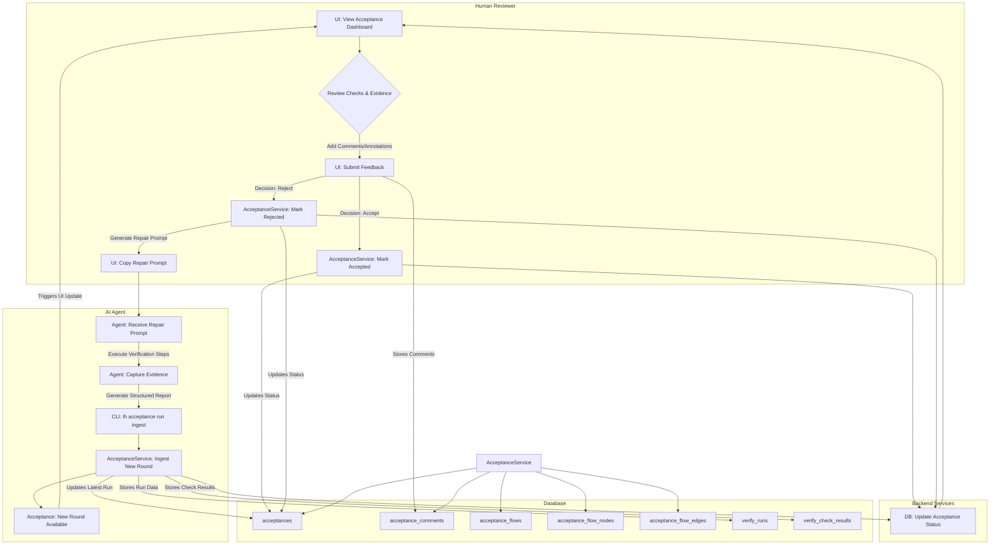

<!-- source: DeepWiki mcp.deepwiki.com · repo lobehub/lobehub · extra page Acceptance Aggregates and Review Loops · fetched 2026-10-29 -->

# Acceptance Aggregates and Review Loops

<details>
<summary>Relevant source files</summary>

The following files were used as context for generating this wiki page:

- [.agents/acceptance/PROCESS.md](.agents/acceptance/PROCESS.md)
- [.agents/acceptance/PROJECT.md](.agents/acceptance/PROJECT.md)
- [.agents/acceptance/common-mistakes.md](.agents/acceptance/common-mistakes.md)
- [.agents/acceptance/probe-mock-patterns.md](.agents/acceptance/probe-mock-patterns.md)
- [.agents/acceptance/scripts/acceptance-guard.sh](.agents/acceptance/scripts/acceptance-guard.sh)
- [.agents/acceptance/scripts/acceptance-guard.test.sh](.agents/acceptance/scripts/acceptance-guard.test.sh)
- [.agents/acceptance/scripts/fixture.mjs](.agents/acceptance/scripts/fixture.mjs)
- [.agents/acceptance/scripts/report-init.sh](.agents/acceptance/scripts/report-init.sh)
- [.agents/acceptance/scripts/resource-guard.test.sh](.agents/acceptance/scripts/resource-guard.test.sh)
- [.agents/scripts/check/pipelines.ts](.agents/scripts/check/pipelines.ts)
- [.agents/skills/acceptance/LICENSE](.agents/skills/acceptance/LICENSE)
- [.agents/skills/acceptance/SKILL.md](.agents/skills/acceptance/SKILL.md)
- [.agents/skills/acceptance/references/acceptance-checker.md](.agents/skills/acceptance/references/acceptance-checker.md)
- [.agents/skills/acceptance/references/agent-browser.md](.agents/skills/acceptance/references/agent-browser.md)
- [.agents/skills/acceptance/references/auth-web.md](.agents/skills/acceptance/references/auth-web.md)
- [.agents/skills/acceptance/references/axe.md](.agents/skills/acceptance/references/axe.md)
- [.agents/skills/acceptance/references/common-mistakes.md](.agents/skills/acceptance/references/common-mistakes.md)
- [.agents/skills/acceptance/references/computer-use.md](.agents/skills/acceptance/references/computer-use.md)
- [.agents/skills/acceptance/references/evidence.md](.agents/skills/acceptance/references/evidence.md)
- [.agents/skills/acceptance/references/plan-format.md](.agents/skills/acceptance/references/plan-format.md)
- [.agents/skills/acceptance/references/recording-cdp.md](.agents/skills/acceptance/references/recording-cdp.md)
- [.agents/skills/acceptance/references/recording-ios-simulator.md](.agents/skills/acceptance/references/recording-ios-simulator.md)
- [.agents/skills/acceptance/references/recording-native-macos.md](.agents/skills/acceptance/references/recording-native-macos.md)
- [.agents/skills/acceptance/references/report.md](.agents/skills/acceptance/references/report.md)
- [.agents/skills/acceptance/references/resource-guard.md](.agents/skills/acceptance/references/resource-guard.md)
- [.agents/skills/acceptance/references/sim-use.md](.agents/skills/acceptance/references/sim-use.md)
- [.agents/skills/acceptance/references/video-chapters.md](.agents/skills/acceptance/references/video-chapters.md)
- [.agents/skills/acceptance/scripts/resource-guard.sh](.agents/skills/acceptance/scripts/resource-guard.sh)
- [.agents/skills/acceptance/surfaces/ios-simulator.md](.agents/skills/acceptance/surfaces/ios-simulator.md)
- [.agents/skills/acceptance/surfaces/web.md](.agents/skills/acceptance/surfaces/web.md)
- [apps/cli/src/commands/acceptanceEvidence.ts](apps/cli/src/commands/acceptanceEvidence.ts)
- [apps/cli/src/commands/acceptanceFlow.test.ts](apps/cli/src/commands/acceptanceFlow.test.ts)
- [apps/cli/src/commands/acceptanceFlow.ts](apps/cli/src/commands/acceptanceFlow.ts)
- [apps/cli/src/commands/acceptanceFlowFeedback.test.ts](apps/cli/src/commands/acceptanceFlowFeedback.test.ts)
- [apps/cli/src/commands/acceptanceInstall.test.ts](apps/cli/src/commands/acceptanceInstall.test.ts)
- [apps/cli/src/commands/acceptanceLanguage.test.ts](apps/cli/src/commands/acceptanceLanguage.test.ts)
- [apps/cli/src/commands/acceptanceLanguage.ts](apps/cli/src/commands/acceptanceLanguage.ts)
- [apps/cli/src/commands/acceptanceRun.test.ts](apps/cli/src/commands/acceptanceRun.test.ts)
- [apps/cli/src/commands/acceptanceRun.ts](apps/cli/src/commands/acceptanceRun.ts)
- [apps/cli/src/commands/verify.test.ts](apps/cli/src/commands/verify.test.ts)
- [apps/cli/src/commands/verify.ts](apps/cli/src/commands/verify.ts)
- [apps/cli/src/commands/verifyAcceptance.create.test.ts](apps/cli/src/commands/verifyAcceptance.create.test.ts)
- [apps/cli/src/commands/verifyAcceptance.ts](apps/cli/src/commands/verifyAcceptance.ts)
- [apps/cli/src/commands/verifyHelpers.ts](apps/cli/src/commands/verifyHelpers.ts)
- [apps/cli/src/utils/skillWiring.test.ts](apps/cli/src/utils/skillWiring.test.ts)
- [apps/cli/src/utils/skillWiring.ts](apps/cli/src/utils/skillWiring.ts)
- [apps/server/src/routers/lambda/__tests__/verify.test.ts](apps/server/src/routers/lambda/__tests__/verify.test.ts)
- [apps/server/src/routers/lambda/acceptance.ts](apps/server/src/routers/lambda/acceptance.ts)
- [apps/server/src/routers/lambda/verify.ts](apps/server/src/routers/lambda/verify.ts)
- [apps/server/src/services/verify/__tests__/acceptanceDecision.test.ts](apps/server/src/services/verify/__tests__/acceptanceDecision.test.ts)
- [apps/server/src/services/verify/__tests__/acceptanceMerge.test.ts](apps/server/src/services/verify/__tests__/acceptanceMerge.test.ts)
- [apps/server/src/services/verify/__tests__/acceptanceSettledCheck.test.ts](apps/server/src/services/verify/__tests__/acceptanceSettledCheck.test.ts)
- [apps/server/src/services/verify/__tests__/acceptanceUnion.test.ts](apps/server/src/services/verify/__tests__/acceptanceUnion.test.ts)
- [apps/server/src/services/verify/__tests__/taskAcceptance.test.ts](apps/server/src/services/verify/__tests__/taskAcceptance.test.ts)
- [apps/server/src/services/verify/acceptanceMerge.ts](apps/server/src/services/verify/acceptanceMerge.ts)
- [apps/server/src/services/verify/acceptanceService.ts](apps/server/src/services/verify/acceptanceService.ts)
- [apps/server/src/services/verify/taskAcceptance.ts](apps/server/src/services/verify/taskAcceptance.ts)
- [locales/en-US/verify.json](locales/en-US/verify.json)
- [locales/zh-CN/verify.json](locales/zh-CN/verify.json)
- [packages/const/src/verify.test.ts](packages/const/src/verify.test.ts)
- [packages/const/src/verify.ts](packages/const/src/verify.ts)
- [packages/database/migrations/0119_add_acceptances.sql](packages/database/migrations/0119_add_acceptances.sql)
- [packages/database/migrations/meta/0119_snapshot.json](packages/database/migrations/meta/0119_snapshot.json)
- [packages/database/src/models/__tests__/acceptance.test.ts](packages/database/src/models/__tests__/acceptance.test.ts)
- [packages/database/src/models/__tests__/verifyRun.test.ts](packages/database/src/models/__tests__/verifyRun.test.ts)
- [packages/database/src/models/acceptance.ts](packages/database/src/models/acceptance.ts)
- [packages/database/src/models/verifyRun.ts](packages/database/src/models/verifyRun.ts)
- [packages/database/src/schemas/verify.ts](packages/database/src/schemas/verify.ts)
- [packages/locales/src/default/verify.ts](packages/locales/src/default/verify.ts)
- [packages/types/src/verify.ts](packages/types/src/verify.ts)
- [src/services/verify.ts](src/services/verify.ts)

</details>


This page details the acceptance subsystem within LobeHub, focusing on its database schema, core services, the `acceptanceFlow` mechanism, the built-in acceptance skill for AI agents, and the user interface/command-line interface (UI/CLI) for managing review loops. The acceptance subsystem is crucial for verifying deliveries (e.g., tasks, topics) and ensuring quality via systematic reviews.

---

## Database Schema

The acceptance subsystem utilizes several related tables, managed by Drizzle ORM, primarily under the verification domain.

### `acceptances` Table

This table is the core acceptance aggregate representing a delivery acceptance instance associated with a subject (task, topic, document, or standalone).

```dbml
table acceptances {
  id uuid [pk, not null, default: `gen_random_uuid()`]
  subject_type text [not null]
  subject_id text [not null]
  title text [not null]
  status text [not null, default: 'pending']
  config jsonb
  visual_render jsonb
  latest_run_id uuid
  latest_run_index integer
  latest_decision_at "timestamp with time zone"
  latest_decision_by_user_id text
  latest_decision_by_agent_id text
  latest_decision_reason text
  user_id text [not null]
  workspace_id text
  accessed_at "timestamp with time zone" [not null, default: `now()`]
  created_at "timestamp with time zone" [not null, default: `now()`]
  updated_at "timestamp with time zone" [not null, default: `now()`]

  indexes {
    (subject_type, subject_id) [name: 'acceptances_subject_type_subject_id_unique', unique]
    user_id [name: 'acceptances_user_id_idx']
    workspace_id [name: 'acceptances_workspace_id_idx']
  }
}
```

Key points:
- `subject_type` and `subject_id` form a polymorphic reference to the object being accepted — decoupling the acceptance workflow from any particular domain entity [packages/types/src/verify.ts:53-54]().
- `status` tracks the lifecycle state (`pending`, `planned`, `verifying`, `repairing`, `delivered`, `accepted`, `closed`, `rejected`, `errored`) [packages/types/src/verify.ts:66-75]().
- `config` stores acceptance configuration such as checklists, enabled state, max iterations, verifier agent IDs, and linked verify criteria/rubrics [packages/types/src/verify.ts:109-120]().
- `visual_render` holds AI-generated report visualizations as JSON with embedded HTML to render in sandboxed iframes [packages/types/src/verify.ts:85-91]().
- Metadata fields track the latest verification run and decision details.
- Ownership and tenancy via `user_id` and `workspace_id`.

---

### `acceptance_comments` Table

Stores threaded comments and annotations related to acceptances — contributed by users or agents, optionally anchored to specific evidence and check items.

```dbml
table acceptance_comments {
  id text [pk, not null]
  acceptance_id uuid [not null]
  author_user_id text
  author_agent_id text
  workspace_id text
  parent_comment_id text
  kind text [not null, default: 'comment']
  anchor_type text [not null, default: 'acceptance']
  context_run_id uuid
  check_item_id text
  evidence_id uuid
  anchor_rect jsonb
  content text [not null]
  editor_data jsonb
  attachments jsonb
  client_id text [not null]
  resolved_at "timestamp with time zone"
  resolved_by_user_id text
  deleted_at "timestamp with time zone"
  created_at "timestamp with time zone" [not null, default: `now()`]
  updated_at "timestamp with time zone" [not null, default: `now()`]

  indexes {
    (acceptance_id, author_user_id, client_id) [name: 'acceptance_comments_acceptance_id_author_user_id_client_id_unique', unique]
    (acceptance_id, created_at, id) [name: 'acceptance_comments_acceptance_id_created_at_id_idx']
    parent_comment_id [name: 'acceptance_comments_parent_comment_id_idx']
    evidence_id [name: 'acceptance_comments_evidence_id_idx']
    author_user_id [name: 'acceptance_comments_author_user_id_idx']
    author_agent_id [name: 'acceptance_comments_author_agent_id_idx']
    workspace_id [name: 'acceptance_comments_workspace_id_idx']
  }
}
```

Important columns:
- `parent_comment_id` enables comment threading.
- Anchoring fields (`check_item_id`, `evidence_id`, `anchor_rect`) allow spatially bound annotations on artifacts like screenshots or videos [locales/en-US/verify.json:96-97]().

---

### Acceptance Flow Tables: `acceptance_flows`, `acceptance_flow_nodes`, `acceptance_flow_edges`

Acceptance flows define the verification process steps in a directed graph format.

```dbml
table acceptance_flows {
  id uuid [pk, not null, default: `gen_random_uuid()`]
  acceptance_id uuid [not null]
  title text [not null]
  accessed_at "timestamp with time zone" [not null, default: `now()`]
  created_at "timestamp with time zone" [not null, default: `now()`]
  updated_at "timestamp with time zone" [not null, default: `now()`]

  indexes {
    acceptance_id [name: 'acceptance_flows_acceptance_idx']
  }
}

table acceptance_flow_nodes {
  id uuid [pk, not null, default: `gen_random_uuid()`]
  flow_id uuid [not null]
  criterion_id uuid
  sub_flow_id uuid
  is_entry boolean [not null, default: false]
  overrides jsonb

  indexes {
    sub_flow_id [name: 'acceptance_flow_nodes_sub_flow_idx']
    (flow_id, id) [name: 'acceptance_flow_nodes_flow_id_unique', unique]
    flow_id [name: 'acceptance_flow_nodes_entry_unique', unique]
    criterion_id [name: 'acceptance_flow_nodes_criterion_idx']
  }
}

table acceptance_flow_edges {
  id uuid [pk, not null, default: `gen_random_uuid()`]
  flow_id uuid [not null]
  source_node_id uuid [not null]
  target_node_id uuid [not null]
  trigger text [not null]
  condition text
  required boolean [not null, default: true]

  indexes {
    (flow_id, source_node_id) [name: 'acceptance_flow_edges_source_idx']
    (flow_id, target_node_id) [name: 'acceptance_flow_edges_target_idx']
  }
}
```

Summary:
- `acceptance_flows` identifies the verification flow tied to an acceptance record.
- `acceptance_flow_nodes` represent individual criteria or sub-flows (nested flows), optionally marked as entry points and capable of overriding criterion properties.
- `acceptance_flow_edges` define transitions between nodes with associated triggers, optional conditions, and whether the transition is required.

---

## AcceptanceService and Check Union

The `AcceptanceService` (in `apps/server/src/services/verify/acceptanceService.ts`) orchestrates acceptance lifecycle management, including creation, retrieval, update, and decision processing.

### Check Union

The acceptance system aggregates verification checks' results across multiple verification rounds into a unified presentation known as the "check union." This union represents:
- The stable identification of checks aligned across rounds by `checkItemId`.
- Folding of superseded checks via the `supersedes` field.
- Aggregated timeline with iteration history and final verdict per check.

The function `buildAcceptanceCheckUnion(rounds, groups)` produces this aggregate, merging multiple rounds' data into stable rows used in the UI and decision workflows [apps/server/src/services/verify/acceptanceService.ts:166-170]().

### Review Overlay

The service also provides a "review overlay," a data structure that combines acceptance check states, verification runs, human decisions, and annotations — enabling a rich UI experience for reviewers. It supports:
- Annotating evidence images and video with circled regions and spatial notes.
- Viewing aggregated verdicts, iteration history, and check statuses.
- Managing user feedback with comments and approval actions.

---

## `acceptanceFlow`

`acceptanceFlow` represents the verification plan as a directed graph of nodes and edges, enabling detailed multi-step verification scenarios.

### Flow Features

- Nodes represent criteria or sub-flows with their associated checks and possible overrides.
- Edges define transitions with triggers (events or conditions) and "required" flags.
- Flows can be nested, supporting complex workflows.

### UI Views

The system's UI supports:
- **Graph View**: Interactive visualization of the entire flow graph [packages/locales/src/default/verify.ts:52-55]().
- **Outline View**: Stepwise presentation of flow nodes for easier understanding [packages/locales/src/default/verify.ts:53]().
- **Diff View**: Side-by-side comparison of different flow versions, showing additions, removals, and modifications in nodes and edges [packages/locales/src/default/verify.ts:91-119]().

These views enhance user comprehension of verification processes and support iteration and review of acceptance flows.

---

## Built-in Acceptance Skill

LobeHub includes a built-in agent skill named `acceptance` (located in `packages/builtin-skills/src/acceptance/SKILL.md`) designed to empower AI agents with the acceptance workflow.

### Skill Capabilities

- **Discover or Author Plans**: Agents can locate existing verification plans or author new acceptance checks for a subject [packages/builtin-skills/src/acceptance/SKILL.md:19]().
- **Pick Proving Surfaces**: Agents choose an environment to run verifications (CLI, web, desktop, iOS Simulator) [packages/builtin-skills/src/acceptance/SKILL.md:8]().
- **Capture Evidence**: Visual confirmation via screenshots or recordings to support verdict claims [packages/builtin-skills/src/acceptance/SKILL.md:9]().
- **Publish Verification Rounds**: Using `lh CLI` commands to upload structured verification results and evidence [packages/builtin-skills/src/acceptance/SKILL.md:9]().

### Agent Workflow Highlights

- Agents check if verification is needed based on delivery state (e.g., documentation changes, existing acceptances) and the number of repair rounds done [packages/builtin-skills/src/acceptance/SKILL.md:28-42]().
- The first round can include an independent `acceptance-checker` providing plan feedback before execution [packages/builtin-skills/src/acceptance/SKILL.md:57-79]().
- Agents then execute verification steps, capture evidence, and publish structured runs through the CLI interface.

### Structured Report Format

The skill uses a structured directory report format:

- `result.json`: Main report, containing provenance, summaries, and check details with inline evidence.
- `proposal.md`: Describes what the round delivers.
- `report.md`: Narrative concluding the round (verdict, recommendations).
- `assets/`: Folder holding evidence files, such as screenshots or videos.

This format supports robust acceptance visualization and tracking in the UI [packages/builtin-skills/src/acceptance/references/report.md:1-7]().

---

## `.agents/acceptance` Process Documentation

The `.agents/acceptance` folder contains extensive project-specific acceptance process documentation for agent authors and developers.

### `PROCESS.md`

Defines the acceptance process including:
- Admission and exit rules.
- Responsibilities for agents and verifiers.
- Integration of judgment rules from common mistakes documentation.

### `common-mistakes.md`

Catalogs typical acceptance mistakes categorized as:
- **Evidence and publication** (`L-E*`)
- **Product and interaction contracts** (`L-D*`)
- **Environment safety** (`L-S*`)

Each entry documents symptom, trigger conditions, and judgment logic [`.agents/acceptance/common-mistakes.md:24-45`]().

### `probe-mock-patterns.md`

Provides testing and probing patterns for the acceptance subsystem, covering:
- UI surfaces (web, Electron, CLI).
- Runtime environments (client, gateway, hetero).
- Phases of operation (environment setup, fixture loading, capture, publish).
- Design patterns for handling reloads, state inspection, route changes, and environment-specific adjustments [`.agents/acceptance/probe-mock-patterns.md:23-52`]().

---

## Acceptance UI/CLI Review Loop

The acceptance review loop is a continuous, structured process facilitated by the UI and CLI tools to support human and agent interactions for verification.

### UI Review Loop

The acceptance UI enables human reviewers to:
- **Browse acceptance lists** showing status and progress.
- **Examine checklists** with details of verification results, iteration history, and evidence [locales/en-US/verify.json:79-81]().
- **Add and view comments** with annotations bound to check items or evidence regions [locales/en-US/verify.json:96-97]().
- **Make decisions** to accept or reject the delivery, optionally providing reasons for rejections [locales/en-US/verify.json:6-9]().

The UI can generate repair prompts encapsulating feedback for AI agents to automate fixing failed verifications [locales/en-US/verify.json:24](). Review-related banners and summaries inform status and exceptions for reviewers [locales/en-US/verify.json:12-20]().

### CLI Review Loop

The `lh` CLI exposes commands for interacting with the acceptance system programmatically:

- `lh acceptance run ingest`: Agents upload new structured acceptance verification rounds [packages/builtin-skills/src/acceptance/references/report.md:45-46]().
- `lh acceptance run create`: Creates acceptance runs, possibly initiating new verification rounds [packages/builtin-skills/src/acceptance/references/report.md:59]().
- `lh acceptance run result submit`: Submit individual check results into existing runs [packages/builtin-skills/src/acceptance/references/report.md:60]().

This enables automation of verification cycles, evidence ingestion, and iterative repair workflows facilitated by AI agents.

---

### Data Flow Diagram: Acceptance Review Loop



This diagram illustrates the cyclical interaction between human reviewers, AI agents, backend service layers, and the database entities involved in managing acceptance workflows. Human reviewers interact with the UI to examine acceptance state, provide feedback, and make decisions. When rejected, repair prompts trigger AI agents to conduct new verification runs using CLI commands. The backend persists all states and results, refreshing UI views to keep the review cycle continuous.

---

## Sources

- `packages/database/src/schemas/verify.ts`
- `packages/database/src/models/acceptance.ts`
- `packages/database/src/models/verifyRun.ts`
- `apps/server/src/services/verify/acceptanceService.ts`
- `apps/server/src/routers/lambda/acceptance.ts`
- `packages/builtin-skills/src/acceptance/SKILL.md`
- `packages/builtin-skills/src/acceptance/references/report.md`
- `apps/cli/src/commands/acceptanceRun.ts`
- `.agents/acceptance/PROCESS.md`
- `.agents/acceptance/common-mistakes.md`
- `.agents/acceptance/probe-mock-patterns.md`
- `locales/en-US/verify.json`
- `locales/zh-CN/verify.json`
- `packages/locales/src/default/verify.ts`

---

