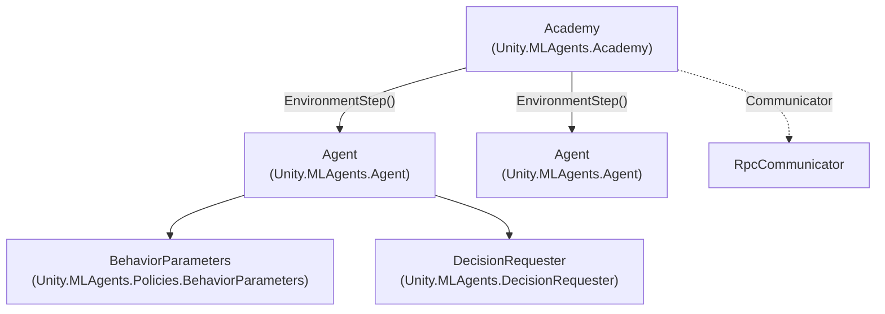
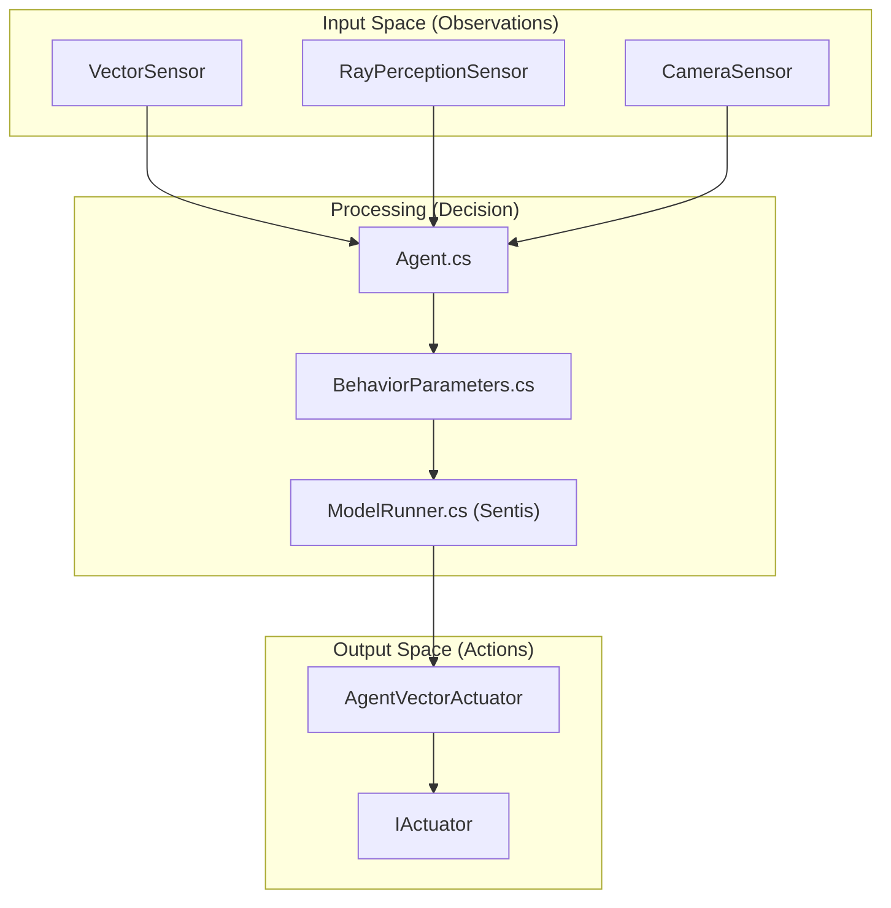

<!-- source: DeepWiki mcp.deepwiki.com · repo Unity-Technologies/ml-agents · page 1.1 Key Components and Structure · fetched 2026-10-30 -->

# Key Components and Structure

<details>
<summary>Relevant source files</summary>

The following files were used as context for generating this wiki page:

- [DevProject/Packages/manifest.json](DevProject/Packages/manifest.json)
- [DevProject/Packages/packages-lock.json](DevProject/Packages/packages-lock.json)
- [DevProject/ProjectSettings/EditorBuildSettings.asset](DevProject/ProjectSettings/EditorBuildSettings.asset)
- [DevProject/ProjectSettings/ProjectVersion.txt](DevProject/ProjectSettings/ProjectVersion.txt)
- [PerformanceProject/Packages/packages-lock.json](PerformanceProject/Packages/packages-lock.json)
- [Project/Packages/manifest.json](Project/Packages/manifest.json)
- [Project/Packages/packages-lock.json](Project/Packages/packages-lock.json)
- [Project/ProjectSettings/ProjectVersion.txt](Project/ProjectSettings/ProjectVersion.txt)
- [com.unity.ml-agents.tests/package.json](com.unity.ml-agents.tests/package.json)
- [com.unity.ml-agents/CHANGELOG.md](com.unity.ml-agents/CHANGELOG.md)
- [com.unity.ml-agents/Editor/Unity.ML-Agents.Editor.asmdef](com.unity.ml-agents/Editor/Unity.ML-Agents.Editor.asmdef)
- [com.unity.ml-agents/Runtime/Academy.cs](com.unity.ml-agents/Runtime/Academy.cs)
- [com.unity.ml-agents/Runtime/Actuators/IActionReceiver.cs](com.unity.ml-agents/Runtime/Actuators/IActionReceiver.cs)
- [com.unity.ml-agents/Runtime/Actuators/IDiscreteActionMask.cs](com.unity.ml-agents/Runtime/Actuators/IDiscreteActionMask.cs)
- [com.unity.ml-agents/Runtime/Agent.cs](com.unity.ml-agents/Runtime/Agent.cs)
- [com.unity.ml-agents/Runtime/Communicator.meta](com.unity.ml-agents/Runtime/Communicator.meta)
- [com.unity.ml-agents/Runtime/Communicator/GrpcExtensions.cs.meta](com.unity.ml-agents/Runtime/Communicator/GrpcExtensions.cs.meta)
- [com.unity.ml-agents/Runtime/Communicator/ICommunicator.cs.meta](com.unity.ml-agents/Runtime/Communicator/ICommunicator.cs.meta)
- [com.unity.ml-agents/Runtime/Communicator/RpcCommunicator.cs.meta](com.unity.ml-agents/Runtime/Communicator/RpcCommunicator.cs.meta)
- [com.unity.ml-agents/Runtime/Demonstrations/DemonstrationRecorder.cs](com.unity.ml-agents/Runtime/Demonstrations/DemonstrationRecorder.cs)
- [com.unity.ml-agents/Runtime/Grpc/AssemblyInfo.cs](com.unity.ml-agents/Runtime/Grpc/AssemblyInfo.cs)
- [com.unity.ml-agents/Runtime/Grpc/AssemblyInfo.cs.meta](com.unity.ml-agents/Runtime/Grpc/AssemblyInfo.cs.meta)
- [com.unity.ml-agents/Runtime/Grpc/Unity.ML-Agents.CommunicatorObjects.asmdef](com.unity.ml-agents/Runtime/Grpc/Unity.ML-Agents.CommunicatorObjects.asmdef)
- [com.unity.ml-agents/Runtime/Unity.ML-Agents.asmdef](com.unity.ml-agents/Runtime/Unity.ML-Agents.asmdef)
- [com.unity.ml-agents/package.json](com.unity.ml-agents/package.json)
- [docs/Installation-Anaconda-Windows.md](docs/Installation-Anaconda-Windows.md)
- [docs/Installation.md](docs/Installation.md)
- [docs/Migrating.md](docs/Migrating.md)
- [docs/Training-on-Amazon-Web-Service.md](docs/Training-on-Amazon-Web-Service.md)
- [docs/Training-on-Microsoft-Azure.md](docs/Training-on-Microsoft-Azure.md)
- [ml-agents-envs/README.md](ml-agents-envs/README.md)
- [ml-agents-envs/mlagents_envs/__init__.py](ml-agents-envs/mlagents_envs/__init__.py)
- [ml-agents/README.md](ml-agents/README.md)
- [ml-agents/mlagents/trainers/__init__.py](ml-agents/mlagents/trainers/__init__.py)
- [utils/validate_versions.py](utils/validate_versions.py)

</details>


This page describes the core architectural components of the Unity ML-Agents Toolkit and how they interact to enable machine learning training in Unity environments. It covers the Unity C# SDK components, Python training system, and communication protocols that form the foundation of the ML-Agents architecture.

## System Architecture Overview

The ML-Agents Toolkit consists of three main layers: the Unity simulation environment, a communication bridge, and the Python training system. The Unity side handles simulation, observation collection, and action execution, while Python manages the machine learning algorithms and training orchestration.

### High-Level System Architecture

```mermaid
graph TB
    subgraph "Unity Environment"
        Academy["Academy<br/>(Singleton)"]
        Agent["Agent<br/>(MonoBehaviour)"]
        BehaviorParameters["BehaviorParameters<br/>(Component)"]
        Sensors["Sensors<br/>(ISensor)"]
        Actuators["Actuators<br/>(IActuator)"]
        ModelRunner["ModelRunner<br/>(Inference Engine)"]
    end
    
    subgraph "Communication Layer"
        ICommunicator["ICommunicator<br/>(Interface)"]
        RpcCommunicator["RpcCommunicator<br/>(gRPC Implementation)"]
        SideChannels["SideChannels<br/>(Non-RL Data)"]
    end
    
    subgraph "Python Training System"
        mlagents_learn["mlagents-learn<br/>(CLI Entry Point)"]
        mlagents_envs["mlagents_envs<br/>(Environment API)"]
        TrainerController["TrainerController<br/>(Training Orchestration)"]
        Trainers["Trainers<br/>(PPO, SAC, POCA)"]
    end
    
    Academy --> Agent
    Agent --> BehaviorParameters
    Agent --> Sensors
    Agent --> Actuators
    BehaviorParameters --> ModelRunner
    
    Academy --> ICommunicator
    ICommunicator --> RpcCommunicator
    RpcCommunicator --> SideChannels
    
    RpcCommunicator <--> mlagents_envs
    mlagents_envs <--> mlagents_learn
    mlagents_learn --> TrainerController
    TrainerController --> Trainers
    
    ModelRunner -.-> "Sentis ONNX Model"
    Trainers -.-> "PyTorch Checkpoint"
```

Sources: [com.unity.ml-agents/Runtime/Academy.cs:16-24](), [com.unity.ml-agents/Runtime/Agent.cs:110-162](), [docs/Installation.md:3-16]()

## Unity SDK Core Components

The Unity SDK provides the foundational components for creating ML-Agents environments within Unity scenes. These components handle agent lifecycle, observation collection, action execution, and communication with the Python training system.

### Agent and Academy Relationship

The `Academy` acts as a singleton orchestrator, while `Agent` instances represent individual actors. The communication version (currently `1.5.0`) ensures compatibility between the Unity simulation and Python trainers.



Sources: [com.unity.ml-agents/Runtime/Academy.cs:104-132](), [com.unity.ml-agents/Runtime/Academy.cs:31-46](), [com.unity.ml-agents/Runtime/Agent.cs:110-150]()

### Core Unity Components

| Component | Purpose | Key Symbols |
|-----------|---------|----------------------|
| `Academy` | Singleton orchestrator managing simulation stepping and communication. | `Academy.Instance`, `Academy.EnvironmentStep()`, `Academy.Communicator` |
| `Agent` | Base class for actors that observe, decide, and act. | `Agent.CollectObservations()`, `Agent.OnActionReceived()`, `Agent.EndEpisode()` |
| `AgentInfo` | Struct containing agent state, rewards, and status for communication. | `AgentInfo.reward`, `AgentInfo.done`, `AgentInfo.storedActions` |
| `BehaviorParameters` | Defines how the agent makes decisions (Heuristic, Inference, or Default). | `BehaviorType`, `Model`, `BrainParameters` |
| `ModelRunner` | Manages neural network inference using the Unity Inference Engine (Sentis). | `ModelRunner.DecideAction()`, `ModelRunner.PutObservations()` |

Sources: [com.unity.ml-agents/Runtime/Academy.cs:66-132](), [com.unity.ml-agents/Runtime/Agent.cs:19-88](), [com.unity.ml-agents/Runtime/Agent.cs:110-162](), [com.unity.ml-agents/package.json:7-12]()

### Observation and Action Flow

Agents use `ISensor` implementations for observations and `IActuator` implementations for actions. The `AgentVectorActuator` is a specialized wrapper for standard vector actions.



Sources: [com.unity.ml-agents/Runtime/Agent.cs:94-107](), [com.unity.ml-agents/Runtime/Agent.cs:121-133](), [com.unity.ml-agents/Runtime/Agent.cs:327-353]()

## Python Training System

The Python side consists of two primary packages: `mlagents` (containing the trainers) and `mlagents_envs` (the communication interface).

### Package Structure

| Package | Purpose | Minimum Version |
|---------|---------|-----------------|
| `com.unity.ml-agents` | Unity C# SDK | 4.0.3 |
| `mlagents` | Python Training Algorithms (PPO, SAC, etc.) | 1.2.0.dev0 |
| `mlagents_envs` | Python API for Unity communication | 1.2.0.dev0 |

Sources: [com.unity.ml-agents/package.json:4-5](), [ml-agents/mlagents/trainers/__init__.py:2](), [ml-agents-envs/mlagents_envs/__init__.py:2](), [docs/Installation.md:9-16]()

## Communication Infrastructure

The `ICommunicator` interface abstracts the bridge between Unity and Python. The toolkit uses gRPC for high-performance messaging.

### Key Workflows

#### Training Workflow (Unity-Python Loop)
1. `Academy` triggers a step via `AcademyFixedUpdateStepper`.
2. `Agent` collects observations through `ISensor.Write()`.
3. `RpcCommunicator` sends `AgentInfo` (including rewards and observations) to the Python trainer.
4. Python trainer (e.g., `PPOTrainer`) processes data and returns actions.
5. `Agent` receives actions via `OnActionReceived(ActionBuffers)`.

Sources: [com.unity.ml-agents/Runtime/Academy.cs:31-46](), [com.unity.ml-agents/Runtime/Agent.cs:19-56](), [com.unity.ml-agents/Runtime/Agent.cs:156-157]()

#### Inference Workflow (Local)
1. `Agent` collects observations.
2. `BehaviorParameters` identifies the `Model` (ONNX).
3. `ModelRunner` executes the model using `Unity.InferenceEngine` (Sentis).
4. Actions are applied directly within the Unity simulation without Python involvement.

Sources: [com.unity.ml-agents/Runtime/Agent.cs:134-143](), [com.unity.ml-agents/package.json:8](), [com.unity.ml-agents/CHANGELOG.md:14]()

## Versioning and Compatibility
The toolkit adheres to semantic versioning for the communication protocol (`k_ApiVersion = "1.5.0"`). Major version changes in the C# package (e.g., from 3.x to 4.x) often correspond to significant Unity engine requirements, such as the transition to Unity 6000.0 and the Sentis inference engine.

Sources: [com.unity.ml-agents/Runtime/Academy.cs:104-110](), [com.unity.ml-agents/CHANGELOG.md:34-38](), [docs/Migrating.md:21-24]()

---

