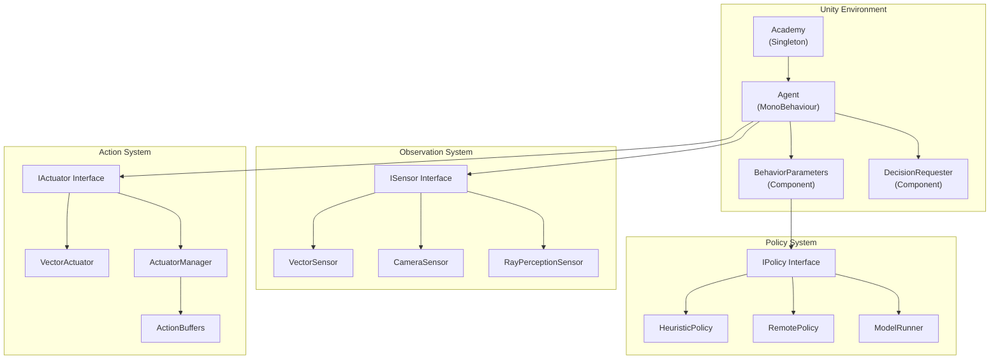
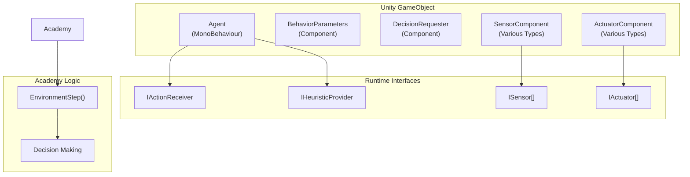
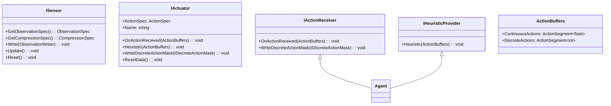

<!-- source: DeepWiki mcp.deepwiki.com · repo Unity-Technologies/ml-agents · page 2 Unity SDK Components · fetched 2026-10-30 -->

# Unity SDK Components

<details>
<summary>Relevant source files</summary>

The following files were used as context for generating this wiki page:

- [Project/Assets/ML-Agents/Examples/SharedAssets/Scripts/ModelOverrider.cs](Project/Assets/ML-Agents/Examples/SharedAssets/Scripts/ModelOverrider.cs)
- [com.unity.ml-agents/CHANGELOG.md](com.unity.ml-agents/CHANGELOG.md)
- [com.unity.ml-agents/Editor/BehaviorParametersEditor.cs](com.unity.ml-agents/Editor/BehaviorParametersEditor.cs)
- [com.unity.ml-agents/Runtime/Academy.cs](com.unity.ml-agents/Runtime/Academy.cs)
- [com.unity.ml-agents/Runtime/Actuators/IActionReceiver.cs](com.unity.ml-agents/Runtime/Actuators/IActionReceiver.cs)
- [com.unity.ml-agents/Runtime/Actuators/IDiscreteActionMask.cs](com.unity.ml-agents/Runtime/Actuators/IDiscreteActionMask.cs)
- [com.unity.ml-agents/Runtime/Agent.cs](com.unity.ml-agents/Runtime/Agent.cs)
- [com.unity.ml-agents/Runtime/Communicator/CommunicatorFactory.cs](com.unity.ml-agents/Runtime/Communicator/CommunicatorFactory.cs)
- [com.unity.ml-agents/Runtime/Demonstrations/DemonstrationRecorder.cs](com.unity.ml-agents/Runtime/Demonstrations/DemonstrationRecorder.cs)
- [com.unity.ml-agents/Runtime/Integrations/Match3/Match3Sensor.cs](com.unity.ml-agents/Runtime/Integrations/Match3/Match3Sensor.cs)
- [com.unity.ml-agents/Runtime/Policies/BehaviorParameters.cs](com.unity.ml-agents/Runtime/Policies/BehaviorParameters.cs)
- [com.unity.ml-agents/Runtime/Policies/BrainParameters.cs](com.unity.ml-agents/Runtime/Policies/BrainParameters.cs)
- [com.unity.ml-agents/Runtime/Sensors/Reflection/ObservableAttribute.cs](com.unity.ml-agents/Runtime/Sensors/Reflection/ObservableAttribute.cs)
- [com.unity.ml-agents/Runtime/SideChannels/SideChannelManager.cs](com.unity.ml-agents/Runtime/SideChannels/SideChannelManager.cs)
- [com.unity.ml-agents/Runtime/Timer.cs](com.unity.ml-agents/Runtime/Timer.cs)
- [com.unity.ml-agents/package.json](com.unity.ml-agents/package.json)
- [docs/Installation-Anaconda-Windows.md](docs/Installation-Anaconda-Windows.md)
- [docs/Installation.md](docs/Installation.md)
- [docs/Migrating.md](docs/Migrating.md)
- [docs/Training-on-Amazon-Web-Service.md](docs/Training-on-Amazon-Web-Service.md)
- [docs/Training-on-Microsoft-Azure.md](docs/Training-on-Microsoft-Azure.md)
- [ml-agents-envs/README.md](ml-agents-envs/README.md)
- [ml-agents-envs/mlagents_envs/__init__.py](ml-agents-envs/mlagents_envs/__init__.py)
- [ml-agents/README.md](ml-agents/README.md)
- [ml-agents/mlagents/trainers/__init__.py](ml-agents/mlagents/trainers/__init__.py)
- [utils/validate_versions.py](utils/validate_versions.py)

</details>


The Unity ML-Agents SDK provides the core C# components for creating reinforcement learning environments within Unity. These components handle agent behavior, observation collection, action execution, and integration with external training systems. This page provides an overview of the main components and their relationships.

## Unity SDK Architecture

The ML-Agents Unity SDK is structured around several key components that work together to create a complete learning environment:



Sources:
- [com.unity.ml-agents/Runtime/Academy.cs:49-67]()
- [com.unity.ml-agents/Runtime/Agent.cs:110-162]()
- [com.unity.ml-agents/package.json:1-16]()

## Component Categories

The Unity SDK components are organized into four main categories, each covered in detail in the following sections:

### Academy and Training Environment
The `Academy` singleton orchestrates the entire ML-Agents environment, managing the simulation loop, episode lifecycle, and coordination between agents and external training processes. It provides the foundation for all ML-Agents functionality.

**Key Components:**
- `Academy` - Central coordinator and singleton [com.unity.ml-agents/Runtime/Academy.cs:66-67]()
- `AcademyFixedUpdateStepper` - Helper class to step the Academy during `FixedUpdate` phase [com.unity.ml-agents/Runtime/Academy.cs:31-46]()
- `ICommunicator` - Interface for managing communication between Unity and Python [com.unity.ml-agents/Runtime/Academy.cs:162-162]()

For detailed information, see [Academy and Training Environment](#2.1).

### Agent and Behavior Parameters  
The `Agent` class is the core component that transforms Unity GameObjects into intelligent agents. The `BehaviorParameters` component configures how agents make decisions and interact with their environment.

**Key Components:**
- `Agent` - Main component for implementing agent logic [com.unity.ml-agents/Runtime/Agent.cs:110-113]()
- `BehaviorParameters` - Configuration for agent behavior and decision-making [com.unity.ml-agents/Runtime/Agent.cs:134-135]()
- `AgentInfo` - Struct containing agent state like rewards, done flags, and actions [com.unity.ml-agents/Runtime/Agent.cs:19-20]()

For detailed information, see [Agent and Behavior Parameters](#2.2).

### Sensors and Observations
The sensor system provides agents with information about their environment through various observation types. All sensors implement the `ISensor` interface and can be combined to create rich observation spaces.

**Key Components:**
- `VectorSensor` - Numerical observations [com.unity.ml-agents/Runtime/Agent.cs:124-125]()
- `CameraSensor` - Visual observations from cameras [com.unity.ml-agents/Runtime/Agent.cs:123-123]()
- `RayPerceptionSensor` - Raycast-based observations [com.unity.ml-agents/Runtime/Agent.cs:124-124]()

For detailed information, see [Sensors and Observations](#2.3).

### Inference and Model Running
The inference system handles loading and running trained neural network models within Unity using the **Sentis** inference engine.

**Key Components:**
- `ModelRunner` - Manages the execution of neural network models [com.unity.ml-agents/Runtime/Academy.cs:165-165]()
- `ModelOverrider` - Utility class to allow the `ModelAsset` file for an agent to be overridden during inference [Project/Assets/ML-Agents/Examples/SharedAssets/Scripts/ModelOverrider.cs:24-25]()

For detailed information, see [Inference and Model Running](#2.4).

Sources:
- [com.unity.ml-agents/Runtime/Academy.cs:49-166]()
- [com.unity.ml-agents/Runtime/Agent.cs:110-162]()
- [com.unity.ml-agents/CHANGELOG.md:14-14]()

## Unity SDK Integration

The Unity SDK components integrate with Unity's GameObject system through MonoBehaviour components and interfaces. The following diagram shows how these components work together in the Unity editor:



Sources:
- [com.unity.ml-agents/Runtime/Agent.cs:110-157]()
- [com.unity.ml-agents/Runtime/Academy.cs:31-46]()
- [com.unity.ml-agents/Runtime/Academy.cs:43-43]()

## Core Interfaces and Data Structures

The Unity SDK is built around several key interfaces that provide a consistent API for ML-Agents functionality:



These interfaces define the contracts for:
- **`ISensor`** - How observations are collected and provided to agents [docs/Migrating.md:79-118]()
- **`IActuator`** - How actions are processed and executed by agents [docs/Migrating.md:74-76]()
- **`IActionReceiver`** - Interface for components that receive actions [com.unity.ml-agents/Runtime/Agent.cs:96-96]()
- **`ActionBuffers`** - Container for continuous and discrete action data [com.unity.ml-agents/Runtime/Agent.cs:24-24]()

Sources:
- [com.unity.ml-agents/Runtime/Agent.cs:19-88]()
- [docs/Migrating.md:34-122]()

## Package Structure and Dependencies

The Unity ML-Agents SDK is distributed as a Unity package (`com.unity.ml-agents`) with the following key dependencies:

- **Sentis** (`com.unity.ai.inference`): The neural network inference engine [com.unity.ml-agents/package.json:8-8]()
- **Unity Modules**: Includes `imageconversion`, `jsonserialize`, and `physics` [com.unity.ml-agents/package.json:9-11]()

As of version 4.0.0, the extension package `com.unity.ml-agents.extensions` was merged into the main package [com.unity.ml-agents/CHANGELOG.md:39-39]().

Sources:
- [com.unity.ml-agents/package.json:1-16]()
- [com.unity.ml-agents/CHANGELOG.md:34-40]()

## Getting Started

To begin using the Unity ML-Agents SDK components:

1. **Install Unity**: Version 6000.0 or later is required [docs/Installation.md:34-34]().
2. **Install the Package**: Add `com.unity.ml-agents` via the Package Manager [docs/Installation.md:92-98]().
3. **Implement an Agent**: Subclass the `Agent` class and implement `CollectObservations` and `OnActionReceived` [com.unity.ml-agents/Runtime/Agent.cs:115-132]().

**Basic Agent Setup Example:**
```csharp
public class MyAgent : Agent
{
    public override void OnEpisodeBegin() { /* Reset logic */ }
    
    public override void CollectObservations(VectorSensor sensor)
    {
        sensor.AddObservation(this.transform.localPosition);
    }
    
    public override void OnActionReceived(ActionBuffers actionBuffers)
    {
        // Use actionBuffers.ContinuousActions or actionBuffers.DiscreteActions
    }
}
```

For detailed information on each component category, refer to the specific sections:
- [Academy and Training Environment](#2.1)
- [Agent and Behavior Parameters](#2.2)
- [Sensors and Observations](#2.3)
- [Inference and Model Running](#2.4)

Sources:
- [docs/Installation.md:21-32]()
- [com.unity.ml-agents/Runtime/Agent.cs:115-157]()

---

