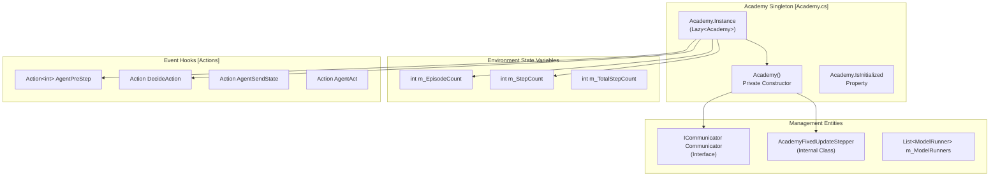
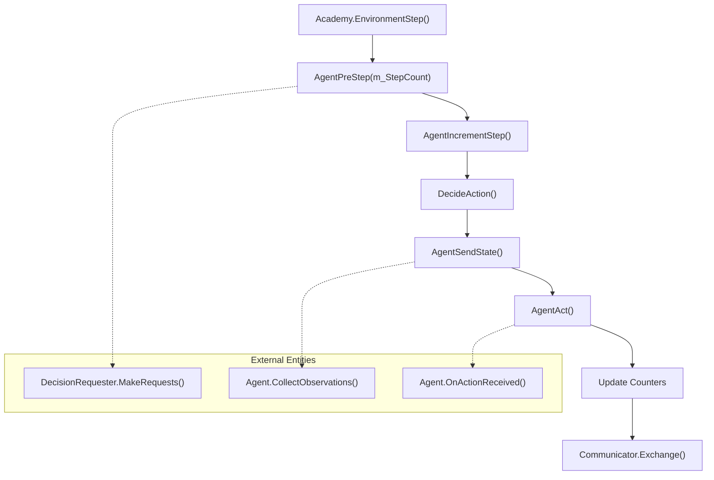

<!-- source: DeepWiki mcp.deepwiki.com · repo Unity-Technologies/ml-agents · page 2.1 Academy and Training Environment · fetched 2026-10-30 -->

# Academy and Training Environment

Relevant source files

The following files were used as context for generating this wiki page:

- [Project/Assets/ML-Agents/Examples/SharedAssets/Scripts/ModelCarousel.cs](Project/Assets/ML-Agents/Examples/SharedAssets/Scripts/ModelCarousel.cs)
- [Project/Assets/ML-Agents/Examples/SharedAssets/Scripts/ModelCarousel.cs.meta](Project/Assets/ML-Agents/Examples/SharedAssets/Scripts/ModelCarousel.cs.meta)
- [com.unity.ml-agents/CHANGELOG.md](com.unity.ml-agents/CHANGELOG.md)
- [com.unity.ml-agents/Runtime/Academy.cs](com.unity.ml-agents/Runtime/Academy.cs)
- [com.unity.ml-agents/Runtime/Areas/TrainingAreaReplicator.cs](com.unity.ml-agents/Runtime/Areas/TrainingAreaReplicator.cs)
- [com.unity.ml-agents/Runtime/Communicator/GrpcExtensions.cs](com.unity.ml-agents/Runtime/Communicator/GrpcExtensions.cs)
- [com.unity.ml-agents/Runtime/Communicator/ICommunicator.cs](com.unity.ml-agents/Runtime/Communicator/ICommunicator.cs)
- [com.unity.ml-agents/Runtime/Communicator/RpcCommunicator.cs](com.unity.ml-agents/Runtime/Communicator/RpcCommunicator.cs)
- [com.unity.ml-agents/Runtime/DecisionRequester.cs](com.unity.ml-agents/Runtime/DecisionRequester.cs)
- [com.unity.ml-agents/Runtime/Demonstrations/DemonstrationWriter.cs](com.unity.ml-agents/Runtime/Demonstrations/DemonstrationWriter.cs)
- [com.unity.ml-agents/Runtime/Sensors/BoxOverlapChecker.cs](com.unity.ml-agents/Runtime/Sensors/BoxOverlapChecker.cs)
- [com.unity.ml-agents/Runtime/Sensors/GridSensorBase.cs](com.unity.ml-agents/Runtime/Sensors/GridSensorBase.cs)
- [com.unity.ml-agents/Runtime/Sensors/GridSensorComponent.cs](com.unity.ml-agents/Runtime/Sensors/GridSensorComponent.cs)
- [com.unity.ml-agents/Runtime/Sensors/IGridPerception.cs](com.unity.ml-agents/Runtime/Sensors/IGridPerception.cs)
- [com.unity.ml-agents/Runtime/Sensors/IGridPerception.cs.meta](com.unity.ml-agents/Runtime/Sensors/IGridPerception.cs.meta)
- [com.unity.ml-agents/Runtime/Sensors/OneHotGridSensor.cs](com.unity.ml-agents/Runtime/Sensors/OneHotGridSensor.cs)
- [com.unity.ml-agents/package.json](com.unity.ml-agents/package.json)
- [ml-agents-envs/mlagents_envs/__init__.py](ml-agents-envs/mlagents_envs/__init__.py)
- [ml-agents-envs/mlagents_envs/environment.py](ml-agents-envs/mlagents_envs/environment.py)
- [ml-agents/mlagents/trainers/__init__.py](ml-agents/mlagents/trainers/__init__.py)
- [utils/validate_versions.py](utils/validate_versions.py)

This document covers the Academy singleton pattern, environment orchestration, and episode management within the Unity ML-Agents Toolkit. The Academy serves as the central coordinator for training environments, managing the lifecycle of agents, communication with Python trainers, and the synchronization of environment steps.

## Academy Singleton Pattern

The `Academy` class implements a thread-safe lazy singleton pattern using `Lazy<Academy>` [com.unity.ml-agents/Runtime/Academy.cs:117-132](). It serves as the central orchestrator for all ML-Agents functionality within a Unity environment. The Academy instance is typically initialized the first time it is accessed, often by the first `Agent` initialized in a scene [com.unity.ml-agents/Runtime/Academy.cs:52-54]().

### Academy Initialization and Versioning
At initialization, the Academy attempts to connect to a Python training process through an `ICommunicator` [com.unity.ml-agents/Runtime/Academy.cs:56-57](). It maintains several critical version strings to ensure compatibility:
*   `k_ApiVersion`: The communication protocol version (currently "1.5.0") [com.unity.ml-agents/Runtime/Academy.cs:104]().
*   `k_PackageVersion`: The Unity package version (currently "4.0.3") [com.unity.ml-agents/Runtime/Academy.cs:110]().

### Code Entity Space: Academy Structure
The following diagram associates natural language concepts with specific code entities in the `Academy` class.

Title: Academy Singleton Structure

**Sources:** [com.unity.ml-agents/Runtime/Academy.cs:26-172](), [com.unity.ml-agents/Runtime/Academy.cs:250-266]()

## Environment Orchestration

The Academy orchestrates environment execution through the `EnvironmentStep()` function [com.unity.ml-agents/Runtime/Academy.cs:577](). This method ensures all agents operate in lockstep, which is essential for deterministic training.

### Step Execution Sequence
The step sequence is triggered either automatically by `AcademyFixedUpdateStepper.FixedUpdate()` [com.unity.ml-agents/Runtime/AcademyFixedUpdateStepper.cs:33-45]() or manually.

| Sequence Order | Event/Method | Code Responsibility |
| :--- | :--- | :--- |
| 1 | `AgentPreStep` | Triggered for components like `DecisionRequester` to call `RequestDecision()` [com.unity.ml-agents/Runtime/DecisionRequester.cs:97-113](). |
| 2 | `AgentIncrementStep` | Increments internal step counters for all active agents. |
| 3 | `DecideAction` | Agents determine their next action via Heuristic, Inference, or External Policy. |
| 4 | `AgentSendState` | Agents collect observations from `ISensor` implementations [com.unity.ml-agents/Runtime/Academy.cs:605](). |
| 5 | `AgentAct` | Agents apply actions through `IActuator` implementations. |
| 6 | `Communicator.Exchange()` | Sends observations to Python and receives new actions [com.unity.ml-agents/Runtime/Academy.cs:614](). |

Title: Step Orchestration Flow

**Sources:** [com.unity.ml-agents/Runtime/Academy.cs:577-618](), [com.unity.ml-agents/Runtime/DecisionRequester.cs:97-113]()

## Episode Management

The Academy manages the global episode lifecycle. An episode count is incremented each time the environment is reset [com.unity.ml-agents/Runtime/Academy.cs:148-150]().

*   **Step Counting**: The Academy tracks `m_StepCount` (steps in current episode) and `m_TotalStepCount` (total simulation steps) [com.unity.ml-agents/Runtime/Academy.cs:152-160]().
*   **Forced Resets**: The `ForcedFullReset()` method [com.unity.ml-agents/Runtime/Academy.cs:520]() triggers the `AgentForceReset` event, causing all agents to reset their state and call `OnEpisodeBegin()`.
*   **Python-Driven Resets**: When the Python trainer sends a `RESET` command, the `RpcCommunicator` triggers the `ResetCommandReceived` event, which the Academy handles to re-initialize the environment [com.unity.ml-agents/Runtime/Communicator/RpcCommunicator.cs:28]().

**Sources:** [com.unity.ml-agents/Runtime/Academy.cs:148-160](), [com.unity.ml-agents/Runtime/Academy.cs:520-530](), [com.unity.ml-agents/Runtime/Communicator/RpcCommunicator.cs:25-30]()

## Communication and Compatibility

The Academy acts as the Unity-side handshake manager for the gRPC connection established by `RpcCommunicator`.

### Compatibility Checks
During initialization, the Academy verifies that the Python `API_VERSION` matches the Unity `k_ApiVersion`.
*   Major versions must match exactly [com.unity.ml-agents/Runtime/Communicator/RpcCommunicator.cs:87-90]().
*   If the major version is 0 (beta), the minor version must also match [com.unity.ml-agents/Runtime/Communicator/RpcCommunicator.cs:80-86]().
*   Python-side checks are performed in `UnityEnvironment._check_communication_compatibility` [ml-agents-envs/mlagents_envs/environment.py:91-117]().

### Capabilities Negotiation
The Academy stores `TrainerCapabilities` received from the Python trainer [com.unity.ml-agents/Runtime/Academy.cs:215](). These capabilities define if the trainer supports features like:
*   `MultiAgentGroups`: Support for `groupId` rewards [com.unity.ml-agents/Runtime/Communicator/GrpcExtensions.cs:75]().
*   `HybridActions`: Support for both continuous and discrete actions [com.unity.ml-agents/Runtime/Communicator/GrpcExtensions.cs:175]().

**Sources:** [com.unity.ml-agents/Runtime/Communicator/RpcCommunicator.cs:73-97](), [ml-agents-envs/mlagents_envs/environment.py:55-68](), [com.unity.ml-agents/Runtime/Communicator/GrpcExtensions.cs:71-105]()

## Automatic Stepping System

The Academy provides an automatic stepping mechanism through the `AcademyFixedUpdateStepper` component.

*   **FixedUpdate Hook**: The stepper calls `Academy.Instance.EnvironmentStep()` inside Unity's `FixedUpdate` phase [com.unity.ml-agents/Runtime/Academy.cs:31-46]().
*   **Ownership Check**: To prevent leaks during "Fast Enter Play Mode" or multiple scene loads, the stepper verifies it is the "owner" via `IsStepperOwner(this)` before stepping [com.unity.ml-agents/Runtime/Academy.cs:37]().
*   **Toggleable**: Automatic stepping can be disabled via `Academy.Instance.AutomaticSteppingEnabled = false` if the developer wishes to manually call `EnvironmentStep()` [com.unity.ml-agents/Runtime/Academy.cs:301-316]().

**Sources:** [com.unity.ml-agents/Runtime/Academy.cs:31-46](), [com.unity.ml-agents/Runtime/Academy.cs:301-316](), [com.unity.ml-agents/CHANGELOG.md:11]()

---

