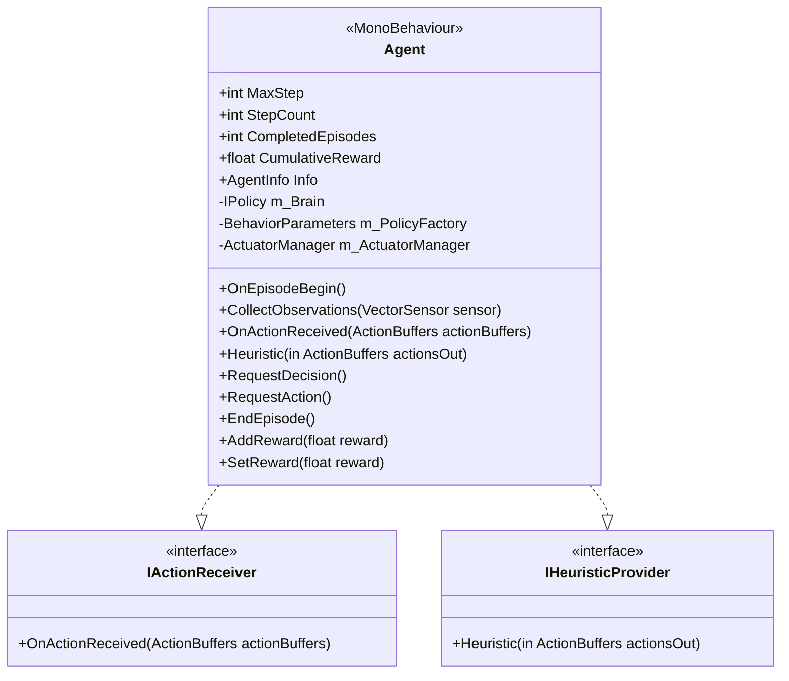
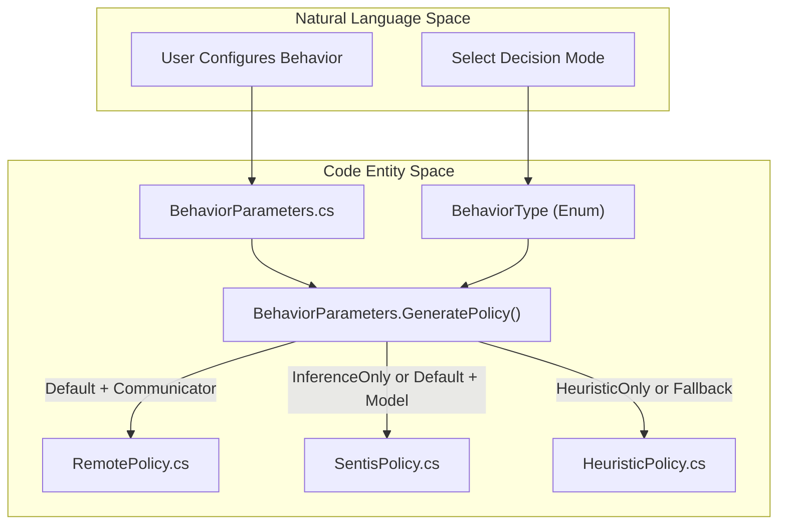
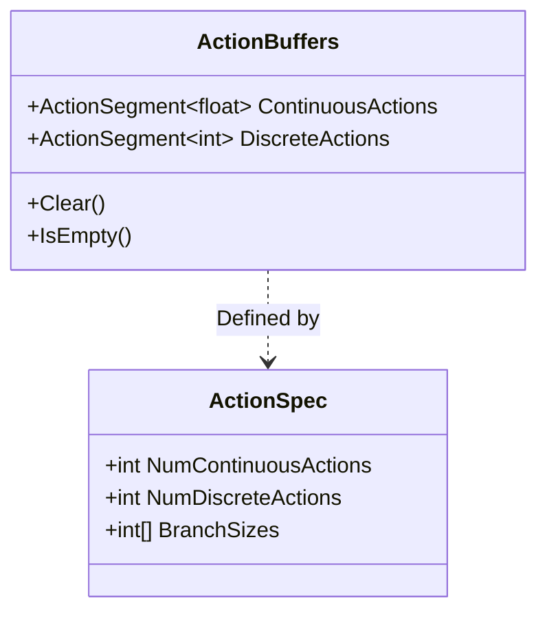
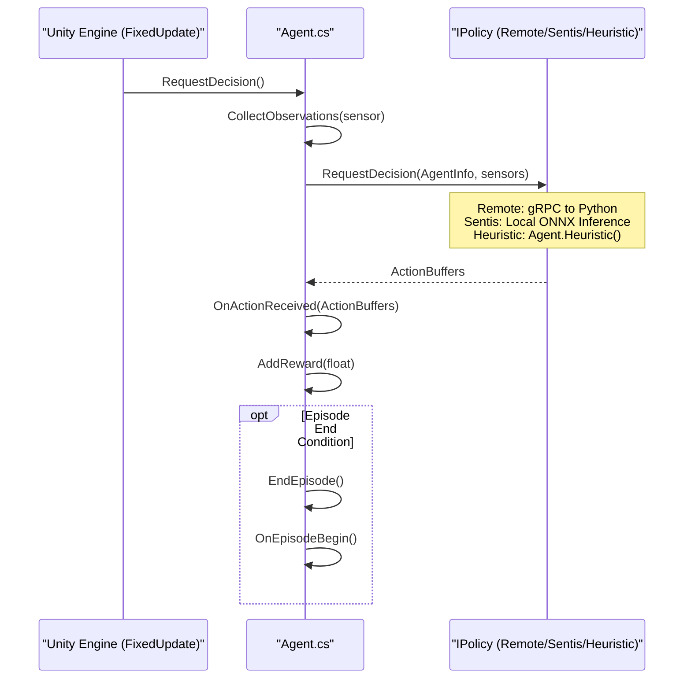

<!-- source: DeepWiki mcp.deepwiki.com · repo Unity-Technologies/ml-agents · page 2.2 Agent and Behavior Parameters · fetched 2026-10-30 -->

# Agent and Behavior Parameters

Relevant source files

The following files were used as context for generating this wiki page:

- [Project/Assets/ML-Agents/Examples/Basic/Scripts/BasicActuatorComponent.cs](Project/Assets/ML-Agents/Examples/Basic/Scripts/BasicActuatorComponent.cs)
- [Project/Assets/ML-Agents/Examples/SharedAssets/Scripts/ModelOverrider.cs](Project/Assets/ML-Agents/Examples/SharedAssets/Scripts/ModelOverrider.cs)
- [com.unity.ml-agents/Editor/BehaviorParametersEditor.cs](com.unity.ml-agents/Editor/BehaviorParametersEditor.cs)
- [com.unity.ml-agents/Runtime/Actuators/ActionSpec.cs](com.unity.ml-agents/Runtime/Actuators/ActionSpec.cs)
- [com.unity.ml-agents/Runtime/Actuators/ActuatorComponent.cs](com.unity.ml-agents/Runtime/Actuators/ActuatorComponent.cs)
- [com.unity.ml-agents/Runtime/Actuators/ActuatorManager.cs](com.unity.ml-agents/Runtime/Actuators/ActuatorManager.cs)
- [com.unity.ml-agents/Runtime/Actuators/IActionReceiver.cs](com.unity.ml-agents/Runtime/Actuators/IActionReceiver.cs)
- [com.unity.ml-agents/Runtime/Actuators/IActuator.cs](com.unity.ml-agents/Runtime/Actuators/IActuator.cs)
- [com.unity.ml-agents/Runtime/Actuators/IDiscreteActionMask.cs](com.unity.ml-agents/Runtime/Actuators/IDiscreteActionMask.cs)
- [com.unity.ml-agents/Runtime/Actuators/VectorActuator.cs](com.unity.ml-agents/Runtime/Actuators/VectorActuator.cs)
- [com.unity.ml-agents/Runtime/Agent.cs](com.unity.ml-agents/Runtime/Agent.cs)
- [com.unity.ml-agents/Runtime/Communicator/CommunicatorFactory.cs](com.unity.ml-agents/Runtime/Communicator/CommunicatorFactory.cs)
- [com.unity.ml-agents/Runtime/Demonstrations/DemonstrationRecorder.cs](com.unity.ml-agents/Runtime/Demonstrations/DemonstrationRecorder.cs)
- [com.unity.ml-agents/Runtime/Integrations/Match3/Match3Sensor.cs](com.unity.ml-agents/Runtime/Integrations/Match3/Match3Sensor.cs)
- [com.unity.ml-agents/Runtime/Policies/BehaviorParameters.cs](com.unity.ml-agents/Runtime/Policies/BehaviorParameters.cs)
- [com.unity.ml-agents/Runtime/Policies/BrainParameters.cs](com.unity.ml-agents/Runtime/Policies/BrainParameters.cs)
- [com.unity.ml-agents/Runtime/Policies/HeuristicPolicy.cs](com.unity.ml-agents/Runtime/Policies/HeuristicPolicy.cs)
- [com.unity.ml-agents/Runtime/Sensors/IBuiltInSensor.cs](com.unity.ml-agents/Runtime/Sensors/IBuiltInSensor.cs)
- [com.unity.ml-agents/Runtime/Sensors/Reflection/ObservableAttribute.cs](com.unity.ml-agents/Runtime/Sensors/Reflection/ObservableAttribute.cs)
- [com.unity.ml-agents/Runtime/Sensors/SensorShapeValidator.cs](com.unity.ml-agents/Runtime/Sensors/SensorShapeValidator.cs)
- [com.unity.ml-agents/Runtime/SideChannels/SideChannelManager.cs](com.unity.ml-agents/Runtime/SideChannels/SideChannelManager.cs)
- [com.unity.ml-agents/Runtime/SideChannels/TrainingAnalyticsSideChannel.cs](com.unity.ml-agents/Runtime/SideChannels/TrainingAnalyticsSideChannel.cs)
- [com.unity.ml-agents/Runtime/Timer.cs](com.unity.ml-agents/Runtime/Timer.cs)
- [docs/Installation-Anaconda-Windows.md](docs/Installation-Anaconda-Windows.md)
- [docs/Installation.md](docs/Installation.md)
- [docs/Migrating.md](docs/Migrating.md)
- [docs/Training-on-Amazon-Web-Service.md](docs/Training-on-Amazon-Web-Service.md)
- [docs/Training-on-Microsoft-Azure.md](docs/Training-on-Microsoft-Azure.md)
- [ml-agents-envs/README.md](ml-agents-envs/README.md)
- [ml-agents/README.md](ml-agents/README.md)

This page explains the core components for creating intelligent agents in the ML-Agents toolkit: the `Agent` class and the `BehaviorParameters` component. These components work together to enable agents to observe their environment, make decisions, and take actions.

## Agent Class Overview

The `Agent` class is the foundational component for creating autonomous entities. It provides the lifecycle hooks for initialization, observation collection, and action execution.

### Agent Class Structure

The `Agent` class implements several key interfaces to facilitate communication between the Unity simulation and the policy (whether remote Python, local inference, or heuristic).

Sources: [com.unity.ml-agents/Runtime/Agent.cs:110-165](), [com.unity.ml-agents/Runtime/Agent.cs:272-360]()

### Key Agent Methods

- **`OnEpisodeBegin()`**: Called when an episode starts, typically used to reset the agent and its environment [com.unity.ml-agents/Runtime/Agent.cs:517-521]().
- **`CollectObservations(VectorSensor sensor)`**: Used to collect vector observations. The agent calls this before making a decision [com.unity.ml-agents/Runtime/Agent.cs:453-457]().
- **`OnActionReceived(ActionBuffers actionBuffers)`**: Receives the actions chosen by the policy and applies them to the agent [com.unity.ml-agents/Runtime/Agent.cs:419-423]().
- **`Heuristic(in ActionBuffers actionsOut)`**: Defines manual control logic for the agent when the behavior type is set to heuristic [com.unity.ml-agents/Runtime/Agent.cs:1071-1075]().
- **`RequestDecision()`**: Manually signals that the agent should collect observations and request a new action [com.unity.ml-agents/Runtime/Agent.cs:1115-1135]().
- **`EndEpisode()`**: Signals the end of the current episode and triggers a reset [com.unity.ml-agents/Runtime/Agent.cs:1278-1290]().

## Behavior Parameters Component

The `BehaviorParameters` component defines how an agent makes decisions. It configures the observation/action space and determines which policy type is active.

### Configuration and Data Flow

The `BehaviorParameters` component acts as a factory that generates the appropriate `IPolicy` implementation at runtime based on the `BehaviorType` and environment state.

Sources: [com.unity.ml-agents/Runtime/Policies/BehaviorParameters.cs:72-135](), [com.unity.ml-agents/Runtime/Policies/BehaviorParameters.cs:229-263]()

### Behavior Types

The `BehaviorType` enum defines three primary modes:
1. **`Default`**: Attempts to use a remote process (Python) for training. If unavailable, it falls back to local inference (ONNX model). If no model is provided, it falls back to the heuristic [com.unity.ml-agents/Runtime/Policies/BehaviorParameters.cs:16-21]().
2. **`HeuristicOnly`**: Always uses the `Heuristic()` method implemented in the Agent class [com.unity.ml-agents/Runtime/Policies/BehaviorParameters.cs:23-26]().
3. **`InferenceOnly`**: Always uses the assigned neural network model for decision-making [com.unity.ml-agents/Runtime/Policies/BehaviorParameters.cs:28-32]().

## Decision-Making Modes

Decisions can be triggered either automatically or manually.

### DecisionRequester

The `DecisionRequester` component is a utility that automatically calls `Agent.RequestDecision()` at a fixed step interval.

- **`DecisionPeriod`**: The frequency (in Academy steps) at which a decision is requested [com.unity.ml-agents/Runtime/DecisionRequester.cs:20-22]().
- **`TakeActionsBetweenDecisions`**: If true, the agent repeats the last action during steps where no new decision is requested [com.unity.ml-agents/Runtime/DecisionRequester.cs:28-30]().

### Model Overriding

During inference or validation, the `ModelOverrider` utility allows developers to swap the `.onnx` model at runtime via command-line arguments. This is often used in automated testing or evaluation pipelines.

| Flag | Purpose |
|------|---------|
| `--mlagents-override-model-directory` | Path to the directory containing override models [Project/Assets/ML-Agents/Examples/SharedAssets/Scripts/ModelOverrider.cs:27]() |
| `--mlagents-quit-after-episodes` | Quits the application after a specific number of episodes [Project/Assets/ML-Agents/Examples/SharedAssets/Scripts/ModelOverrider.cs:29]() |

Sources: [Project/Assets/ML-Agents/Examples/SharedAssets/Scripts/ModelOverrider.cs:24-32]()

## Action Buffers and Spec

Actions are passed to the agent via the `ActionBuffers` struct, which contains segments for both continuous and discrete actions.

Sources: [com.unity.ml-agents/Runtime/Actuators/IActionReceiver.cs:11-26](), [com.unity.ml-agents/Runtime/Actuators/ActionSpec.cs:11-30]()

### Discrete Action Masking
For discrete control, agents can prohibit specific actions using `IDiscreteActionMask`. In version 2.x+, the API uses `SetActionEnabled(branch, index, bool)` to toggle action availability [docs/Migrating.md:50-73]().

## Agent Lifecycle Flow

The following diagram illustrates the interaction between the Unity Engine, the Agent component, and the Policy implementation during a simulation step.

Sources: [com.unity.ml-agents/Runtime/Agent.cs:1115-1135](), [com.unity.ml-agents/Runtime/Agent.cs:1278-1290](), [com.unity.ml-agents/Runtime/Policies/RemotePolicy.cs:60-75]()

## Summary Table: Behavior Parameters

| Parameter | Type | Description |
|-----------|------|-------------|
| `BehaviorName` | `string` | Base name for the behavior, used for model matching [com.unity.ml-agents/Runtime/Policies/BehaviorParameters.cs:146-150]() |
| `Model` | `ModelAsset` | The ONNX model used for inference [com.unity.ml-agents/Runtime/Policies/BehaviorParameters.cs:105-109]() |
| `InferenceDevice` | `InferenceDevice` | Whether to run inference on CPU or GPU [com.unity.ml-agents/Runtime/Policies/BehaviorParameters.cs:119-123]() |
| `DeterministicInference` | `bool` | Whether to use deterministic action selection [com.unity.ml-agents/Runtime/Policies/BehaviorParameters.cs:188-192]() |
| `UseChildSensors` | `bool` | Automatically find sensors in child objects [com.unity.ml-agents/Runtime/Policies/BehaviorParameters.cs:174-178]() |

Sources: [com.unity.ml-agents/Runtime/Policies/BehaviorParameters.cs:72-192]()

---

